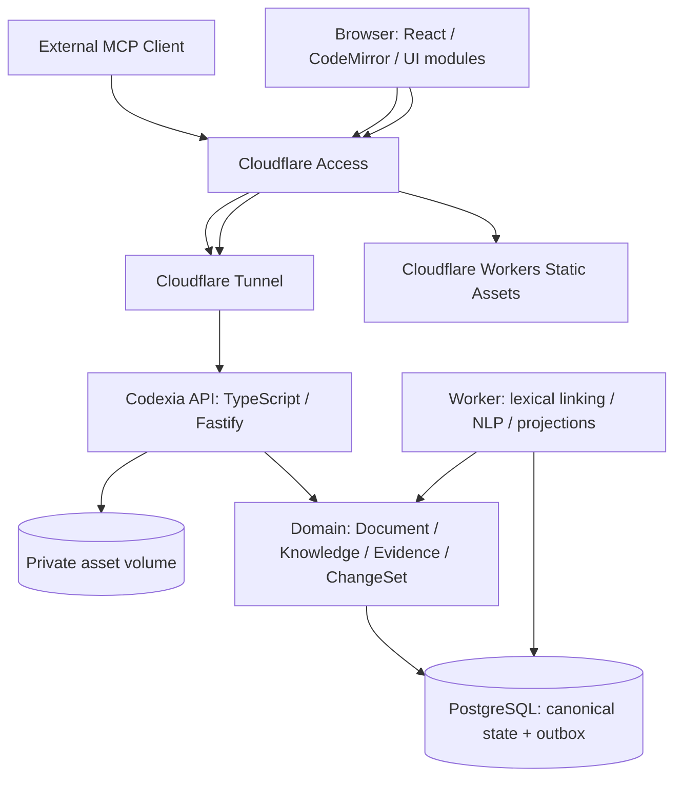

# Codexia — アーキテクチャ・実装移行 RFC

- **状態**: 設計RFC（移行処理は未実装）。新リポジトリ `yohn-jp/codexia` は Scriptorium の main を複製済み。設計の文書化と製品名変更は行うが、DB移行・VM/Cloudflare配備は別工程。
- **作成日**: 2026-11-08
- **コード調査基準**:
  - Scriptorium `main` [`1a05a0f`](https://github.com/yohn-jp/scriptorium/tree/1a05a0f10b33acca3fcfc544a5a6a2592f1c3865)
  - Nous OSINT `main` [`2103b71`](https://github.com/yohn-jp/nous-osint/tree/2103b71901308d9d3c1ef63b7047092dc9470882)
  - Arcadia Loom `main` `edc033c2c9466274a334299dadfa426661d957d9`（機能目標の参照。非公開）

## 0. 決定事項と未決事項

### 設計方針

1. 新製品 **Codexia** は Scriptorium をコード移行の基点とする。過去リポジトリは残し、新リポジトリへの複製後に変更する。
2. 製品の正本は GitHub/Git ではなく、**独立VM上の PostgreSQL**。GitHub はアプリケーションのコード・CI/CD のためにのみ利用する。
3. 作品は **Document／Knowledge／Evidence** の接続グラフとして管理する。グラフDB専用製品の導入は初期要件ではない。必要なグラフクエリは PostgreSQL の外部キー・索引・再帰クエリ・必要な投影で実装する。
4. 原稿本文は **MarkdownのUTF-8文字列**を正本とする。本文に自動リンクを埋めず、別の `text_anchor` / `mention_link` / `assertion_evidence` を持つ。Markdownは既存エディタ・日本語組版・入出力に適合する。構造化JSON ASTへの全面変換は実施しない。
5. React/CodeMirrorフロントは Cloudflare Workers **Static Assets** から配信。API・MCP・非同期解析・PostgreSQLはVMに配置。UIとBackendを独立デプロイする。
6. 信頼済みTypeScript ModuleRuntime、遅延ロード、依存解決、WorkerSupervisor、UI貢献機構を再利用・改修する。Propriumの外部WASMプラグインABI／WIT／配布基盤は引き継がない。
7. 作者確定の情報と、本文から検出・推論された情報を厳密に分離する。AIによる正本変更は ChangeSet と作者承認を必須とする。
8. 自動保存・参照追従・検索索引の更新は **編集ホットパスを阻害しない**。本文保存は強整合、解析の派生結果はRevision付きの結果整合性で管理する。

### 実装前に決める必要がある事項

- **確定**: 製品名は `Codexia`。リポジトリは公開 `yohn-jp/codexia`、LICENSEは複製元と同じMITを保持。
- Cloudflare UI/API を同一ホストの限定Routeで分岐するか、UIとAPIを別ホストにするか。いずれも *WorkerからVMをプロキシしない* ことを基本とする。
- 単一作者を初期権限モデルとし、共同編集/複数作者は非目標としてよいか。ここでは既存の単一作者モデルを前提とする。
- 明示的な作品内承認（人物設定や事実）と、辞書的な自動言及リンクのUI上の表示方式。

## 1. 既存実装の観測事実

| 場所 | 観測内容 | 移行での影響 |
|---|---|---|
| [`modules/story/src/snapshot.ts`](https://github.com/yohn-jp/scriptorium/blob/1a05a0f10b33acca3fcfc544a5a6a2592f1c3865/modules/story/src/snapshot.ts) | `readStorySnapshot` が `bible/`、`plot/`、`manuscript/` のファイルを列挙・読込・YAML解析し、エンティティ/リンクを組み立てる | 正本読込を DB のRepository/QueryServiceに置換。ドメインモデル/投影関数は選別して維持 |
| [`modules/story/src/domain/mentionIndex.ts`](https://github.com/yohn-jp/scriptorium/blob/1a05a0f10b33acca3fcfc544a5a6a2592f1c3865/modules/story/src/domain/mentionIndex.ts) | 名前/別名のTrieから本文を走査。結果はエンティティID集合で文字位置は返さない。同名エイリアスは複数IDになり得る | 永続的なspan/曖昧性管理に置換。Trieは候補抽出アルゴリズムとして再利用可能 |
| [`modules/story/src/domain/readerKnowledge.ts`](https://github.com/yohn-jp/scriptorium/blob/1a05a0f10b33acca3fcfc544a5a6a2592f1c3865/modules/story/src/domain/readerKnowledge.ts) | シーン本文に対して都度言及抽出し、読者への開示を計算。一部の人物知識推定は「同一シーンの登場人物に言及対象を結び付ける」ヒューリスティック | `mention` を永続化して読者知識投影を構築。言及＝登場人物の知識とはみなさない |
| [`modules/story/src/actions.ts`](https://github.com/yohn-jp/scriptorium/blob/1a05a0f10b33acca3fcfc544a5a6a2592f1c3865/modules/story/src/actions.ts) | `story.entities.freshness` はシーンを走査して言及を再検出。各種Actionは `readStorySnapshot` 依存 | Action名/入力の機能対応表を作り、DB QueryPortに移行。DTOは新バージョンにする |
| [`app/src/editor/ManuscriptInput.tsx`](https://github.com/yohn-jp/scriptorium/blob/1a05a0f10b33acca3fcfc544a5a6a2592f1c3865/app/src/editor/ManuscriptInput.tsx) | CodeMirror 6。`update.docChanged` 時に本文全体を `onChange(nextText)` に渡す | UIの入力体験は維持。CodeMirror ChangeSetを保存境界に追加する |
| [`app/src/editor/cm/termAdornments.ts`](https://github.com/yohn-jp/scriptorium/blob/1a05a0f10b33acca3fcfc544a5a6a2592f1c3865/app/src/editor/cm/termAdornments.ts) | 表示範囲を非同期に照合して一時的Decorationを生成。文書変更で破棄・再要求する | 装飾表示を永続化済みAnchor取得＋ローカルChangeSet追従に変更。未知部分のみ候補抽出 |
| [`packages/contracts/src/index.ts`](https://github.com/yohn-jp/scriptorium/blob/1a05a0f10b33acca3fcfc544a5a6a2592f1c3865/packages/contracts/src/index.ts) | `SnapshotId=repository+remoteCommit+overlay`、`ChangeOperation=ファイルread/write`、`SnapshotReader`、`DocumentSource`がGit/パス前提 | **最重要の破壊的変更**。Git型を安易に使い回さず、`ProjectRevision`、`DocumentRevision`、`MutationProposal`、`DocumentReader`を新設 |
| [`packages/core/src/index.ts`](https://github.com/yohn-jp/scriptorium/blob/1a05a0f10b33acca3fcfc544a5a6a2592f1c3865/packages/core/src/index.ts) | Git、checkpoint、publish、reconcile、proposalを所有する巨大なCore | 既存クラスの名前だけ変えない。Persistence/Revision/ProposalCoordinatorを新実装し、旧Coreは移行完了時に除外 |
| [`packages/module-runtime/src/module-runtime.ts`](https://github.com/yohn-jp/scriptorium/blob/1a05a0f10b33acca3fcfc544a5a6a2592f1c3865/packages/module-runtime/src/module-runtime.ts) | 信頼済みモジュールの有効化/依存性解決、遅延ロード、処理中断、Worker管理を提供 | ライフサイクル部分は継承。`SnapshotReader`や`ChangeOperation`に結び付いたActionHostContextを変更 |
| [`modules/search/src/index-cache.ts`](https://github.com/yohn-jp/scriptorium/blob/1a05a0f10b33acca3fcfc544a5a6a2592f1c3865/modules/search/src/index-cache.ts) | Git Snapshotごとの派生文書索引と差分更新 | ソースリビジョンに基づく索引更新思想を維持。正本の検索索引はDB側で管理 |
| [`docs/EDGE_FRONTEND_DEPLOYMENT.md`](https://github.com/yohn-jp/nous-osint/blob/2103b71901308d9d3c1ef63b7047092dc9470882/docs/EDGE_FRONTEND_DEPLOYMENT.md) | Cloudflare Static AssetsのUIと、Tunnel側API/MCPを分離。catch-all Proxy禁止、限定的Worker Routesで運用 | 配備パターンを採用。ただし同一ホスト分岐の認証E2E・RollbackはNousでも未検証のため無条件コピー禁止 |
| [`docs/EDGE_RELEASE_PIPELINE.md`](https://github.com/yohn-jp/nous-osint/blob/2103b71901308d9d3c1ef63b7047092dc9470882/docs/EDGE_RELEASE_PIPELINE.md) | UI/Backend/Reportsの変更差分判定と独立リリース、digestとcommitの証跡管理 | Codexiaにも差分ビルド、独立デプロイ、固定digest、fail-closed を適用 |

**現時点の証拠の限界:** 全Actionの実行時プロファイリング、作品実データでの移行検証、VM・Cloudflareの実機検証は未実施。上記は最新mainのコードと設計書による監査であり、未実施事項を完了とは扱わない。

## 2. 論理アーキテクチャ



上図は通信上の論理関係を示す。Cloudflareにおける同一ホストのUIとAPIの経路分岐は別途ルーティング契約として実証すること。ブラウザからPostgreSQLへ直接接続しない。MCPも同じドメインActionを呼び、独立した書込経路を持たない。

### VM構成

- `codexia-db`: PostgreSQL、永続Volume。非公開Podmanネットワークのみ。
- `codexia-api`: 認証・認可、Query API、ChangeSet、ドキュメントの保存。静的UIはホストしない（初期カットオーバーのRollback期間は除く）。
- `codexia-worker`: DBに保存されたジョブをclaimし、解析・索引更新を非同期処理。モデルは必要時のみロード。ジョブのモデルと版を記録。
- `codexia-tunnel`: Cloudflare Tunnel。Ingressに必要なAPI/MCPのみ到達可能。
- File Volume: 添付画像・資料の内容本体。DBにID、hash、サイズ、ACL、参照を保存。

初期実装ではRedis、Kafka、別のグラフDB、別のベクトルDBを追加しない。PostgreSQLジョブテーブルのlease＋`FOR UPDATE SKIP LOCKED`、一意制約、冪等処理で十分に始められる。

## 3. 正本・派生・提案の境界

| レイヤー | 例 | Authoritative | 編集者/解析権限 |
|---|---|---|---|
| 原稿 | 章/シーンMarkdown、順序 | Yes | 作者の直接編集、承認済みAI ChangeSet |
| 知識 | 人物定義、場所、関係、確定した事実 | Yes | 作者の直接編集、承認済みChangeSet |
| 言及・根拠 | 本文範囲、人物IDへの解決、命題の出典 | 部分的：作者確認部分はYes | 機械候補は`proposed`、確認結果は永続化 |
| 派生結果 | NLP抽出、候補エッジ、推測された知識、意味索引 | No | WorkerがSourceRevisionに紐付けて生成 |
| 提案 | AI編集、設定追加、矛盾の修正案 | No | 作者が承認するまで正本を変えない |

**必須の意味区別:** `MENTIONS`（単なる語の出現）、`APPEARS`（物語への登場）、`KNOWS`（登場人物の知識）、`DISCLOSED_TO_READER`（読者が知った）、`ASSERTS`（発言/叙述が何を主張するか）、`CANON`（作者確定設定）は別の概念。`MENTIONS` から `KNOWS` や `CANON` を自動的に推論・昇格しない。

叙述が否定、仮定、回想、嘘、登場人物の思い込みである場合を区別するため、命題には最低限、`modality`（確定/否定/推量等）、`perspective`（語り手/人物/作者）、`narrative_time`、`confidence`、`status`、`provenance`を持たせる。初期段階では高度な自動命題抽出なしでもよい。

## 4. PostgreSQL論理モデル

すべてのIDは **ファイルパスではない不変のID**。UI並べ替えや改名ではIDを変えない。最初はUUID採用、既存ID (`char-*`, `sc-*`) は `external_identity` に対応付ける。権限境界となる `project_id` は各データと関連制約・クエリで必須。

| Entity / Table | 主なカラム | 目的 |
|---|---|---|
| `project` | `id, title, version, settings` | 作品の正本ルート |
| `document` | `id, project_id, parent_id, kind, order_key, head_revision_id` | 巻・章・シーン等の構造と現在版 |
| `document_revision` | `id, document_id, parent_revision_id, body_md, sha256, author_id, created_at` | 不変の本文版。単一作者の自動保存も版として保持 |
| `edit_operation` | `idempotency_key, document_id, base_revision_id, new_revision_id, change_desc, client_id` | リトライの重複防止・変更範囲の追跡 |
| `knowledge_node` | `id, project_id, type, name, attributes jsonb, version, deleted_at` | 人物・場所・事件・設定・用語・伏線等 |
| `knowledge_alias` | `id, node_id, surface, normalized, scope, status` | 別名と曖昧性検出。別名単独を一意にしない |
| `knowledge_relation` | `id, project_id, source_id, target_id, type, attributes jsonb, validity, status` | 知識同士の関係。時間・状態・向きを保持 |
| `text_anchor` | `id, document_id, current_revision_id, from_utf16, to_utf16, quote_hash, status` | 本文範囲の現在位置と参照状態 |
| `anchor_history` | `anchor_id, revision_id, from_utf16, to_utf16, status` | 過去版での根拠位置と変遷の追跡 |
| `mention_link` | `anchor_id, node_id, status, source, confidence, extractor_version` | 本文範囲と既存ノードの対応。候補・確定・曖昧を区別 |
| `assertion` | `id, project_id, proposition jsonb, modality, perspective, status, version` | 本文が表現した命題・主張 |
| `assertion_evidence` | `assertion_id, anchor_id, evidence_role` | 命題の支持/反証/引用根拠 |
| `analysis_job` | `id, project_id, document_id, revision_id, stage, version, status, lease_until, attempts` | 非同期解析、再試行、完了版の管理 |
| `projection_state` | `project_id, projection, source_version, generated_at, status` | 年表・初出・知識差分などの鮮度 |
| `change_proposal` / `change_operation` | `base_revision, read_set, write_set, status, approval, provenance` | AI/MCP/一括処理の承認境界 |
| `module_setting` | `project_id, module_id, enabled, config, schema_version` | Optional機能の状態。OFFでも作者データは削除しない |
| `external_identity` | `project_id, kind, legacy_path, legacy_id, new_id, source_hash` | 再インポートの冪等性・移行監査 |
| `asset` | `id, sha256, mime, size, storage_key, project_id` | 添付ファイルとその保管先 |

### 制約・インデックス

1. すべてのノード参照には `project_id` 境界を付け、別プロジェクトのIDを誤接続できないことをDB制約とアプリケーションの両方で保証する。作品シリーズを跨ぐ参照は別の明示的な機構に分離する。
2. `knowledge_relation(source_id,type,target_id)`、`mention_link(node_id,anchor_id)`、`text_anchor(document_id,current_revision_id,from_utf16)`、`analysis_job(status,lease_until)`、`document(parent_id,order_key)` に適切なB-tree索引を配置する。
3. `knowledge_node.attributes` は必要な問い合わせが明確になったキーのみGINまたは式索引を追加する。全文検索やAliasは日本語の照合品質を実測するまでは万能な `tsvector` に依存しない。
4. `edit_operation` のIdempotency Keyに一意制約。`analysis_job` は `(document_id,revision_id,stage,extractor_version,knowledge_dictionary_version)` に一意制約を持ち、再試行の多重適用を防ぐ。
5. 正本ノード・確定Mention・承認済みChangeSetを、解析モデルの更新やモジュールOFFで物理削除しない。

### 保存粒度

原稿本文は `TEXT`、グラフは `node/edge`、文字位置は `anchor`。文書を構造化JSON ASTに変更しない。初期は**保存成功ごとに不変の全文Revision**を作る。サイズ増加を計測し、必要なら後段で差分圧縮・保持ポリシーを検討する。変更操作の履歴を、全文Revisionなしの単独正本としない。

## 5. 編集とEvidence接続のプロトコル

### ブラウザでの即時処理

1. CodeMirrorの `update.transactions` / `update.changes` から変更範囲（旧/新）を得る。IME組成中に外部再描画や解析が割り込まないよう従来のガードを維持する。
2. 画面中の既存Anchor Decorationを `ChangeDesc` で追従。編集位置に重なるAnchorは「再検証待ち」として表示し、正しいと断定しない。
3. 即時復旧用のIndexedDB Draft Journalへ操作を記録。失敗は可視化する。サーバー保存はdebounce＋文書切替/終了等の明示的Flushを検討する。
4. `baseRevisionId`、`idempotencyKey`、変更操作列、最終本文ハッシュをAPIに送信。サーバーはUTF-16境界・最大バイト長・既存版への適用結果を検証する。

### サーバーの原子的保存

```text
BEGIN
 SELECT document HEAD FOR UPDATE
 verify base_revision + idempotency_key
 apply exact changes to base body (JavaScript UTF-16 offsets)
 verify resulting body hash
 INSERT document_revision
 UPDATE document.head_revision_id
 update/copy current text_anchor positions by change map
 invalidate overlapping/removed anchor evidence, preserve history
 INSERT analysis_job / outbox with immutable document_revision
 COMMIT
```

`base_revision` が古い場合、**409 conflict**（最新版＋競合情報）を返し、未保存本文は保持。作者の意図を確認せず全文上書きや自動合成をしない。`idempotencyKey` が同じなら元の成功結果を返す。

**位置計算は UTF-16** を規約化する。CodeMirrorのオフセットをPostgreSQLの`substring()`で直接計算しない。絵文字、異体字セレクタ、結合文字、サロゲート対、改行、青空文庫ルビなどで再現テストを行う。保存するquote/hashは検証に使用し、単純な引用文検索だけをAnchor IDとしない。

### 編集の境界条件

| 変更 | Anchorの扱い |
|---|---|
| Anchorより前への挿入/削除 | 差分に応じた位置追従。引用・範囲検証に合格すればcurrent |
| Anchor内部の変更 | `needs_review`へ。新版へ推論を無条件で引き継がない |
| Anchor全体を削除 | `orphaned`。履歴は保持し、現在の言及一覧から除外 |
| 切り取り＋移動 | 旧Anchorは無効化。移動先は再検出／作者確認で解決。文字列一致だけで自動付替しない |
| 別名追加/改名 | 既存の確認済みノードIDは保持。候補索引の影響文書をバックグラウンド再解析 |
| シーン順の変更 | 出現位置は変更しない。初出・年表・知識投影のみ更新 |
| 複数タブ/デバイス | OCC＋重複操作ID、409解決。初期にCRDTは導入しない |
| 変更と解析ジョブが競合 | ジョブは入力Revisionに固定。旧版の結果は現行版に書き込まず履歴扱い |

`ChangeDesc` の移動だけではAnchor内部の意味同一性を証明できない。位置追従と意味的な正当性検証を別工程にする。

## 6. Graph linking / Analysis Worker

### ステージ

1. **Lexical linker（基本機能）**: 正規化した辞書/別名から対象文書の候補spanを抽出。Trieを再利用可能。ただし複数候補ID・同名・文脈不一致は `ambiguous`、確定リンクにしない。入力：document revision、dictionary revision。
2. **Semantic disambiguation（任意）**: 前後文脈・作品設定から候補を順位付け。モデル、プロンプト、閾値、confidence、根拠を保存。作者の決定を上書きしない。
3. **Assertions / events（任意）**: 命題・人物状態・時系列を候補として抽出。否定、仮定、引用、視点と時点を明示する。
4. **Projection update（基本＋Story）**: `mention_link`と確定知識から登場箇所、初出、人物ごとの言及、伏線、Reader knowledgeなどのクエリ投影を差分更新。単なるmentionからcharacter knowledgeを断定しない。
5. **Optional semantic search**: 必要になったらEmbedding＋pgvector等を追加。検索語の日本語分かち書き・意味精度と運用コストを計測してから導入する。

### 再計算を制御する契約

- UI表示時は保存済みAnchor/Knowledgeを **DB Queryで取得**。全章を再パースしない。
- 本文変更時は原則、変更したシーンの本文と必要な前後文脈だけを解析する。
- Dictionaryの変更は影響を受ける候補文書をバッチ再評価。対象が不明な新規Aliasは一度のプロジェクト全体バックフィルを許容する。
- Reader knowledge、時系列、伏線などは後続シーンへ依存が伝播し得る。**本文再解析の範囲**と**派生投影の再計算範囲**は別に扱う。すべての計算がO(変更文字数)になるとは主張しない。
- ジョブは `(documentRevision, dictionaryRevision, stage, modelVersion)` をキーにし、再起動・リトライ・重複実行へ耐える。
- 派生結果の `sourceRevision` と現行版に差があれば `stale` と表示し、正本と誤認させない。
- Workerを停止／任意モジュールOFFにしても原稿編集・確定知識参照・履歴は引き続き動く。

## 7. UI / API / MCP契約

### UI

- 既存 `app/src/editor/ManuscriptInput.tsx`、`SceneEditor.tsx`、Desktop/Mobile Shell、Workspace Layoutを優先再利用。React＋CodeMirrorを保持する。
- Context Dock は「本文選択→Anchor→知識ノード→根拠・修正候補」を扱う主要導線。ユーザーに機能メニューを探させず、本文クリックから知識に移動できるようにする。
- `termAdornments`の責務を `EvidenceDecorations` に更新：サーバーから確認済みAnchorを取得し、ローカルの編集差分へ追従。未確定候補・曖昧候補は見分けられるUI。
- Knowledge側から「この設定への言及一覧」「この設定と矛盾する候補」「いつ読者に開示されたか」へ逆引きできること。
- モバイルでは執筆、復旧、Knowledge参照、確認キューへ到達可能。IME、縦書き、青空文庫ルビ、視覚的なノイズ制限を維持。

### API（例、最終パスはバージョン契約に従う）

| Endpoint | 権限 | 意味 |
|---|---|---|
| `GET /v1/projects/{p}/documents/{id}` | owner-read | 本文、headRevision、hash |
| `PATCH /v1/projects/{p}/documents/{id}` | owner-write | `If-Match`または明示base revision付き編集操作、Idempotency Key |
| `GET /v1/projects/{p}/documents/{id}/anchors?revision=...` | owner-read | 現行・履歴の参照spanと状態 |
| `GET /v1/projects/{p}/nodes/{id}` | owner-read | Knowledge ノードと関連事実 |
| `GET /v1/projects/{p}/nodes/{id}/evidence` | owner-read | 本文引用と原稿へのリンクをページングして返す |
| `GET /v1/projects/{p}/graph/traverse` | owner-read | 起点、深さ、件数、型を限定して辿る |
| `POST /v1/projects/{p}/changesets` | owner-write/propose | AI/外部ツールからの提案登録（承認ではない） |
| `POST /v1/projects/{p}/changesets/{id}/approve` | author-approval | Author本人のみが差分承認・適用 |
| `GET /v1/projects/{p}/analysis/status` | owner-read | Job/派生投影の進捗とsourceRevision |
| `GET/POST /v1/projects/{p}/export` | owner-read/authorized | Markdown/JSONエクスポートの起動・成果取得 |

**契約不変条件**: Request/Responseの型を共有パッケージで定義し、schema validationを境界で強制。ブラウザやMCPが任意SQL・生の内部ファイルパス・承認権限を得ない。MCPの `propose` と Authorの `approve` は別Action。`current`と`stale`の判定はRevisionで行う。

## 8. モジュール境界（旧Scriptoriumからの移行）

| 新責務 | 再利用元 | 方針 |
|---|---|---|
| `core/document` | 既存CoreのRevision/安全性思想、既存Editor | **新実装**：DB正本・OCC・Draft・Revision。Git操作は削除 |
| `core/knowledge` | Storyのエンティティ型・グラフQuery | **新実装＋ドメイン関数移植**：汎用ノード/関係をCoreが所有 |
| `core/evidence` | `mentionIndex`、`termAdornments`、履歴表示 | **新設**：span・検出・確定リンク・Anchor追従 |
| `core/changeset` | Scriptoriumの提案/承認/操作ID/鮮度検証 | **新実装**：Git file writesではなくDocument/Node/Edgeの論理操作 |
| `Story` | `modules/story/domain` | **移植**：人物、設定、伏線、Reader/World State等。DB QueryPort経由、SnapshotReader依存を除去 |
| `Search` | Search cache/terminology | **改修**：DB索引、言及逆引き、任意の語彙表示。Gitパス索引を廃止 |
| `Diagnostics` | 既存ルール・Worker | **アルゴリズム再利用**：文書Revision付きの結果 |
| `NLP` | 既存tokenizer/候補抽出 | **任意**：低負荷優先・明示起動。内包Lindera WASM依存は外部プラグインWASMとは別途評価 |
| `Speaker` | 既存アルゴリズム・確認ログ | **移行**：訂正情報をDB正本、音声特徴・推論は派生 |
| `Semantic` | Embedding/矛盾検出 | **後段移行**：sourceRevision付き。まず依存最小化 |
| `Assistant` | 文脈構築、Provider、ChangeSet | **凍結**：既存Provider資産を保持し、新規内部LLM実行を拡張しない。文脈・提案は [MCP-first](MCP-FIRST.md) に従う |
| `MCP` | 既存Tool名/Action境界 | **改修**：同一Domain APIに接続。外部から直接DB mutate禁止 |
| `Publishing` | EPUB、縦書き、Plaintext | **移行**：DB→Markdown等のエクスポート経由で生成 |
| `module-runtime` | 現行ランタイム | **部分維持**：依存解決、OFF/idle/active、Worker。Git Snapshot前提のhost context変更 |

**基本機能の明確化**: Document/Knowledge/Evidenceと軽量Lexical LinkerはCodexiaの恒久的Core。高度なStory分析・NLP・Speaker・Semantic・Assistant・Publishing等を任意化する。OFFは単なるメニュー非表示でなく、Action/HTTP/MCP露出、タイマー、ジョブ投入、重い依存の初期化まで停止。ただし過去の確定データは保存する。

## 9. 推奨モノレポ構造

既存構造を大きく変えず、Git依存を層単位で除去する。

```text
codexia/
  app/                     # React / CodeMirror / Vite UI
  packages/
    contracts/             # ProjectRevision / Document/Knowledge/Evidence DTO
    core/                  # Document・Knowledge・Evidence・ChangeSetの調整
    persistence/           # PostgreSQL repositories / transactions / migrations
    module-runtime/        # existing TS module lifecycle, modified host port
    migration/             # Scriptorium Git file -> DB importer
    api/                   # Fastify / auth / API / MCP mounting
  modules/
    story/ search/ diagnostics/ nlp/ speaker/
    semantic/ assistant/ mcp/ publishing/
  services/
    worker/                # outbox / analysis / projection jobs
  db/
    migrations/
  edge/
    frontend/              # static-only Worker asset delivery
  deploy/
    quadlet/               # db/api/worker/tunnel
    cloudflare/            # IaC for Access/Tunnel/worker routes
  docs/
    architecture/
  .github/workflows/
```

命名とディレクトリ移動だけの大型リファクタリングは実施しない。依存関係が断ち切れてからレイヤー単位に必要な移動を行う。

## 10. 移行手順

### Phase 0 — Repository bootstrap・authority確定

- Scriptoriumのmainを新リポジトリへ複製。既存のLoom/Scriptorium/Propriumは改変しない。
- 元のLICENSE、サードパーティライセンス、README、CI、ビルド、既存機能一覧を確認。
- `docs/architecture/`にCodexia正本のADRと移行受入条件を置く。最初に設計契約を決定する。
- Baseline `pnpm install`, typecheck, tests, buildの実測・記録。

### Phase 1 — Database-backed canonical Core

- PostgreSQLスキーマとmigration runner、APIのトランザクション/認証層を実装。
- Project/Document/DocumentRevision/EditOperationを実装。Editorは既存CodeMirrorを保持し、サーバー正本への自動保存、Revision競合、ブラウザDraft Recoveryを接続。
- 原稿の完全復元・重複リクエスト耐性・差分検証を先に成立させる。ここまでは外部解析に依存させない。

### Phase 2 — Knowledge Graphと旧作品データ取り込み

- ノード、別名、Relation、SourceIdentity、参照制約を実装。
- Scriptoriumの `bible/`, `plot/`, `manuscript/`, `meta/` から、エンティティID、Scene階層、Unknown属性、関連、作者の修正履歴・承認情報を分類して移す。公開済みGit本線だけでなく、未Pushのローカルcheckpoint、復旧可能なブラウザDraft Journalが存在しないか調査し、未回収データがあれば切替を禁止する。
- importer は `dry-run` / `apply` とログを持ち、同一入力の再実行で重複を作らない。未対応データは消さず保留・レポート。
- 旧Git作業データは読み取り専用の移行元として保持。移行後のGitHub Push/Publishを作品保存経路から除去。

### Phase 3 — Evidence・編集追従

- Anchor/Mention/Assertion Evidenceを導入。CodeMirrorからChangeSetを取得して原子的保存と参照位置の追従。
- 出典クリック・知識ノード逆引き・候補承認をUI/MCP共通に接続。
- 旧一時用語デコレーションを、永続化Anchor（確定）＋候補（未確定）へ置換。

### Phase 4 — Analysis job・既存Story機能の回収

- PostgreSQLジョブ/outbox、Worker、辞書リンク、無効化条件、freshnessを実装。
- 既存Storyの人物出現・関係図・Reader/World State・伏線/年表をDB QueryPortへ移行し、必要な推論は正本と分離。
- Search/Diagnosticsなどを段階的に接続。語彙更新が必要な文書だけに反映する。任意機能OFFでもCoreが動くことを検証。

### Phase 5 — 安全なAI/MCP・公開/エクスポート

- DB操作を対象とするChangeSet、提案者と承認者の境界、stale read/write preconditions、部分承認/却下/再提案を実装。
- MCPは既存Action経由に統一。Speaker、Semantic、Publishingは既存アルゴリズムを選別移植。Assistantの内部LLM実行の新規拡張は [MCP-first](MCP-FIRST.md) により凍結。
- EPUB、Markdown、JSONなどのエクスポートを旧形式との照合に使う。

### Phase 6 — Nous型のデプロイ・実機受入

- VM上のQuadlet `db/api/worker/tunnel`、Secrets、private volume、健康判定、rootless運用を実装。
- Vite UIのWorkers Static Assetsと差分CIを実装。UI-onlyはAPI imageを更新せず、API-onlyはUI assetsを再デプロイしない。
- Access/Tunnel/Origin検証、MCP OAuth、静的UI、API保存、未認証遮断、404、Rollback、ブラウザ更新中の未保存Draft保護を実機で検証。
- `pg_dump`＋必要なPITR/WAL保全、暗号化されたVM外バックアップ、添付ファイルバックアップ、**復元演習**を実施。

## 11. 受入条件（完了判定）

1. **本文忠実性**: 移行前後の原稿が同じ内容で再エクスポート可能。日本語、ルビ、Markdown、改行、特殊文字の情報損失なし。
2. **保存の保証**: 編集内容が永続Revisionになり、ブラウザ再読込・API再起動・VM再起動でも復元できる。重複操作IDは1回しか適用されない。
3. **参照の保証**: Anchorの前への文字挿入は正しく追従、対象内変更はstale/needs-review、削除はorphaned。別名衝突は複数ノードを自動確定しない。
4. **知識の保証**: NLPが生成した候補を作者確定のKnowledgeへ勝手に昇格しない。人物の出現・単語言及・登場人物の知識・読者への開示を混同しない。
5. **再計算の削減**: 原稿画面・知識画面を開くたび全ファイル走査・全本文解析をしない。編集保存でenqueueされる解析対象はRevision差分で監査できる。Anchor位置更新が文書長や言及数に対して過大にならないか実測し、必要なら安定Block ID＋Block内位置へ段階的に切り替える。
6. **整合性**: 旧版に対するWorker結果は現行版に誤適用されない。辞書・関連・章順の変更によるProjection失効が追跡できる。
7. **任意機能**: Disabled/Not included/Enabled idle/Activeを区別し、OFF時はAPI/MCP/ジョブ/重いモデルの読み込みが抑止され、確定データは残る。
8. **AIの安全性**: ChangeSetの作者承認なしに本文/知識を変更できない。競合時も原稿を失わない。
9. **配信分離**: UI-only変更はWorkers Static Assetsだけ、API/Worker変更はVMイメージだけのリリース。Cloudflare Routeと認証バイパスは実機で確認。
10. **運用**: PostgreSQL・添付ファイルを外部バックアップから再現できることを実証。DBポート非公開、失敗時のRollbackが機能する。

**検証方法**: Unit（Anchor変換、Unicode、idempotency、型/Schema）、PostgreSQL Integration（transaction、FK、OCC、worker claim、migrations）、E2E Browser（執筆→保存→知識クリック→修正→復元、PC/mobile/IME）、MCP（提案・非承認アクセス拒否）、Deploy（Access + Tunnel + Static Routes + Backup Restore）。CIの成功やドキュメントが存在することは本番E2E完了を意味しない。

## 12. 除外・延期

- 本文の全段落・全単語を永続Knowledge Nodeにする設計。
- ProseMirror/Tiptap JSON ASTへの全面移行（リッチテキスト要件が立証されるまで不要）。
- Neo4j等の専用グラフDB、外部Search/Vector DB、Kafka/Redis/CRDT（要件が実証されるまで追加しない）。
- 第三者WASMプラグイン配布、Propriumの汎用Browser Git Host、作品GitHub同期。
- AIの推論を無承認でcanonに適用する機能。
- 最初からのマルチユーザー権限階層・リアルタイム共同編集。

## 13. 決定の要旨

**Gitを外した新しい執筆アプリ**ではなく、**本文・知識・根拠・変更履歴を単一の正本に統合し、検出結果を永続化するNarrative IDE**としてCodexiaを構成する。本文のMarkdownはそのまま保持し、グラフに接続するのは意味のあるエンティティと、その本文中での根拠である。解析は更新時にだけ行い、文書参照を毎回の再解析に依存させない。単一VM・PostgreSQL・TypeScript API/Worker・Workers Static AssetsというNous OSINT型の運用に統一しながら、執筆・復旧の安全性を最優先する。