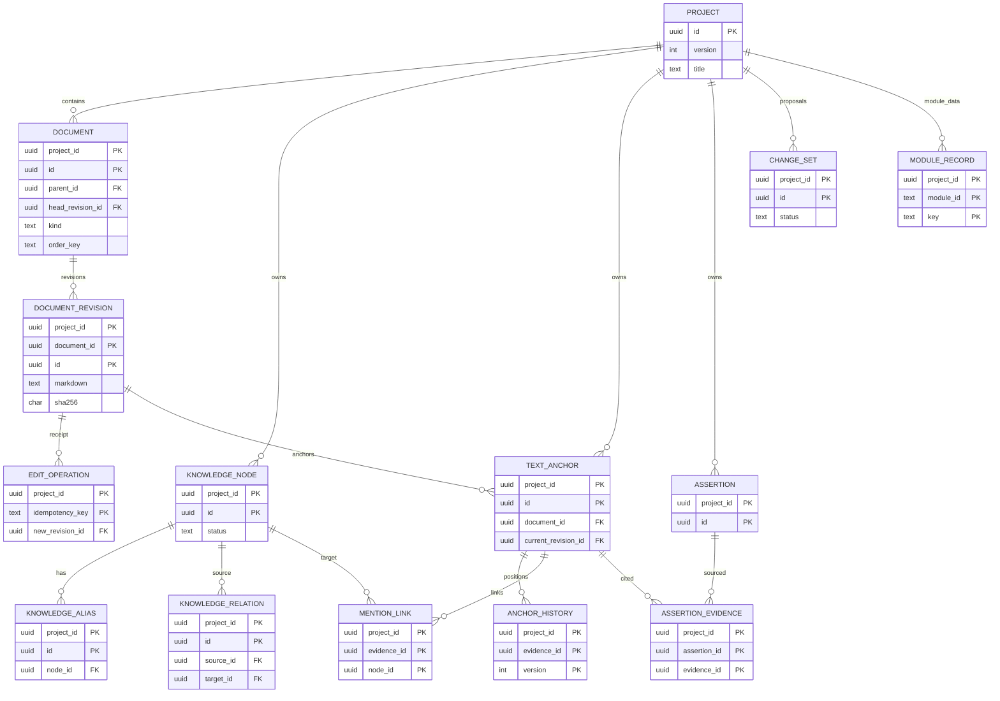

# PostgreSQL ドメイン・データモデル

**種別: 正本・規範的設計。** 本書は [システム基本設計](SYSTEM-DESIGN.md) のデータ責務を具体化する。物理列型・索引・制約の現行実装は `packages/persistence-postgres/migrations/*.sql` により照合するが、変更の可否は本書と [Core](CORE.md) の不変条件で判断する。

## 永続化の境界

- PostgreSQL が Project、Document、Document Revision、Knowledge、Evidence、Assertion、ChangeSet、ModuleRecord を所有する。すべての対象資源は project により分離する。
- Better Auth のユーザー・Passkey・セッション・OAuth クライアント等は同一 PostgreSQL サービス上の**別認証スキーマ**と認証用ロールの責務である。原稿 schema の entity と混ぜない。
- IndexedDB とネイティブの保護されたローカルjournalは作者・作品・文書に束縛した未確定ドラフト・提案回復領域であり、サーバー正本ではない。現行の `codexia-history` は操作履歴などの運用状態を保持する移行対象であり、原稿の代替正本ではない。
- 原稿構成・本文の実体は Git の checkout、YAML ファイル配置、Git commit、一般ファイルストアのいずれにも存在させない。
- Module の再計算可能な索引、モデル重み、埋め込み、検索 cache は source revision・schema/model identity に紐付けた派生データであり、復旧時に再生成できる。

## サーバー永続データ集約契約（REQ-DATA-005）

**採用済み目標・未実装。** 所有者はデータモデル／永続化層と、API・認証・運用各領域の責務所有者。対象は開発者・運用者。単一PostgreSQLクラスタを、作品だけでなくサーバー側の確定済みアプリケーション状態全体の唯一の復旧正本とする。DBへの無差別なファイル格納、クライアント未保存データの中央集約、バックアップ製品の選定、OS管理機能の追加は非目標。

| 永続化対象 | 採用目標 |
| --- | --- |
| 作品、Revision、Knowledge、Evidence、ChangeSet、作者所有module record、保存/適用receipt | 現行ドメイン正本を維持 |
| Better Auth、owner enrollment、Passkey、OAuth、失効・共有許可等の認証/権限状態 | 同一クラスタ内の専用スキーマ・役割を維持 |
| バックアップ運用設定、sealed credentials、operation/receipt | 既存運用スキーマと独立executorの権限分離を維持。復旧鍵は独立保全 |
| ジョブ履歴、保持対象の結果、通知、既読状態（現行 `/history/jobs/jobs-state.json`） | PostgreSQL運用データとして移行 |
| 編集・読書位置、端末別順序・競合制御（現行 `/history/recent-activity/recent-activity-state.json` と `recent-activity-order.json`） | PostgreSQLユーザー状態として移行 |
| モデル、検索index、埋め込み、Speaker評価・ルールgate、その他cache | 再取得・再計算可能と実証できる場合のみDB外可。採用済みモデルや作者の確定判断など再構成不能なものはDB正本 |
| Git/Ansible管理の設定、OCI/配布物、OS/journaldログ、Podman secrets、復旧鍵、独立保全証拠 | 各既存の運用正本・保持方針で管理。アプリDBへの取り込みを要求しない |
| 未確定クライアントdraft・一時ファイル | 現行のローカル回復契約または一時領域。サーバー復旧対象外 |

### 境界・正常系・異常系

- 作品の正本、認証、ユーザー状態、運用記録のスキーマ・ロール・認可を分離する。物理表名・SQL・専用roleの詳細は実装前に [DB detail](DATABASE-DETAIL-CONTRACT.md) と正式migration契約で確定する。既存project/owner identity、read/write scope、author承認は変更しない。新しいDBやORM、第二writerを設けない。
- ジョブ登録・状態遷移・結果・通知生成・既読の整合性はDBで原子的に確定する。terminal状態の不変性、ID再利用拒否、保持件数・容量上限、再起動時の中断状態、既存API/SSEの意味を維持する。DB移行は永続実行キューの導入や中断ジョブの自動再実行を意味しない。receipt確定前の成功通知を禁止する。
- Recent Activityはowner/project/deviceとwriter sequence/page sequenceの識別・境界を保持する。cursorと順序メタデータは同一トランザクションで更新し、古い応答が新しい状態を上書きしない。冪等再送と遅延ページの既存契約を維持する。
- DB停止・transaction失敗時は正本への永続化成功を返さない。ローカルファイルへの代替書込み、成功したとみなすフォールバック、DBとファイルの恒久dual-writeは禁止する。

### 移行と受入

- 全runtime profile、ファイル書込み、外部依存、volumeを棚卸しし、永続／派生／一時／独立保全を分類する。派生物は空のcacheから復元でき、作者の確定判断を失わないことを実際に検証する。Speakerのgate/evaluationは必要な再生成または正本化を選択し、消失で黙って解析結果の意味を変更しない。
- 既存データがある場合、保護された整合的な事前バックアップと承認済みの停止・移行手順を使う。旧historyのjobs/inbox/cursor/orderを読み取り専用で検証してDBへ一度だけ移す。件数、内容、owner/project境界、順序メタデータを照合し、再試行の冪等性と中断時の失敗停止を確認する。既存データの破棄を暗黙に許可しない。
- 隔離した実PostgreSQLで状態遷移、同時更新、順序逆転、DB停止、移行失敗、API再起動、同一ID再送、権限拒否を検証する。旧historyなしで動作することが認定されてから旧ファイル実装、環境変数・volume・保守ツール・互換分岐を除去する。
- 空のVMに構成・秘密情報を正規経路で再配備し、独立保全されたPostgreSQLクラスタを復元する。確定済み原稿／履歴、owner認証、運用設定、ジョブ・通知、編集位置の同一性とAPI readiness、派生データの再生成を照合する。旧 `/history` や `/data` のコピーなしで成立することを受入条件とする。
- [Backup](../deployment/BACKUP.md) が現行保全経路と後続のDB専用バックアップへの切替条件を所有する。集約だけで独立復旧試験や従来の保護義務を免除しない。

## 正規化された実体関係

以下は概念 ER 図であり、列名の全列挙ではない。複合主キーは原則として `(project_id, id)` または domain 固有キーとする。

文書の `parent_id` は同じ project の親 Document のみを参照できる。`head_revision_id` は同一文書の immutable Revision のみを参照する。`document_revision` の UPDATE/DELETE は DB trigger で拒否する。Knowledge の関係は source と target の双方が同一 project に存在することを要求する。Text Anchor は UTF-16 範囲、quote hash、対応 Revision によって根拠の同一性を検証する。

## 変更・読み取りの設計

| 操作 | 不変条件・失敗の意味 |
| --- | --- |
| 作品・構成の作成/変更 | project version と対象 resource の version を競合検査し、木構造の循環と他作品参照を禁止 |
| 本文保存 | base Revision と `idempotency_key` を照合し、原稿本文・新 Revision・編集 receipt を原子的に確定 |
| 履歴復元 | 過去の immutable Revision は変更せず、復元結果を新 Revision として追加 |
| Knowledge/Relation | UUID の同一性を利用し、同名・別名の文字列一致だけで統合しない。status と evidence を保存 |
| Text Anchor 更新 | 原稿変更で追随可能な位置のみ移す。重複・消失箇所は `needs_review`/`orphaned` として保存 |
| ChangeSet | `proposed → approved → applied` または `proposed → rejected`。承認時・適用時に対象、read/write set、version、principal を再検証 |
| Module record | project/module/key で所属を固定し、unknown data を不正に解釈・破棄しない |
| Read snapshot | 同一 project/version の一貫した読取り。要求された過去状態がない場合はエラーとし、現在値に置換しない |

API や MCP の単なる呼出し成功は transaction 成功を意味しない。作者 UI の「保存済み」は正しい DB receipt と対応する journal の確定状態を必要とする。ネットワーク応答が失われても同じ冪等操作の結果を照合する。

## スキーマの更新と回復

物理スキーマはチェックサム付きの versioned migration ledger として管理し、適用済み SQL を改変しない。`migrationSetFingerprint` は migration 名/チェックサム集合の一致を確認する。既存より新しい DB、欠落した migration、変更された checksum のいずれも**互換とみなさない**。

通常の OCI イメージ更新はスキーマ変更を実行せず、互換性を観測するだけとする。DB migration、認証 schema、persistence format の変更が必要なら、独立した設計・暗号化バックアップ・隔離復元ドリル・停止中の migration・再検証・失敗時のデータ復旧計画を承認してから実行する。コンテナー image rollback と database restore は別操作である。

- 読取性能と Snapshot: [Backend read model](BACKEND-READ-MODEL.md)
- 認証 schema: [API 認証・認可](API-AUTHN-AUTHZ.md)
- クライアント回復: [Interaction contract](../design/INTERACTION-CONTRACT.md)
- DB 運用: [初期導入](../deployment/INITIAL-DEPLOYMENT-FLOW.md)・[更新](../deployment/UPDATE-FLOW.md)・[Backups](../deployment/BACKUP.md)
