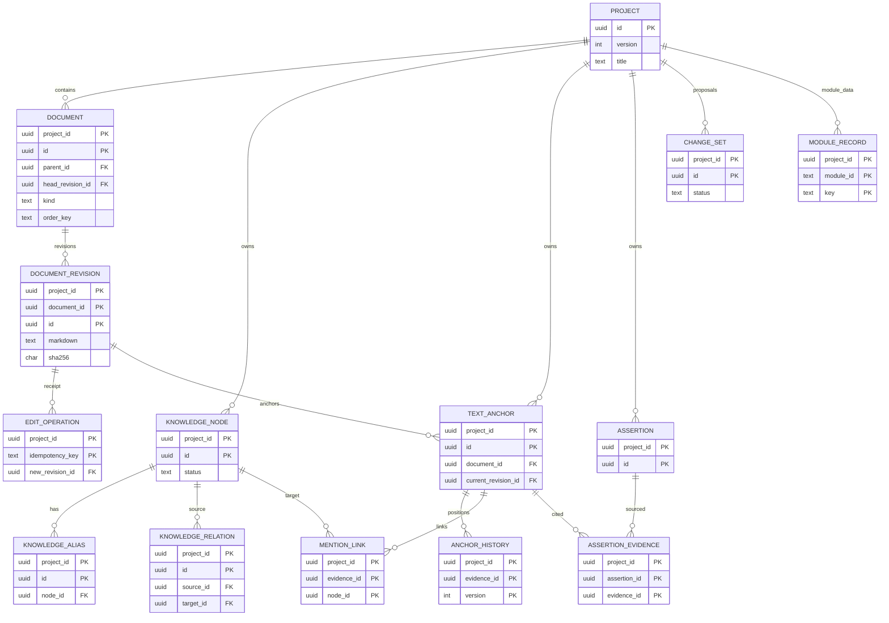

# PostgreSQL ドメイン・データモデル

**種別: 正本・規範的設計。** 本書は [システム基本設計](SYSTEM-DESIGN.md) のデータ責務を具体化する。物理列型・索引・制約の現行実装は `packages/persistence-postgres/migrations/*.sql` により照合するが、変更の可否は本書と [Core](CORE.md) の不変条件で判断する。

## 永続化の境界

- PostgreSQL が Project、Document、Document Revision、Knowledge、Evidence、Assertion、ChangeSet、ModuleRecord を所有する。すべての対象資源は project により分離する。
- Better Auth のユーザー・Passkey・セッション・OAuth クライアント等は同一 PostgreSQL サービス上の**別認証スキーマ**と認証用ロールの責務である。原稿 schema の entity と混ぜない。
- IndexedDB は作者・作品・文書に束縛した回復可能なドラフト、提案 journal を保持する。ホストの `codexia-history` ボリュームは操作履歴などの運用状態であり、原稿の代替正本ではない。
- 原稿構成・本文の実体は Git の checkout、YAML ファイル配置、Git commit、一般ファイルストアのいずれにも存在させない。
- Module の再計算可能な索引、モデル重み、埋め込み、検索 cache は source revision・schema/model identity に紐付けた派生データであり、復旧時に再生成できる。

## 正規化された実体関係

以下は概念 ER 図であり、列名の全列挙ではない。複合主キーは原則として `(project_id, id)` または domain 固有キーとする。

文書の `parent_id` は同じ project の親 Document のみを参照できる。`head_revision_id` は同一文書の immutable Revision のみを参照する。`document_revision` の UPDATE/DELETE は DB trigger で拒否する。Knowledge の関係は source と target の双方が同一 project に存在することを要求する。Text Anchor は UTF-16 範囲、quote hash、対応 Revision によって根拠の同一性を検証する。

## 変更・読み取りの設計

| 操作 | 不変条件・失敗の意味 |
| --- | --- |
| 作品・構成の作成/変更 | project version と対象 resource の version を競合検査し、木構造の循環と他作品参照を禁止 |
| 本文保存 | base Revision と `idempotency_key` を照合し、原稿本文・新 Revision・編集 receipt を原子的に確定 |
| 履歴復元 | 過去の immutable Revision は変更せず、復元結果を新 Revision として追加 |
| Knowledge/Relation | UUID の同一性を利用し、同名・別名の文字列一致だけで統合しない。status と evidence を保存 |
| Text Anchor 更新 | 原稿変更で追随可能な位置のみ移す。重複・消失箇所は `needs_review`/`orphaned` として保存 |
| ChangeSet | `proposed → approved → applied` または `proposed → rejected`。承認時・適用時に対象、read/write set、version、principal を再検証 |
| Module record | project/module/key で所属を固定し、unknown data を不正に解釈・破棄しない |
| Read snapshot | 同一 project/version の一貫した読取り。要求された過去状態がない場合はエラーとし、現在値に置換しない |

API や MCP の単なる呼出し成功は transaction 成功を意味しない。作者 UI の「保存済み」は正しい DB receipt と対応する journal の確定状態を必要とする。ネットワーク応答が失われても同じ冪等操作の結果を照合する。

## スキーマの更新と回復

物理スキーマはチェックサム付きの versioned migration ledger として管理し、適用済み SQL を改変しない。`migrationSetFingerprint` は migration 名/チェックサム集合の一致を確認する。既存より新しい DB、欠落した migration、変更された checksum のいずれも**互換とみなさない**。

通常の OCI イメージ更新はスキーマ変更を実行せず、互換性を観測するだけとする。DB migration、認証 schema、persistence format の変更が必要なら、独立した設計・暗号化バックアップ・隔離復元ドリル・停止中の migration・再検証・失敗時のデータ復旧計画を承認してから実行する。コンテナー image rollback と database restore は別操作である。

- 読取性能と Snapshot: [Backend read model](BACKEND-READ-MODEL.md)
- 認証 schema: [API 認証・認可](API-AUTHN-AUTHZ.md)
- クライアント回復: [Interaction contract](../design/INTERACTION-CONTRACT.md)
- DB 運用: [初期導入](../deployment/INITIAL-DEPLOYMENT-FLOW.md)・[更新](../deployment/UPDATE-FLOW.md)・[Backups](../deployment/BACKUP.md)
