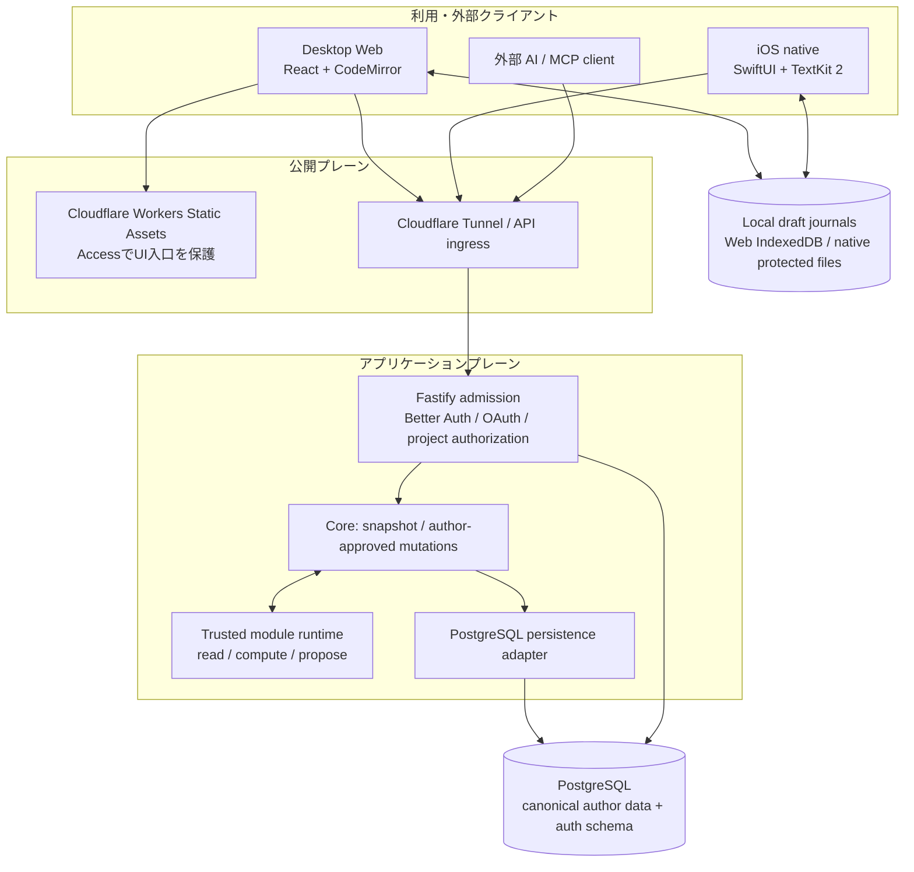
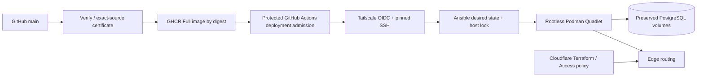

# Codexia システム基本設計

[図をグラフィカルに閲覧する](https://yohn-jp.github.io/codexia/architecture/#system-1)

**種別: 正本・規範的設計（normative）。** 本書はシステム全体の構成、責務分界、変更が守る不変条件を定義する。実装・CI・本番環境を検査して得られる事実は適合証拠であり、設計の代替正本ではない。運用手順・個別機能の詳細は本書から参照する所有文書が定める。

## 設計の優先順位

1. 明示的に承認された製品・アーキテクチャ上の決定と、本書・各領域の規範的設計書。
2. 対象領域の契約、受入条件および承認済み変更設計。
3. 実装、スキーマ、テスト、CI、および実環境の観測結果。これらは「何が動くか」を示すが「何が正しいか」を再定義しない。
4. 履歴、提案、移行証跡、外部資料は背景情報であり、本書を暗黙に上書きしない。

矛盾が判明したら、実装側の設計逸脱または設計変更要求として記録する。既存コードへ合わせて設計を黙って書き換えない。詳細な変更規律は [設計書の正本・保守規則](DOCUMENTATION-AUTHORITY.md)。

汎用プロトコル・入力検証・アーカイブ解析・開発ツールの外部依存は、[外部ライブラリ選定規約](DEPENDENCY-POLICY.md)を正本としてライブラリ優先・最新安定版を原則とする。ただし製品固有の認可、PostgreSQLとIndexedDBの正本、CI証拠の不変条件は委譲しない。

## 採用済みツール移行目標と現行実装の区別

[Specification toolchain](SPECIFICATION-TOOLCHAIN.md) により、**HTTPの型付き契約をTypeSpecで定義し、Fastifyの明示的ルート/JSON SchemaとOrval生成クライアントへ接続すること、MCP SDK v2、SQL-firstの実DB検証、StrictDocの要求追跡**を採用目標とする。**Fastifyは継続採用**し、下記の図と本文に記されたFastifyは現行と目標の両方に該当する。現在の手動catch-allからSchema-firstの明示ルートへの移行は未実装であり、同じAPI/OAuth/MCP権限とPostgreSQL単一正本を維持する。移行の完了は [HTTP基盤受入](HTTP-PLATFORM-MIGRATION.md)、[MCP移行受入](MCP-V2-MIGRATION.md)、[CI受入](../verification/SPECIFICATION-TOOLING-ACCEPTANCE.md) に必要な実行証拠が揃った時に限る。

## 製品・システム境界

- 製品は単一作者の小説執筆・知識管理・提案レビューを提供する。作品本文・構成・Revision・Knowledge・Evidence・ChangeSet・module record の永続正本は **PostgreSQL** のみ。
- **採用目標は Desktop Web (React/CodeMirror) とインストール型 iOS (SwiftUI + 必要なUIKit/TextKit 2) の2クライアント。** Mobile Web/PWA、Ionic/Capacitorを用いるモバイル執筆は製品対象から撤去する。両者は画面、UIコンポーネント、ルーティング、クライアントの状態管理を共有しない。**Core/API契約・作者権限・保存とRevisionの意味論のみ共通**。DesktopのIndexedDBとiOSの保護されたローカルdraft journalは未確定の回復領域であり、PostgreSQLの第二正本ではない。ネイティブ詳細は [iOS SwiftUI](IOS-SWIFTUI-ARCHITECTURE.md)。現行Mobile React/Capacitor実装は移行未完了であり、完成済みとみなさない。
- オプション module は Core の読取・提案境界を利用する。module 側の解析キャッシュ・索引・モデルは再構築可能な派生物。Core だけで作品作成、執筆、保存、履歴、復元が成立する。
- AI の推論・生成は外部クライアントで実施し、Codexia は MCP 経由で文脈、読取、検証、提案と作者承認を提供する。内部生成モデル API の拡張は凍結する。
- Git レポジトリを原稿ストア、同期、復旧、デプロイ制御として復活させない。内部のファイル状投影は過渡的な読み取り表現であり、独立した正本または永久互換性の根拠にしない。

通常の執筆UIと所有者管理UI（`/console`、初回登録の`/console/setup`、`/console/security`、`/console/identity`、**バックアップ保管先管理の`/console/backups`**）は**Cloudflare Workers Static Assets**が配信する。管理者登録キー検証・Passkey・OAuth・権限状態の正本は**VMのFastify/Better AuthとPostgreSQL**であり、Workersは管理者を作成しない。新規DBは本番起動前にAPIを**setup-only**として限定公開できる目標設計とし、その他の作品・MCP APIは停止/拒否する。既存DBのVM交換では同じownerを復旧し、新規登録キーを発行しない。現行の一時SSH登録サーバー方式からの移行は未実装である。

UI 配信と API の外部認可は分離して管理する。Access の通過は Codexia の project/object 認可を代替しない。公開 reader は別の読み取り専用経路とする。HTTP MCP と stdio は同じ認可済みドメイン操作へ到達するアダプターであり、第二の writer を実装しない。

## データと処理の不変条件

| 不変条件 | 設計契約 |
| --- | --- |
| データの同一性 | project ID をすべての読取・変更に結合し、document/revision/knowledge/evidence は project scope で参照する |
| 保存 | 観測した base Revision、入力差分・ハッシュ、冪等キーを使い、DB の確定 receipt とローカル journal を整合させる |
| 競合・応答喪失 | stale write は競合として拒否、応答喪失は同一操作 ID で照合し、原稿を捨てない |
| Snapshot | project/version を固定し、異なる時点の資料を同一結果に混合しない |
| 提案 | module/MCP は読取・計算・提案まで。作者による承認と適用、DB 同一トランザクション内の再検証が必要 |
| 認証 | Better Auth のセッションと OAuth を使用。手入力の長期固定 API トークンを設けず、owner・scope・対象資源を API 側で認可する |
| 障害分離 | DB 不可時に Git/ファイルへの代替書込を行わない。Optional module の失敗は Core 執筆を停止させない |
| 更新 | 署名ではなく、検証済み main・イメージ digest・証明書・互換性・承認を満たす一経路のみが本番を変更する |

詳細データモデルは [PostgreSQL ドメイン設計](DATA-MODEL.md)、API 認証と BOLA は [API 認証・認可](API-AUTHN-AUTHZ.md)、責務境界は [Internal boundaries](INTERNAL-BOUNDARIES.md)、外部 AI は [MCP-first](MCP-FIRST.md) が所有する。

## 論理レイヤーと依存関係

| レイヤー | 主なパッケージ・構成 | 責務 |
| --- | --- | --- |
| 表示 | Desktop React（現行 `app`）、iOS native SwiftUI（導入対象） | プラットフォーム別UIとアクセシビリティ。DOM/React状態、SwiftUI状態、画面部品は共有しない。直接SQL・作者以外の承認を行わない |
| クライアント状態 | Web：既存 `app/src/application/*`・IndexedDB journal。iOS：Swift native authoring coordinator・保護draft journal（新規） | 両端末に同等の入力保護・ナビゲーションguard・receipt照合の振舞いを実装するが、コード共有しない |
| HTTP・認証 | `packages/api`、`modules/mcp` | 入場、token 検証、対象資源認可、HTTP/MCP DTO、サービスライフサイクル |
| ドメイン | `packages/core`、`packages/contracts`、`packages/persistence-contracts` | Domain ID・snapshot・提案・操作の規約。任意実装へ依存しない |
| 永続化 | `packages/persistence-postgres` | SQL・スキーマ・履歴・冪等処理・トランザクション |
| 任意機能 | `packages/module-runtime`、`modules/*` | 宣言された capability の範囲内での遅延起動と監督された計算 |
| デプロイ | `deploy/ansible`、`deploy/quadlet`、`.github/workflows` | 宣言的な VM 状態収束、検証済みイメージの承認済み適用 |

## 運用プレーンと更新

- **一つのデプロイ制御プレーン:** GitHub Actions → Tailscale OIDC → pinned SSH → Ansible → rootless Podman Quadlet。VM 上の polling updater、pull timer、別のリリース選択器、MCP によるデプロイは設けない。
- VMの最小前提はAnsibleからのSSH到達と権限付きの構成変更。OSの適合性は`inspect`/`bootstrap`で検証する。初期導入では新規DBと既存DBの復旧を分け、Ansibleは256-bitの登録キー発行を管理するがownerを作成しない。本人はWorkersの`/console/setup`でPasskey登録を行い、保護された本番`deploy`の承認は別操作とする。今ある`bootstrap`はhost/secrets/base/auth-runtimeの構成収束まで実装済みであり、setup-only公開APIとコンソール登録UIは未実装。
- 通常更新は **DB migration fingerprint、persistence format、API epoch、Full profile、認証スキーマ互換性** を検証し、互換なイメージのみ自動適用できる。互換でないものは承認済み別手順に隔離する。
- 変更前バックアップ、host lock、停止、適用、health、失敗時の既知良好イメージへの復帰を一つのトランザクションとして扱う。コンテナーだけを戻してデータ変更が巻き戻ったと主張しない。

手順と実行状況の区別は [初期デプロイ遷移](../deployment/INITIAL-DEPLOYMENT-FLOW.md) および [アップデート遷移](../deployment/UPDATE-FLOW.md)。公開ルート・証明書・CI は [デプロイ概要](../deployment/README.md) と [CI/CD](../verification/CI-CD.md)。

## UI 契約・設計受入

- [利用画面の遷移図](../design/USER-SCREEN-FLOW.md) は Desktop Web とネイティブiOSの起動、OAuth、作品、執筆、知識、レビュー、保存・復旧を定義する。React Mobile Webの画面/viewport検証は対象外。
- [管理画面の遷移図](../design/ADMIN-SCREEN-FLOW.md) は owner の Passkey・セッション、連携 OIDC の目標設計、および Web 管理画面とは別の運用プレーンを定義する。
- [UX 契約](../design/UX-CONTRACT.md) は原稿保護、IME、可用性、アクセシビリティの受入基準を定義する。

**適合判定:** 設計書の変更時には対象ルート、API 認可、DB migration、CI、実機/実 VM の必要証拠を受入条件として列挙する。設計書が存在することだけで実装済み・本番検証済みとは判定しない。
