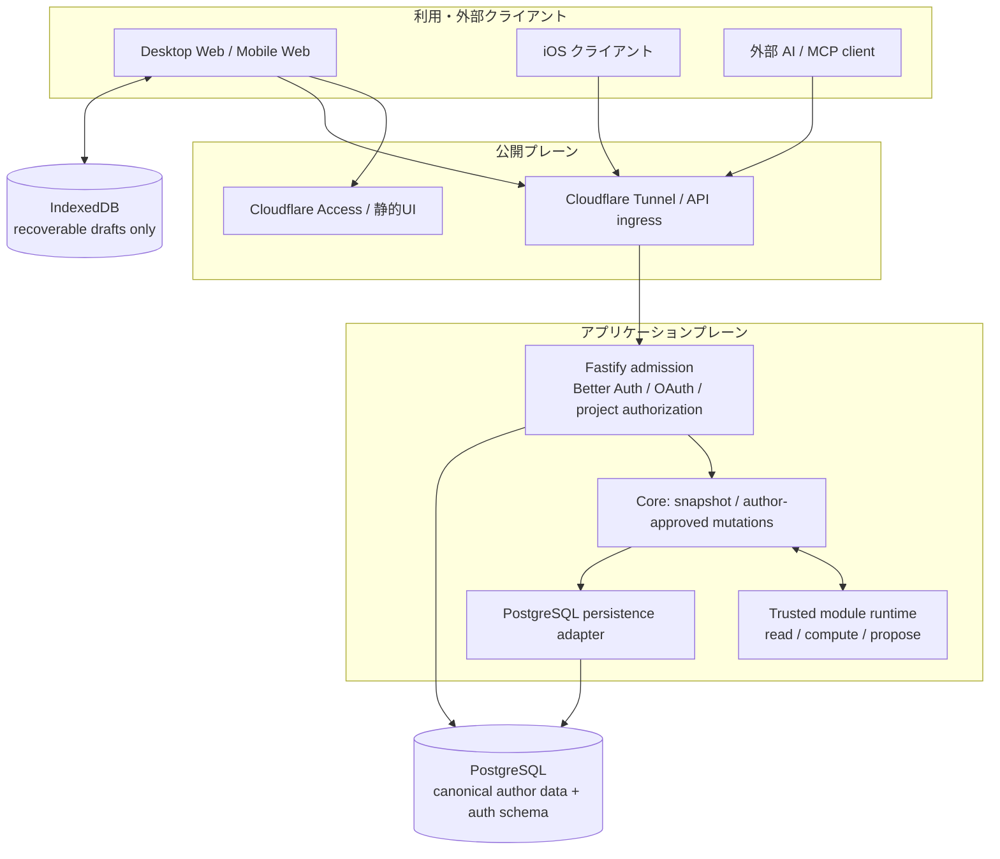
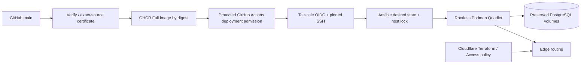

# Codexia システム基本設計

**種別: 正本・規範的設計（normative）。** 本書はシステム全体の構成、責務分界、変更が守る不変条件を定義する。実装・CI・本番環境を検査して得られる事実は適合証拠であり、設計の代替正本ではない。運用手順・個別機能の詳細は本書から参照する所有文書が定める。

## 設計の優先順位

1. 明示的に承認された製品・アーキテクチャ上の決定と、本書・各領域の規範的設計書。
2. 対象領域の契約、受入条件および承認済み変更設計。
3. 実装、スキーマ、テスト、CI、および実環境の観測結果。これらは「何が動くか」を示すが「何が正しいか」を再定義しない。
4. 履歴、提案、移行証跡、外部資料は背景情報であり、本書を暗黙に上書きしない。

矛盾が判明したら、実装側の設計逸脱または設計変更要求として記録する。既存コードへ合わせて設計を黙って書き換えない。詳細な変更規律は [設計書の正本・保守規則](DOCUMENTATION-AUTHORITY.md)。

## 製品・システム境界

- 製品は単一作者の小説執筆・知識管理・提案レビューを提供する。作品本文・構成・Revision・Knowledge・Evidence・ChangeSet・module record の永続正本は **PostgreSQL** のみ。
- Desktop Web、Mobile Web、インストール型 iOS は同じ Core/API 契約を使用し、表示・入力の実装だけを分ける。ブラウザーの IndexedDB は未確定下書きと提案回復のローカル保護領域であり、サーバーの正本ではない。
- オプション module は Core の読取・提案境界を利用する。module 側の解析キャッシュ・索引・モデルは再構築可能な派生物。Core だけで作品作成、執筆、保存、履歴、復元が成立する。
- AI の推論・生成は外部クライアントで実施し、Codexia は MCP 経由で文脈、読取、検証、提案と作者承認を提供する。内部生成モデル API の拡張は凍結する。
- Git レポジトリを原稿ストア、同期、復旧、デプロイ制御として復活させない。内部のファイル状投影は過渡的な読み取り表現であり、独立した正本または永久互換性の根拠にしない。

UI 配信と API の外部認可は分離して管理する。Access の通過は Codexia の project/object 認可を代替しない。公開 reader は別の読み取り専用経路とする。HTTP MCP と stdio は同じ認可済みドメイン操作へ到達するアダプターであり、第二の writer を実装しない。

## データと処理の不変条件

| 不変条件 | 設計契約 |
| --- | --- |
| データの同一性 | project ID をすべての読取・変更に結合し、document/revision/knowledge/evidence は project scope で参照する |
| 保存 | 観測した base Revision、入力差分・ハッシュ、冪等キーを使い、DB の確定 receipt とローカル journal を整合させる |
| 競合・応答喪失 | stale write は競合として拒否、応答喪失は同一操作 ID で照合し、原稿を捨てない |
| Snapshot | project/version を固定し、異なる時点の資料を同一結果に混合しない |
| 提案 | module/MCP は読取・計算・提案まで。作者による承認と適用、DB 同一トランザクション内の再検証が必要 |
| 認証 | Better Auth のセッションと OAuth を使用。手入力の長期固定 API トークンを設けず、owner・scope・対象資源を API 側で認可する |
| 障害分離 | DB 不可時に Git/ファイルへの代替書込を行わない。Optional module の失敗は Core 執筆を停止させない |
| 更新 | 署名ではなく、検証済み main・イメージ digest・証明書・互換性・承認を満たす一経路のみが本番を変更する |

詳細データモデルは [PostgreSQL ドメイン設計](DATA-MODEL.md)、API 認証と BOLA は [API 認証・認可](API-AUTHN-AUTHZ.md)、責務境界は [Internal boundaries](INTERNAL-BOUNDARIES.md)、外部 AI は [MCP-first](MCP-FIRST.md) が所有する。

## 論理レイヤーと依存関係

| レイヤー | 主なパッケージ・構成 | 責務 |
| --- | --- | --- |
| 表示 | `app`、`app/src/shells/*`、`app/src/settings/*` | 操作、状態表示、アクセシビリティ。直接 SQL・作者以外の承認を行わない |
| クライアント状態 | `app/src/application/*`、`app/src/storage/journal.ts` | 入力保護、ナビゲーション guard、回復、サーバー receipt 照合 |
| HTTP・認証 | `packages/api`、`modules/mcp` | 入場、token 検証、対象資源認可、HTTP/MCP DTO、サービスライフサイクル |
| ドメイン | `packages/core`、`packages/contracts`、`packages/persistence-contracts` | Domain ID・snapshot・提案・操作の規約。任意実装へ依存しない |
| 永続化 | `packages/persistence-postgres` | SQL・スキーマ・履歴・冪等処理・トランザクション |
| 任意機能 | `packages/module-runtime`、`modules/*` | 宣言された capability の範囲内での遅延起動と監督された計算 |
| デプロイ | `deploy/ansible`、`deploy/quadlet`、`.github/workflows` | 宣言的な VM 状態収束、検証済みイメージの承認済み適用 |

## 運用プレーンと更新

- **一つのデプロイ制御プレーン:** GitHub Actions → Tailscale OIDC → pinned SSH → Ansible → rootless Podman Quadlet。VM 上の polling updater、pull timer、別のリリース選択器、MCP によるデプロイは設けない。
- 初期導入では専用の承認を要する。空ホストと既存データの採用を分け、資格情報、DB 初期化、owner 登録、本番初回起動を無断連結しない。単一の `bootstrap` 操作へ収束させることは設計目標であり、現行コードの段階操作を実装済みと読み替えない。
- 通常更新は **DB migration fingerprint、persistence format、API epoch、Full profile、認証スキーマ互換性** を検証し、互換なイメージのみ自動適用できる。互換でないものは承認済み別手順に隔離する。
- 変更前バックアップ、host lock、停止、適用、health、失敗時の既知良好イメージへの復帰を一つのトランザクションとして扱う。コンテナーだけを戻してデータ変更が巻き戻ったと主張しない。

手順と実行状況の区別は [初期デプロイ遷移](../deployment/INITIAL-DEPLOYMENT-FLOW.md) および [アップデート遷移](../deployment/UPDATE-FLOW.md)。公開ルート・証明書・CI は [デプロイ概要](../deployment/README.md) と [CI/CD](../verification/CI-CD.md)。

## UI 契約・設計受入

- [利用画面の遷移図](../design/USER-SCREEN-FLOW.md) は起動、OAuth、作品、執筆、知識、レビュー、保存・復旧、Desktop/Mobile 間の遷移を定義する。
- [管理画面の遷移図](../design/ADMIN-SCREEN-FLOW.md) は owner の Passkey・セッション、連携 OIDC の目標設計、および Web 管理画面とは別の運用プレーンを定義する。
- [UX 契約](../design/UX-CONTRACT.md) は原稿保護、IME、可用性、アクセシビリティの受入基準を定義する。

**適合判定:** 設計書の変更時には対象ルート、API 認可、DB migration、CI、実機/実 VM の必要証拠を受入条件として列挙する。設計書が存在することだけで実装済み・本番検証済みとは判定しない。
