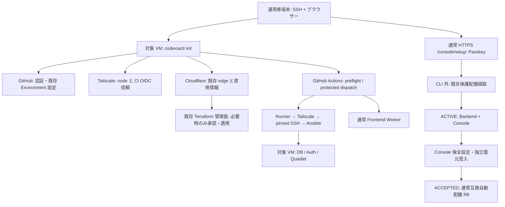

# Codexia 初回配備 CLI（codexiactl）設計

**種別: 正本・規範的設計（normative）。** CLI の責務、操作契約、外部サービス認証、SSH 接続下の操作、配備制御面の登録、初回配備の実行・中断再開および受入条件を定める。実装済み・稼働済みとはみなさない。[Deployment lifecycle](DEPLOYMENT-LIFECYCLE.md) が R0–R8 の経路選択と排他を所有し、[Initial deployment](INITIAL-DEPLOYMENT-FLOW.md)、[IaC](IAC.md)、[Production Bootstrap](PRODUCTION-BOOTSTRAP.md)、[Push deployment](PUSH-DEPLOYMENT.md)、[CI/CD](../verification/CI-CD.md) が配備・認定を所有する。本書はそれらの実装を CLI に移すものではない。

## 1. 採用決定と完了目標

Go 製の独立した一時的なインストーラー `codexiactl` を対象 VM の SSH セッションから起動する。VM の観測、認証の誘導、必要な外部資源の特定、制御面の入力整備、既存保護 Workflow の起動・監視、本人登録の案内を一連の対話として実行する。人間が入力名・ID・Run ID・公開鍵・Token を複数の管理画面の間で転記する運用を通常経路にしない。人間に残す操作は、外部アカウントの認証・委任、権限や対象の選択、明示的な変更承認、独立した GitHub Environment 承認、Owner の本人 Passkey 登録、必要な独立復旧受入に限定する。外部 API が値の取得を許さない場合の限定的な初期資格情報入力は許容する。

CLI の実行主体は対象 VM に対し独立に認証済みの配備運用者である。CLI は root として常時動作しない。初回管理接続を可能にするための Tailscale 接続・必要な公開鍵登録だけが対象 VM 上の許可された初期準備であり、必要時に限定して sudo を使う。Codexia の host/base/secrets/auth-runtime、DB の初期化、Quadlet、API/Tunnel の構成は従来どおり Runner 上の Ansible に委譲する。Cloudflare IaC は既存 Terraform の管理面で適用する。通常配備は GitHub Actions → Tailscale OIDC → pinned OpenSSH → Ansible → rootless Podman Quadlet の一経路であり、CLI を必要としない。

CLI を常駐 agent、self-hosted runner、独自 scheduler、pull updater、Ansible/Terraform/SSH の代替実装、バックアップ・復元エンジンにしてはならない。第二の API/DB/運用台帳、第二の Bootstrap Workflow、設定同期用 Workflow、独自の認定機構は作らない。CLI による外部入力の登録は既存配備制御面に対する一時的な操作である。通常の Web Console と MCP にこれらの権限を付与しない。

| 実行面 | 所有する責務 |
| --- | --- |
| オペレーター端末 | 最初の SSH 接続と host identity の確認、外部サービスのブラウザー認証・承認、Owner 本人の登録 |
| 対象 VM の CLI | 観測、初期管理接続準備、各サービスの認証・設定、dispatch、結果の照合、再開 |
| GitHub Actions | exact-source 認定、Environment 承認、release/配備制御、R4/R5/R6/R8 |
| Ansible / systemd / Quadlet | VM 構成、秘密生成、DB/Auth、サービス、host lock、トランザクション |
| 既存 Terraform | Cloudflare の DNS、Tunnel ingress、Access、Worker/route の所望状態 |
| PostgreSQL / Better Auth / Web Console | アプリケーション状態、本人登録・認証、稼働後の操作 |
| 独立復旧担当 | 復旧秘密、バックアップ保全と独立復元、既存データ復旧判断 |



## 2. 配布・起動・コマンドの契約

対象は現行 IaC のサポート OS/CPU（Ubuntu 26.04 x86-64）である。署名または認定された provenance と SHA-256 を検証できる immutable な GitHub Release 成果物として Linux 用 Go バイナリを配布する。配布先とバージョンを明示し、未認定 HEAD の実行や curl | shell を通常手順にしない。CLI のリリースは既存 CI の exact-source 契約に従い、初回利用者に Go、Node、Ansible、Terraform のインストールを要求しない。OS の OpenSSH、sudo、Tailscale はそれぞれ公式コンポーネントを利用する。必要な Tailscale の導入はサポート対象 OS の公式署名済みパッケージを用い、導入前に承認する。既存の公式 CLI を補助利用する場合も権限・バージョン・一時設定ディレクトリ・終了時の消去を明記し、未導入なら対応する公式 API または認証ガイドを使う。未確認の OAuth client ID、埋込み client secret、非公開 API は採用しない。

運用者が信頼済みの手段で対象 VM へ SSH し、通常ユーザーとして以下を実行する。CLI は別のリポジトリに対して任意の配備権限を行使しない。初期対象は `yohn-jp/codexia` の `main` と、同一認定 source の [production.json](../../deploy/production.json) である。リポジトリ ID・origin・対象 VM を表示し、名前だけで同一性を判定しない。

| コマンド | 入力・動作 | 終了条件 |
| --- | --- | --- |
| `codexiactl init` | 対話 TTY 必須。§3 の順序で現況を観測し、不足分だけ承認の下で整備して初回導入を進める。再実行が再開操作を兼ねる | R5 の登録専用 API と Frontend の稼働、Owner Setup Grant の安全な引き渡しを確認して終了。既存 Owner には再発行しない |
| `codexiactl init --plan` | ローカル読取りと外部読取り・必要な一時認証のみ。変更予定・資格不足・利用する Workflow と承認を表示。秘密値は出さない | 計画の提示。VM・GitHub・Tailscale・Cloudflare の構成変更や deploy dispatch はしない |
| `codexiactl status [--json]` | 観測済み VM/外部 identity、Environment 設定の存在、最新対象 run、R 状態、ACTIVE/ACCEPTED、通常更新可否を読取り | 観測結果。未観測・不明・到達不能を成功としない |
| `codexiactl doctor [--json]` | 同じ観測を使い、OS/sudo/SSH、Tailnet/ACL、GitHub 権限と認定、Edge、設定欠落を診断。保護 preflight は既存の読取り専用 Workflow を明示承認の下で起動する `init` から利用する | 阻害要因、原因の証拠、次に解決すべき操作。構成変更なし |
| `codexiactl version` / `help` | バージョン・source・仕様と利用法を表示 | 外部接続・認証なし |

`--json` は読取り結果に限定し、スキーマ版、対象、観測時刻、状態、blockers、run IDs、証拠参照を含む。秘密、grant、OAuth code、認証用 URL の query、トークンレスポンスを含めない。機械出力は stdout、診断は stderr。初回対話を stdin から無条件に自動承認する `--yes`、`--force`、任意 command 実行、秘密の command-line 引数、隠れた非対話モードは提供しない。ユーザー中断を除き終了コードは 0（要求した段階の成立）、1（失敗または不明）、2（不足・承認待ちで安全停止）、3（対象/状態の不整合・拒否）とする。中断は 130。ACTIVE と ACCEPTED は結果に必ず区別して表示する。

## 2.1 CLI 自身のリリース・更新ライフサイクル（正本）

CLI の**配布**は本節が所有し、CLI を使う初回 VM 導入・R0–R8 は本書 §3 と [Deployment lifecycle](DEPLOYMENT-LIFECYCLE.md) が所有する。CLI のバージョンと Backend/Frontend の配備バージョンを混同しない。CLI は常駐更新器ではなく、既存 VM の自動更新・再起動を行わない。

1. 開発者が `cmd/codexiactl/**`、`scripts/ci/execution/verify-codexiactl.sh`、CLI release component、または `.github/workflows/publish-oci.yml` を変更して PR を main に統合する。対象変更の定義は自動タグ付け Workflow と一致させる。ドキュメントだけの変更はリリースを要求しない。
2. `Verify Codexia` の main push 実行が成功した後、`.github/workflows/codexiactl-auto-release.yml` が成功 run の exact SHA と現行 main HEAD を照合する。変更のない main、失敗した認定、追い越された SHA は発行しない。比較不能・API 応答不完全なら安全停止する。
3. 既存の `v0.1.x` タグから最大 patch を求め、次の未使用 `v0.1.(x+1)` を発行する。タグの再割当て、削除、既存バージョンの上書きは禁止。競合や API 応答喪失時は現存タグと SHA を再照合し、曖昧なら停止する。発行されたが公開に失敗した番号は再利用せず、修復した main の次の番号を使う。
4. タグ push で既存 `Publish Codexia OCI` が起動する。既存の exact-source Verify 証明、Immutable Releases 設定、OCI core/full 公開、Linux amd64 CLI ビルド、provenance/attestation、SHA-256 manifest、Release asset の照合を**すべて**維持する。自動タグ作成の成功は公開成功を意味しない。CLI だけを独自の未認定経路で配布しない。
5. 正式公開後に運用者は immutable GitHub Release から `codexiactl-linux-amd64` と `codexiactl-linux-amd64.sha256` を取得し、SHA-256 と GitHub attestation/provenance を照合して通常ユーザーで配置する。初回導入は `version`、`doctor`、`init --plan`、`init` の順。更新時も認定済みバイナリに置き換えるだけで、既存 owner/DB/鍵を再初期化しない。

### 発行用認証と保護

`CODEXIA_RELEASE_TAG_TOKEN` は自動タグ付け Workflow が GitHub の `refs/tags/v0.1.x` を作成するため**だけ**の GitHub 認証資格である。標準 `GITHUB_TOKEN` による push は通常後続 Workflow の push trigger を起動しないため、GitHub App installation token または期限付き・リポジトリ限定の fine-grained PAT（Contents: write）が必要となる。これは CLI が VM で使う認証でも、GitHub Release の公開認証でも、Cloudflare/Tailscale/本番配備認証でもない。認証資格をコード・ログ・VM・Release artifact に埋め込まない。資格の最小権限・有効期限・失効・rotation と、Workflow の default-branch trusted source 制約を守る。可能なら GitHub App の短命 installation token を優先し、恒久 PAT を前提としない。

`CODEXIA_RELEASE_IMMUTABILITY_READ_TOKEN` は既存公開 Workflow が repository の Immutable Releases 設定を検証する**別資格**であり、タグ発行権限とは別に扱う。公開失敗時に検証を緩和しない。

**受入:** (a) CLI 変更を含む main の認定成功でタグが一つだけ発行され Release に CLI バイナリと manifest が存在する、(b) 非対象変更・失敗・stale SHA では発行されない、(c) 連続変更で patch が単調増加し既存タグを変更しない、(d) 同時実行・API 障害・資格不足で重複/未認定公開がない、(e) Release の SHA/provenance が元の main SHA と一致し VM 上で `version` が動作する。実際の公開が成功するまでは「自動リリース完了」と判定しない。

## 3. init の順序と状態遷移

操作の前に read-only で対象を確定し、外部変更の直前に意図・対象・差分を提示する。安全に並列できる読取り以外は次の順序を守る。step の成功をログの文字列や Workflow 全体の緑色から推定しない。CLI 内の step は配備 R 経路の第二定義ではなく、その入力準備と既存 operation の呼出しである。

| 順番 | 操作と入力 | 成功・次への条件 |
| --- | --- | --- |
| 01 VM | 現在の SSH ユーザー、OS、CPU、時刻、sudo、既存 sshd の有効設定・公開 host key、既存 Tailscale 状態、既存 Codexia 資源の非破壊観測 | 対象 VM の同一性が確認でき、独立に認証した管理経路が残る。root・service account を bootstrap 管理者にしない |
| 02 GitHub | §4.1 の認証、利用者と app/repo 権限、repo ID、main SHA、既存 Environment と protection、既存 Variables/Secrets の名前、workflow の存在を取得 | 配備対象一致。必要な権限が有効。main と現行 CLI 対応契約を確認 |
| 03 Tailscale | §4.2 の node 接続、Tailnet 管理認証、既存 node ID、対象アドレス、WIF client ID/audience、CI tag、policy の検査 | 期待する Tailnet と node、CI の到達許可、既存 OIDC 信頼を確認。不足だけ承認して準備 |
| 04 Cloudflare | §4.3 の認証、production origin に対応する account/zone、Tunnel、Access apps/policies、Worker/routes の読取り。既存設定に対応する資格情報を確認・準備 | origin/route/identity の唯一の一致、正常な setup-only 経路の前提。変更は既存 Terraform の承認済み適用後の再観測 |
| 05 制御面登録 | §5 の差分を提示。bootstrap 管理鍵と runtime 鍵を分離し、必要な公開鍵・pin・外部資格情報・Environment 入力を登録 | GitHub の登録結果、公開鍵の対応、protection、既存設定の非破壊を確認。Secrets の存在は実接続の代用にしない |
| 06 管理接続 / 候補認定 | Protected production bootstrap の `mode=preflight` を dispatch。main の認定済み Full Backend と互換 Frontend を既存証拠から選択可能であることを確認 | 管理 SSH / sudo / host pin の実証、認定 source・artifact が確定。欠落時は正規 CI を待つか認定を起動し、公開・証明を自作しない |
| 07 R4 | fresh lifecycle Preflight（install, bootstrap）。対象と DB 意図を承認し、必要な場合のみ独立した DB 初期化承認を取得。既存 Bootstrap に Plan ID を渡す | R4 の実ジョブ成功、runtime SSH、DB/Auth の同一性を再観測 |
| 08 R5 Frontend | fresh lifecycle Preflight（install, runtime）。既存 Frontend の初回公開を dispatch | 通常 Worker で認定 Frontend identity を確認 |
| 09 R5 owner-setup | §4.4 の配送用公開鍵を確定。fresh lifecycle Preflight（install, bootstrap）。setup-only 起動と一回限り grant 発行を dispatch | 同一 origin、登録時の edge 保護、業務 API 拒否、暗号化 handoff を確認 |
| 10 引き渡し・終了 | 通常端末のブラウザーで /console/setup を開く案内を表示し、一時認証を片付ける | 登録可能な状態を確認して終了。本人登録を待機しない |

以降の Owner 登録、R5 prepare-activation、R6 は CLI の実行範囲外であり、既存の保護配備経路が所有する。Owner 未登録のまま通常 Backend を起動してはならない。

R0（不明・不一致）、R1/R3（中断・復旧）、R2（restore）、R8（互換更新）は lifecycle の判定を尊重する。CLI は既存 DB の採用/削除や復元を新規 install と推定しない。既存データ・不明な host/DB/owner/transaction があれば該当保護経路への案内と証拠提示で停止する。新 VM への交換でも独立復旧受入の代わりに新規 Owner を発行しない。バックアップの実装変更を CLI の初回稼働条件にしない。

## 4. SSH ヘッドレス認証とブラウザー誘導

### 4.0 共通契約

Device Authorization Grant では CLI が VM から HTTPS で code を要求し、運用者が手元端末のブラウザーで provider の verification URL と短い user code を使って本人認証する。CLI は interval/slow_down/expiry/denial を守って token endpoint を poll する。**Device Flow には SSH ポート転送も VM 上のブラウザーも不要である。** ブラウザーを開けない VM で xdg-open 等の成功を要求しない。認証先の公式ドメイン、対象アカウント、意図する権限、期限を表示し、利用者の明示的な確認後に開始する。device_code、access/refresh token を表示・保存しない。短い user code の表示は当該 TTY のみに限定し、構造化ログには残さない。

公式実装が Authorization Code + PKCE の loopback callback を要求する場合のみ、SSH local forwarding を案内する。VM の callback server は 127.0.0.1 上の provider が許す単一ポートだけで待受け、端末側も 127.0.0.1 に限定する。CLI は実際のポートと既に認証済みの SSH 接続先を表示する。利用者が既存の SSH セッションから制御できない場合は、手元端末の別ターミナルで次を実行する（例の 8976 は Wrangler の既定 callback。実際のアダプターが表示するポートを使う）。

```sh
# 手元端末で実行する。対象 VM 上では実行しない。
ssh -N -o ExitOnForwardFailure=yes -o StrictHostKeyChecking=yes \
  -L 127.0.0.1:8976:127.0.0.1:8976 <verified-admin>@<verified-host>
```

最初の SSH が独立に host key pin を検証済みであることを要求し、別セッションも同じ pin/SSH config を使う。remote CLI が端末側の SSH forwarding を勝手に設定できるとは仮定しない。事前確保されたポート競合、転送禁止、接続失敗、callback 不一致は診断して安全停止または公式 Device Flow へ切り替える。PKCE/state/redirect URI の一致、コードの一回性、期限、callback の送信元・path を検証する。0.0.0.0 での待受け、公開 Cloudflare Tunnel/Funnel、SSH agent forwarding、SSH の host verification 無効化、URL からのコード手動抽出は通常手段としない。認証完了/失敗/中断で callback listener を閉じ、CLI が開いたものだけ閉じる。端末で利用者が起動した転送は終了コマンドを案内する。ブラウザー認証後の Owner 登録は本番 HTTPS origin で実施し、OAuth 用 SSH 転送を使わない。

### 4.1 GitHub（最初の外部サービス認証）

配布元が事前登録した device flow 有効の GitHub App の公開 client ID を CLI の対応リリースに束縛する。App は対象 repository にのみインストールする。対話では必要時に GitHub の公式 App インストール/認証ページへ誘導し、権限一覧と実対象を確認する。App private key/client secret をバイナリに含めない。公式 Device Flow で得た短命な user access token を使用する。GitHub App が未準備の場合は明示的な保守前提の不足として案内し、任意の OAuth client を流用しない。対応する期限付き repository 限定 fine-grained PAT を運用者が選ぶ場合のみ、TTY の非表示入力で受け付ける。

必要権限は repository の Metadata/Contents read、Actions read/write（dispatch・run 照合）、Environments read/write（環境 Variables/Secrets）、必要な場合のみ Administration write（Environment の新規作成・保護設定）。公開候補の証拠の読取りに必要な追加 read 権限は公式 endpoint 要件に従って明示する。user の権限と App の権限の積を実 API で検査する。Environment の保護ルールを書き換えて承認を迂回しない。既存同等の保護設定が不足する場合は別の明示承認が必要であり、設定不能な plan では停止する。

GitHub REST API から repository ID、default/main、Environment と保護、branch restriction、Variables、Secret の名前と更新時刻を列挙する。Secret の値は取得できない。GitHub の Environment public key で Libsodium 互換 sealed box を使い値を暗号化して登録する。GitHub token の権限不足や App 未承認を private credential のログ出力で解決しない。GitHub の管理 token は VM サービスや Actions の Secret に格納しない。Workflow は公式 dispatch API の run ID 応答を利用し、その ID の job/attempt/artifact を照合する。既存版 API が ID を返さない場合は同じ操作の run を一意に同定できるまで読取りのみとし、時刻の近い別 run を採用しない。

### 4.2 Tailscale（node 認証と管理 API 認証は別）

`tailscale status --json` と公式 CLI で既存 node の状態、Tailnet、node ID、アドレス、承認状態を確認する。すでに正しい Tailnet に接続していれば再ログイン・タグ付替えを行わない。未接続時は公式 `tailscale up` のブラウザー認証 URL を運用者に提示し、必要な device approval を待つ。既存 SSH 接続を失う変更、DNS/route/exit node のリセット、Tailscale SSH への変更を暗黙に行わない。Codexia は従来の OpenSSH over Tailscale を使用する。node のログインは Tailnet 管理 API の認証ではない。

管理 API は既存の scoped trust credential または運用者が公式 admin console で取得した期限付き API access token を非表示入力で受け取る。管理 API 用の汎用 CLI Device Flow が使えるとは仮定しない。CLI が必要な公式画面・権限を示し、node/keys/policy を読取り、既存の federated identity の issuer（GitHub Actions）、audience、repository/workflow/main/Environment の claim 条件、`auth_keys` scope、`tag:ci` を照合する。通常 CI は現行の WIF と短命な ephemeral node を利用し、管理 API token や長命 auth key を Actions に渡さない。既存 client ID/audience を再利用する。新規 WIF が必要な場合に限り、`federated_keys` 権限を持つ公式 API または管理画面で作成し、差分と信頼条件を承認する。policy の変更は既存 policy 管理権限に従い、必要な node/tag への TCP/22 のみ許可する。共有 Tailnet の ACL 全体の置換、既存タグへの広範な権限追加、SSH の公開はしない。GitHub の保護 runner から実接続して初めて CI 到達性を確認する。

### 4.3 Cloudflare（管理認証、配備用資格、製品 Access を分離）

既存の provider 管理資格がなければ公式 OAuth/device login が当該管理 endpoint と scope をカバーする場合だけ利用する。現行の Wrangler 4.119.0 以降は `wrangler login --device --browser=false` に対応する（callback 不要）。既存の認定済み公式 CLI が利用できる場合に補助利用し、取得 token の scope を検査する。Wrangler の Workers ログインが API Token 発行・Zero Trust 全操作を許すとは仮定しない。公式 OAuth の利用条件を満たさない操作は、CLI が公式 Token 作成ページ、必要な account/zone と具体的な許可・期限を案内し、一時 provisioning token を非表示入力で受け付ける。VM に Node/Wrangler の恒久導入を要求しない。発行権限を持つ管理 token がない場合は token 発行までの完全自動化を約束しない。

production origin を基に account/zone、DNS record、remote-managed Tunnel ID と ingress、Access author/CI policy、Worker/routes を公式 API で検出する。複数候補、未知の origin、Terraform 管理の drift、他の connector/writer が稼働中なら停止。Cloudflare IaC による修正が必要なら既存 Terraform workspace/state と認証・承認経路へ誘導し、承認済み plan/apply の結果を再取得する。CLI は Terraform を VM 上で起動しない。Terraform 管理資源を Cloudflare API で別に作成/更新しない。既存 Access CI policy にサービス Token を結び付ける場合もその policy の所有経路を尊重する。

既存の Tunnel token は該当 Tunnel の公式 API から取得できる場合のみ取得する。既存稼働 connector の token を無断 rotation しない。Access service token の client secret は作成時のみ取得可能である。既存の有効な Secret は継続利用し、別 Environment に必要な秘密が復元できないときは、既存の正当な保管元から取得するか、明示承認の下で scoped 新規 token を作成し、CI policy への限定許可・実疎通確認後に旧 token を必要時のみ廃止する。既存有効資格の破壊・全体権限の拡張はしない。Worker publication token、deployment read token、Access client ID/secret、Tunnel token の用途は分離する。API token を自動発行する場合は API Tokens Write または Account API Tokens Write 等の必要な発行権限と具体的な account/zone scope を実 API で確認し、ない場合は一度だけ本人に発行を案内する。長命で広範な管理 token は GitHub/VM に残さない。Cloudflare Access の本人ブラウザー認証は別途 Owner が行う。

### 4.4 Owner Passkey と暗号化 handoff

R5 の既存 owner-setup grant と age 暗号化 handoff を利用し、CLI は grant を生成する第二経路を作らない。Owner の本人登録を代行しない。既存 Owner がいないことを lifecycle の観測で確認する。

原則として Owner の公開 age recipient を独立に確認して登録し、暗号化 handoff を信頼済み SSH セッションで Owner に配送する。Owner と配備運用者が同一で対象 VM を信頼することを明示確認した場合に限り、CLI は Go の age ライブラリで一時配送用鍵を当該プロセスに生成し、公開 recipient のみを GitHub に登録できる。秘密鍵はプロセス外・GitHub・ログ・artifact・恒久ファイルに出さない。R5 が成功した後、現行の service-owned `~/.local/state/codexia-deploy/owner-setup.age` を最小限の権限で読取り、既存の envelope の recipient と origin を検証して復号する。Owner が信頼済みのブラウザーに貼り付ける一度の TTY 表示以外に grant を出さない。URL query、shell history、clipboard 自動転送、CI 出力は禁止する。Owner が別人の場合は Owner の端末で復号し、CLI は暗号文のみを安全な既存配送経路で渡す。

一時鍵の喪失・grant 期限切れ・中断は、Owner 未登録を再確認して現行の承認済み reissue を使う。既存有効 grant の無断破棄・再発行を禁止する。独立 Owner recipient を利用すれば中断後も既存暗号文を復号できる。本人 Passkey 登録後の grant 無効化と clients の確定は既存認証・保護配備経路の責務であり、CLI は待機・確認しない。WebAuthn RP ID は通常 production origin のままであり、localhost や SSH callback を登録 origin に使わない。

## 5. 入力の整備と GitHub Environment

既存 `codexia-bootstrap` と `codexia-production` を使う。以下は現行 Workflow の入力名を保つ登録契約である。共通値は同一の検証済み source から CLI が必要な保護 Environment に投影し、利用者による重複転記を廃止する。登録済み値を一律上書きしない。Secrets を repo-wide に昇格して権限を広げない。将来 Workflow が共通入力を一つの保護面で消費できるように変更するなら、不要になった入力は同じ変更で撤去する。設定同期スクリプトを新設しない。

| 正本・取得方法 | 既存 Variable / Secret 名 | 登録先・注意 |
| --- | --- | --- |
| 確認済み VM Tailnet address、OpenSSH host key pin | V: CODEXIA_BOOTSTRAP_HOST / CODEXIA_DEPLOY_HOST、CODEXIA_BOOTSTRAP_SSH_KNOWN_HOSTS / CODEXIA_DEPLOY_SSH_KNOWN_HOSTS | bootstrap / production の各対応名。同一 VM を指す。同じ公開 pin を検証して投影 |
| 独立した sudo 管理者 | V: CODEXIA_BOOTSTRAP_SSH_USER | bootstrap のみ。対象 UID、sudo -n、既存 SSH 接続を検証 |
| bootstrap SSH Ed25519 identity | S: CODEXIA_BOOTSTRAP_SSH_PRIVATE_KEY | bootstrap のみ |
| runtime SSH Ed25519 identity | S: CODEXIA_DEPLOY_SSH_PRIVATE_KEY | production のみ。R4 の既存 runtime identity stage が公開鍵を対象 service account に登録 |
| Tailscale WIF | S: TS_OAUTH_CLIENT_ID（現行入力名） | 両保護 Environment。client ID は同じ信頼のものを使う。audience と tag は現行 Workflow と照合し、固定設定が異なる場合に無断上書きせず PR で修正 |
| Cloudflare account/zone/tunnel/policy IDs、teamName、public protocol 状態 | V: CODEXIA_DEPLOYMENT_CLOUDFLARE_TARGET | 両保護 Environment。公式観測から生成。Git の公開設定と照合 |
| 限定 Cloudflare read credential | S: CODEXIA_DEPLOYMENT_CLOUDFLARE_READ_TOKEN | 両保護 Environment |
| CI Access probe identity | S: CODEXIA_ACCESS_CLIENT_ID / CODEXIA_ACCESS_CLIENT_SECRET | 両保護 Environment。author 権限を与えない |
| 該当 remote-managed Tunnel | S: CODEXIA_TUNNEL_TOKEN | bootstrap のみ |
| Worker publication の限定資格 | S: CLOUDFLARE_API_TOKEN / CLOUDFLARE_ACCOUNT_ID（現行入力名） | production のみ。read token と分離 |
| Owner 確認済み公開 recipient | V: CODEXIA_OWNER_SETUP_AGE_RECIPIENT | bootstrap のみ。R5 配送時に設定 |
| 初回 operation 承認 | V: CODEXIA_BOOTSTRAP_ENABLED、CODEXIA_DATABASE_INITIALIZATION_APPROVED | bootstrap のみ。§6 の承認と範囲・時点を照合して設定 |
| CLI 外の R6 operation 承認 | V: CODEXIA_INITIAL_INSTALL_APPROVED、CODEXIA_DATABASE_INITIALIZATION_APPROVED、CODEXIA_PUSH_DEPLOYMENT_ENABLED | production のみ。CLI は設定せず、既存保護配備経路が管理する |

V=Variable、S=Secret。現行 `CODEXIA_DEPLOYMENT_PRESERVATION` は既存データの保全/復旧経路で必要となる個別保護入力であり、純新規 install の必須入力ではない。DB admin/app/auth passwords、Better Auth secret、introspection secret 等は既存 R4 の VM 上の生成・保管に委譲する。S3/復号鍵・バックアップ executor 資格は CLI の登録入力に含めない。

SSH host pin は既に独立認証された SSH 接続または provider console の証拠と、VM 上で取得する sshd の実効 host public key を照合する。ssh-keyscan だけで信頼を確立しない。CLI は bootstrap 管理者専用鍵と runtime 鍵を別々に扱う。既存 Secret がある場合は実接続を試し、有効なら継続利用する。新規鍵が必要なときだけ CSPRNG で生成し、適切な key type/format を既存 Workflow と照合する。bootstrap 管理者の authorized_keys には対象公開鍵のみを冪等に追加し、既存内容・permissions を保存する。runtime 公開鍵の配置は R4 に委譲する。private key は GitHub の対象 Environment public key で暗号化して送信し、ローカルの平文一時ファイルを原則として作らない。SSH 鍵を GitHub ユーザーアカウントのログイン鍵や repository deploy key として登録しない。

## 6. Workflow dispatch・承認・再開契約

初回はすべて `ref=main`。起動前に現行 main と承認対象 SHA が一致することを検査し、返った run の head_sha、event、workflow path、attempt、必要な job/receipt/certified pair を確認する。動的な Run ID は CLI が扱い、ユーザーにはレビュー用のリンクと要約を表示する。新たな状態変更または main の変化・rerun の後は新しい lifecycle preflight を生成し、古い証拠を流用しない。

| operation | dispatch workflow file | inputs（固定名） |
| --- | --- | --- |
| 管理接続確認 | production-bootstrap.yml | mode=preflight |
| 状態・候補観測 | production-preflight.yml | mode=lifecycle, intent=install, management=bootstrap または runtime。R6 は window_start/window_end（UTC ISO 8601） |
| R4 | production-bootstrap.yml | mode=bootstrap, preflight_run_id, approval_phrase=BOOTSTRAP_CODEXIA, initialize_database=承認済みの真の DB 不在の場合のみ true |
| R5 Frontend | frontend-release.yml | preflight_run_id, approval_phrase=PUBLISH_INITIAL_FRONTEND |
| R5 grant | production-bootstrap.yml | mode=owner-setup, preflight_run_id, approval_phrase=OWNER_SETUP_CODEXIA |

各 protected operation の内容・状態・計画の run link・candidate・対象・承認範囲を提示し、運用者の承認なしに approval phrase や gate を送らない。人間に固定文字列を転記させる必要はない。CLI が正規の承認 phrase を送る条件はその operation の明示承認である。Environment required reviewer の独立した承認は GitHub の既存画面に案内して待機し、CLI は pending approval の自動承認 API を呼ばない。preflight のみでは書込み承認にならない。DB 初期化の承認を既存データの破棄承認と混同しない。時刻枠は運用者が選択・承認した UTC start/end として明示し、CLI は無期限の window を設定しない。

HTTP 200/202、dispatch 成功、Workflow conclusion=success だけを配備成功としない。期待する実ジョブが skipped の場合は未実行と表示し、ライフサイクル状態と証拠を照合する。workflow/run/attempt の不一致、gate の期限切れ、取消し、失敗、候補変更時は停止して原因・リンクを提示する。read-only API poll は timeout・rate limit・retry-after・backoff を守る。作成・dispatch の応答喪失は当該 operation の照合を先に行い、自動再送しない。秘密の作成結果を失った場合も他 token を無制限に作らない。

同時に複数の init が同一 VM を操作しないよう、ユーザー/対象単位のローカル排他を使い、実配備の排他は既存 Workflow queue と host lock に委譲する。再実行は外部実状態を正本として再観測する。VM 上に任意の非秘密 checkpoint（mode 0600、親 0700、atomic replace）を持てるが、それは repo ID、target fingerprint、main SHA、operation/run ID、作成済み resource ID、変更した gate の元値等の照合用に限定する。独立した DB や永続デーモンを設けない。checkpoint が無い・壊れた場合は再観測し、未知状態を fresh install と判断しない。異なる VM や repo の checkpoint を受理しない。

## 7. 完了条件・継続配備・資格の片付け

CLI の初回実行は通常 Frontend、登録専用 API、業務 API の拒否、Owner Setup Grant の安全な引き渡しを確認して終了する。ACTIVE とは報告しない。本人登録・ログインは通常端末のブラウザーで行い、以後の保護配備は CLI に依存しない。

CLI 外の既存保護配備経路は R6 後、初回用 gate を解除し、必要なら GitHub の既存通常配備設定を安全側に戻す。R6 中だけ必要となる CODEXIA_PUSH_DEPLOYMENT_ENABLED は明示承認の作業枠内で扱う。通常 R8 に必要な保全・独立復元の受入を満たさない限り、初回終了後の通常 push は有効にしない。中断時は変更した gate と run の現在状態を再観測し、安全に停止させるか未解決として報告する。既存の正当に稼働中の production 設定を無断で無効化しない。常設 R8 は [Update flow](UPDATE-FLOW.md) と [Backup](BACKUP.md) の受入を証拠で確認した後の別途明示承認で有効にする。再度 init を起動した場合、既存 Owner や ACTIVE/ACCEPTED を観測したら変更せず既存運用経路を案内する。CLI は R8 の自動実行に関与しない。

provider 管理 token、device code、refresh token、age 一時鍵、生成中の private key は一時認証のためだけに使う。CLI 内の保持を最短化し、永続ファイルや command line、stdout/stderr の診断、JSON、shell history、CI artifacts、git に流さない。必要な公式 CLI の一時認証ディレクトリを隔離して権限を制限し、終了/中断時に CLI が生成したものを消去する。管理認証は可能な場合に失効またはログアウトし、既存利用者の認証・通常配備用資格・VM 内部秘密を削除しない。初回の独立管理者 SSH key は一時 bootstrap 権限として扱い、R6 成功後に bootstrap 無効化と、当該 CLI が作成した鍵の安全な撤去/再利用方針を運用者に提示する。復旧時に必要な独立管理経路を失わない。初回専用 Secret の廃止は明示承認と実接続確認後に限る。

## 8. 実装境界と受入

Go の標準 crypto/net/http、維持されている GitHub/Tailscale/Cloudflare 公式または成熟 SDK、Libsodium 互換 sealed box、age の既存実装を使う。CLI parser 等も [依存選定方針](../architecture/DEPENDENCY-POLICY.md) に従う。protocol、暗号、SSH、IaC、DB/Backup を再実装しない。依存の採用・固定バージョンは実装 PR で公式機能と検証を示し register を更新する。CLI に必要な公開認証 app の準備・配布・認定を実装受入に含める。新規の helper script、常駐 service、別 Workflow を追加して既存の手動運用を温存することを完成としない。既存 Workflow の個別操作を独立復旧/診断のために維持し、正常初回導入で要求していた管理画面転記や別々の手動 dispatch を CLI 経由に置き換える。

以下を独立した隔離アカウント/VM と、承認済みの実 production acceptance で実証する。模擬 HTTP のみを実サービス適合の証明にしない。

| ID | 必須証明 |
| --- | --- |
| CLI-01 | 認定バイナリを SSH のみの新規 VM で取得・実行。Go/Node/Ansible/Terraform を VM に要求せず、既存 SSH を失わない |
| CLI-02 | GitHub Device Flow、Tailscale node 認証と管理 API 認証、Cloudflare Device Flow または必要 scope の認証ガイドを実証。拒否・期限・slow_down・権限不足・誤 account を安全停止。Device Flow で転送不要、loopback 型のみ local forwarding、port conflict と転送禁止、state 不一致を検証 |
| CLI-03 | 既存 production の値を維持し、不足 bootstrap 入力を整備。Secrets 読み出し不可、鍵分離、pin、既存 Token の保持、保護 Environment、provider token の分離、実 runner SSH/probe を確認 |
| CLI-04 | 新規 install で 06–09 の既存 Workflow を順番に起動し、毎回 fresh preflight と同じ source/実ジョブを照合。Grant 引き渡しで終了し、Owner 登録を待たず、R6 を起動しない。skipped / stale main / denied approvals を成功にしない |
| CLI-05 | R4/R5 の各境界で切断/中断/応答喪失から再開。既存 owner/DB/有効鍵/資格を再生成しない。二重 dispatch、別 VM、未知 DB、既存 writer、失われた age handoff を安全に処理 |
| CLI-06 | CLI 終了後に管理 token/一時鍵が残らず、通常配備が CLI 非依存。保全未受入で R8 が停止し、独立受入後は既存の compatible update が実際に成功 |
| CLI-07 | plan/status/doctor は構成を変更せず、JSON/log に秘密がない。失敗した実ステップ・不足する権限・対象 run を表示し、不明状態を成功としない |
| CLI-08 | リポジトリと運用入口を照合し、CLI と重複する設定同期・手作業だけの通常経路を除去。Ansible/Terraform/Actions/認定/復旧の正本が二重化されていない |

この設計 PR では CLI の実装や配備、外部アカウント設定の変更を行わない。実装の受入は上記証拠をもって判定する。

## 公式仕様（設計根拠）

- GitHub: [CLI with a GitHub App / device flow](https://docs.github.com/en/apps/creating-github-apps/writing-code-for-a-github-app/building-a-cli-with-a-github-app), [user access token](https://docs.github.com/en/apps/creating-github-apps/authenticating-with-a-github-app/generating-a-user-access-token-for-a-github-app), [Environments](https://docs.github.com/en/rest/deployments/environments), [Variables](https://docs.github.com/en/rest/actions/variables), [Secrets](https://docs.github.com/en/rest/actions/secrets), [Workflow dispatch](https://docs.github.com/en/rest/actions/workflows#create-a-workflow-dispatch-event).
- Tailscale: [tailscale up](https://tailscale.com/docs/reference/tailscale-cli/up), [Workload identity federation](https://tailscale.com/docs/features/workload-identity-federation), [Trust credentials and scopes](https://tailscale.com/docs/reference/trust-credentials).
- Cloudflare: [Wrangler device flow](https://developers.cloudflare.com/changelog/post/2026-08-04-wrangler-login-device-flow/), [Wrangler auth commands](https://developers.cloudflare.com/workers/wrangler/commands/general/), [Tunnel token](https://developers.cloudflare.com/api/resources/zero_trust/subresources/tunnels/), [Service token creation](https://developers.cloudflare.com/api/resources/zero_trust/subresources/access/subresources/service_tokens/methods/create/), [User token creation](https://developers.cloudflare.com/api/resources/user/subresources/tokens/methods/create/), [Account token creation](https://developers.cloudflare.com/api/resources/accounts/subresources/tokens/methods/create/).
