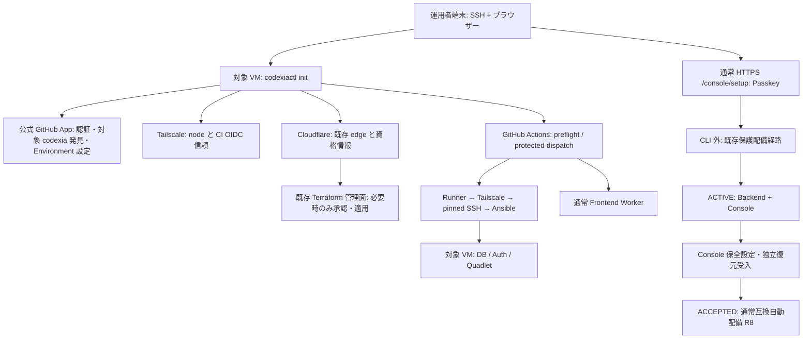

# Codexia 初回配備 CLI（codexiactl）設計

**種別: 正本・規範的設計（normative）。** CLI の責務、操作契約、外部サービス認証、SSH 接続下の操作、配備制御面の登録、初回配備の実行・中断再開および受入条件を定める。実装済み・稼働済みとはみなさない。[Deployment lifecycle](DEPLOYMENT-LIFECYCLE.md) が R0–R8 の経路選択と排他を所有し、[Initial deployment](INITIAL-DEPLOYMENT-FLOW.md)、[IaC](IAC.md)、[Production Bootstrap](PRODUCTION-BOOTSTRAP.md)、[Push deployment](PUSH-DEPLOYMENT.md)、[CI/CD](../verification/CI-CD.md) が配備・認定を所有する。本書はそれらの実装を CLI に移すものではない。

## 1. 採用決定と完了目標

Go 製の独立した一時的なインストーラー `codexiactl` を対象 VM の SSH セッションから起動する。VM の観測、認証の誘導、必要な外部資源の特定、制御面の入力整備、既存保護 Workflow の起動・監視、本人登録の案内を一連の対話として実行する。人間が入力名・ID・Run ID・公開鍵・Token を複数の管理画面の間で転記する運用を通常経路にしない。人間に残す操作は、外部アカウントの認証・委任、権限や対象の選択、明示的な変更承認、Owner の本人 Passkey 登録、必要な独立復旧受入に限定する。外部 API が値の取得を許さない場合の限定的な初期資格情報入力は許容する。

CLI の実行主体は対象 VM に対し独立に認証済みの配備運用者である。CLI は root として常時動作しない。初回管理接続を可能にするための Tailscale 接続・必要な公開鍵登録だけが対象 VM 上の許可された初期準備であり、必要時に限定して sudo を使う。Codexia の host/base/secrets/auth-runtime、DB の初期化、Quadlet、API/Tunnel の構成は従来どおり Runner 上の Ansible に委譲する。Cloudflare IaC は既存 Terraform の管理面で適用する。通常配備は GitHub Actions → Tailscale OIDC → pinned OpenSSH → Ansible → rootless Podman Quadlet の一経路であり、CLI を必要としない。

CLI を常駐 agent、self-hosted runner、独自 scheduler、pull updater、Ansible/Terraform/SSH の代替実装、バックアップ・復元エンジンにしてはならない。第二の API/DB/運用台帳、第二の Bootstrap Workflow、設定同期用 Workflow、独自の認定機構は作らない。CLI による外部入力の登録は既存配備制御面に対する一時的な操作である。通常の Web Console と MCP にこれらの権限を付与しない。

| 実行面 | 所有する責務 |
| --- | --- |
| オペレーター端末 | 最初の SSH 接続と host identity の確認、外部サービスのブラウザー認証・承認、Owner 本人の登録 |
| 対象 VM の CLI | 観測、初期管理接続準備、各サービスの認証・設定、dispatch、結果の照合、再開 |
| GitHub Actions | exact-source 認定、Environment 承認、release/配備制御、R4/R5/R6/R8 |
| Ansible / systemd / Quadlet | VM 構成、秘密生成、DB/Auth、サービス、host lock、トランザクション |
| 既存 Terraform | Cloudflare の DNS、Tunnel ingress、Access、Worker/route の所望状態 |
| PostgreSQL / Better Auth / Web Console | アプリケーション状態、本人登録・認証、稼働後の操作 |
| 独立復旧担当 | 復旧秘密、バックアップ保全と独立復元、既存データ復旧判断 |



## 2. 配布・起動・コマンドの契約

対象は現行 IaC のサポート OS/CPU（Ubuntu 26.04 x86-64）である。署名または認定された provenance と SHA-256 を検証できる immutable な GitHub Release 成果物として Linux 用 Go バイナリを配布する。配布先とバージョンを明示し、未認定 HEAD の実行や curl | shell を通常手順にしない。CLI のリリースは既存 CI の exact-source 契約に従い、初回利用者に Go、Node、Ansible、Terraform のインストールを要求しない。OS の OpenSSH、sudo、Tailscale はそれぞれ公式コンポーネントを利用する。必要な Tailscale の導入はサポート対象 OS の公式署名済みパッケージを用い、導入前に承認する。既存の公式 CLI を補助利用する場合も権限・バージョン・一時設定ディレクトリ・終了時の消去を明記し、未導入なら対応する公式 API または認証ガイドを使う。未確認の OAuth client ID、埋込み client secret、非公開 API は採用しない。

運用者が信頼済みの手段で対象 VM へ SSH し、通常ユーザーとして以下を実行する。CLI の公式配布元は `yohn-jp/codexia` であるが、配備対象は公式 GitHub App の認証後に §4.1 に従って発見する。公式リポジトリと利用者の Fork は同じ経路で扱い、配備先の owner・repository ID・OIDC identity を公式配布元に固定しない。対象は選択された `codexia` リポジトリの保護された `main` と、その exact source の [production.json](../../deploy/production.json) である。利用者に repository 名・ID・任意 URL・設定ファイル・`--repo` 等の追加指定を要求しない。

| コマンド | 入力・動作 | 終了条件 |
| --- | --- | --- |
| `codexiactl init` | 対話 TTY 必須。§3 の順序で現況を観測し、不足分だけ承認の下で整備して初回導入を進める。再実行が再開操作を兼ねる | R5 の登録専用 API と Frontend の稼働、Owner Setup Grant の安全な引き渡しを確認して終了。既存 Owner には再発行しない |
| `codexiactl init --plan` | ローカル読取りと外部読取り・必要な一時認証のみ。GitHub保護、OIDCの不一致、Cloudflare、変更予定・資格不足・利用するWorkflowと承認を提示。秘密値は出さず、独立した読取りは前段の失敗後も継続する | 計画の提示。VM・GitHub・Tailscale・Cloudflare の構成変更や deploy dispatch はしない |
| `codexiactl status [--json]` | 観測済み VM/外部 identity、Environment 設定の存在、最新対象 run、R 状態、ACTIVE/ACCEPTED、通常更新可否を読取り | 観測結果。未観測・不明・到達不能を成功としない |
| `codexiactl doctor [--json]` | 同じ観測を使い、OS/sudo/SSH、Tailnet/ACL、GitHub 権限と認定、Edge、設定欠落を診断。human-readable表示はWorkflowごと最新のRunだけに抑え、全取得履歴はJSON・fail-closed証跡で保持する。保護preflightは既存の読取り専用Workflowを明示承認の下で起動する `init` から利用する | 阻害要因とその修復先、実行に必要な承認。構成変更なし |
| `codexiactl version` / `help` | バージョン・source・仕様と利用法を表示 | 外部接続・認証なし |

`--json` は読取り結果に限定し、スキーマ版、対象、観測時刻、状態、blockers、run IDs、証拠参照を含む。秘密、grant、OAuth code、認証用 URL の query、トークンレスポンスを含めない。機械出力は stdout、診断は stderr。初回対話を stdin から無条件に自動承認する `--yes`、`--force`、任意 command 実行、秘密の command-line 引数、隠れた非対話モードは提供しない。ユーザー中断を除き終了コードは 0（要求した段階の成立）、1（失敗または不明）、2（不足・承認待ちで安全停止）、3（対象/状態の不整合・拒否）とする。中断は 130。ACTIVE と ACCEPTED は結果に必ず区別して表示する。

## 2.1 CLI 自身のリリース・更新ライフサイクル（正本）

公式 CLI の**配布**は本節が所有し、CLI を使う初回 VM 導入・R0–R8 は本書 §3 と [Deployment lifecycle](DEPLOYMENT-LIFECYCLE.md) が所有する。公式 CLI の配布元、公開 GitHub App、公式 Release の認定主体は `yohn-jp/codexia` に固定する。Fork は同じ公式 CLI を取得して使用し、Fork に公式 CLI の自動採番・再公開や別の App の登録を要求しない。公式 CLI 発行専用 Workflow は公式配布元でのみ発行処理を行う。Backend/Frontend の認定・公開・配備は選択された配備リポジトリ自身の既存 Workflow が所有する。CLI のバージョンと Backend/Frontend の配備バージョンを混同しない。Backend は既存 `backend-release.yml` → `backend-deployment-handoff.yml` の自動認定・公開・互換更新経路、Frontend は `frontend-release.yml` を利用する。CTL のタグでは OCI や本番配備を起動しない。CLI は常駐更新器ではなく、既存 VM の自動更新・再起動を行わない。

1. 開発者が `cmd/codexiactl/**`、`scripts/ci/execution/verify-codexiactl.sh`、CLI release component、または `.github/workflows/publish-codexiactl.yml` を変更して PR を main に統合する。対象変更の定義は自動タグ付け Workflow と一致させる。ドキュメントだけの変更はリリースを要求しない。
2. `Verify Codexia` の main push 実行が成功した後、`.github/workflows/codexiactl-auto-release.yml` が成功 run の exact SHA と現行 main HEAD を照合する。失敗した認定、追い越された SHA は発行しない。初回の認定成功では、直前のコミットの変更範囲によらず CLI を一度公開する。比較不能・API 応答不完全なら安全停止する。
3. 既存の `v0.1.x` の最大 patch とそのソース SHA を取得する。以前のタグと現在の認定済み `main` の全差分（第一親の直近1コミットではない）に CLI 関連入力の実変更がある場合のみ `v0.1.(x+1)` を発行する。同一 SHA が既存タグを持つ場合は新しい番号を発行しない。公開完了済みなら no-op、タグ作成後の dispatch 失敗や結果不明なら、後続の無関係な main 更新後も公開未完了の既存タグを再 dispatch して再開する。異なるソースに既存番号を転用しない。タグの再割当て・削除・上書きは禁止。取得したタグの祖先性、競合する書込み、対象範囲が検証できなければ安全停止する。
4. `GITHUB_TOKEN` でタグを作成した後、同じトークンの `workflow_dispatch` でタグ ref を指定し、独立した `Publish CodexiaCTL`（`.github/workflows/publish-codexiactl.yml`）が起動する。exact-source Verify 証明、Linux amd64 CLI ビルド、provenance/attestation、SHA-256 manifest、Release asset の照合を**すべて**維持する。OCI core/full の公開・本番配備は実行しない。自動タグ作成の成功は公開成功を意味しない。
5. 正式公開後に運用者は immutable GitHub Release から `codexiactl-linux-amd64` と `codexiactl-linux-amd64.sha256` を取得し、SHA-256 と GitHub attestation/provenance を照合して通常ユーザーで配置する。初回導入は `version`、`doctor`、`init --plan`、`init` の順。公開元の attestation は `publish-codexiactl.yml` と公式配布元の正しい tag/source を確認する。配備先の認定証跡を公式 CLI の provenance として代用しない。更新時も認定済みバイナリに置き換えるだけで、既存 owner/DB/鍵を再初期化しない。

### 発行用認証と保護

自動タグ作成と後続公開 Workflow の起動には標準 `GITHUB_TOKEN` の `contents: write` と `actions: write` を利用する。GitHub Actions で `GITHUB_TOKEN` により作成されたタグの push は別 Workflow の push trigger を起動しないため、タグ ref を指定した `workflow_dispatch` を明示的に発行する。`CODEXIA_RELEASE_TAG_TOKEN`、発行用の専用 GitHub App、PAT は不要であり、登録してはならない。利用者認証用の公式 Codexia GitHub App はこの発行権限を持つ主体ではない。公開 Workflow は tag ref、remote tag の exact SHA、成功した main Verify を再検証する。

`CODEXIA_RELEASE_IMMUTABILITY_READ_TOKEN` は要求しない。公開結果の Release API 応答で `immutable=true` と asset digest/size を検証し、設定が無効な場合は公開失敗として扱う。管理権限の読み取り専用トークンを新設しない。

**受入:** (a) 初回または最後の CLI タグ以降の変更を含む main の認定成功でタグが一つだけ発行され Release に CLI バイナリと manifest が存在する、(b) 非対象変更・失敗・stale SHA では発行されない、(c) 連続変更で patch が単調増加し、同一SHAの再認定やAPI応答喪失で重複採番せず、必要なら既存タグの公開を再開する、(d) 同時実行・API 障害・資格不足で重複/未認定公開がない、(e) Release の SHA/provenance が元の main SHA と一致し VM 上で `version` が動作する。実際の公開が成功するまでは「自動リリース完了」と判定しない。

## 2.2 ターミナル UX と対話の責務（正本）

CodexiaCTL は SSH の通常端末上で完結する、案内付きの逐次 CLI とする。対話フォームに [Huh v2](https://github.com/charmbracelet/huh)、表示・レイアウトに [Lip Gloss v2](https://github.com/charmbracelet/lipgloss) を採用する。採用版と依存管理は [依存選定規約](../architecture/DEPENDENCY-POLICY.md#codexiactl-terminal-ux) に従う。Bubble Tea は Huh の内部の描画・入力基盤として利用し、別の常駐 TUI、全面画面の独自イベントループ、配備状態機械を作らない。現行の少数のコマンド・フラグには既存 parser を維持し、汎用 CLI framework を導入しない。

対話・表示を一つの operator/presentation 境界に集約する。Huh は観測済みの非秘密候補の選択（§4.1 の複数 repo 等）、通常入力、非保護の確認フォームを所有し、Lip Gloss は工程見出し、選択対象、状態、差分、診断、完了表示を所有する。provider SDK、Workflow 制御、R0–R8 の判定、認可、排他、証跡・入力検証は既存制御面に留め、描画ライブラリの状態を成功・承認・配備結果の根拠にしない。入力の意味検証とエラー処理を表示に移さない。全フォームの正常・異常結果を既存の operator 契約に戻し、独自 UI を各 provider に散在させない。

### 表示とガイド

- §3 の既存 01–10 工程と観測結果を唯一の進捗源とし、doctor・init --plan にも同じ工程見出しを適用する。成功・阻害の表示には明示的な結果ラベルと semantic style を使用し、通常の読み取り・対象確認は既定 Cancel の Huh 選択を使用する。保護書込みの確認と秘密入力は従来経路を維持する。工程番号・名称、現在の作業、完了・待機・不足・失敗・未実行を明記する。成功の観測がない段階を完了色にしない。待機中は対象 run と承認先・待機理由を表示し、計測していない進捗率や完了時刻を表示しない。
- 最初の認証・対象確定後は repository、branch、確認済み VM・origin を表示する。複数候補は Huh の選択メニューで完全修飾 repo 名と識別情報を表示し、選択後も §4.1 の対象確認を省略しない。変更前には対象、意図、差分、影響、必要な権限、任意の Environment 承認設定の有無を示す。
- 診断・失敗は工程と観測した原因、影響、次に必要な具体的操作（設定箇所・公式 URL・不足権限・再実行コマンド・確認済み run link のうち該当するもの）を一緒に示す。既存値や事実が不明なら不明と表示する。一般的な失敗メッセージだけにしない。doctor/status の既存表示内容・JSON schema、最新 run の選択規則、ACTIVE/ACCEPTED の区別を保持する。
- CLI 固有の共有 semantic style を定義する。Codexia の落ち着いた配色と明晰な階層を反映し、端末の明暗・色対応に応じて読みやすいアクセント、本文、補助、警告、エラーを使い分ける。Desktop Web の CSS・テーマ実装の共有は要求しない。状態と選択・フォーカスは色だけに依存させず、文字・記号・明示ラベルでも識別可能にする。狭幅・Unicode 幅・ASCII 端末でも情報を欠落させず折り返す。画面消去や別画面への常時切替を通常表示にせず、SSH の scrollback に非秘密の工程結果・修復案内を残す。

### 端末とセキュリティ境界

SSH 上で独立に開いた controlling TTY (`/dev/tty`) を対話の入出力とする。Huh の input/output はその TTY に明示的に接続し、stdin や stdout の既定値に依存しない。`--json` の stdout は ANSI 制御列・対話・進捗表示・秘密を含まない機械可読出力だけとし、診断は既存 stderr 契約に従う。パイプ・リダイレクトは承認の代わりにならない。TTY が無ければ対話を要求する command は安全停止し、help/version は外部認証なしで実行できる。

秘密入力、Owner Setup Grant の一度限りの表示、provider の認証 code の TTY 限定表示、保護操作の明示承認は既存の安全な operator/TTY 経路を維持する。秘密を Huh の string 値・フォーム履歴・表示 model・clipboard・診断・JSON に渡さない。秘密入力は echo の完全無効化、入力長制限、byte slice の消去、端末設定復元を維持する。外部由来文字列は表示前に端末制御文字・escape sequence の注入を防止する。信頼済みの固定 style が生成する制御列と、外部入力を区別する。

保護操作は確認対象と差分を表示し、既存の明示肯定（既定 No）を取得した時だけ実行する。未選択・空入力・曖昧な入力・EOF・中断・タイムアウト・入力障害を承認に変換しない。GitHub Environment の Required reviewers と Prevent self-review は必須にしない。任意で設定されている場合はその承認を尊重し、端末フォームで代替しない。Huh の選択も正常に明示 submit された観測済み候補だけ受理し、終了時の既定値・未確定値では進めない。中断後に line mode へ切り替えて承認を再取得する等の暗黙の再試行を行わない。

通常の Huh フォームは `RunWithContext` を利用して既存 command の cancellation と結合する。Huh の組込み accessible mode は `Field.RunAccessible` のエラーを破棄する実装で、通常の context-aware 実行経路とも異なるため、配備 CLI では採用しない。`TERM=dumb`、描画非対応端末等では開始前に既存の context-aware な line mode を選択する。これは同じ意味契約の表示・入力方式であり、第二の配備経路ではない。`NO_COLOR` が設定された環境では色を出さず、非対話出力に cursor 操作を出さない。全 mode で正常終了、拒否、Ctrl+C、SIGTERM、SIGHUP、SSH 切断、エラーの terminal mode・cursor 復元と §2 の終了コードを維持する。端末復元のために provider operation や workflow dispatch を再実行しない。

進捗表示は既存 context と実際の待機・観測処理に従属させる。spinner 等を利用しても、表示側が副作用を実行する第二の worker や同一処理の並列 retry を作らず、待機終了・中断・エラー時は停止する。秘密入力・承認中に別描画処理が同じ TTY を読み書きしない。

## 3. init の順序と状態遷移

操作の前に read-only で対象を確定し、外部変更の直前に意図・対象・差分を提示する。安全に並列できる読取り以外は次の順序を守る。step の成功をログの文字列や Workflow 全体の緑色から推定しない。CLI 内の step は配備 R 経路の第二定義ではなく、その入力準備と既存 operation の呼出しである。

| 順番 | 操作と入力 | 成功・次への条件 |
| --- | --- | --- |
| 01 VM | 現在の SSH ユーザー、OS、CPU、時刻、sudo、既存 sshd の有効設定・公開 host key、既存 Tailscale 状態、既存 Codexia 資源の非破壊観測 | 対象 VM の同一性が確認でき、独立に認証した管理経路が残る。root・service account を bootstrap 管理者にしない |
| 02 GitHub | §4.1 の Device Flow、公式 App installation とユーザーの権限の共通部分から `codexia` を発見し確認、owner/repo ID、main SHA、既存 Environment/protection、Variables/Secrets の名前、workflow と正本を取得 | 一意に承認された対象に固定。必要な権限・保護・現行 CLI 対応契約が成立。他の repo の入力・証跡を利用しない |
| 03 Tailscale | §4.2 の node 接続、Tailnet 管理認証、既存 node ID、対象アドレス、WIF client ID/audience、CI tag、policy の検査 | 期待する Tailnet と node、CI の到達許可、既存 OIDC 信頼を確認。不足だけ承認して準備 |
| 04 Cloudflare | §4.3 の認証、production origin に対応する account/zone、Tunnel、Access apps/policies、Worker/routes の読取り。既存設定に対応する資格情報を確認・準備 | origin/route/identity の唯一の一致、正常な setup-only 経路の前提。変更は既存 Terraform の承認済み適用後の再観測 |
| 05 制御面登録 | §5 の差分を提示。bootstrap 管理鍵と runtime 鍵を分離し、必要な公開鍵・pin・外部資格情報・Environment 入力を登録 | GitHub の登録結果、公開鍵の対応、protection、既存設定の非破壊を確認。Secrets の存在は実接続の代用にしない |
| 06 管理接続 / 候補認定 | Protected production bootstrap の `mode=preflight` を dispatch。main の認定済み Full Backend と互換 Frontend を既存証拠から選択可能であることを確認 | 管理 SSH / sudo / host pin の実証、認定 source・artifact が確定。欠落時は正規 CI を待つか認定を起動し、公開・証明を自作しない |
| 07 R4 | fresh lifecycle Preflight（install, bootstrap）。対象と DB 意図を承認し、必要な場合のみ独立した DB 初期化承認を取得。既存 Bootstrap に Plan ID を渡す | R4 の実ジョブ成功、runtime SSH、DB/Auth の同一性を再観測 |
| 08 R5 Frontend | fresh lifecycle Preflight（install, runtime）。既存 Frontend の初回公開を dispatch | 通常 Worker で認定 Frontend identity を確認 |
| 09 R5 owner-setup | §4.4 の配送用公開鍵を確定。fresh lifecycle Preflight（install, bootstrap）。setup-only 起動と一回限り grant 発行を dispatch | 同一 origin、登録時の edge 保護、業務 API 拒否、暗号化 handoff を確認 |
| 10 引き渡し・終了 | 通常端末のブラウザーで /console/setup を開く案内を表示し、一時認証を片付ける | 登録可能な状態を確認して終了。本人登録を待機しない |

以降の Owner 登録、R5 prepare-activation、R6 は CLI の実行範囲外であり、既存の保護配備経路が所有する。Owner 未登録のまま通常 Backend を起動してはならない。

R0（不明・不一致）、R1/R3（中断・復旧）、R2（restore）、R8（互換更新）は lifecycle の判定を尊重する。CLI は既存 DB の採用/削除や復元を新規 install と推定しない。既存データ・不明な host/DB/owner/transaction があれば該当保護経路への案内と証拠提示で停止する。新 VM への交換でも独立復旧受入の代わりに新規 Owner を発行しない。バックアップの実装変更を CLI の初回稼働条件にしない。

## 4. SSH ヘッドレス認証とブラウザー誘導

### 4.0 共通契約

Device Authorization Grant では CLI が VM から HTTPS で code を要求し、運用者が手元端末のブラウザーで provider の verification URL と短い user code を使って本人認証する。CLI は interval/slow_down/expiry/denial を守って token endpoint を poll する。**Device Flow には SSH ポート転送も VM 上のブラウザーも不要である。** ブラウザーを開けない VM で xdg-open 等の成功を要求しない。認証先の公式ドメイン、対象アカウント、意図する権限、期限を表示し、利用者の明示的な確認後に開始する。device_code、access/refresh token を表示・保存しない。短い user code の表示は当該 TTY のみに限定し、構造化ログには残さない。

公式実装が Authorization Code + PKCE の loopback callback を要求する場合のみ、SSH local forwarding を案内する。VM の callback server は 127.0.0.1 上の provider が許す単一ポートだけで待受け、端末側も 127.0.0.1 に限定する。CLI は実際のポートと既に認証済みの SSH 接続先を表示する。利用者が既存の SSH セッションから制御できない場合は、手元端末の別ターミナルで次を実行する（例の 8976 は Wrangler の既定 callback。実際のアダプターが表示するポートを使う）。

```sh
# 手元端末で実行する。対象 VM 上では実行しない。
ssh -N -o ExitOnForwardFailure=yes -o StrictHostKeyChecking=yes \
  -L 127.0.0.1:8976:127.0.0.1:8976 <verified-admin>@<verified-host>
```

最初の SSH が独立に host key pin を検証済みであることを要求し、別セッションも同じ pin/SSH config を使う。remote CLI が端末側の SSH forwarding を勝手に設定できるとは仮定しない。事前確保されたポート競合、転送禁止、接続失敗、callback 不一致は診断して安全停止または公式 Device Flow へ切り替える。PKCE/state/redirect URI の一致、コードの一回性、期限、callback の送信元・path を検証する。0.0.0.0 での待受け、公開 Cloudflare Tunnel/Funnel、SSH agent forwarding、SSH の host verification 無効化、URL からのコード手動抽出は通常手段としない。認証完了/失敗/中断で callback listener を閉じ、CLI が開いたものだけ閉じる。端末で利用者が起動した転送は終了コマンドを案内する。ブラウザー認証後の Owner 登録は本番 HTTPS origin で実施し、OAuth 用 SSH 転送を使わない。

### 4.1 GitHub（公式 App による認証・配備対象の発見）

配布元が事前登録した **一つの公開 Codexia GitHub App** を公式の利用者認証入口とする。第三者の個人アカウント・Organization にインストールできる Public App とし、Device Flow と有効期限付き user access token を有効にする。利用者は GitHub の公式 App インストール画面で `Only select repositories` を選び、自身の `codexia`（公式リポジトリまたは Fork 等）に委任する。App の公開 Client ID は公式配布元の Repository Variable `CODEXIACTL_GITHUB_APP_CLIENT_ID` から既存の公式 Release ビルドに束縛して埋め込む。これは秘密ではない。App private key/client secret、installation access token、PAT を CLI・Git・GitHub Actions の Secret に配布しない。公式 CLI は Device Flow の user access token を当該対話セッション内だけで使う。App が未準備、Client ID が未設定、認証が拒否・失効した場合は設定者・公式画面・不足条件を示して安全停止する。この対象発見契約では旧 fine-grained PAT 経路を廃止し、PAT・任意の OAuth App・手入力した repository で App の委任を迂回しない。公式 App の登録と権限付与は公式配布元の管理者が行い、利用者ごとに App を作成させない。

#### 対象発見と確認

ローカルの VM 観測後、同じ公式 Device Flow で `init`、`init --plan`、`doctor`、`status` の対象を発見する。GitHub の認証済みユーザーと公式 App の user token を確認し、`GET /user/installations` と `GET /user/installations/{installation_id}/repositories` の全ページを取得する。App がアクセスできる全 repo ではなく、認証済みユーザーと App の両方がアクセスできる repo だけが対象である。停止中の installation、対象の委任・権限を実証できない repo、archived/disabled repo、名前が `codexia` でない repo は配備対象にしない。App のインストールは対象 repo に限定する方針を維持し、all-repositories の一括委任は対象選択の代わりとしない。候補の判定に公式 owner 名・既知の repository ID・`fork` フラグ・親 repo の固定値は使わない。リポジトリ名は候補のフィルターであって、配備の認可・契約適合を証明するものではない。

| 候補 | 対話と次への条件 |
| --- | --- |
| 0 件 | 公式 App を対象 `codexia` にインストールし、認証したユーザーへ必要な権限を付与する手順・URLを示す。再観測するまで配備を開始しない。公式 repo に暗黙でフォールバックしない |
| 1 件 | `owner/codexia`、owner/repository の数値 ID、installation、ユーザー、`main`、公開 origin、対象 VM を確認できる順に表示し、対象を明示確認する。無条件で書き込まない |
| 複数件 | 重複を repository ID で排除し、完全修飾名と ID による一覧から対象を選択させる。入力は観測済み候補の選択に限定する。選択取消・一覧不完全・不明確な ID は安全停止 |
| 再実行 | 同じ VM の既存 checkpoint の repository ID を再観測した候補と照合する。対象が消失、権限剥奪、所有者移転、改名、別 ID、候補の曖昧さがある場合は安全停止。既存 DB/設定/秘密/未解決 run を別 repo に自動移管しない |

選択された一つの配備対象を、GitHub API が返す canonical owner/name、owner ID、repository ID、installation ID と保護された default branch `main` の組として扱う。認証・対象確認後に一つの不変の対象コンテキストとして CLI の全制御面に渡す。公式配布元自身を選んだ場合も例外分岐を設けない。名前だけで同一性を判定せず、変更直前の再観測で repo/owner/installation・権限・main SHA・protection を照合する。再開には既存の非秘密 checkpoint を利用し、read-only command はその保存・変更を行わない。別 repo の URL、Environment、run、artifact、secret、OIDC credential を同じ名前であることを理由に採用しない。

#### 権限・配備契約と認定の分離

必要権限は repository の Metadata/Contents read、Actions read/write（dispatch・run 照合）、Environments read/write（環境 Variables/Secrets）、必要な場合のみ Administration write（Environment の新規作成・保護設定）。公開候補の証拠の読取りに必要な追加 read 権限は公式 endpoint 要件に従って明示する。user の権限と App の権限の積を実 API で検査し、対象 repo の必要操作が認可されなければ安全停止する。Environment の保護ルールを書き換えて承認を迂回しない。既存同等の保護設定が不足する場合は別の明示承認が必要であり、設定不能な plan では停止する。

公式 CLI の release source と配備対象の main source は別の識別子である。公式バイナリは公式配布元の immutable Release と attestation により検証する。配備対象については、選択した repo の保護 main の exact SHA で、CLI が呼ぶ既存 Workflow・dispatch inputs・保護条件・証跡/構成 schema・route/identity/protocol の契約が公式 CLI Release の対応契約と一致することを検証する。従来の source/契約照合を維持し、契約上許容された配備固有の公開値（選択 repo の `deploy/production.json` 等）だけを区別して扱う。公式 repo と Fork の main SHA が同一である必要はない。Fork が自ら出す Verify 成功だけで未知・非互換の CLI 制御契約を受理しない。契約比較不能・不適合の場合は対応する公式 CLI Release または対応契約へ更新するよう案内し、書込み前に停止する。

公開 origin 等の配備固有値は選択 repo の認定 source の既存公開設定から取得して検証し、同じ値を build・配備・probes・Terraform 管理資源・Owner 認証に結合する。公式 origin や Cloudflare account/zone、Tailscale client ID を他の repo に引き継がない。対象固有値を CLI の別設定に複製しない。

対象の repo/owner ID と exact SHA は既存の認定・公開・配備全体の共通境界とする。Workflow の同一 repo/main 判定、API URL、run/job/attempt/artifact/attestation、GHCR namespace/digest、release、certificate、Ansible に渡す証拠、復旧・再開の binding には、選択 repo または実行時に検証した同じ GitHub repository context を使用する。公式リポジトリの固定 owner/ID、公式の product image、公式 origin、他 repo の成功 run を Fork の認定・配備対象に代用しない。公式の CLI 配布・開発者向け公開物など本来 upstream が所有する入口は配備入口と分離する。既存の exact-source certification、Environment/main 保護、OIDC/SSH pin、操作ごとの明示承認、host lock、R0–R8 の経路判定を弱めず、公式と Fork の二重実装、別 Workflow、別配備 controller、認定機構の追加を行わない。

GitHub REST API から選択 repo の identity、default/main、Environment と保護、branch restriction、Variables、Secret の名前と更新時刻を列挙する。Secret の値は取得できない。GitHub の Environment public key で Libsodium 互換 sealed box を使い値を暗号化して登録する。GitHub token の権限不足や App 未承認を private credential のログ出力で解決しない。GitHub の管理 token は VM サービスや Actions の Secret に格納しない。Workflow は公式 dispatch API の run ID 応答を利用し、その ID の job/attempt/artifact を選択 repo に結びつけて照合する。既存版 API が ID を返さない場合は同じ操作の run を一意に同定できるまで読取りのみとし、時刻の近い別 run を採用しない。

### 4.2 Tailscale（node 認証と管理 API 認証は別）

`tailscale status --json` と公式 CLI で既存 node の状態、Tailnet、node ID、アドレス、承認状態を確認する。すでに正しい Tailnet に接続していれば再ログイン・タグ付替えを行わない。未接続時は公式 `tailscale up` のブラウザー認証 URL を運用者に提示し、必要な device approval を待つ。既存 SSH 接続を失う変更、DNS/route/exit node のリセット、Tailscale SSH への変更を暗黙に行わない。Codexia は従来の OpenSSH over Tailscale を使用する。node のログインは Tailnet 管理 API の認証ではない。

管理 API は既存の scoped trust credential または運用者が公式 admin console で取得した期限付き API access token を非表示入力で受け取る。管理 API 用の汎用 CLI Device Flow が使えるとは仮定しない。CLI は管理 API 認証と対象 VM の Tailscale node 認証を区別し、目的と権限を入力前に表示する。read-only の `doctor` と `init --plan` は node/keys/policy を読み取り、既存の federated identity の issuer（GitHub Actions）、audience、immutable repository subject、workflow/main/Environment claims、`auth_keys` だけの scope、`tag:ci` を個別に照合し、不一致の設定名と必要な値を表示する。GitHub immutable OIDC subject は §4.1 の実際の対象 identity から `repo:OWNER@OWNER-ID/codexia@REPOSITORY-ID:environment:codexia-*` を導出し、`ref=refs/heads/main` と `workflow_ref=OWNER/codexia/.github/workflows/*@refs/heads/main` で限定する。`OWNER` 等は GitHub API により確認された値であり手入力・公式 owner/ID 固定ではない。対象 repo の immutable subject 形式が有効であることを照合し、旧形式・非互換のカスタム subject では GitHub の公式 OIDC 設定で対応形式を有効化する案内を出して停止する。異なる repo/owner ID に対する WIF は許可しない。現行の `codexia-production` だけに限定した既存 Credential や `all` scope は自動許可せず、既存 Credential の変更・削除もしない。

既存の適合 WIF がない場合、`init` のみが設定内容を表示して別承認を求め、`federated_keys (write)` のある一時管理 API token を使って最小権限の新規 Federated Identity を作成し、再取得して完全一致を検証できる。書込み失敗または API 応答喪失時は再観測してから判断し、既存設定を修正・削除・無断再作成しない。通常 CI は WIF の短命な ephemeral node を使用し、管理 API token や長命 auth key を Actions に渡さない。Workflow の audience は同じ保護 Environment の公開 `vars.TS_OAUTH_CLIENT_ID` から `api.tailscale.com/<client-id>` を導出し、固定IDにはしない。新しい導入ではCLIがこの公開Client IDを両EnvironmentのVariableとして登録する。既存の `secrets.TS_OAUTH_CLIENT_ID` は、移行前の本番Workflowを壊さないためにVariable未登録の場合だけフォールバックとして利用し、CLIは読み取れないSecretの既存値を推測・上書きしない。新VariableとOIDC信頼が実動作で検証できた後に、既存Secretの廃止を別途明示承認する。policy の変更は既存 policy 管理権限に従い、必要な node/tag への TCP/22 のみ許可する。共有 Tailnet の ACL 全体の置換、既存タグへの広範な権限追加、SSH の公開はしない。GitHub の保護 runner から実接続して初めて CI 到達性を確認する。

### 4.3 Cloudflare（管理認証、配備用資格、製品 Access を分離）

Cloudflare の自己管理 OAuth Client は Authorization Code + PKCE（S256、公開 client、client secret なし）を使う。公式配布元が登録した公開 Client ID を公式 Release の任意の Repository Variable `CODEXIACTL_CLOUDFLARE_OAUTH_CLIENT_ID` からビルドへ束縛し、未設定の場合は Token template に案内する。第三者利用には Cloudflare の public visibility と publisher domain verification が必要である。登録する callback は `http://127.0.0.1:18765/callback` のみとし、§4.0 の SSH local forwarding を利用する。自己管理 client に Device Flow があるとは仮定しない。doctor / init --plan、および必要な配備資格が登録済みの init では公式 OAuth が設定済みの場合にブラウザー認証を選択でき、state / PKCE を検証し、取得した access token は当該観測にだけ使用して終了時に revoke を試行する。必要 scope は `zone.read dns.read workers-routes.read argotunnel.read access.read access-service-token.read workers-scripts.read`。登録、実 callback と scope の実サービス受入は別途確認する。

初回の配備資格の発行・ポリシー照合には Account API Token の Verify / Details / Permission Groups API が必要である。OAuth では同等の管理 API がすべて使えることを確認できていないため、不足資格の発行・取得が必要な init は当面、短命の management token を使用する。公式 [API token template URL](https://developers.cloudflare.com/fundamentals/api/how-to/account-owned-token-template/) を生成して文書化済みの短い permission key を prefill し、対象 account / zone、有効期限、未 prefill の Tunnel / Access service token 権限を利用者が確認・選択する。未確認の permission key や ID を推測しない。既存 Environment の Secret inventory に基づき、read-only template は読み取りだけ、必要な配備資格の peer-copy 時は Account API Tokens Read、両方に存在しない配備用 API token の発行時だけ Account API Tokens Edit、既存 Tunnel token の取得が必要なときだけ Tunnel Edit を要求する。同一ユーザーの既存 user-owned token の metadata には同じユーザーの API Tokens Read が必要であり、user token の代替入力も維持する。Token template の画面設定は実 API の target / scope 照合の代わりにしない。既存資格の取得・発行権限・ポリシーの検証契約を維持する。OAuth 非対応や未登録時の fallback は同じ一時 Token 経路とし、Node / Wrangler の恒久導入や OAuth token の CI 登録を要求しない。

production origin を基に account/zone、DNS record、remote-managed Tunnel ID と ingress、Access author/CI policy、Worker/routes を公式 API で検出する。複数候補、未知の origin、Terraform 管理の drift、他の connector/writer が稼働中なら停止。Cloudflare IaC による修正が必要なら既存 Terraform workspace/state と認証・承認経路へ誘導し、承認済み plan/apply の結果を再取得する。CLI は Terraform を VM 上で起動しない。Terraform 管理資源を Cloudflare API で別に作成/更新しない。既存 Access CI policy にサービス Token を結び付ける場合もその policy の所有経路を尊重する。

既存の Tunnel token は該当 Tunnel の公式 API から取得できる場合のみ取得する。既存稼働 connector の token を無断 rotation しない。Access service token の client secret は作成時のみ取得可能である。既存の有効な Secret は継続利用し、別 Environment に必要な秘密が復元できないときは、既存の正当な保管元から取得するか、明示承認の下で scoped 新規 token を作成し、CI policy への限定許可・実疎通確認後に旧 token を必要時のみ廃止する。既存有効資格の破壊・全体権限の拡張はしない。Worker publication token、deployment read token、Access client ID/secret、Tunnel token の用途は分離する。API token を自動発行する場合は API Tokens Write または Account API Tokens Write 等の必要な発行権限と具体的な account/zone scope を実 API で確認し、ない場合は一度だけ本人に発行を案内する。長命で広範な管理 token は GitHub/VM に残さない。Cloudflare Access の本人ブラウザー認証は別途 Owner が行う。

### 4.4 Owner Passkey と暗号化 handoff

R5 の既存 owner-setup grant と age 暗号化 handoff を利用し、CLI は grant を生成する第二経路を作らない。Owner の本人登録を代行しない。既存 Owner がいないことを lifecycle の観測で確認する。

原則として Owner の公開 age recipient を独立に確認して登録し、暗号化 handoff を信頼済み SSH セッションで Owner に配送する。Owner と配備運用者が同一で対象 VM を信頼することを明示確認した場合に限り、CLI は Go の age ライブラリで一時配送用鍵を当該プロセスに生成し、公開 recipient のみを GitHub に登録できる。秘密鍵はプロセス外・GitHub・ログ・artifact・恒久ファイルに出さない。R5 が成功した後、現行の service-owned `~/.local/state/codexia-deploy/owner-setup.age` を最小限の権限で読取り、既存の envelope の recipient と origin を検証して復号する。Owner が信頼済みのブラウザーに貼り付ける一度の TTY 表示以外に grant を出さない。URL query、shell history、clipboard 自動転送、CI 出力は禁止する。Owner が別人の場合は Owner の端末で復号し、CLI は暗号文のみを安全な既存配送経路で渡す。

一時鍵の喪失・grant 期限切れ・中断は、Owner 未登録を再確認して現行の承認済み reissue を使う。既存有効 grant の無断破棄・再発行を禁止する。独立 Owner recipient を利用すれば中断後も既存暗号文を復号できる。本人 Passkey 登録後の grant 無効化と clients の確定は既存認証・保護配備経路の責務であり、CLI は待機・確認しない。WebAuthn RP ID は通常 production origin のままであり、localhost や SSH callback を登録 origin に使わない。

## 5. 入力の整備と GitHub Environment

選択した repo の既存 `codexia-bootstrap` と `codexia-production` を使う。他 repo の Environment は参照・変更しない。以下は現行 Workflow の入力名を保つ登録契約である。共通値は同一の検証済み source から CLI が必要な保護 Environment に投影し、利用者による重複転記を廃止する。登録済み値を一律上書きしない。Secrets を repo-wide に昇格して権限を広げない。将来 Workflow が共通入力を一つの保護面で消費できるように変更するなら、不要になった入力は同じ変更で撤去する。設定同期スクリプトを新設しない。

| 正本・取得方法 | 既存 Variable / Secret 名 | 登録先・注意 |
| --- | --- | --- |
| 確認済み VM Tailnet address、OpenSSH host key pin | V: CODEXIA_BOOTSTRAP_HOST / CODEXIA_DEPLOY_HOST、CODEXIA_BOOTSTRAP_SSH_KNOWN_HOSTS / CODEXIA_DEPLOY_SSH_KNOWN_HOSTS | bootstrap / production の各対応名。同一 VM を指す。同じ公開 pin を検証して投影 |
| 独立した sudo 管理者 | V: CODEXIA_BOOTSTRAP_SSH_USER | bootstrap のみ。対象 UID、sudo -n、既存 SSH 接続を検証 |
| bootstrap SSH Ed25519 identity | S: CODEXIA_BOOTSTRAP_SSH_PRIVATE_KEY | bootstrap のみ |
| runtime SSH Ed25519 identity | S: CODEXIA_DEPLOY_SSH_PRIVATE_KEY | production のみ。R4 の既存 runtime identity stage が公開鍵を対象 service account に登録 |
| Tailscale WIF | V: TS_OAUTH_CLIENT_ID（公開Client ID） | 両保護 EnvironmentのVariableとして同じScoped WIF Client IDを登録。旧 `secrets.TS_OAUTH_CLIENT_ID` はVariable未登録のWorkflowのみ互換フォールバック。audienceはそのClient IDから導出し、secret値の無断上書きや固定IDによる拘束をしない |
| Cloudflare account/zone/tunnel/policy IDs、teamName、public protocol 状態 | V: CODEXIA_DEPLOYMENT_CLOUDFLARE_TARGET | 両保護 Environment。公式観測から生成。Git の公開設定と照合 |
| 限定 Cloudflare read credential | S: CODEXIA_DEPLOYMENT_CLOUDFLARE_READ_TOKEN | 両保護 Environment |
| CI Access probe identity | S: CODEXIA_ACCESS_CLIENT_ID / CODEXIA_ACCESS_CLIENT_SECRET | 両保護 Environment。author 権限を与えない |
| 該当 remote-managed Tunnel | S: CODEXIA_TUNNEL_TOKEN | bootstrap のみ |
| Worker publication の限定資格 | S: CLOUDFLARE_API_TOKEN / CLOUDFLARE_ACCOUNT_ID（現行入力名） | production のみ。read token と分離 |
| Owner 確認済み公開 recipient | V: CODEXIA_OWNER_SETUP_AGE_RECIPIENT | bootstrap のみ。R5 配送時に設定 |
| 初回 operation 承認 | V: CODEXIA_BOOTSTRAP_ENABLED、CODEXIA_DATABASE_INITIALIZATION_APPROVED | bootstrap のみ。§6 の承認と範囲・時点を照合して設定 |
| CLI 外の R6 operation 承認 | V: CODEXIA_INITIAL_INSTALL_APPROVED、CODEXIA_DATABASE_INITIALIZATION_APPROVED、CODEXIA_PUSH_DEPLOYMENT_ENABLED | production のみ。CLI は設定せず、既存保護配備経路が管理する |

V=Variable、S=Secret。現行 `CODEXIA_DEPLOYMENT_PRESERVATION` は既存データの保全/復旧経路で必要となる個別保護入力であり、純新規 install の必須入力ではない。DB admin/app/auth passwords、Better Auth secret、introspection secret 等は既存 R4 の VM 上の生成・保管に委譲する。S3/復号鍵・バックアップ executor 資格は CLI の登録入力に含めない。

SSH host pin は既に独立認証された SSH 接続または provider console の証拠と、VM 上で取得する sshd の実効 host public key を照合する。ssh-keyscan だけで信頼を確立しない。CLI は bootstrap 管理者専用鍵と runtime 鍵を別々に扱う。既存 Secret がある場合は実接続を試し、有効なら継続利用する。新規鍵が必要なときだけ CSPRNG で生成し、適切な key type/format を既存 Workflow と照合する。bootstrap 管理者の authorized_keys には対象公開鍵のみを冪等に追加し、既存内容・permissions を保存する。runtime 公開鍵の配置は R4 に委譲する。private key は GitHub の対象 Environment public key で暗号化して送信し、ローカルの平文一時ファイルを原則として作らない。SSH 鍵を GitHub ユーザーアカウントのログイン鍵や repository deploy key として登録しない。

## 6. Workflow dispatch・承認・再開契約

初回はすべて選択 repo の `ref=main`。起動前に選択済み repository identity・App/user 権限・現行 main と承認対象 SHA が一致することを検査し、返った run の repository/head repository ID、head_sha、event、workflow path、attempt、必要な job/receipt/certified pair を同じ対象に照合する。動的な Run ID は CLI が扱い、ユーザーにはレビュー用のリンクと要約を表示する。新たな状態変更または main の変化・rerun の後は新しい lifecycle preflight を生成し、古い証拠を流用しない。

| operation | dispatch workflow file | inputs（固定名） |
| --- | --- | --- |
| 管理接続確認 | production-bootstrap.yml | mode=preflight |
| 状態・候補観測 | production-preflight.yml | mode=lifecycle, intent=install, management=bootstrap または runtime。R6 は window_start/window_end（UTC ISO 8601） |
| R4 | production-bootstrap.yml | mode=bootstrap, preflight_run_id, approval_phrase=BOOTSTRAP_CODEXIA, initialize_database=承認済みの真の DB 不在の場合のみ true |
| R5 Frontend | frontend-release.yml | preflight_run_id, approval_phrase=PUBLISH_INITIAL_FRONTEND |
| R5 grant | production-bootstrap.yml | mode=owner-setup, preflight_run_id, approval_phrase=OWNER_SETUP_CODEXIA |

各 protected operation の内容・状態・計画の run link・candidate・対象・承認範囲を提示し、運用者の承認なしに approval phrase や gate を送らない。人間に固定文字列を転記させる必要はない。CLI が正規の承認 phrase を送る条件はその operation の明示承認である。Environment の Required reviewers と Prevent self-review は任意とし、単独運用を許可する。任意の reviewer が設定されている場合だけ GitHub の既存画面に案内して待機し、CLI は pending approval の自動承認 API を呼ばない。preflight のみでは書込み承認にならない。DB 初期化の承認を既存データの破棄承認と混同しない。時刻枠は運用者が選択・承認した UTC start/end として明示し、CLI は無期限の window を設定しない。

HTTP 200/202、dispatch 成功、Workflow conclusion=success だけを配備成功としない。期待する実ジョブが skipped の場合は未実行と表示し、ライフサイクル状態と証拠を照合する。workflow/run/attempt の不一致、gate の期限切れ、取消し、失敗、候補変更時は停止して原因・リンクを提示する。read-only API poll は timeout・rate limit・retry-after・backoff を守る。作成・dispatch の応答喪失は当該 operation の照合を先に行い、自動再送しない。秘密の作成結果を失った場合も他 token を無制限に作らない。

同時に複数の init が同一 VM を操作しないよう、ユーザー/対象単位のローカル排他を使い、実配備の排他は既存 Workflow queue と host lock に委譲する。再実行は外部実状態を正本として再観測する。VM 上に任意の非秘密 checkpoint（mode 0600、親 0700、atomic replace）を持てるが、それは repo ID、target fingerprint、main SHA、operation/run ID、作成済み resource ID、変更した gate の元値等の照合用に限定する。独立した DB や永続デーモンを設けない。checkpoint が無い・壊れた場合は再観測し、未知状態を fresh install と判断しない。異なる VM や repo の checkpoint を受理しない。

## 7. 完了条件・継続配備・資格の片付け

CLI の初回実行は通常 Frontend、登録専用 API、業務 API の拒否、Owner Setup Grant の安全な引き渡しを確認して終了する。ACTIVE とは報告しない。本人登録・ログインは通常端末のブラウザーで行い、以後の保護配備は CLI に依存しない。

CLI 外の既存保護配備経路は R6 後、初回用 gate を解除し、必要なら GitHub の既存通常配備設定を安全側に戻す。R6 中だけ必要となる CODEXIA_PUSH_DEPLOYMENT_ENABLED は明示承認の作業枠内で扱う。通常 R8 に必要な保全・独立復元の受入を満たさない限り、初回終了後の通常 push は有効にしない。中断時は変更した gate と run の現在状態を再観測し、安全に停止させるか未解決として報告する。既存の正当に稼働中の production 設定を無断で無効化しない。常設 R8 は [Update flow](UPDATE-FLOW.md) と [Backup](BACKUP.md) の受入を証拠で確認した後の別途明示承認で有効にする。再度 init を起動した場合、既存 Owner や ACTIVE/ACCEPTED を観測したら変更せず既存運用経路を案内する。CLI は R8 の自動実行に関与しない。

provider 管理 token、device code、refresh token、age 一時鍵、生成中の private key は一時認証のためだけに使う。CLI 内の保持を最短化し、永続ファイルや command line、stdout/stderr の診断、JSON、shell history、CI artifacts、git に流さない。必要な公式 CLI の一時認証ディレクトリを隔離して権限を制限し、終了/中断時に CLI が生成したものを消去する。管理認証は可能な場合に失効またはログアウトし、既存利用者の認証・通常配備用資格・VM 内部秘密を削除しない。初回の独立管理者 SSH key は一時 bootstrap 権限として扱い、R6 成功後に bootstrap 無効化と、当該 CLI が作成した鍵の安全な撤去/再利用方針を運用者に提示する。復旧時に必要な独立管理経路を失わない。初回専用 Secret の廃止は明示承認と実接続確認後に限る。

## 8. 実装境界と受入

Go の標準 crypto/net/http、維持されている GitHub/Tailscale/Cloudflare 公式または成熟 SDK、Libsodium 互換 sealed box、age の既存実装を使う。CLI parser 等も [依存選定方針](../architecture/DEPENDENCY-POLICY.md) に従う。protocol、暗号、SSH、IaC、DB/Backup を再実装しない。依存の採用・固定バージョンは実装 PR で公式機能と検証を示し register を更新する。CLI に必要な公開認証 app の準備・配布・認定を実装受入に含める。新規の helper script、常駐 service、別 Workflow を追加して既存の手動運用を温存することを完成としない。既存 Workflow の個別操作を独立復旧/診断のために維持し、正常初回導入で要求していた管理画面転記や別々の手動 dispatch を CLI 経由に置き換える。

以下を独立した隔離アカウント/VM と、承認済みの実 production acceptance で実証する。模擬 HTTP のみを実サービス適合の証明にしない。

| ID | 必須証明 |
| --- | --- |
| CLI-01 | 認定バイナリを SSH のみの新規 VM で取得・実行。Go/Node/Ansible/Terraform を VM に要求せず、既存 SSH を失わない |
| CLI-02 | GitHub Device Flow、Tailscale node 認証と管理 API 認証、Cloudflare Device Flow または必要 scope の認証ガイドを実証。拒否・期限・slow_down・権限不足・誤 account を安全停止。Device Flow で転送不要、loopback 型のみ local forwarding、port conflict と転送禁止、state 不一致を検証 |
| CLI-03 | 既存 production の値を維持し、不足 bootstrap 入力を整備。Secrets 読み出し不可、鍵分離、pin、既存 Token の保持、保護 Environment、provider token の分離、実 runner SSH/probe を確認 |
| CLI-04 | 新規 install で 06–09 の既存 Workflow を順番に起動し、毎回 fresh preflight と同じ source/実ジョブを照合。Grant 引き渡しで終了し、Owner 登録を待たず、R6 を起動しない。skipped / stale main / denied approvals を成功にしない |
| CLI-05 | R4/R5 の各境界で切断/中断/応答喪失から再開。既存 owner/DB/有効鍵/資格を再生成しない。二重 dispatch、別 VM、未知 DB、既存 writer、失われた age handoff を安全に処理 |
| CLI-06 | CLI 終了後に管理 token/一時鍵が残らず、通常配備が CLI 非依存。保全未受入で R8 が停止し、独立受入後は既存の compatible update が実際に成功 |
| CLI-07 | plan/status/doctor は構成を変更せず、JSON/log に秘密がない。失敗した実ステップ・不足する権限・対象 run を表示し、不明状態を成功としない |
| CLI-08 | リポジトリと運用入口を照合し、CLI と重複する設定同期・手作業だけの通常経路を除去。Ansible/Terraform/Actions/認定/復旧の正本が二重化されていない |
| CLI-09 | 同じ公式バイナリと公式 App で公式 repo および他の個人/Organization の `codexia` を検出し、対象を選択して初回導入を完走する。0/1/複数候補、全ページ取得、取消・停止中 installation・非対象名・権限不足・未設定 App・別 repo checkpoint・別 repo からの証跡を検証。PAT や任意 URL での迂回は不可 |
| CLI-10 | 配備対象ごとに owner/repo ID、OIDC Subject/claims、Environment、公開 origin、証跡と product image を一貫して分離。異なる SHA でも対応契約の Fork を許可し、不適合契約・旧 OIDC 形式・古い証拠・改名/移転・別 repo への書込みは拒否する。公式 CLI の配布主体と対象 repo の product publication を分離し、Fork で公式 CLI の自動発行を行わない。実 GitHub App/隔離 Fork/VM での受入と既存公式 repo の回帰確認は模擬 API/CI と区別する |
| CLI-11 | §2.2 の対話・表示契約を Huh/Lip Gloss の実ビルドと隔離した PTY/SSH で実証する。40/80 桁等の狭幅と resize、明暗・NO_COLOR・TERM=dumb/line mode、候補選択/取消/EOF/不正入力、既定 No、Ctrl+C/SIGTERM/SIGHUP/SSH 切断、terminal mode/cursor の復元、stdin/stdout redirect・JSON 分離、制御文字注入、秘密・grant・code の秘匿と明示承認前の無変更を確認する。既存 CLI の受入と同じ control/exit semantics を保ち、描画 snapshot や模擬 HTTP だけで実端末を合格としない |

本書は規範的な設計・受入契約であり、CLI の実装、公式 App の設定、配備が完了したことを示すものではない。実装の受入は上記証拠をもって判定する。

## 公式仕様（設計根拠）

- Terminal UX: [Huh v2 forms and terminal I/O](https://github.com/charmbracelet/huh), [Huh form implementation](https://github.com/charmbracelet/huh/blob/v2.0.3/form.go), [Lip Gloss v2](https://github.com/charmbracelet/lipgloss), [Bubble Tea v2](https://github.com/charmbracelet/bubbletea).

- GitHub: [CLI with a GitHub App / device flow](https://docs.github.com/en/apps/creating-github-apps/writing-code-for-a-github-app/building-a-cli-with-a-github-app), [user access token](https://docs.github.com/en/apps/creating-github-apps/authenticating-with-a-github-app/generating-a-user-access-token-for-a-github-app), [App installations and accessible repositories](https://docs.github.com/en/rest/apps/installations), [OIDC immutable subject claims](https://docs.github.com/en/actions/reference/security/oidc#immutable-subject-claims), [Environments](https://docs.github.com/en/rest/deployments/environments), [Variables](https://docs.github.com/en/rest/actions/variables), [Secrets](https://docs.github.com/en/rest/actions/secrets), [Workflow dispatch](https://docs.github.com/en/rest/actions/workflows#create-a-workflow-dispatch-event).
- Tailscale: [tailscale up](https://tailscale.com/docs/reference/tailscale-cli/up), [Workload identity federation](https://tailscale.com/docs/features/workload-identity-federation), [Trust credentials and scopes](https://tailscale.com/docs/reference/trust-credentials).
- Cloudflare: [Wrangler device flow](https://developers.cloudflare.com/changelog/post/2026-08-04-wrangler-login-device-flow/), [Wrangler auth commands](https://developers.cloudflare.com/workers/wrangler/commands/general/), [Tunnel token](https://developers.cloudflare.com/api/resources/zero_trust/subresources/tunnels/), [Service token creation](https://developers.cloudflare.com/api/resources/zero_trust/subresources/access/subresources/service_tokens/methods/create/), [User token creation](https://developers.cloudflare.com/api/resources/user/subresources/tokens/methods/create/), [Account token creation](https://developers.cloudflare.com/api/resources/accounts/subresources/tokens/methods/create/).
