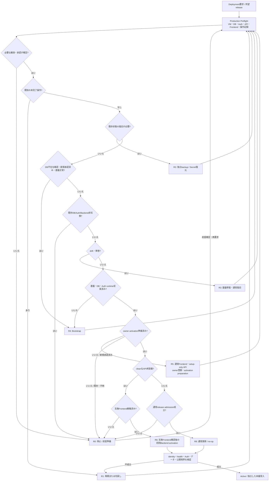

# 本番Deploymentライフサイクル設計

**種別: 正本・規範的設計（normative）。** 本書は、本番Deployment全体の状態分類、経路選択、初回配備、互換更新、排他・再開・受入を所有する。対象読者はインフラ管理者、配備運用者、開発・検証担当者。承認済み設計目標であり、現行Workflowや実環境が全契約に適合済みであることを意味しない。

[システム基本設計](../architecture/SYSTEM-DESIGN.md)を上位とする。[初期導入](INITIAL-DEPLOYMENT-FLOW.md)はVM収束・owner登録、[互換更新](UPDATE-FLOW.md)は通常更新、[IaC](IAC.md)はAnsibleの所望状態、[Backup](BACKUP.md)は保全・復元、[CI/CD](../verification/CI-CD.md)はexact-source証明を所有する。本書はこれらを合成する横断契約であり、個別機能の第二正本を設けない。[Production Bootstrap](PRODUCTION-BOOTSTRAP.md)と[Push deployment](PUSH-DEPLOYMENT.md)は運用手順である。

**非目標:** VM提供基盤・Tailnet自体の構築、既存Ansible・backup・release検証の再実装、別writer・pull updater・常駐Deployment controllerの追加、互換性チェックの緩和、Web/MCPへのインフラ操作権限付与、暗黙のデータ削除、非互換releaseの協調Cutover・自動移行・汎用Migration executor。CloudflareのTerraform/DNS/Access/zone policy変更は既存の別承認・管理権限に従う。唯一のVM管理経路は GitHub Actions → Tailscale OIDC → pinned SSH → Ansible → rootless Podman Quadlet とする。

## 状態観測と入力契約

所望状態は認定済みmainのFull Backend OCI digest・証明書・migration fingerprint・persistence format・API epoch・認証schema契約、対応するFull Frontendの検証済みarchive digest・producer/source identity・API epoch・公開OAuth設定で特定する。独立したcomponent versionの一致は互換条件ではない。既存exact-source/証拠再利用規則に従いmainとproducerを区別する。

変更前に以下の直交する軸を読取専用で観測する。各軸の状態は排他的に分類し、対象が存在しないことを確認した場合のみ未配備/未作成とする。観測不能・矛盾は不明として残す。通信失敗・Access拒否・確認済み旧形式・真の未配備を同一視しない。該当しない軸は理由を明示してN/Aとする。

| 軸 | 状態 | 観測証拠 |
| --- | --- | --- |
| M 管理接続 | 未準備／到達・認証済み／異常・不明 | VM ID、OS、Tailscale、SSH host key pin、操作者/rootless identity、必要なsudo |
| H 基盤 | 未構築／canonicalな部分構築／canonicalで正常／drift・不明 | Podman/systemd/UID/GID、Volume/Network/Quadlet、DB/Tunnel container・unit・Secretの一致 |
| D データ | 未作成／新規空／既存互換／既存非互換／復旧対象が欠落／不明・破損 | DB cluster ID、logical DB、volume、role・ledger・persistence、履歴・独立backup・復旧意図 |
| A 認証 | 未構成／登録待ち／登録済みだがactivation未準備／登録済み・検証済み／確認済み旧認証方式／回復必要／不明 | Better Auth schema、owner/Passkey/client同一性、setup marker・grant状態、Secretの存在・一致 |
| B Backend | clean未配備／setup-only／通常稼働・互換／通常稼働・非互換／停止・障害・残存状態／不明 | API container・unit・実digest・embedded identity・health、deployed-release/transaction記録 |
| F Frontend | 未配備／稼働・互換／稼働・非互換（確認済み旧形式含む）／障害／不明 | Worker version・traffic、artifact identity・profile/epoch・公開OAuth設定、routeとAccess |
| T 操作 | なし／既知の再開可能操作／中断・復旧必要／不明 | 操作ID、対象・承認・前提、host lock・通常deploy transactionと旧/候補identity |

Cloudflare側のTunnel/DNS/route/AccessとVM内のTunnel runtimeは独立に観測する。外部Tunnelだけ既存なら既存token・経路を利用してVMを構築できる。VM上のTunnelだけ既存ならcanonical identity・所有者・Secret・network・unitの一致を確認して残りを収束する。別ユーザー・別構成のTunnelやDBを暗黙に採用・上書きしない。

Preflightは環境、host pin、観測時刻、source/candidate、現在のidentity、データ/Auth/backup状態、選択経路、不足する承認・証拠を束縛した機械可読な非秘密結果を返す。秘密値、資格情報付きURL、平文登録キー、原稿本文を記録しない。異なる環境への流用、古い観測に基づくmutationは禁止。

## 経路選択の優先順位

次の判定を上から順に適用し、最初に一致する経路を選ぶ。選択経路に必要な承認・証明が欠落する場合は無変更で停止する。中間経路の完了後は再観測して判定に戻る。新規installと既存環境の復旧意図は運用者が明示し、空に見える状態だけで選択しない。Dの「新規空」は未初期化のpristine状態を指す。schema/ledger初期化が完了したDBは原稿件数が0でも互換DBとして扱い、承認済みinstall intentとA/Tに基づき登録待ちを判定する。

| 経路 | 条件（先行条件は除外済み） | 実行と遷移先 |
| --- | --- | --- |
| R0 STOP / PREPARE | M未準備・異常、選択に必要な観測不明、解釈不能な操作記録、必要な承認・証明不足 | 無変更で停止。VM/SSH/edge/backupの前提を準備・調査し再観測 |
| R1 RESUME / RECOVER | Tに既知の未完了操作あり | 同一操作の記録・現状態を照合して再開または切戻し。未知記録はR0 |
| R2 RESTORE | 既存環境の復旧意図があり必要な保存状態が欠落・故障 | 独立backup・外部秘密管理から復元。必要なら先に基盤構築するが初回owner発行は禁止 |
| R3 MAINTENANCE | H drift、A回復必要、B/F障害（既存データ・認証の非互換はR0） | 明示的な基盤修復・通常deploy復旧・owner回復のみ。非互換移行を実行しない |
| R4 BOOTSTRAP | H未構築/部分構築、D未作成/新規空またはA未構成で、新規・既存採用・復旧の意図が確定。承認済みinstallでDの欠落を確認した場合は旧B/Aの残存より優先 | 必要なhost/secrets/base/auth-runtimeを収束。新規初期化を別承認。既存identity/ledger/資格情報保持 |
| R5 OWNER_SETUP | 承認済み新規installでA登録待ちまたはactivation未準備、あるいはB setup-only | 通常Frontendの認定済みFullアーカイブを必要時に先行配備。同じFull Backendのsetup-only APIと一回限りgrantで本人登録、client検証、保護されたactivation preparation。既存ownerを再発行しない |
| R6 ACTIVATE | H/D/A検証済み、B clean未配備、F互換 | 既存の保護されたBackend-only初回deploy。初回・DB使用・公開承認、backup |
| R7 廃止 | 選択禁止 | 旧番号を再利用しない。非互換または未配備Frontendで通常Admissionが成立しない場合はR0 |
| R8 UPDATE / VERIFY | B通常稼働・互換、Fが正常で通常admission成立 | 変更のあるcomponentのみ通常互換更新。完全同一ならno-op＋health/identity検証 |

R0は観測不明・不整合・非互換・必要な証明不足を含む。R1は通常deployの既知transactionのみ再開または切戻しできる。R2の基盤driftは明示修復を先行する。既存データを新規として扱わない。確認済みDB不在に対する承認済み新規初期化は、既存データの変換・削除ではない。旧認証方式・非互換DB・非互換Backendを自動移行しない。

### DB不在時の再初期化（R4）

VMの利用履歴や旧API epochではなく現在のDB状態を判定する。新規installの明示と既存のdatabase-initialization承認がある場合、管理接続・canonical基盤の確認と正常なPostgreSQL管理接続による専用logical DBの不存在確認（または新規基盤での確認済み未作成）を根拠に、R4へ収束する。接続不能・認証失敗・観測不明は不存在と見なさずR0で停止する。restore意図はR2を維持する。既存DBを削除・上書きする操作は一切含めない。

DB不在が確定した旧配備では、旧epoch・旧owner・旧API稼働記録は新しいDBの互換条件としない。既知の未完了操作はR1を優先し、不明な操作記録・基盤drift・対象所有者不一致は停止する。R4の保護された実行系統はproduction queueとcanonical host lockの下でDB不在を再検証し、Tunnel/APIを停止して旧API slotおよびDBに束縛された旧owner/setup/release状態だけを整理し、既存のclean target検証を満たす。PostgreSQL cluster・他DB・role・Secret・外部Tunnel/Access設定・独立backupは保持する。処理中断時は再観測し、不在が維持されている場合に限り整理を再開できること。既に作成・初期化されたDBは通常の新規空・install intentに束縛された再開契約に従い、暗黙に破棄しない。

既存BootstrapのDB初期化承認を用い、DB再作成固有の重複承認や旧epoch移行契約を要求しない。認定済みFull imageで現行schema/ledgerとBetter Authを初期化し、R5で通常Frontendを配備してownerを登録、R6で既に互換なFrontendを維持してBackend activationを行う。旧Frontendの存在はR4の妨げではない。通常update/adoptではDB不在を自動的な新規installへ読み替えない。

### 統合Deployment経路

[グラフィカルな遷移図を開く](https://yohn-jp.github.io/codexia/architecture/#lifecycle-1)

### Frontend・Backendの配備マトリクス

候補B/Fは互いに互換であることが前提。H/D/Aの収束、承認・証明・Tの解決を先行する。setup-onlyはR5であり通常Bではない。「互換」は候補profile/API epochに対する状態で、DB migration/persistence/認証schema不一致、確認済み旧認証方式はR0で停止する。

| Backend ＼ Frontend | 未配備 | 非互換・旧形式確定 | 互換 |
| --- | --- | --- | --- |
| clean未配備 | R0（R5の完了を確認） | R0（R5の完了を確認） | R6 初回Backendのみ |
| 通常稼働・非互換 | R0 | R0 | R0 |
| 通常稼働・互換 | R0 | R8 通常Frontend admission成立時のみ。それ以外はR0 | R8 独立更新/no-op |
| 停止・障害・残存状態 | R3復旧後再判定 | R3復旧後再判定 | R3復旧後再判定 |
| 不明 | R0 | R0 | R0 |

Frontend障害はR3、未観測はR0を先行する。空VMでも旧Frontendが残り得る。API停止だけではclean未配備ではない。API container/unit/activation link/transaction/release/rollback記録が残る場合は既存配備の回復とし、first-install承認で上書きしない。ただし、前節のDB不在が確認されR4の初期化が承認された場合に限り、旧配備の残存状態を整理する。

## 実行系統と互換性境界

本番の実行系統は Bootstrap / Activation（R4・R5・R6）、Update（R8）、Recovery（R1・R2・R3）の三つとする。Preflightは共通の読取専用入口である。R7は廃止し、非互換releaseを実行する経路を持たない。

API epoch、Full profile、SQL ledger/fingerprint、persistence format、Better Auth schema、公開OAuth設定を引き続き独立に検証する。互換性のない既存環境は無変更で停止する。非互換更新が将来必要になったときは、その具体的なデータ・認証・配備要件を別途承認するまで実装しない。汎用的な移行契約catalog、transition resolver、Cutover executor、専用Workflow・journal・Cloudflare fence・CI fixtureを再導入しない。

DBが真に不在で新規installが明示承認された場合はR4を利用する。DBの削除はBootstrapの責務ではなく、既存データを持つ環境の初期化・変換・復旧を暗黙に行わない。

Preflightは観測、候補identity、変更軸、必要な操作・承認・保全/復旧・受入条件を非秘密の計画として返す。計画は環境/host/DB/旧・候補identity/証拠/意図/有効期間に束縛しdigestで固定する。承認は別環境・別artifact・変更後のsourceに流用できない。queue/host lock取得後に対象と現状態を再照合する。drift・期限切れ・未知transactionでは停止する。

通常更新は既存release triggerと保護条件を使用する。初回・復旧でも既存の承認分離、本人Passkey登録、backupと独立復元の証拠、通常deploy transaction、単一writerを維持する。公開後に新規書込みがあり得る場合、旧backupを無条件に復元しない。

## 実行権限と保護された引き渡し

Workflowファイル数は固定しない。論理モードと権限・承認・成功条件を分離し、既存保護環境、canonical Ansible task、release証明、backup/recoveryを再利用する。

| 実行経路 | 実行者・入力 | 完了と引き渡し |
| --- | --- | --- |
| Production Preflight | 保護された読取専用運用者、対象pin、読取権限 | 状態・経路判定。VM接続/syntaxだけでは完了しない |
| Production Bootstrap | 独立管理者・sudo、private inventory、stage別承認、認定済みFull | host/secrets/base/auth-runtime、初回登録待ち/既存owner検証/停止。通常APIは起動しない |
| Production Activation | 保護運用者、rootless配備identity、初回・DB使用・公開の別承認、owner本人 | setup-onlyを閉じ、互換な通常Frontendを維持し、認定済みBackendを通常deployで有効化 |
| Production Update | 認定済みmainのcomponent release、保護された有効化承認 | 互換Backend/Frontend更新、no-op、rollback |
| Production Maintenance / Recovery | 明示保守/復旧承認、Cloudflare管理権限、復旧証拠 | 基盤修復、DB/Auth復元、通常deployの切戻し。非互換移行は実行しない |

Bootstrap入力Full digestは既存release handoffの証明書・発行元・main tree/producer・profile・embedded identityに照合してからDB/auth migration、setup-only APIに使う。digest形式や指定だけでは認定しない。保護controllerからowner状態を照会し暗号化grantを秘密経路で引き渡す。本人登録後に既存activation preparationを実行し、owner subjectを手転記・生成しない。Bootstrap成功や登録完了を次のreleaseイベントの自然発生に依存させず、既存の正確な証明済み成果物を再検証して別承認のactivationを起動できること。

既存PostgreSQLクラスタでlogical `codexia` DBだけが欠落する場合は、対象DBの欠落・role・旧API状態・復旧意図を確定し、保全と明示承認後に既存の限定再作成処理を使う。別DB/volume/ownerを削除・再初期化する権限にはならない。

## 初回配備

通常Frontend更新の互換性Admissionは維持する。初回だけR5の制限付き通常Frontend配備を利用し、R6で互換Frontendを再確認する。両者は認定済み候補を使い、R6はFrontendを書き換えない。欠落・非互換Frontendが残る場合はR0で停止し、R5の完了状態を確認する。

新規owner登録では通常の `codexia-frontend` Worker・Full Frontendアーカイブ・canonical UI/Access/Tunnel経路のみを用いる。専用setup Worker、別Environment、別Frontendビルド、登録のためのTerraform経路切替を禁止する。R4後、確認済みR5（新規install、owner登録待ち、通常writer不在）に限り、`codexia-production` の保護されたFrontend workflowは認定済み候補を通常Workerへ配備できる。通常更新のlive Backend互換性Admissionは変更せず、初回配備は認定済み候補pair、fresh plan、Accessとcanonical route、version単調性でAdmissionする。既存writer/ownerを保持する必要がある場合は新規登録を行わない。通常業務/OAuth/MCP APIはsetup-only Backendが拒否し、public protocol bypassは通常runtime受入まで無効とする。setup-only API、Access/TLS/RP ID、登録キー追加認可、拒否経路を実測して本人へ引き渡す。登録後は既存の `--prepare-activation` 相当でowner/client検証、setup-only API/Tunnel停止、通常認証設定確定、clean API slotへの復帰を行う。FrontendとUI経路は維持しR6で同じ認定Full Backendを通常起動する。

初回Backendの起動は既存の保護されたBackend deployment handoffとAnsible deploy transactionだけで行う。既存host lock下で事前保全・ledger/Auth検証・単一writer・readiness・Tunnel公開を確認する。失敗時は通常deployの安全停止・復旧を利用し、登録済みownerとデータを保持する。

### 旧Cutover機構の撤去境界

旧journal・停止フラグ・専用Cloudflare fenceが実環境で有効かは、撤去前に権限を持つ運用者が読取専用で確認する。未完了操作、実際に有効なfence、不明なwriter/DB identityを無視したり自動削除・解除したりしない。既存の通常deploy復旧または別途承認された運用者の復旧で安全な状態を確定し、不要な旧設定・権限・状態を明示的に撤去する。新たなCutover処理は開始しない。恒久的な旧機構の互換fallbackは残さない。

## 排他・再開・証跡

- Bootstrap、Activation、Maintenance、Frontend/Backend mutationは同じ環境のproduction slotを共有する。保守状態はWorkflow寿命を越えて維持し、runner終了やowner登録待ちで解除しない。通常releaseは保守中に公開状態を変更しない。writer変更・backup・Auth初期化は既存host lockを再利用し、取得後に対象・前提・identityを再照合する。別lock/writer controllerを作らない。
- mutation前にdurable操作記録を作り、対象・意図・承認・DB cluster・候補/旧identity・完了checkpoint・backup receiptを束縛する。既存deploy transactionと矛盾する第二台帳を作らない。失敗・中断時は記録と現状態を照合し、同一操作の既知checkpointの再開または承認済み復旧のみを許す。
- Bootstrapは段階完了と新規install intentを永続的に識別する。schema初期化済みだがgrant/installation marker未作成の場合、既存owner DBや未知DBと区別できる証拠がなければ停止する。同一cluster・承認済み新規意図・owner未登録が証明できる場合に限り再開。grantと暗号化handoff、期限切れ、owner登録、setup停止からactivationの各中断を扱い、Secret/ownerを再生成しない。
- 成功状態は `STAGED`（成果物）、`BOOTSTRAPPED`（基盤）、`SETUP_PENDING`（本人登録待ち）、`ACTIVATION_READY`（配備準備）、`ACTIVE`（公開配備の実測成功）、`ACCEPTED`（実環境受入）を区別する。これらは契約上の意味であり既存API/DB enumの変更を自動要求しない。停止・復旧待ち・不明を成功としない。一時承認と保守状態を完了後に解除して通常運用へ戻る。

## 受入契約

互換性検査の変更は非互換拒否と通常更新の回帰を、Bootstrap/Activationの変更は初回経路と通常deployの安全性を実証する。旧Cutover専用fixture・認定レーンは廃止し、既存の通常deploy/backup/restore/認証・成果物認定の検証は弱めない。計画改変、陳腐化、別host/DB/候補への承認流用、未知transaction、証拠欠落は拒否する。

CIは認定済み候補、使い捨てUbuntu/rootless Podman/PostgreSQL 17、Cloudflare限定権限fixture/APIモックで以下を検証する。実VM・実edgeの成功とは区別する。経路判定は全状態の直積を網羅的に評価し、各入力に対して選択経路が一意または明示停止となること、各分岐に到達可能な代表ケースがあることを確認する。

| ケース | 必要な検証 |
| --- | --- |
| 空VM・外部Tunnelのみ・canonical VM Tunnelのみ | 必要な基盤だけ収束、既存Tunnel保持、未配備pairから通常Frontend・setup-only API・activation、通常運用到達 |
| 部分構築・既存互換DB・既存owner | 冪等採用、owner/cluster/Secret/データ保持、登録キー再発行なし |
| 非canonical基盤・未知状態・欠落identity | 拒否、暗黙削除なし、旧形式/真の不在とAccess拒否・到達不能の区別 |
| 旧epoch/非互換schema・片側のみ配備 | 非互換の通常releaseを拒否、無変更停止。R4/R5/R6の新規導入と既存データ保全を区別 |
| VM消失、論理DB欠落、owner資格回復 | 別ホスト復元、role/Secret/owner同一性維持、無承認初期化拒否 |
| 中断・競合・再実行 | schema/marker/grant/owner/prepare-activation、backup/停止/Backend起動/通常Frontend公開/Tunnel公開の各checkpointで中断。再開または検証済み切戻し、二重writer・再owner発行・通常lane割込みなし |
| 不正artifact/承認/backup | 全経路で未証明・陳腐化候補、不正host/DB identity、保全不成立を拒否 |
| 通常運用と実環境受入 | 同一digest no-op、独立互換更新、rollback、VM reboot、実Cloudflare/Browser/owner認証・許可/拒否経路・独立復元の実測 |

証拠は既存CI artifactまたは保護運用記録で環境、source、artifact、操作ID、backup/restore receipt、観測結果を紐付ける。全経路の到達性とfail-closedを検証する。未観測は未検証、失敗は失敗、部分稼働は受入未完了とする。
