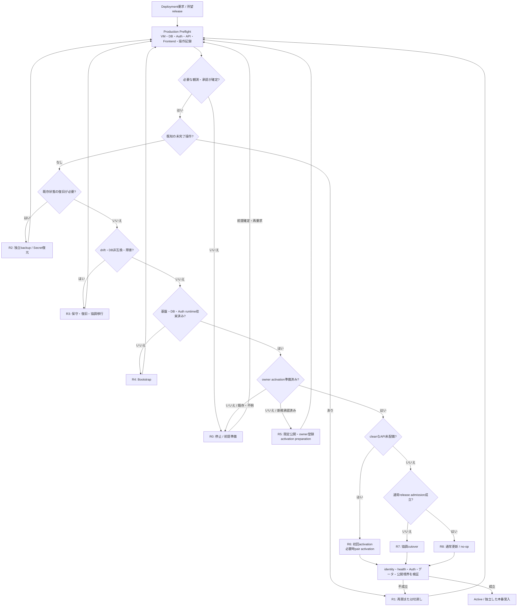
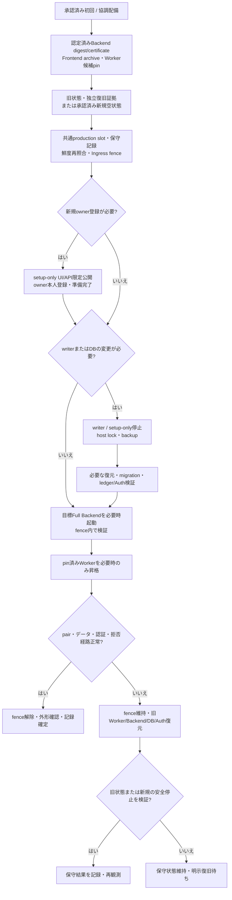

# 本番Deploymentライフサイクル設計

**種別: 正本・規範的設計（normative）。** 本書は、本番Deployment全体の状態分類、経路選択、初回協調配備、非互換切替、排他・再開・受入を所有する。対象読者はインフラ管理者、配備運用者、開発・検証担当者。承認済み設計目標であり、現行Workflowや実環境が全契約に適合済みであることを意味しない。

[システム基本設計](../architecture/SYSTEM-DESIGN.md)を上位とする。[初期導入](INITIAL-DEPLOYMENT-FLOW.md)はVM収束・owner登録、[互換更新](UPDATE-FLOW.md)は通常更新、[IaC](IAC.md)はAnsibleの所望状態、[Backup](BACKUP.md)は保全・復元、[CI/CD](../verification/CI-CD.md)はexact-source証明を所有する。本書はこれらを合成する横断契約であり、個別機能の第二正本を設けない。[Production Bootstrap](PRODUCTION-BOOTSTRAP.md)と[Push deployment](PUSH-DEPLOYMENT.md)は運用手順である。

**非目標:** VM提供基盤・Tailnet自体の構築、既存Ansible・backup・release検証の再実装、別writer・pull updater・常駐Deployment controllerの追加、互換性チェックの緩和、Web/MCPへのインフラ操作権限付与、暗黙のデータ削除。CloudflareのTerraform/DNS/Access/zone policy変更は既存の別承認・管理権限に従う。唯一のVM管理経路は GitHub Actions → Tailscale OIDC → pinned SSH → Ansible → rootless Podman Quadlet とする。

## 状態観測と入力契約

所望状態は認定済みmainのFull Backend OCI digest・証明書・migration fingerprint・persistence format・API epoch・認証schema契約、対応するFull Frontendの検証済みarchive digest・producer/source identity・API epoch・公開OAuth設定で特定する。独立したcomponent versionの一致は互換条件ではない。既存exact-source/証拠再利用規則に従いmainとproducerを区別する。

変更前に以下の直交する軸を読取専用で観測する。各軸の状態は排他的に分類し、対象が存在しないことを確認した場合のみ未配備/未作成とする。観測不能・矛盾は不明として残す。通信失敗・Access拒否・確認済み旧形式・真の未配備を同一視しない。該当しない軸は理由を明示してN/Aとする。

| 軸 | 状態 | 観測証拠 |
| --- | --- | --- |
| M 管理接続 | 未準備／到達・認証済み／異常・不明 | VM ID、OS、Tailscale、SSH host key pin、操作者/rootless identity、必要なsudo |
| H 基盤 | 未構築／canonicalな部分構築／canonicalで正常／drift・不明 | Podman/systemd/UID/GID、Volume/Network/Quadlet、DB/Tunnel container・unit・Secretの一致 |
| D データ | 未作成／新規空／既存互換／既存非互換／復旧対象が欠落／不明・破損 | DB cluster ID、logical DB、volume、role・ledger・persistence、履歴・独立backup・復旧意図 |
| A 認証 | 未構成／登録待ち／登録済みだがactivation未準備／登録済み・検証済み／回復必要／不明 | Better Auth schema、owner/Passkey/client同一性、setup marker・grant状態、Secretの存在・一致 |
| B Backend | clean未配備／setup-only／通常稼働・互換／通常稼働・非互換／停止・障害・残存状態／不明 | API container・unit・実digest・embedded identity・health、deployed-release/transaction記録 |
| F Frontend | 未配備／稼働・互換／稼働・非互換（確認済み旧形式含む）／障害／不明 | Worker version・traffic、artifact identity・profile/epoch・公開OAuth設定、routeとAccess |
| T 操作 | なし／既知の再開可能操作／中断・復旧必要／不明 | 操作ID、対象・承認・前提、host lock・durable transaction、fenceと旧/候補identity |

Cloudflare側のTunnel/DNS/route/AccessとVM内のTunnel runtimeは独立に観測する。外部Tunnelだけ既存なら既存token・経路を利用してVMを構築できる。VM上のTunnelだけ既存ならcanonical identity・所有者・Secret・network・unitの一致を確認して残りを収束する。別ユーザー・別構成のTunnelやDBを暗黙に採用・上書きしない。

Preflightは環境、host pin、観測時刻、source/candidate、現在のidentity、データ/Auth/backup状態、選択経路、不足する承認・証拠を束縛した機械可読な非秘密結果を返す。秘密値、資格情報付きURL、平文登録キー、原稿本文を記録しない。異なる環境への流用、古い観測に基づくmutationは禁止。

## 経路選択の優先順位

次の判定を上から順に適用し、最初に一致する経路を選ぶ。選択経路に必要な承認・証明が欠落する場合は無変更で停止する。中間経路の完了後は再観測して判定に戻る。新規installと既存環境の復旧意図は運用者が明示し、空に見える状態だけで選択しない。Dの「新規空」は未初期化のpristine状態を指す。schema/ledger初期化が完了したDBは原稿件数が0でも互換DBとして扱い、承認済みinstall intentとA/Tに基づき登録待ちを判定する。

| 経路 | 条件（先行条件は除外済み） | 実行と遷移先 |
| --- | --- | --- |
| R0 STOP / PREPARE | M未準備・異常、選択に必要な観測不明、解釈不能な操作記録、必要な承認・証明不足 | 無変更で停止。VM/SSH/edge/backupの前提を準備・調査し再観測 |
| R1 RESUME / RECOVER | Tに既知の未完了操作あり | 同一操作の記録・現状態・fenceを照合して再開または切戻し。未知記録はR0 |
| R2 RESTORE | 既存環境の復旧意図があり必要な保存状態が欠落・故障 | 独立backup・外部秘密管理から復元。必要なら先に基盤構築するが初回owner発行は禁止 |
| R3 MAINTENANCE | H drift、D既存非互換、既存A回復必要、B停止・障害・残存状態またはF障害 | 明示保守・復旧・移行。先行保全・互換性判定。既存owner回復を新規登録と分離 |
| R4 BOOTSTRAP | H未構築/部分構築、D未作成/新規空またはA未構成で、新規・既存採用・復旧の意図が確定 | 必要なhost/secrets/base/auth-runtimeを収束。新規初期化を別承認。既存identity/ledger/資格情報保持 |
| R5 OWNER_SETUP | 承認済み新規installでA登録待ちまたはactivation未準備、あるいはB setup-only | 制限付きsetup UI/APIと一回限りgrant。本人登録、client検証、保護されたactivation preparation。既存ownerを再発行しない |
| R6 ACTIVATE | H/D/A検証済み、B clean未配備 | F互換なら既存初回Backend配備。F未配備/非互換ならpair activation。初回・DB使用承認、backup |
| R7 CUTOVER | B通常稼働だが非互換、F未配備、またはF非互換かつ通常Frontend admissionが成立しない | 既存データ/owner保持、必要な移行・協調配備。既に互換な側を無用に再配備しない |
| R8 UPDATE / VERIFY | B通常稼働・互換、Fが正常で通常admission成立 | 変更のあるcomponentのみ通常互換更新。完全同一ならno-op＋health/identity検証 |

R0の不明は独立した証拠で確定した旧identityや未配備を含まない。R1の再開可能な操作が本人登録・別承認待ちなら待機状態を返し、自動再試行ループや新しい登録キー発行を行わない。R2で基盤のdriftがある場合は安全な明示修復を復元の前提とする。R3のmigrationとR7の対切替が同一保守操作に属する場合は一つのfence・保全・transactionで完結させる。途中で通常公開へ戻さない。既存データを新規として扱う経路はない。旧認証からの移行に新しいBetter Auth owner登録が必要なら、旧データ保全・新規認証の明示承認・別のclean targetを用いる保守経路でのみ行う。

### 統合Deployment経路

[グラフィカルな遷移図を開く](https://yohn-jp.github.io/codexia/architecture/#lifecycle-1)

### Frontend・Backendの配備マトリクス

候補B/Fは互いに互換であることが前提。H/D/Aの収束、承認・証明・Tの解決を先行する。setup-onlyはR5であり通常Bではない。「互換」は候補profile/API epochに対する状態で、DB migration/persistence/認証schema不一致はR3が優先する。

| Backend ＼ Frontend | 未配備 | 非互換・旧形式確定 | 互換 |
| --- | --- | --- | --- |
| clean未配備 | R6 pair初回配備 | R6 旧UI置換＋初回Backend | R6 初回Backendのみ |
| 通常稼働・非互換 | R7 必要な移行＋pair配備 | R7 pair cutover | R7 Backend保守移行、F再検証 |
| 通常稼働・互換 | R7 Frontend初回配備、B維持 | R8 通常Frontend admission成立時のみ。それ以外はR7 | R8 独立更新/no-op |
| 停止・障害・残存状態 | R3復旧後再判定 | R3復旧後再判定 | R3復旧後再判定 |
| 不明 | R0 | R0 | R0 |

Frontend障害はR3、未観測はR0を先行する。空VMでも旧Frontendが残り得る。API停止だけではclean未配備ではない。API container/unit/activation link/transaction/release/rollback記録が残る場合は既存配備の回復とし、first-install承認で上書きしない。

## 5つの実行経路と権限

Workflowファイル数は固定しない。論理モードと権限・承認・成功条件を分離し、既存保護環境、canonical Ansible task、release証明、backup/recoveryを再利用する。

| 実行経路 | 実行者・入力 | 完了と引き渡し |
| --- | --- | --- |
| Production Preflight | 保護された読取専用運用者、対象pin、読取権限 | 状態・経路判定。VM接続/syntaxだけでは完了しない |
| Production Bootstrap | 独立管理者・sudo、private inventory、stage別承認、認定済みFull | host/secrets/base/auth-runtime、初回登録待ち/既存owner検証/停止。通常APIは起動しない |
| Production Activation | 保護運用者、rootless配備identity、初回・DB使用・公開の別承認、owner本人 | setup-onlyを閉じ、認定済みartifactを有効化。必要時pair経路 |
| Production Update | 認定済みmainのcomponent release、保護された有効化承認 | 互換Backend/Frontend更新、no-op、rollback |
| Production Maintenance / Recovery | 明示保守/復旧承認、Cloudflare管理権限、復旧証拠 | 基盤修復、DB/Auth復元・migration、非互換pair切替、切戻し |

Bootstrap入力Full digestは既存release handoffの証明書・発行元・main tree/producer・profile・embedded identityに照合してからDB/auth migration、setup-only APIに使う。digest形式や指定だけでは認定しない。保護controllerからowner状態を照会し暗号化grantを秘密経路で引き渡す。本人登録後に既存activation preparationを実行し、owner subjectを手転記・生成しない。Bootstrap成功や登録完了を次のreleaseイベントの自然発生に依存させず、既存の正確な証明済み成果物を再検証して別承認のactivationを起動できること。

既存PostgreSQLクラスタでlogical `codexia` DBだけが欠落する場合は、対象DBの欠落・role・旧API状態・復旧意図を確定し、保全と明示承認後に既存の限定再作成処理を使う。別DB/volume/ownerを削除・再初期化する権限にはならない。

## 初回協調配備と非互換切替

通常Frontendは稼働Backendと既存Frontend identityを、通常Backendは互換な稼働Frontendを要求する。両方が未配備または旧epochが非互換なら通常経路は使わない。初回と保守のpair経路は、旧稼働identityの一致ではなく、**独立に認定された候補pair、確定した初期状態、明示承認、隔離・復旧条件**に基づく専用Admissionを持つ。通常更新チェックを無効化しない。

新規owner登録用Frontendが未配備/非互換なら、認定済み静的assetsを事前stageし、same-originのsetupルートと必要APIのみを制限付きで公開する。既存writer/ownerを保持する必要がある場合は別clean targetを使う。業務・通常OAuth/MCP経路は公開しない。setup-only API、Access/TLS/RP ID、登録キー追加認可、拒否経路を実測して本人へ引き渡す。登録後は既存の `--prepare-activation` 相当でowner/client検証、setup-only API/Tunnel停止、通常認証設定確定、clean API slotへの復帰を行う。

### 制限付き初回配備・協調切替・切戻し

[グラフィカルな遷移図を開く](https://yohn-jp.github.io/codexia/architecture/#lifecycle-2)

1. 両候補を認定・pinし、通常trafficを変えずWorker候補をstageする。旧Worker version/traffic、Backend digest、Quadlet/Auth設定、DB/historyの復旧手段を確保。新規で旧releaseがなければ不在を記録。
2. 既存環境の非互換変更・復元では独立保管age暗号化backup、隔離復元、必要なmigration rehearsalを破壊的操作前に検証。role/Secret/鍵/ownerの復旧を別途保証。新規でも旧データ不在の承認と通常activation前のDB/Auth backupを要求。
3. 通常release/bootstrap/backupとの競合を排除し、公開hostname全体のIngress fenceを設定・実測。承認済みidentity GETと限定setup/受入経路以外を拒否。Tailscale管理経路は維持。
4. writer変更が必要ならhost lock下で旧writer/Tunnelを停止し最新backupを保全・検証。承認済みmigration/restoreのみ実行しledger・persistence・Auth/owner/client・データを照合。初回でもDB初期化をdeployに隠さない。
5. 必要なBackendだけ起動してdigest・readiness・単一writerを確認。Tunnelをfence下で接続し、必要時のみFrontend候補を100%昇格。双方の実identity、認証・拒否経路、データを検証してから公開。片側が既に目標互換なら無用な再配備・writer停止を要求しない。
6. 失敗時はfence維持、旧Frontend traffic、旧Backend digest/設定、必要なDB/history/Authを保全済み復旧点から戻す。旧releaseがない場合はsetup待ちまたは安全停止に戻しowner/データを削除しない。復旧検証なしにfence解除しない。公開解除後の外形検証失敗も再遮断・復旧判断へ送る。

## 排他・再開・証跡

- Bootstrap、Activation、Maintenance、Frontend/Backend mutationは同じ環境のproduction slotを共有する。保守状態はWorkflow寿命を越えて維持し、runner終了やowner登録待ちで解除しない。通常releaseは保守中に公開状態を変更しない。writer変更・backup・Auth初期化は既存host lockを再利用し、取得後に対象・前提・identityを再照合する。別lock/writer controllerを作らない。
- mutation前にdurable操作記録を作り、対象・意図・承認・DB cluster・候補/旧identity・完了checkpoint・backup receipt・fence状態を束縛する。既存deploy transactionと矛盾する第二台帳を作らない。失敗・中断時は記録と現状態を照合し、同一操作の既知checkpointの再開または承認済み復旧のみを許す。
- Bootstrapは段階完了と新規install intentを永続的に識別する。schema初期化済みだがgrant/installation marker未作成の場合、既存owner DBや未知DBと区別できる証拠がなければ停止する。同一cluster・承認済み新規意図・owner未登録が証明できる場合に限り再開。grantと暗号化handoff、期限切れ、owner登録、setup停止からactivationの各中断を扱い、Secret/ownerを再生成しない。
- 成功状態は `STAGED`（成果物）、`BOOTSTRAPPED`（基盤）、`SETUP_PENDING`（本人登録待ち）、`ACTIVATION_READY`（配備準備）、`ACTIVE`（公開配備の実測成功）、`ACCEPTED`（実環境受入）を区別する。これらは契約上の意味であり既存API/DB enumの変更を自動要求しない。停止・復旧待ち・不明を成功としない。一時承認と保守状態を完了後に解除して通常運用へ戻る。

## 受入契約

CIは認定済み候補、使い捨てUbuntu/rootless Podman/PostgreSQL 17、Cloudflare限定権限fixture/APIモックで以下を検証する。実VM・実edgeの成功とは区別する。経路判定は全状態の直積を網羅的に評価し、各入力に対して選択経路が一意または明示停止となること、各分岐に到達可能な代表ケースがあることを確認する。

| ケース | 必要な検証 |
| --- | --- |
| 空VM・外部Tunnelのみ・canonical VM Tunnelのみ | 必要な基盤だけ収束、既存Tunnel保持、未配備pairから限定setup/activation、通常運用到達 |
| 部分構築・既存互換DB・既存owner | 冪等採用、owner/cluster/Secret/データ保持、登録キー再発行なし |
| 非canonical基盤・未知状態・欠落identity | 拒否、暗黙削除なし、旧形式/真の不在とAccess拒否・到達不能の区別 |
| 旧epoch/非互換schema・片側のみ配備 | 通常release拒否、fence内協調切替、必要な側のみ更新、writer/データ保全 |
| VM消失、論理DB欠落、owner資格回復 | 別ホスト復元、role/Secret/owner同一性維持、無承認初期化拒否 |
| 中断・競合・再実行 | schema/marker/grant/owner/prepare-activation、backup/停止/Backend起動/Worker昇格/公開解除の各checkpointで中断。再開または検証済み切戻し、二重writer・再owner発行・通常lane割込みなし |
| 不正artifact/承認/backup | 全経路で未証明・陳腐化候補、不正host/DB identity、保全不成立を拒否 |
| 通常運用と実環境受入 | 同一digest no-op、独立互換更新、rollback、VM reboot、実Cloudflare/Browser/owner認証・許可/拒否経路・独立復元の実測 |

証拠は既存CI artifactまたは保護運用記録で環境、source、artifact、操作ID、backup/restore receipt、観測結果を紐付ける。全経路の到達性とfail-closedを検証する。未観測は未検証、失敗は失敗、部分稼働は受入未完了とする。
