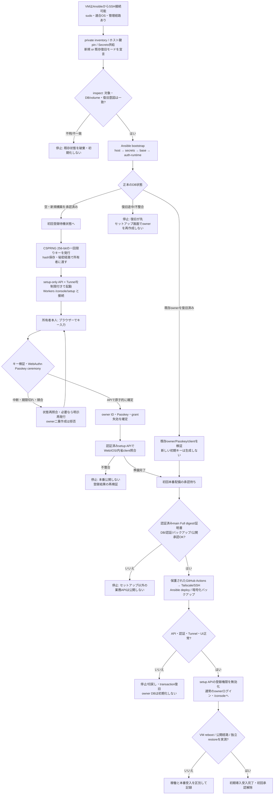
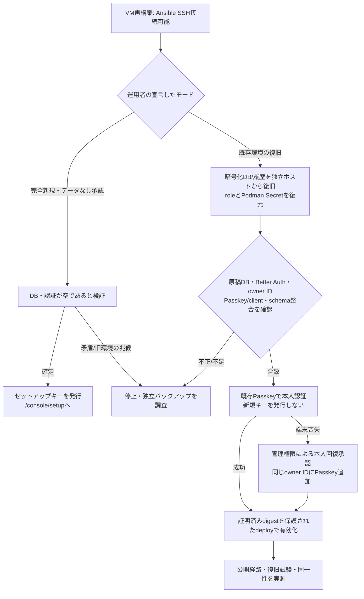
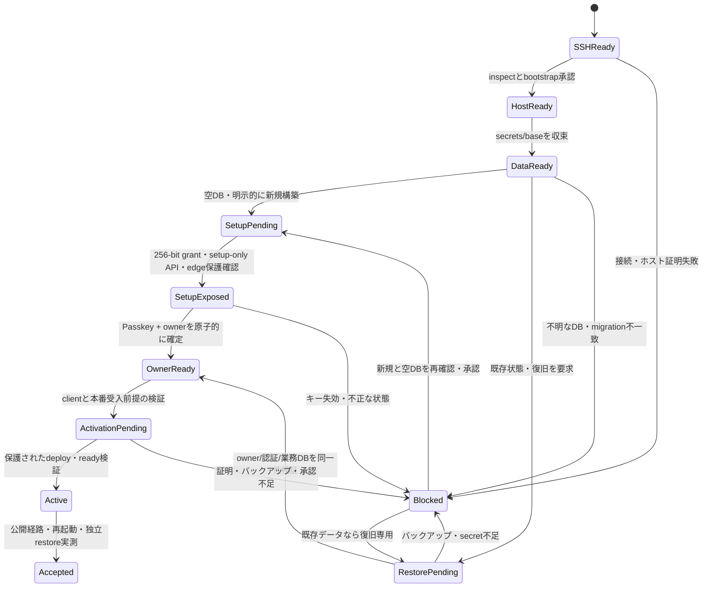

# 初期デプロイの遷移設計

**種別: 正本・規範的設計。** **採用済みの目標:** SSH可能なVMをAnsibleで構築し、Cloudflare Workersの`/console/setup`から、登録キー＋Passkeyによって初回所有者を確定する。**現行のSSH一時登録サーバーは移行前の実装であって目標の利用者導線ではない。**  新規 VM を所望状態へ収束し、PostgreSQL、本人認証、API、Cloudflare 経由の利用を安全に開始するための状態・遷移・停止条件を定義する。全体の境界は [システム基本設計](../architecture/SYSTEM-DESIGN.md)、所有手順は [IaC](IAC.md)、[Push deployment](PUSH-DEPLOYMENT.md)、[Ansible 運用](../../deploy/ansible/README.md)、[認証初期化](../../deploy/ansible/AUTH-RUNTIME.md) が定める。

## 初期構築・公開までの状態遷移

[グラフィカルな遷移図を開く](https://yohn-jp.github.io/codexia/architecture/#first-1)

**DB の空状態と既存状態は別の分岐**である。未知の volume を新規クラスタとして初期化し直さず、既存環境の資格情報を暗黙に置換しない。公開画面から実行するデプロイではなく、認可された運用者による導入である。

## 収束ステージ・所有権・障害時の動作

| 遷移 | 実行権限・入力 | 成功判定 | 失敗時 |
| --- | --- | --- | --- |
| `bootstrap` | 既存 bootstrap管理者、承認済み private inventory | host/secrets/base と許可した auth-runtime を順序どおり収束 | 途中で失敗した状態を観測し、同じ inventory の明示的な再適用に限定 |
| `inspect` | bootstrap またはサービス利用者、private inventory | サポート対象 OS、所有 ID、既存資源の観測 | 読取専用で中断 |
| `host` | 必要な sudo とアカウント作成承認 | rootless user、Podman/systemd 条件 | UID 衝突や既存 unit の予期せぬ自動起動を拒否 |
| `secrets` | mode 0400/0600 の保護 credential ファイルと承認 | Podman secret の内容・所有が一致 | 不足・異なる secret を自動修復・rotation しない |
| `base` | network/volume/PG/Tunnel の所望状態 | 固定 volume、Podman、PostgreSQL 17 の同一性 | 既存 DB・container drift を拒否 |
| `auth-runtime` | 審査済み Full digest、DB・認証初期化承認 | 原稿 migration ledger、別 auth role/schema、秘密設定 | API は非公開のまま停止 |
| 初回キー発行（設計目標） | Ansibleの承認済み新規構築、空の正本DB、CSPRNG | 256-bit一回限りキーのハッシュ保存、期限と配送先の明示、setup-only入口の検証 | 既存owner・復旧中なら発行禁止。ログ/CI artifactに平文キーを出さない |
| owner・client 登録（設計目標） | Workersの`/console/setup`、有効な初期キー、本人のWebAuthn | Better Authの永続owner、Passkey、Web/iOS/内省client照合。キー即時失効 | 中断・再送・競合でもowner一人。未完成時は業務APIを有効化しない |
| `deploy` | protected GitHub Environment と証明済み Full digest | migration・auth・origin・API ready | durable transaction record に従い復旧 |
| 公開受入 | 実 VM、Cloudflare、実ブラウザー、独立復元ホスト | API・OAuth・reboot・バックアップの観測 | fixture 成功だけで受入扱いしない |

管理経路は **GitHub Actions → Tailscale OIDC → pinned SSH → Ansible → rootless Podman Quadlet**。公開 UI/認証入口は Cloudflare **Workers Static Assets**、API origin は Cloudflare Tunnel。`/console`と`/console/setup`はWorkersからの静的アプリルートであり、登録キー検証はVMのFastify/Better AuthとPostgreSQLが担当する。Cloudflare Terraform / Access policy は別承認・別検証を要する。MCP は管理 VM の初期構築経路ではない。

## VMの入力契約と担当者の作業（合意済み目標）

**VMの基準:** 構築対象VMに対してAnsibleコントローラーからSSH接続でき、宣言されたユーザーが必要時にsudoできること。Ubuntu 26.04 x86-64、systemd/cgroup v2などのサポート条件はAnsibleの事前検査で強制する。VM作成プロバイダーやTerraformの導入をこの契約の前提にしない。VMの手作業によるPodman/DBインストールは不要。

| 順番 | 誰が | 実行・入力 | 誰に何を引き渡すか |
| --- | --- | --- | --- |
| 1 | インフラ管理者 | VMのSSH到達、sudo、ホスト鍵pin、公開FQDN・TLS/Access経路、秘密情報の供給元を準備 | Ansibleコントローラーへinventoryと承認済み環境 |
| 2 | Ansible/構築担当 | inspect → bootstrapでOS・DB・Auth・Quadletを収束。DBが新規か復旧か判定する | 「初回登録待ち」「既存owner復旧待ち」「停止」の機械可読な結果 |
| 3A | 新規DBの場合: Ansible | ownerを**作成せず**、256-bit CSPRNG初期キーを一回だけ生成しハッシュを認証DBに記録。平文は保護された一回限りの配送経路で所有者本人に渡す | 本人に`/console/setup`、初期キー、有効期限。CIログやURLには載せない |
| 3B | 既存DBの復旧の場合: 復旧担当 | DB/原稿履歴、owner ID、Passkey/OAuth client、PostgreSQL role、Podman secretを独立バックアップ・秘密管理から復旧・検証 | ownerへ既存資格情報によるログイン確認。**新しい登録キーは発行しない** |
| 4 | 初回owner本人 | Workersで配信される`/console/setup`からキー検証・Passkey登録 | Better Auth上の唯一のownerと登録消費の確定結果 |
| 5 | 構築担当/保護されたAPI | Web/iOS/内省クライアントの登録とresource/redirectをAPI側で照合。OIDCは任意で、認証後に`/console/identity`から設定 | 保護された初回deployの入力条件と確認状態 |
| 6 | 保護されたGitHub Actions | 配備承認、証明済みdigest、DB schema/backup、Cloudflare/Tunnel、health確認 | 本番owner login可能な`/console`。setup側の登録権限を閉じる |

**新規の起動モード:** `auth-runtime`後に、既存のFastify/Better Authプロセスの**setup-onlyモード**（設計目標）をCloudflare Tunnel経由で限定公開する。許可するのはセットアップ状態・キー認可・Passkey ceremony・登録完了確認に必要な狭い認証APIとreadinessのみ。通常の作品API・MCP・owner設定変更・任意のsignup・一般向けOAuth client登録は403/503等で**フェイルクローズ**する。別の永久稼働認証サーバーは新設しない。公開前にWorkersの静的ルート、Access経路・origin境界、正確なWebAuthn RP ID/HTTPS originを検証する。Accessの保護下でもセットアップキーは独立して必須で、Accessの利用者をownerとはみなさない。初期キーをpublic URLのquery/fragmentに埋め込まない。

**登録キーの権威:** Ansibleによる発行操作は、アプリが提供する制限付きbootstrap操作を利用し、平文を永続DB/Ansible fact/ログ/CI artifact/Workers assetへ書かない。正本DBにハッシュ、発行時刻、24時間の期限、失効・消費状態を記録する。繰り返しのAnsible適用は平文キーを再生成せず、失効や紛失からの再発行には**owner未登録を再検証した運用者の別承認**を要する。キー総当たりに対するレート制限、TLS、CSRF/Origin、競合時のDBロック・一意制約を備える。所有者の生成・Passkey確認・キー失効は再試行・競合でも**単一owner**という不変条件を守る。通常ログイン・OAuth/MCP認可にこのキーを流用しない。

**初回セットアップ画面:** UIの入口/画面/異常系の正本は [管理画面遷移](../design/ADMIN-SCREEN-FLOW.md) とする。キー入力、Passkey登録、完了確認、クライアント準備、初回公開待ちが連続したフローである。作業途中でSSHによる一時サーバー起動、SQL更新、owner IDの手転記を求めない。失敗・中断時はDB状態を再照合して続行または明示停止する。**UIがAnsibleやVM管理権限を取得して本番公開することはない。**

## 宣言的な初期化と公開の責務分離

**採用済み設計:** 宣言的inventoryと承認で新規VMへ`bootstrap`一操作で`host → secrets → base → auth-runtime`を順序どおり収束させる。初回キーはAnsible管理下で安全に生成・配送するが、ownerをAnsibleは作成しない。本人によるWorkers上のセットアップUI/Better AuthでのPasskey登録を経て、別途承認された本番`deploy`に進む。新規・復旧・通常更新を混同せず、再適用は冪等。秘密情報や既存データを無条件に初期化しない。

**現行実装とのギャップ:** `deploy/ansible/site.yml`は`bootstrap`で`host`、`secrets`、`base`、承認済み`auth-runtime`を実行できる。一方、現時点のowner初回登録は[認証運用手順](../../deploy/ansible/AUTH-RUNTIME.md)のSSHポートフォワード・一時コンテナー方式であり、**setup-only公開API、Ansible管理の一回限りキー配送、Workersの`/console/setup`、登録後の自動的な状態収束は未実装**。`inspect`、個別ステージ、`deploy-lifecycle-fixture`、`restore-drill`は維持する。本書の設計はこれらが実装済み・本番受入済みであるとの主張ではない。

初回 API container が存在しない `deploy` では、保護環境の `CODEXIA_INITIAL_INSTALL_APPROVED=true` と `CODEXIA_DATABASE_INITIALIZATION_APPROVED=true` が必要で、いずれもデフォルト false。承認しても migration/所有者の検証を迂回しない。成功後は false に戻す。再試行時は既存 transaction とデータを観測してから行う。

## VMの再構築と所有者資格の復旧

VMを作り直すだけで初回owner登録を再開してはならない。新規モードへの分岐は**DBが空で、独立バックアップに復旧対象がないことを運用者が確認・承認した場合のみ**許す。空に見えるDBでも、障害復旧中・ボリューム未マウント・Secret不一致であれば新規登録は禁止する。

**復旧の鍵:** PostgreSQL dumpと履歴だけでは完了しない。PostgreSQLのロール、Podman Secret、復号鍵、OIDC設定、OAuth client/署名鍵、ownerの同一性を元の環境から再現する。暗号化バックアップが同じVMにしかない状態を災害復旧可能とは呼ばない。既存owner IDが維持できない場合に、初回登録を代替復旧手段として利用することは禁止する。

## 復旧状態と受入

- **DB/認証不一致:** 既存データ・role・Secret を勝手に削除・変更しない。公開 API は開始せず、承認済み復旧/移行へ送る。
- **公開の失敗:** Tunnel/Access 経路の受入を API 起動成功と区別する。管理用 Tailscale/SSH を公開経路に依存させない。
- **バックアップ:** ローカルの暗号化 archive は同一 VM の消失には耐えない。独立保管と `restore-drill` の別ホスト実行を本番の復旧能力の受入に含める。

**受入証拠:** 使い捨て Ubuntu VM で空状態・再適用・既存データの採用/拒否・secret drift・schema 不一致・owner 登録・Full 初回起動を検証する。実 VM では reboot、Cloudflare 公開 routing、Web 認証、独立バックアップ復元を別途観測する。検証未実施を PASS として報告しない。
