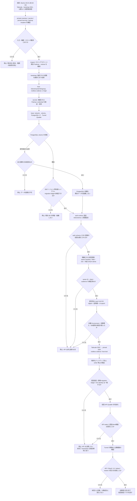
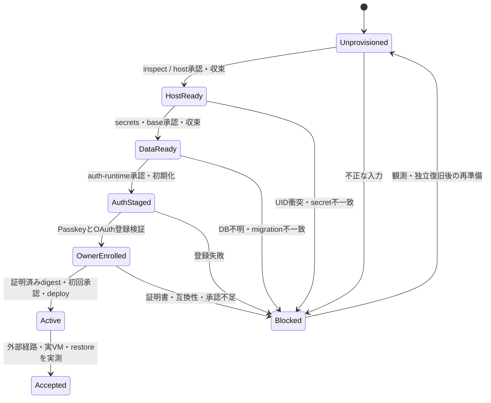

# 初期デプロイの遷移設計

**種別: 正本・規範的設計。** 新規 VM を所望状態へ収束し、PostgreSQL、本人認証、API、Cloudflare 経由の利用を安全に開始するための状態・遷移・停止条件を定義する。全体の境界は [システム基本設計](../architecture/SYSTEM-DESIGN.md)、所有手順は [IaC](IAC.md)、[Push deployment](PUSH-DEPLOYMENT.md)、[Ansible 運用](../../deploy/ansible/README.md)、[認証初期化](../../deploy/ansible/AUTH-RUNTIME.md) が定める。

## 初期構築・公開までの状態遷移

[グラフィカルな遷移図を開く](https://yohn-jp.github.io/codexia/architecture/#first-1)

**DB の空状態と既存状態は別の分岐**である。未知の volume を新規クラスタとして初期化し直さず、既存環境の資格情報を暗黙に置換しない。公開画面から実行するデプロイではなく、認可された運用者による導入である。

## 収束ステージ・所有権・障害時の動作

| 遷移 | 実行権限・入力 | 成功判定 | 失敗時 |
| --- | --- | --- | --- |
| `bootstrap` | 既存 bootstrap管理者、承認済み private inventory | host/secrets/base と許可した auth-runtime を順序どおり収束 | 途中で失敗した状態を観測し、同じ inventory の明示的な再適用に限定 |
| `inspect` | bootstrap またはサービス利用者、private inventory | サポート対象 OS、所有 ID、既存資源の観測 | 読取専用で中断 |
| `host` | 必要な sudo とアカウント作成承認 | rootless user、Podman/systemd 条件 | UID 衝突や既存 unit の予期せぬ自動起動を拒否 |
| `secrets` | mode 0400/0600 の保護 credential ファイルと承認 | Podman secret の内容・所有が一致 | 不足・異なる secret を自動修復・rotation しない |
| `base` | network/volume/PG/Tunnel の所望状態 | 固定 volume、Podman、PostgreSQL 17 の同一性 | 既存 DB・container drift を拒否 |
| `auth-runtime` | 審査済み Full digest、DB・認証初期化承認 | 原稿 migration ledger、別 auth role/schema、秘密設定 | API は非公開のまま停止 |
| owner・client 登録 | 管理 SSH と owner Passkey ceremony | 既存と同じ内部 owner、Web/iOS/introspection client と resource | 別 user の暗黙作成や未検証 client を拒否 |
| `deploy` | protected GitHub Environment と証明済み Full digest | migration・auth・origin・API ready | durable transaction record に従い復旧 |
| 公開受入 | 実 VM、Cloudflare、実ブラウザー、独立復元ホスト | API・OAuth・reboot・バックアップの観測 | fixture 成功だけで受入扱いしない |

管理経路は **GitHub Actions → Tailscale OIDC → pinned SSH → Ansible → rootless Podman Quadlet**。公開 UI/認証入口は Cloudflare Worker Static Assets、API origin は Cloudflare Tunnel。Cloudflare Terraform / Access policy は別承認・別検証を要する。MCP は管理 VM の初期構築経路ではない。

## 宣言的な初期化と公開の責務分離

**採用済み設計:** 宣言的 inventory と明示的な承認によって新規 VM へ `bootstrap` 一操作で `host → secrets → base → auth-runtime` を順序どおり収束させる。秘密情報や既存データの無条件な初期化、本人の Passkey 登録、OAuth client 登録、本番初回起動の承認を省略しない。再適用は安全であること。登録完了後は一時 enrollment ファイルを残さない。

**実装境界:** `deploy/ansible/site.yml` は `bootstrap` を提供し、宣言的な inventory に従って `host`、`secrets`、`base`、承認された `auth-runtime` を順次適用する。`inspect`、単独ステージ、検証専用 `deploy-lifecycle-fixture`、復旧専用 `restore-drill` も区別して維持する。owner Passkey / OAuth client の本人登録と本番での初回 `deploy` は別の明示操作であり、`bootstrap` の実装が本番受入を証明するわけではない。

初回 API container が存在しない `deploy` では、保護環境の `CODEXIA_INITIAL_INSTALL_APPROVED=true` と `CODEXIA_DATABASE_INITIALIZATION_APPROVED=true` が必要で、いずれもデフォルト false。承認しても migration/所有者の検証を迂回しない。成功後は false に戻す。再試行時は既存 transaction とデータを観測してから行う。

## 復旧状態と受入

- **DB/認証不一致:** 既存データ・role・Secret を勝手に削除・変更しない。公開 API は開始せず、承認済み復旧/移行へ送る。
- **公開の失敗:** Tunnel/Access 経路の受入を API 起動成功と区別する。管理用 Tailscale/SSH を公開経路に依存させない。
- **バックアップ:** ローカルの暗号化 archive は同一 VM の消失には耐えない。独立保管と `restore-drill` の別ホスト実行を本番の復旧能力の受入に含める。

**受入証拠:** 使い捨て Ubuntu VM で空状態・再適用・既存データの採用/拒否・secret drift・schema 不一致・owner 登録・Full 初回起動を検証する。実 VM では reboot、Cloudflare 公開 routing、Web 認証、独立バックアップ復元を別途観測する。検証未実施を PASS として報告しない。
