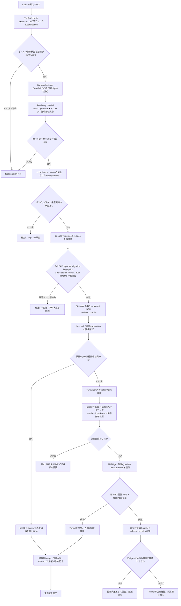
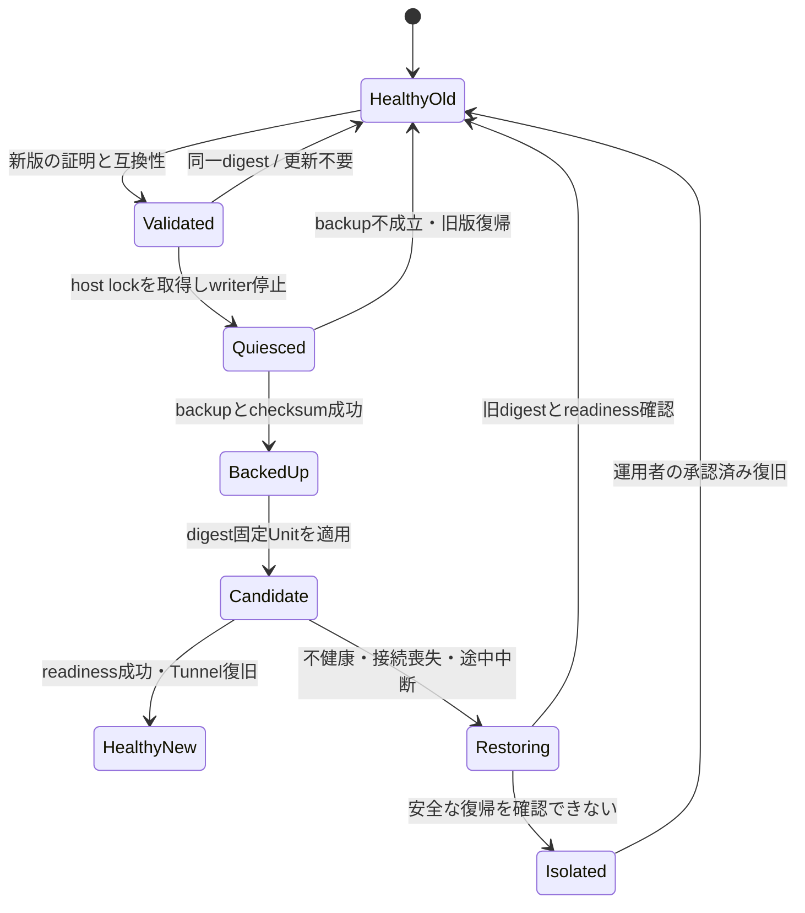

# バックエンドアップデートの遷移設計

**種別: 正本・規範的設計。** PostgreSQL schema を変更せず、特別なデータ統合を必要としない範囲の API/Core/module 機能を、承認済み main の検証・配布から自動的に本番へ適用する経路を定める。「自動」は **検証済み互換 digest だけを保護されたデプロイ制御が適用すること**であり、未知の migration や認証・保存形式の破壊を無条件で取り込むことではない。

[本番Deploymentライフサイクル](DEPLOYMENT-LIFECYCLE.md) が通常更新と初回activation・非互換停止・復旧の経路選択、共通排他、保守状態を所有する。本書は通常の互換更新に限定する。純新規のR4〜R6には事前バックアップを要求しない。ACTIVE後の運用受入を済ませ、R8のBackend更新時はConsoleで確定した通常バックアップ設定と同じVM内実行主体を使用する。GitHubへバックアップ設定・復号鍵を渡さない。

[CI/CD 規範](../verification/CI-CD.md)、[Push deployment](PUSH-DEPLOYMENT.md)、[IaC](IAC.md)、[Backup](BACKUP.md)、[システム基本設計](../architecture/SYSTEM-DESIGN.md) を補完し、独立した release authority を追加しない。

## リリースからアクティベーションまでの状態遷移

[グラフィカルな遷移図を開く](https://yohn-jp.github.io/codexia/architecture/#update-1)

**公開前の所望状態と稼働状態を区別する。** CI 成功だけで release 発行や VM 反映を主張しない。認定済み main、Core/Full image digest、配備済み UI epoch、稼働 API の実 identity を段階ごとに照合する。PR の検証には本番 Environment の認証情報を与えない。

## 互換性・自動更新可否の判定

| 変更 | 通常の自動更新 | 判定と責務 |
| --- | --- | --- |
| API 内部処理、Core read model、許可済み module のコード追加 | **許可** | Full digest、同一 API epoch、migration fingerprint、persistence format、auth schema 互換 |
| 稼働中と同一 digest の再適用 | **安全な no-op** | image identity・release record・readiness を検証し、無条件の再起動を行わない |
| 静的 UI のみの変更 | **別の Frontend lane** | 稼働 API epoch と Access / route の preflight を確認 |
| PostgreSQL の物理 migration / ledger 差分 | **禁止** | 停止・バックアップ・隔離検証・migration・データ復旧の独立承認 |
| Better Auth の認証 schema 差分 | **通常更新では禁止** | 期待する catalog との読取検査が合致しなければ更新しない |
| API epoch / persistence format の変更 | **禁止** | 無変更停止。必要な非互換移行は別途仕様・承認が必要。初回導入用の [API 契約是正](../architecture/API-CONTRACT.md#操作の追加変更廃止) は既存稼働環境の更新許可ではない |
| 再構築可能な cache/model データ | **条件付き** | 派生データとして再作成可能で、Core 執筆の妨げにならないこと |
| Secret、サービス ID、Access policy の変更 | **画像更新と分離** | IaC / セキュリティの独立承認と実環境での適合確認 |

ソース証明 → 不変 digest → 互換性 → 管理経路 → host lock → writer 停止 → 変更前バックアップ → image 切替 → readiness → Tunnel → 実利用の観測を維持する。どこかが未検証なら次の段階へ進まない。データ model・schema の変更は [PostgreSQL ドメイン設計](../architecture/DATA-MODEL.md) の変更管理に従う。

## 中断とロールバック

writer quiesce は API コンテナーと Tunnel の停止を確認する。バックアップは host lock を保持した状態で PostgreSQL と history を対象に作成し、age 暗号化後の checksum と manifest を確認する。失敗したら候補を起動しない。

以前の Quadlet を戻すだけで **DB が元の内容に復元されたと判断しない**。通常更新は DB migration を行わない設計であり、新版が行う書込みについても永続化契約に従う。schema/format の maintenance は暗号化バックアップ、隔離 restore drill、旧 writer 停止中の migration、実データの確認を伴う独立作業である。

runner や SSH が途中で消えた場合は、`~/.local/state/codexia-deploy` の durable transaction intent / release record / 実稼働 digest を再観測する。推測で新たな更新を開始しない。旧版 health と identity を確認できない間は Tunnel を停止し、明示的な復旧判断を待つ。

## 最新 main 追従と運用上の authority

- **採用済み・実装済みのゲート:** 保護された deploy queue の取得直後に、候補の main・published release・証明書を再確認し、古い認定結果、動くタグ、出所不明の registry artifact を拒否する。CI と運用環境での受入は別の証拠を要する。
- **現行 main:** `.github/workflows/backend-release.yml` と `.github/workflows/backend-deployment-handoff.yml` が exact-main 検証、handoff、保護されたデプロイを所有する。Ansible `deploy` は互換 Full image を適用し、migration fingerprint / persistence format / API epoch 不一致を拒否する。queue 内の再検証と Better Auth catalog の事前照合は通常更新の admission に含まれる。稼働中 VM での成功は別途実証する。
- **別の ownership:** Cloudflare Worker の Frontend release、Cloudflare Terraform / Access、認証 schema maintenance は backend image-only lane に混ぜない。MCP デプロイ経路、VM polling、旧 pull updater を復活させない。

## 最低限の受入証拠

実際の job の commit/tree、必須 check と証明書、published digest、VM release record と image ID、バックアップ checksum、health、外部 OAuth / 作者 API を突き合わせる。同一 digest の no-op、互換更新、非互換拒否、壊れた候補の rollback、バックアップ拒否、host lock 競合、実 VM reboot、接続喪失後の復旧、独立 `restore-drill` を検証する。使い捨て CI host の成功は **本番 VM の受入の代替ではない**。
