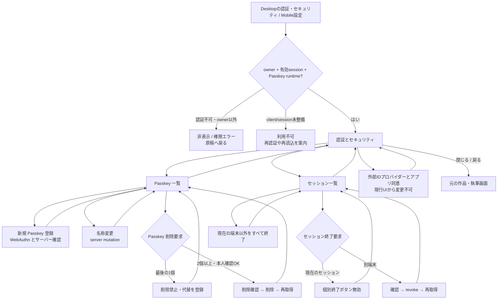
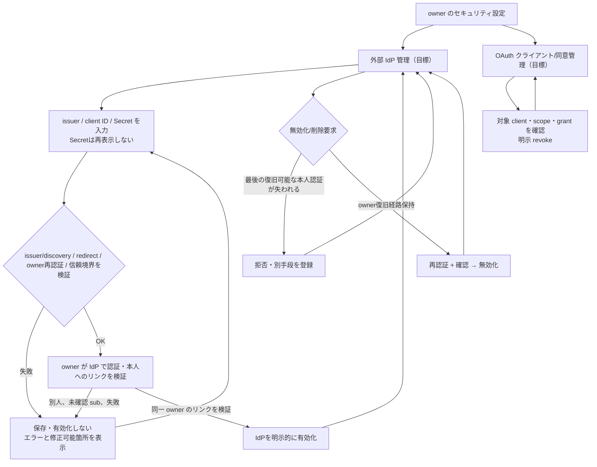
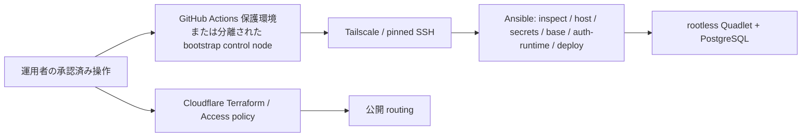
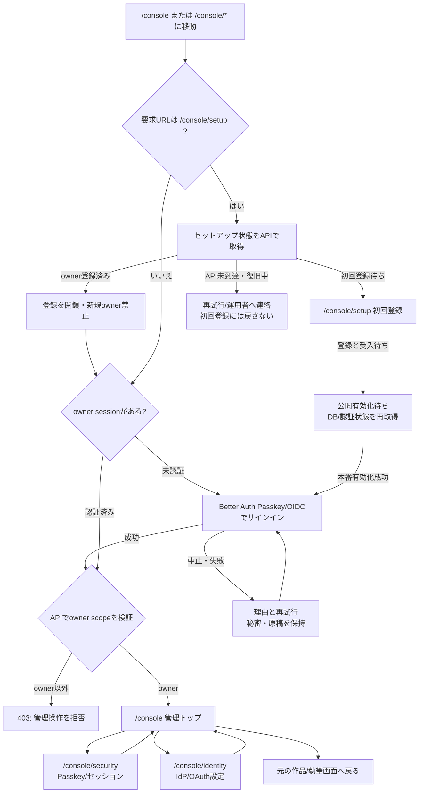
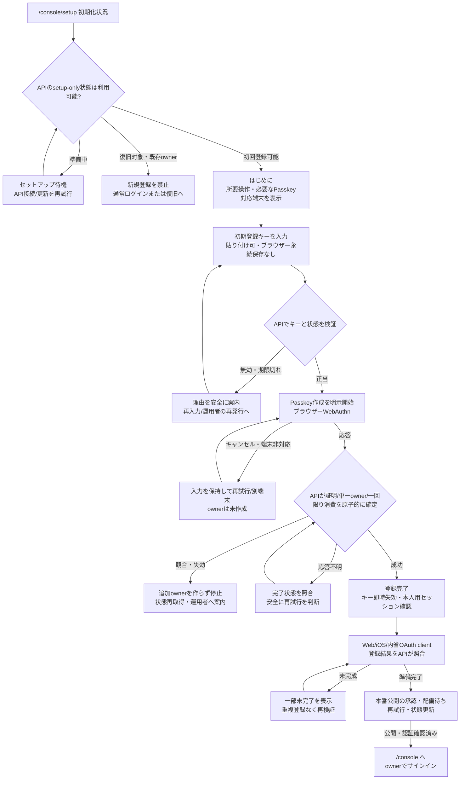

# 管理画面の遷移設計

**種別: 正本・規範的設計。** 管理者の識別情報、Passkey、セッション、外部 IdP と OAuth を管理する画面・操作の責任を定義する。管理画面という語は **(1) 作者本人の認証・セキュリティ UI** と **(2) VM・リリース・Cloudflare 運用** を混同しないために使い分ける。**合意済み目標:** 作者の認証・セキュリティを扱う管理コンソールは Cloudflare Workers Static Assets の `/console` に置き、`/console/setup` を初回登録の入口とする。独立したインフラ運用コンソールや第二の認証基盤は設けない。既存の Desktop/Mobile 内の認証・セキュリティ UI は**現行実装**であり、専用 `/console` の画面・ルーティングは**未実装の設計目標**として区別する。権限の正本は [API 認証・認可](../architecture/API-AUTHN-AUTHZ.md)、全体の正本は [システム基本設計](../architecture/SYSTEM-DESIGN.md)。

## 本人のセキュリティ管理画面（現在提供する範囲）

[既存の本人セキュリティ画面の遷移図をSVGで開く](https://yohn-jp.github.io/codexia/architecture/#admin-1)

- **Desktop:** 原稿 Shell の「認証・セキュリティ」から dialog を開く。閉じると元の原稿に戻る。
- **Mobile:** ヘッダー「設定」→ `view=settings` →「認証とセキュリティ」を表示し、元の執筆面に戻る。
- **前提:** API session が認証済み、作者 scope が `owner`、Passkey runtime と Better Auth session が利用可能。いずれかが欠けた場合は UI を非表示または利用不能として示す。UI を非表示にすることはサーバー側認可の代替ではない。
- **本人認証:** Better Auth session と必要な fresh reauthentication をサーバーで検証する。Passkey ceremony は安全な origin と利用者による明示操作を必要とする。

変更には **要求前の本人認証・owner 確認 → 対象識別 → 確認 → サーバー書込結果 → 最新一覧の再取得** を必須とする。一覧の取得失敗を操作失敗と同一視せず、「書込は成功、一覧更新は失敗」を区別する。最後の Passkey 削除や現在のセッション個別 revoke は UI 側でも抑止するが、API 側でも同じ権限・安全条件を検証する。

## 外部 IdP / OAuth クライアントの管理（採用済み設計目標）

次の遷移は [API 認証・認可](../architecture/API-AUTHN-AUTHZ.md) の**目標仕様**を図式化したものであり、現在の `IdentityManagementPanel` に操作可能な IdP 追加・更新・取消画面が存在するという主張ではない。現行画面は「この画面からの追加・変更・取り消しはまだ利用できません」と表示する。OAuth consent 画面は `/oauth/consent` の専用認可経路であり、設定画面の OAuth client 一覧ではない。

OAuth public Web / iOS / MCP clients は Better Auth の maintained OAuth Provider に登録する。ブラウザー・iOS の認証は Authorization Code + PKCE、MCP は対象 API resource と project assignment/scope の検証を要する。OAuth grant の取消し、セッションの revoke、既発行 access token の revoke は異なる操作であり、単にブラウザーから logout しても既発行 JWT の revoke にはならない。

**管理画面の安全契約:** 任意のアカウントによる自己登録、別ユーザーへの暗黙の ID 紐付け、client secret のブラウザー保存、権限確認なしの IdP 追加、OAuth client scope の無制限な拡張、未検証設定の「有効」表示は禁止する。owner の IdP を喪失した場合も、独立した承認済み recovery 手順で Passkey を復旧する。具体手順は [Ansible 認証初期化](../../deploy/ansible/AUTH-RUNTIME.md) が所有する。

## インフラの管理プレーン（Web UI の外）

本番 API の更新、DB migration、Podman secret、Tailscale 接続、Cloudflare Access 改訂、復旧バックアップは**作者の Web 設定画面から実行しない**。これらには独立した運用者権限、保護された秘密情報、承認済み手順と監査証拠が必要である。経路は [初期デプロイ遷移](../deployment/INITIAL-DEPLOYMENT-FLOW.md) と [アップデート遷移](../deployment/UPDATE-FLOW.md) を正本とする。

## 誤操作・障害時の遷移

| 状態 | 表示/処理 | 保護するもの |
| --- | --- | --- |
| session 期限切れ / owner でない | 再認証または操作不可。管理情報を返さない | 権限と原稿 draft |
| WebAuthn のキャンセル・未対応端末 | 操作を中止し、Passkey 一覧へ戻る | 既存 credential |
| 最後の Passkey の削除 | 拒否。別 Passkey 登録を案内 | owner の復旧可能性 |
| 削除・revoke 書込み結果不明 | 同じ要求の状態を再取得し、成功を推定しない | 対象と操作 identity |
| IdP の疎通失敗（目標 UI） | 未検証設定を有効化しない | 既存サインイン経路 |
| 管理操作中に原稿の未保存変更 | 元の journal と editor を保護してから遷移 | 入力・作者 scope |
| 公開経路・VM 操作で障害 | Web UI に迂回権限を与えず、管理プレーンの停止/復旧手順へ | 既存サービスとバックアップ |

**受入条件:** 実ブラウザーで Desktop dialog、Mobile settings、owner/non-owner、Passkey 登録/名称変更/最後の1個削除拒否、別セッション revoke、認証失効・ネットワーク障害、元の原稿への安全な復帰を確認する。外部 IdP / OAuth 管理は実装後に別途 E2E と本人同一性・CSRF・権限拒否を検証する。Web に運用コンソールがないことは欠落ではなく信頼境界の決定である。

## 管理コンソールのルート・認可と情報設計（合意済み目標）

| URL | 画面責務 | 表示・操作の前提 |
| --- | --- | --- |
| `/console` | 管理トップ。本人認証状態、設定の準備状況、Passkey/セッション/連携先への導線、操作結果 | Better Authの有効なowner session |
| `/console/setup` | **初回所有者だけ**の登録ウィザード。セットアップの状態確認、初期登録キー入力、Passkey作成、登録完了 | 正本DBが新規構築を承認済み・owner未登録・期限内の一回限りのキー |
| `/console/security` | Passkey一覧、追加・名称変更・削除、セッション一覧と終了、再認証 | owner session。危険操作はfresh reauthentication |
| `/console/identity` | OIDCの登録・検証・有効化、OAuthクライアント・同意の参照／許可された取消し | owner sessionと操作ごとの認可。現在のIdP変更UIは未実装 |
| `/oauth/consent` | OAuthの同意。管理コンソールから**独立**した認可画面 | 既存のBetter Auth/OAuthプロトコル |

静的UIは既存の**Cloudflare Workers Static Assets**で提供し、`/console/*` は同一のWeb UIのルートとして管理する。登録状態、初期キー検証、owner確定、Passkey ceremonyはCloudflare Workersでなく、Cloudflare Tunnel経由の**VM上のFastify + Better Auth / `codexia_auth`**が権威を持つ。**セットアップキーはインフラ権限でも通常のAPI bearerでもない**。Cloudflare AccessはUI入口の保護策として別途承認・検証し、owner権限の根拠としない。

[コンソール全体の遷移図](https://yohn-jp.github.io/codexia/architecture/#admin-4)

### 初回所有者登録ウィザード（`/console/setup`）

**目的:** VMをAnsibleで構成した後、所有者本人がブラウザーだけでPasskeyを登録できること。SSHによる一時Webサーバー手動起動、ポートフォワード、SQL、環境変数編集、登録済みowner IDの転記を**通常の初回登録導線から排除する**。AnsibleはCSPRNGによる256 bitの初期登録キーの発行・安全な引渡しに責任を持つが、ownerを登録しない。実装契約は [初期導入遷移](../deployment/INITIAL-DEPLOYMENT-FLOW.md) と [API認証設計](../architecture/API-AUTHN-AUTHZ.md)。

[初回登録の画面遷移図](https://yohn-jp.github.io/codexia/architecture/#admin-5)

| 画面・状態 | 画面の主操作 | エラー時の扱いと回復 |
| --- | --- | --- |
| 初期化状況 | 必要な作業とセットアップ状態の表示、再読込 | DBが不明・復旧中ならowner新規作成を提示しない |
| キー入力 | 安全な入力欄、貼り付け、検証、戻る | キー全体をURL、分析ログ、Web Storage、エラー表示に残さない。無効・期限切れ・失効は再発行を案内 |
| Passkey作成 | ユーザーの明示クリックでWebAuthn、利用可能端末で本人確認 | キャンセル/非対応/不正origin・challengeを区別。検証前にowner登録完了と表示しない |
| 完了確認 | owner確定・OAuth client準備状態をAPIから再取得 | 応答喪失を未実施と推定しない。二重owner/二重キー消費を拒否 |
| 本番公開待ち | 構築担当に必要な承認を案内、状態を更新 | UIからSSH/Ansible/デプロイ権限を行使しない。公開が失敗しても認証DBを初期化しない |
| 完了・サインイン | /consoleへ進む、認証設定を確認 | sessionがない場合は通常のPasskeyログインへ誘導し、登録処理を再開しない |

**UX品質:** Desktop/Mobile Webで同じ深いURLを開けること。幅320px、キーボード操作、可視フォーカス、スクリーンリーダーの状態通知、非同期処理中の重複送信防止と再開可能性を満たす。初期登録キーは通常のサインインパスワードではなく一回限りの導入資格情報として扱う。管理コンソールへ遷移するときも執筆中の下書きを破棄しない。OAuthのclient secretや初期キーをフロントエンドの配信物へ同梱しない。

### 管理トップと日常的な設定変更のUX

`/console` は初回登録を終えたownerだけのホームであり、**セキュリティ**（Passkey・セッション）、**連携ID**（OIDC）、**アプリのアクセス**（OAuthクライアント・同意）の三つの操作群を区別する。現在のDesktop dialogとMobile設定の実装を再利用・移行し、同じAPI状態を異なる画面で独立して書き換える実装を新設しない。危険操作は対象を明示して確認、fresh reauthentication、サーバー書込結果、再取得の順とする。失敗後も最後の本人認証手段を維持する。

既存のDesktop/Mobileの「認証・セキュリティ」入口は、実装移行後は`/console/security`への案内を正規導線とし、ログイン/戻り先は同一origin内の安全な既知ルートのみ許す。現在はdialog/settingsとして実装されており、`/console`へ切り替えたと主張しない。

## 新設コンソールの受入条件（実装後に検証）

- Workersの`/console`、`/console/setup`、`/console/security`、`/console/identity`がDesktop/Mobile Webで直接訪問・再読込でき、SPAの404にならない。
- 新規DBではキー検証からPasskey確定、登録後の同一キー拒否、API応答不明からの状態照合、本人の通常ログインまで実ブラウザーで確認する。
- 既存owner、復旧中、キー失効・期限切れ・競合、非owner、API/DB障害、WebAuthn不正origin/UV不備をすべて拒否し、公開経路が作業APIへの抜け道にならない。
- セキュリティ設定はログイン維持・再認証・最後のPasskey削除拒否・セッション失効・原稿へ戻る際の下書き保護を通す。
- Cloudflare Access、Tunnel、Workers、独立VM・復旧ホストについて、必要な経路での公開/拒否を**実測**する。本文書の図だけでは本番受入としない。
