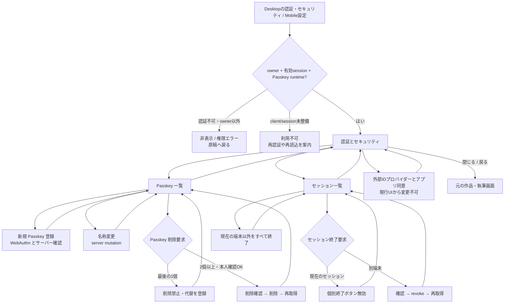
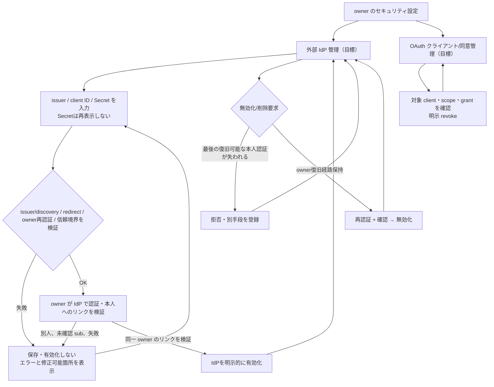
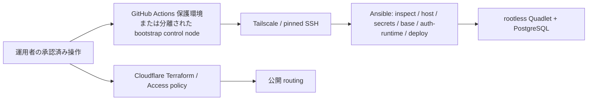

# 管理画面の遷移設計

**種別: 正本・規範的設計。** 管理者の識別情報、Passkey、セッション、外部 IdP と OAuth を管理する画面・操作の責任を定義する。管理画面という語は **(1) 作者本人の認証・セキュリティ UI** と **(2) VM・リリース・Cloudflare 運用** を混同しないために使い分ける。現行製品に独立した `/admin` SPA または Web デプロイコンソールは設けない。権限の正本は [API 認証・認可](../architecture/API-AUTHN-AUTHZ.md)、全体の正本は [システム基本設計](../architecture/SYSTEM-DESIGN.md)。

## 本人のセキュリティ管理画面（現在提供する範囲）

[管理画面の遷移図をSVGで開く](https://yohn-jp.github.io/codexia/architecture/#admin-1)

- **Desktop:** 原稿 Shell の「認証・セキュリティ」から dialog を開く。閉じると元の原稿に戻る。
- **Mobile:** ヘッダー「設定」→ `view=settings` →「認証とセキュリティ」を表示し、元の執筆面に戻る。
- **前提:** API session が認証済み、作者 scope が `owner`、Passkey runtime と Better Auth session が利用可能。いずれかが欠けた場合は UI を非表示または利用不能として示す。UI を非表示にすることはサーバー側認可の代替ではない。
- **本人認証:** Better Auth session と必要な fresh reauthentication をサーバーで検証する。Passkey ceremony は安全な origin と利用者による明示操作を必要とする。

変更には **要求前の本人認証・owner 確認 → 対象識別 → 確認 → サーバー書込結果 → 最新一覧の再取得** を必須とする。一覧の取得失敗を操作失敗と同一視せず、「書込は成功、一覧更新は失敗」を区別する。最後の Passkey 削除や現在のセッション個別 revoke は UI 側でも抑止するが、API 側でも同じ権限・安全条件を検証する。

## 外部 IdP / OAuth クライアントの管理（採用済み設計目標）

次の遷移は [API 認証・認可](../architecture/API-AUTHN-AUTHZ.md) の**目標仕様**を図式化したものであり、現在の `IdentityManagementPanel` に操作可能な IdP 追加・更新・取消画面が存在するという主張ではない。現行画面は「この画面からの追加・変更・取り消しはまだ利用できません」と表示する。OAuth consent 画面は `/oauth/consent` の専用認可経路であり、設定画面の OAuth client 一覧ではない。

OAuth public Web / iOS / MCP clients は Better Auth の maintained OAuth Provider に登録する。ブラウザー・iOS の認証は Authorization Code + PKCE、MCP は対象 API resource と project assignment/scope の検証を要する。OAuth grant の取消し、セッションの revoke、既発行 access token の revoke は異なる操作であり、単にブラウザーから logout しても既発行 JWT の revoke にはならない。

**管理画面の安全契約:** 任意のアカウントによる自己登録、別ユーザーへの暗黙の ID 紐付け、client secret のブラウザー保存、権限確認なしの IdP 追加、OAuth client scope の無制限な拡張、未検証設定の「有効」表示は禁止する。owner の IdP を喪失した場合も、独立した承認済み recovery 手順で Passkey を復旧する。具体手順は [Ansible 認証初期化](../../deploy/ansible/AUTH-RUNTIME.md) が所有する。

## インフラの管理プレーン（Web UI の外）

本番 API の更新、DB migration、Podman secret、Tailscale 接続、Cloudflare Access 改訂、復旧バックアップは**作者の Web 設定画面から実行しない**。これらには独立した運用者権限、保護された秘密情報、承認済み手順と監査証拠が必要である。経路は [初期デプロイ遷移](../deployment/INITIAL-DEPLOYMENT-FLOW.md) と [アップデート遷移](../deployment/UPDATE-FLOW.md) を正本とする。

## 誤操作・障害時の遷移

| 状態 | 表示/処理 | 保護するもの |
| --- | --- | --- |
| session 期限切れ / owner でない | 再認証または操作不可。管理情報を返さない | 権限と原稿 draft |
| WebAuthn のキャンセル・未対応端末 | 操作を中止し、Passkey 一覧へ戻る | 既存 credential |
| 最後の Passkey の削除 | 拒否。別 Passkey 登録を案内 | owner の復旧可能性 |
| 削除・revoke 書込み結果不明 | 同じ要求の状態を再取得し、成功を推定しない | 対象と操作 identity |
| IdP の疎通失敗（目標 UI） | 未検証設定を有効化しない | 既存サインイン経路 |
| 管理操作中に原稿の未保存変更 | 元の journal と editor を保護してから遷移 | 入力・作者 scope |
| 公開経路・VM 操作で障害 | Web UI に迂回権限を与えず、管理プレーンの停止/復旧手順へ | 既存サービスとバックアップ |

**受入条件:** 実ブラウザーで Desktop dialog、Mobile settings、owner/non-owner、Passkey 登録/名称変更/最後の1個削除拒否、別セッション revoke、認証失効・ネットワーク障害、元の原稿への安全な復帰を確認する。外部 IdP / OAuth 管理は実装後に別途 E2E と本人同一性・CSRF・権限拒否を検証する。Web に運用コンソールがないことは欠落ではなく信頼境界の決定である。
