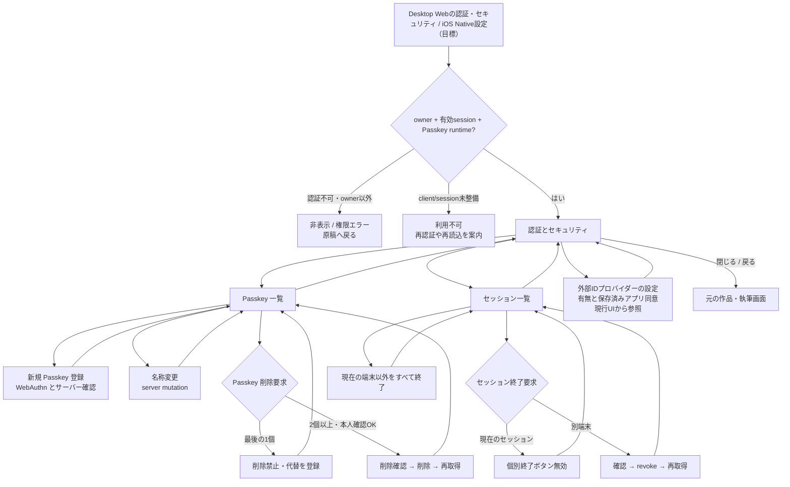
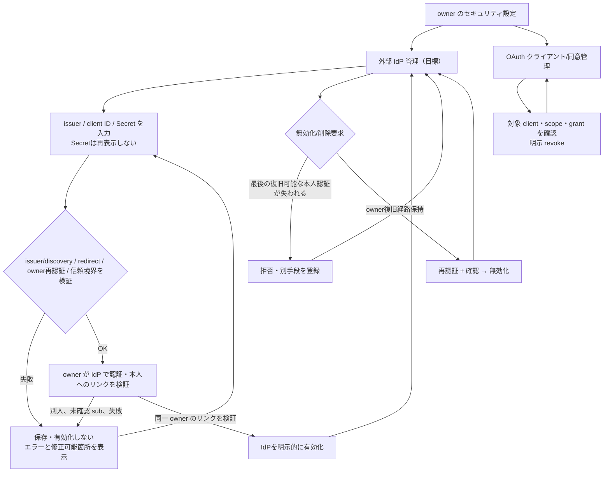
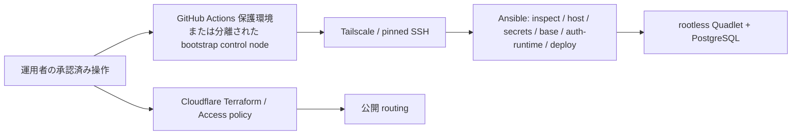
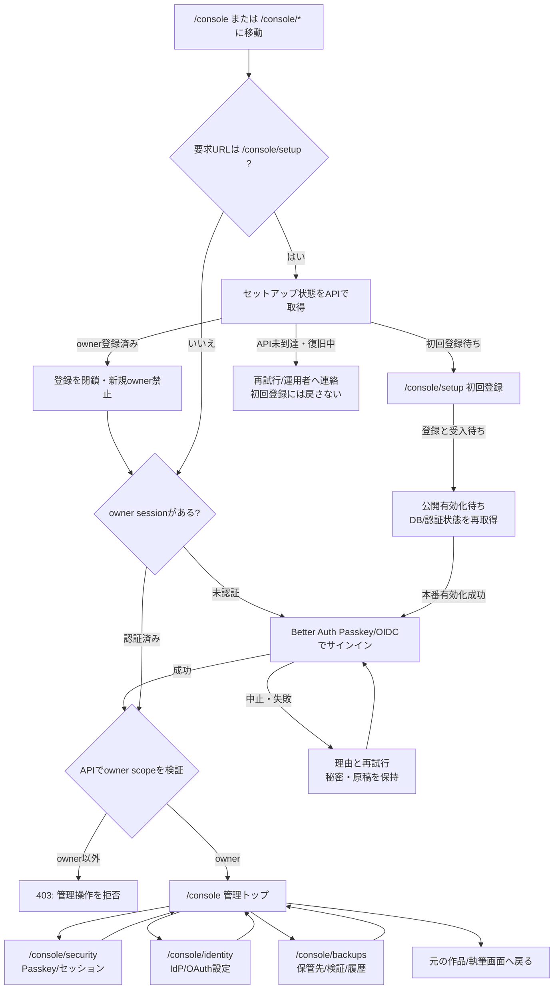
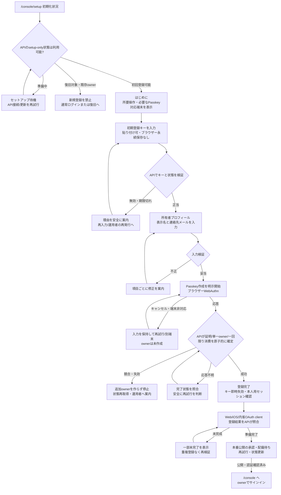
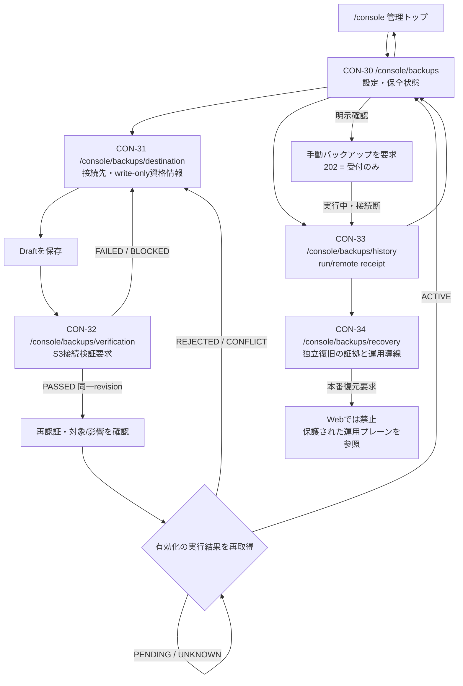

# 管理画面の遷移設計

**詳細画面設計:** [全画面・ボタン台帳](SCREEN-CONTROL-CATALOG.md)、[画面状態遷移図](SCREEN-STATE-ATLAS.md)、[URL/API認可設計](../architecture/ROUTE-AUTHORIZATION-CONTRACT.md) が初回SETUP、owner-session管理、OIDC/OAuth、運用プレーンの権限を区別する。

**種別は正本および規範的設計。** 管理者の識別情報、Passkey、セッション、外部 IdP と OAuth を管理する画面と操作の責務を定める。
作者本人の認証とセキュリティを扱う管理コンソールは Cloudflare Workers Static Assets の `/console` に置き、`/console/setup` を初回登録の入口とする。
VM、リリース、Cloudflare の運用は独立した運用プレーンが担い、管理コンソールは既存の認証基盤を使う。[API 認証・認可](../architecture/API-AUTHN-AUTHZ.md) ／ [システム基本設計](../architecture/SYSTEM-DESIGN.md)

Desktop Web は管理トップと初回登録を実装している。
`/console/security` で Passkey とセッションを管理し、`/console/identity` で外部 IdP の設定状態を確認し、保存済み OAuth 同意を参照または取り消せる。
原稿 Shell の認証とセキュリティのダイアログからも本人操作を利用できる。
所有者による OIDC 設定の登録、検証、有効化は採用目標である。[Owner OIDC 契約](../architecture/OWNER-OIDC-MANAGEMENT-CONTRACT.md)

バックアップ先の指定、接続検証、実行履歴の参照には `/console/backups` を使う。
実 S3 保管と独立復旧の受入は運用環境ごとに確認する。
特権 VM 操作と本番復元は運用プレーンが担う。[Backup console contract](../architecture/BACKUP-CONSOLE-CONTRACT.md)

作者用製品は Desktop Web である。
SwiftUI Native iOS は開発凍結中の採用目標で、実機受入を要する。
旧 Mobile React 設定 UI は製品導線から撤去済みであり、Native の本人認証と設定画面は独立して実装する。[iOS SwiftUI 正本](../architecture/IOS-SWIFTUI-ARCHITECTURE.md)

## 本人のセキュリティ管理画面（現在提供する範囲）

[既存の本人セキュリティ画面の遷移図をSVGで開く](https://yohn-jp.github.io/codexia/architecture/#admin-1)

- **Desktop:** 原稿 Shell の「管理コンソール」から `/console/security` と `/console/identity` に進む。原稿 Shell の「認証・セキュリティ」でも同じ管理画面をダイアログで開ける。
- **iOS Native目標:** SwiftUI設定・OS認証から許可された本人操作へ移動する。旧Mobile Reactの`view=settings` routeは撤去済みで、Native UIの正本ではない。
- **前提:** 管理コンソールでは Better Auth の所有者セッションを API で確認する。原稿 Shell のダイアログでは作者 scope `owner` も確認する。Passkey runtime やセッションを確認できない場合は、画面で再認証や再読込の方法を示す。
- **本人認証:** Better Auth session と必要な fresh reauthentication をサーバーで検証する。Passkey ceremony は安全な origin と利用者による明示操作を必要とする。

変更には **要求前の本人認証・owner 確認 → 対象識別 → 確認 → サーバー書込結果 → 最新一覧の再取得** を必須とする。一覧の取得失敗を操作失敗と同一視せず、「書込は成功、一覧更新は失敗」を区別する。書込の応答を確認できない場合は同じ一覧を再取得し、利用者に現在の状態を示す。最後の Passkey 削除や現在のセッション個別 revoke は UI 側でも抑止するが、API 側でも同じ権限・安全条件を検証する。

## 外部 IdP と OAuth クライアントの管理

`/console/identity` と原稿 Shell の設定は、運用者による設定の有無と、所有者との連携が未確認の状態を区別する。
保存済み OAuth 同意はクライアント ID と scope で参照でき、対象の確認と Passkey での再認証を経て取り消せる。
アプリへの同意は専用認可経路 `/oauth/consent` で行う。
図の IdP 変更経路は採用目標を示す。[API 認証・認可](../architecture/API-AUTHN-AUTHZ.md)

OAuth public Web / iOS / MCP clients は Better Auth の maintained OAuth Provider に登録する。ブラウザー・iOS の認証は Authorization Code + PKCE、MCP は対象 API resource と project assignment/scope の検証を要する。OAuth grant の取消し、セッションの revoke、既発行 access token の revoke は異なる操作であり、単にブラウザーから logout しても既発行 JWT の revoke にはならない。

**管理画面の安全契約:** 任意のアカウントによる自己登録、別ユーザーへの暗黙の ID 紐付け、client secret のブラウザー保存、権限確認なしの IdP 追加、OAuth client scope の無制限な拡張、未検証設定の「有効」表示は禁止する。owner の IdP を喪失した場合も、独立した承認済み recovery 手順で Passkey を復旧する。具体手順は [Ansible 認証初期化](../../deploy/ansible/AUTH-RUNTIME.md) が所有する。

## インフラの管理プレーン（Web UI の外）

本番 API の更新、DB migration、Podman secret、Tailscale 接続、Cloudflare Access 改訂、**本番DB/運用資源の復元**は**作者の Web 設定画面から実行しない**。一方、**S3互換バックアップの保管先・ポリシー指定と検証・保全ジョブ要求・履歴参照**は `/console/backups` の機能として採用する。Webは任意のVMコマンド/SSH/RPCを実行せず、限定された設定とdurable requestのみをFastifyへ提出する。実行はoperatorが事前設置した専用バックアップexecutorが担い、既存backup.sh/host lockを再利用する。これらには独立した運用者権限、保護された秘密情報、承認済み手順と監査証拠が必要である。経路は [初期デプロイ遷移](../deployment/INITIAL-DEPLOYMENT-FLOW.md) と [アップデート遷移](../deployment/UPDATE-FLOW.md) を正本とする。

## 誤操作・障害時の遷移

| 状態 | 表示/処理 | 保護するもの |
| --- | --- | --- |
| session 期限切れ / owner でない | 再認証または操作不可。管理情報を返さない | 権限と原稿 draft |
| WebAuthn のキャンセル・未対応端末 | 操作を中止し、Passkey 一覧へ戻る | 既存 credential |
| 最後の Passkey の削除 | 拒否。別 Passkey 登録を案内 | owner の復旧可能性 |
| 削除・revoke 書込み結果不明 | 同じ要求の状態を再取得し、成功を推定しない | 対象と操作 identity |
| IdP の疎通失敗（目標 UI） | 未検証設定を有効化しない | 既存サインイン経路 |
| 管理操作中に原稿の未保存変更 | 元の journal と editor を保護してから遷移 | 入力・作者 scope |
| 公開経路・VM 操作で障害 | Web UI に迂回権限を与えず、管理プレーンの停止/復旧手順へ | 既存サービスとバックアップ |

**受入条件:** Desktop Webの実ブラウザーとiOS Nativeの実機で、各設定・本人操作、owner/non-owner、Passkey 登録/名称変更/最後の1個削除拒否、別セッション revoke、認証失効・ネットワーク障害、元の原稿への安全な復帰を確認する。外部 IdP と OAuth 管理は別途 E2E と本人同一性・CSRF・権限拒否を検証する。Web に運用コンソールがないことは欠落ではなく信頼境界の決定である。

## 管理コンソールのルート・認可と情報設計

| URL | 画面責務 | 表示・操作の前提 |
| --- | --- | --- |
| `/console` | 管理トップ。本人認証状態、設定の準備状況、Passkey/セッション/連携先への導線、操作結果 | Better Authの有効なowner session |
| `/console/setup` | **初回所有者だけ**の登録ウィザード。セットアップの状態確認、初期登録キー入力、Passkey作成、登録完了 | 正本DBが新規構築を承認済み・owner未登録・期限内の一回限りのキー |
| `/console/security` | Passkey一覧、追加・名称変更・削除、セッション一覧と終了、再認証 | owner session。危険操作はfresh reauthentication |
| `/console/identity` | OIDCの登録・検証・有効化、OAuthクライアント・同意の参照／許可された取消し | owner sessionと操作ごとの認可。現在のIdP変更UIは未実装 |
| `/console/backups` | S3バックアップ設定状態、検証済み保全点、手動ジョブ要求、運用状態 | owner session。操作ごとにfresh reauthentication |
| `/console/backups/destination` | S3互換接続先・暗号化済資格情報のwrite-only設定、検証、有効化 | owner session＋検証/active revision |
| `/console/backups/verification` | draftのS3疎通probeと適用結果を照合 | owner session。202 は要求の受付を示す |
| `/console/backups/history` | 各実行と遠隔保全receipt、復旧演習結果への導線 | owner session。復元ボタンは提供しない |
| `/console/backups/recovery` | 隔離復元証拠と保護された運用復旧手順を表示 | owner session。実本番復元はOPERATORだけ |
| `/oauth/consent` | OAuthの同意。管理コンソールから**独立**した認可画面 | 既存のBetter Auth/OAuthプロトコル |

静的UIは既存の**Cloudflare Workers Static Assets**で提供し、`/console/*` は同一のWeb UIのルートとして管理する。登録状態、初期キー検証、owner確定、Passkey ceremonyはCloudflare Workersでなく、Cloudflare Tunnel経由の**VM上のFastify + Better Auth / `codexia_auth`**が権威を持つ。**セットアップキーはインフラ権限でも通常のAPI bearerでもない**。Cloudflare AccessはUI入口の保護策として別途承認・検証し、owner権限の根拠としない。

[コンソール全体の遷移図](https://yohn-jp.github.io/codexia/architecture/#admin-4)

### 初回所有者登録ウィザード（`/console/setup`）

**目的:** VMをAnsibleで構成した後、所有者本人がブラウザーだけでPasskeyを登録できること。SSHによる一時Webサーバー手動起動、ポートフォワード、SQL、環境変数編集、登録済みowner IDの転記を**通常の初回登録導線から排除する**。AnsibleはCSPRNGによる256 bitの初期登録キーの発行・安全な引渡しに責任を持つが、ownerを登録しない。実装契約は [初期導入遷移](../deployment/INITIAL-DEPLOYMENT-FLOW.md) と [API認証設計](../architecture/API-AUTHN-AUTHZ.md)。

[初回登録の画面遷移図](https://yohn-jp.github.io/codexia/architecture/#admin-5)

| 画面・状態 | 画面の主操作 | エラー時の扱いと回復 |
| --- | --- | --- |
| 初期化状況 | 必要な作業とセットアップ状態の表示、再読込 | DBが不明・復旧中ならowner新規作成を提示しない |
| キー入力 | 安全な入力欄、貼り付け、検証、戻る | キー全体をURL、分析ログ、Web Storage、エラー表示に残さない。無効・期限切れ・失効は再発行を案内 |
| プロフィール | 表示名と連絡先メールを入力・確認 | メールアドレスだけでowner権限やアカウントリンクを確定しない。Better Authの内部user IDが正本 |
| Passkey作成 | ユーザーの明示クリックでWebAuthn、利用可能端末で本人確認 | キャンセル/非対応/不正origin・challengeを区別。検証前にowner登録完了と表示しない |
| 完了確認 | owner確定・OAuth client準備状態をAPIから再取得 | 応答喪失を未実施と推定しない。二重owner/二重キー消費を拒否 |
| 本番公開待ち | 構築担当に必要な承認を案内、状態を更新 | UIからSSH/Ansible/デプロイ権限を行使しない。公開が失敗しても認証DBを初期化しない |
| 完了・サインイン | /consoleへ進む、認証設定を確認 | sessionがない場合は通常のPasskeyログインへ誘導し、登録処理を再開しない |

**UX品質:** Desktop Webの`/console`で深いURL・再読込・キーボード操作・可視フォーカス・スクリーンリーダーの状態通知を確認する。iOS NativeではSwiftUI画面遷移とOS認証、VoiceOver、IME、再開を物理iPhoneで独立検証する。Mobile React viewport E2Eを要求しない。非同期処理中の重複送信防止と再開可能性を満たす。初期登録キーは通常のサインインパスワードではなく一回限りの導入資格情報として扱う。管理コンソールへ遷移するときも執筆中の下書きを破棄しない。OAuthのclient secretや初期キーをフロントエンドの配信物へ同梱しない。

### 管理トップと日常的な設定変更のUX

`/console` は初回登録を終えたownerだけのホームであり、**セキュリティ**（Passkey・セッション）、**連携ID**（OIDC）、**アプリのアクセス**（OAuthクライアント・同意）、**バックアップ**（S3保管先・検証・保全履歴）の四つの操作群を区別する。旧Mobile React設定の再利用は要求しない。iOS NativeはSwiftUI独立UIと同じAPI契約を使用し、別の認証DB・権限正本を作らない。危険操作は対象を明示して確認、fresh reauthentication、サーバー書込結果、再取得の順とする。失敗後も最後の本人認証手段を維持する。

Desktop Web の本人管理への正規導線は `/console/security` とし、ログインと戻り先には同一 origin 内の安全な既知ルートのみを許可する。

## 管理コンソールの受入条件

- Workersの`/console`、`/console/setup`、`/console/security`、`/console/identity`はDesktop Webで直接訪問・再読込でき、SPAの404にならない。iOS Nativeは別の画面/認証導線で実機受入を行い、Mobile React WebとのURL互換を要求しない。
- 新規DBではキー検証からPasskey確定、登録後の同一キー拒否、API応答不明からの状態照合、本人の通常ログインまで実ブラウザーで確認する。
- 既存owner、復旧中、キー失効・期限切れ・競合、非owner、API/DB障害、WebAuthn不正origin/UV不備をすべて拒否し、公開経路が作業APIへの抜け道にならない。
- セキュリティ設定はログイン維持・再認証・最後のPasskey削除拒否・セッション失効・原稿へ戻る際の下書き保護を通す。
- Cloudflare Access、Tunnel、Workers、独立VM・復旧ホストについて、必要な経路での公開/拒否を**実測**する。本文書の図だけでは本番受入としない。

## バックアップ保管先と履歴の管理画面（`/console/backups`）

**目的:** ownerがSSHや環境変数の手入力を行わず、**保護済みのS3保存先をUIから指定し、接続を検証して有効化**できること。保全完了・復旧可能性を推測せず、ジョブ結果と証拠を区別する。画面ID `CON-30`〜`CON-34`、control ID、実認可は [Screen catalog](SCREEN-CONTROL-CATALOG.md)、[State Atlas](SCREEN-STATE-ATLAS.md)、[Backup console contract](../architecture/BACKUP-CONSOLE-CONTRACT.md) が正本。

画面の状態・回復を次のように区別する。

| 表示 | 意味と次の操作 |
| --- | --- |
| 未設定 / Draft | オフVM保管先は未有効。接続先を設定し検査する。編集途中の秘匿値は保存後に再表示しない |
| PROBE_PENDING / FAILED | テスト送信でありバックアップではない。エラー区分・設定を修正して再検証 |
| PROBE_PASSED | S3に検証用暗号文を送受信できた。保全点やDR復元の証拠にはならない |
| ACTIVE | 設定がexecutorに適用された状態。新しいbackup runがまだ無ければ「オフVM未保全」を表示 |
| RUN_QUEUED / RUNNING / UNKNOWN | 現行writerの停止を伴い得る。API/Tunnel切断時もrun IDから再照合。成功・失敗を推測しない |
| REMOTE_VERIFIED | 暗号文・manifest・独立保護receiptを一致確認したoff-VM保全点 |
| DRILL_PASSED | 独立した復旧hostで実データ契約を満たす復号・復元を観測した別の証拠。REMOTE_VERIFIEDと混同しない |
| DISABLED / DEGRADED | 既存のオフVM保全を削除しない。required保管先の停止は保護条件を検証し拒否する |

本画面を開く前のブラウザー原稿draftは既存の離脱ガードで保護する。Desktop Webのキーボード・スクリーンリーダー・再認証・戻り先、連続操作/応答喪失をPlaywrightで確認する。iOS Nativeは実機/Simulatorで独立検証し、Mobile React 320px専用E2Eは要求しない。

Desktop Web は設定、接続検証と有効化、手動ジョブの要求、実行履歴と復旧証拠の表示に対応する。
API と executor の有効化はオペレーターが行う。
遠隔保全と独立復旧の受入は、実際の保管先と復旧ホストで確認する。[Backup console provisioning](../../deploy/backup/CONSOLE.md)
