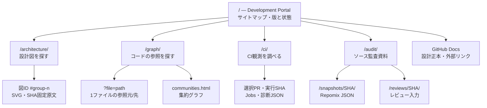
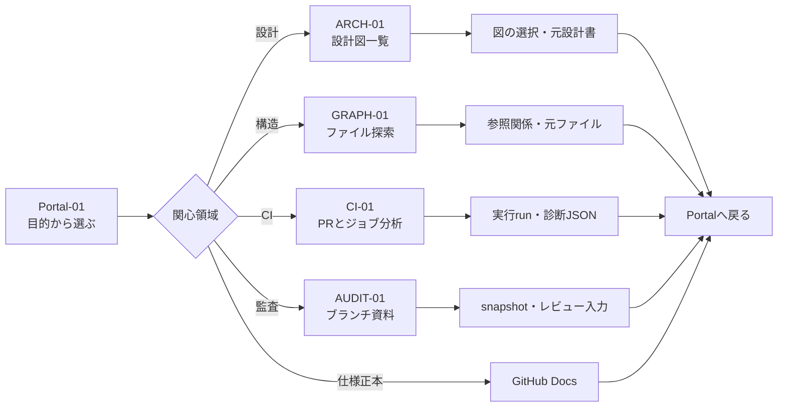
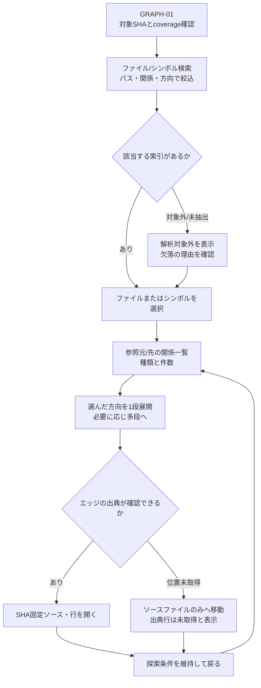
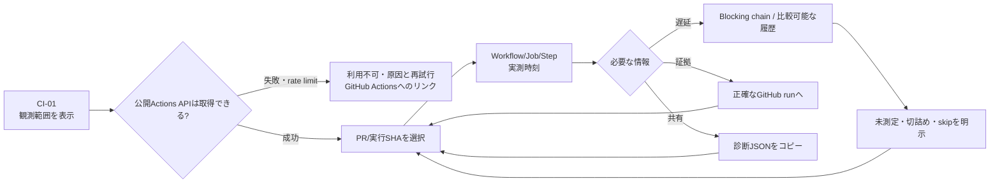
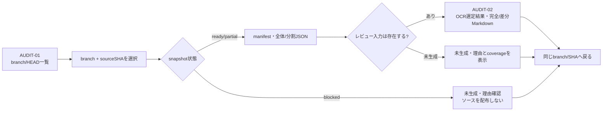
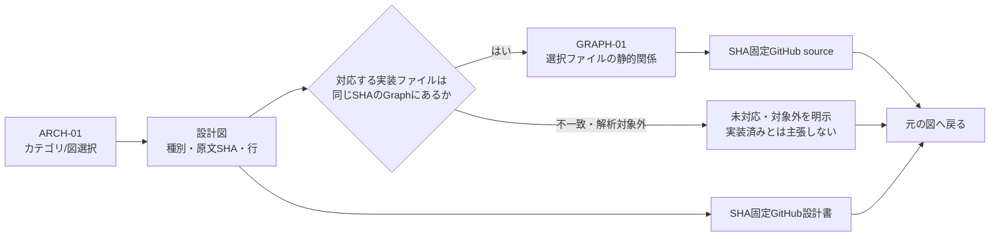

# GitHub Pages 統合ポータル — サイトマップと画面UX設計

**文書種別は設計詳細。** Codexia の GitHub Pages が提供する開発ポータルの画面と操作を扱う。
運用と出典は各機能の資料を参照する。[Pages 機能棚卸し](../verification/PAGES-FUNCTION-INVENTORY.md) ／ [CI/CD](../verification/CI-CD.md) ／ [Architecture Atlas](../verification/ARCHITECTURE-ATLAS.md) ／ [CI Observatory](../verification/CI-DASHBOARD.md) ／ [Graphify](../verification/GRAPHIFY-PAGES.md)

## 目的、閲覧者、設計原則

**主目的:** 開発者・レビュアーが「設計、コード構造、CI観測、監査用ソース」を迷わず発見し、情報の対象SHA・信頼性・観測範囲を確認して、元データまで追えること。

- **主役はリポジトリと版の同一性。** ページは独立した「今」を持つ。Auditのremote HEAD、Graph/Atlasのbuild SHA、CIのbrowser観測時点を明確に分離し、サイト全体を一つのリアルタイム状態として見せない。
- **入口は一つ、公開者も一つ。** `/`を総合サイトマップにし、既存の`repository-audit.yml`と`github-pages`環境を使う。各生成器に別のGitHub Pages publish権限を与えない。
- **導線は深くても戻れる。** 全主要ページに共通のプライマリナビ、ページ名、データ出典、現在位置、トップへのリンク、画面内の説明を用意する。既存の`?file=`、`#admin-5`、SHA別アーティファクトのディープリンクを壊さない移行手順が必要。
- **図は説明、証拠は別。** Architecture Atlasは採用設計を示す。Graphifyは静的観測を示す。CIは選定した公開ワークフローデータを示す。Auditはソースを配る。図・エッジ・待ち時間だけで利用実績、削除可否、全CI成功、本番受入を宣言しない。
- **秘密と操作権限を持たない。** 静的PagesにはGitHubトークン、VM情報、環境シークレット、原稿データ、管理操作を配置しない。公開されるソース監査データには別途公開許可と機密検査を要求する。

## 1. サイトマップ

`/` は開発ポータルのトップ、`/audit/` は監査の入口とする。
資料の閲覧には `/snapshots/<SHA>/` と `/reviews/<SHA>/` の既存 URL を使う。
ポータルの文書リンクから GitHub の正本へ移動する。[設計書の正本](../README.md)

| URL | 表示名 / 画面ID | 責務 |
| --- | --- | --- |
| `/` | Portal / PORTAL-01 | 主要4機能への入口、サイトマップ、ビルド SHA、GitHub への導線 |
| `/architecture/` | Architecture Atlas / ARCH-01 | 正本の設計図を選択し、生成 SVG と SHA 固定の原文を閲覧 |
| `/graph/` | Code Map / GRAPH-01 | Graphify が抽出したファイルとシンボルの静的参照を探索 |
| `/graph/communities.html` | Community Overview / GRAPH-02 | Graphify の集約概観を閲覧 |
| `/ci/` | CI Observatory / CI-01 | PR と実行 SHA を起点とする公開 CI テレメトリ、履歴、診断 JSON |
| `/audit/` | Source Audit / AUDIT-01 | 観測したブランチ、snapshot、レビュー入力の索引と収録状況 |
| `/reviews/<SHA>/` | Review Materials / AUDIT-02 | OCR が選定したレビュー入力、差分、収録の根拠 |
| `/snapshots/<SHA>/` | Source Snapshot Artifacts / AUDIT-03 | Repomix の全体 JSON、分割 JSON、manifest |
| GitHub Docs / Repository / Actions | External | 正本ドキュメント、ソース、Actions の実行記録 |

サイト内の `/` は GitHub Pages のプロジェクトパス `/codexia/` を指す。[統合ポータルの生成物](../verification/PAGES-FUNCTION-INVENTORY.md#統合ポータルの生成物)

### 図1: サイトマップ（ページ/生成物の区別）

## 2. グローバルな情報設計

**Desktop:**

1. **グローバルヘッダー:** `Codexia / Development`、`概要`・`Architecture`・`Code Map`・`CI`・`Source Audit`。正本GitHub Docsは外部リンクとして明示する。各機能の現在位置は`aria-current`で示す。
2. **トップの主領域:** ユーザーのタスクから探せる4カテゴリカード。「設計を確認」「コード構造を追う」「CIの待ちを分析」「レビュー資料を得る」。各カードは**何が分かるか・何が分からないか・データの基準**を短く記載し、一つの明確な操作リンクを置く。
3. **サイトマップ:** 全主要URLと説明、詳細画面・ダウンロードの関係を表示。生成されなかった機能を機能一覧から消さず「利用不可／証拠不明」と示し、代替のGitHubリンクを提供する。
4. **版とデータの帯:** 「Published Pages source SHA」（サイト生成に使用したmain SHA）と、各機能の観測モデルを別々に表示。CIを`live`、Graph/Atlasを`build snapshot`、Auditを`branch snapshots`として区別する。
5. **補助領域:** サイトの生成方針、検証対象、Docs・Actionsへのリンク。実際のrunner/CIのグリーン判定は表示しない。

**Mobile（幅320pxから）:** ヘッダー・ナビを折畳可能にし、カードは1列、サイトマップは読みやすい入れ子リストへ。モーダルでナビを占有しない。長いファイル名/SHAは改行できる一方、全文をコピーできる。キーボード、focus-visible、スクリーンリーダーの見出し階層、reduce-motionに対応する。

**共通ルール:** カードは単なる大きなリンクにせず、説明・対象SHA・閲覧入口を分離。サイトのリンクはサイトルート相対/相対URLを使い`/codexia/`というGitHub Pagesのproject pathを壊さない。状態表示は`loading`・`ready`・`empty`・`unavailable`・`truncated`・`stale`を区別し、HTTPエラーやAPI制限を空データと混同しない。

共通ナビゲーションは、リンクの順序と現在位置を画面幅によらず揃える。
キーボードで本文に移動できるようにし、フォーカスを明示する。
主なモバイル操作には 44 CSS px を目安とする操作領域を確保し、長いパスや SHA は折り返す。
図や表の横スクロールは各表示領域に収める。

### 図2: トップから各機能に進む画面遷移

## 3. 各画面の操作契約

| 画面ID | 初見で分かること | 主要操作 | 失敗/空/再読込時の表現 | 元のコンテキスト |
| --- | --- | --- | --- | --- |
| PORTAL-01 | 全ツール、何を調べられるか、公開の版 | カテゴリを選択、Docsへ移動 | 一部生成なし→個別の利用不可。全体を空白にしない | トップから戻った際に開いていた区画 |
| ARCH-01 | 設計上の対象/図名/正本SHA | カテゴリ、図選択、ズーム、原文/単体SVG | 描画失敗→原文リンク。図が実装済みとは書かない | 図のハッシュ、倍率は選択後初期化 |
| GRAPH-01 | 対象SHA、解析対象・除外範囲、選択ファイル | 検索・filter・ファイル選択、多段追跡（目標） | indexed 0・未解析・関係0を区別、relation missingを推定しない | `?file=`と選択方向/絞込条件 |
| GRAPH-02 | コミュニティ概要は集約ノードである | native graphを閲覧し、ファイル探索へ戻る | community 0 ≠ ソース未使用 | 概観から元の選択ファイルへ戻れる導線（目標） |
| CI-01 | 選択PR/実行SHA、observed time、取得上限 | PR選択、Job/step分析、コピー、GitHubへ | API制限・不完全・失敗/skipを分ける | 選択PR/ソースを戻して比較可能（目標） |
| AUDIT-01 | remote branch HEADとパッケージ状態 | branch選択、SHA manifest、レビュー入力 | blocked/partial/除外を明示、完了と扱わない | 同じbranch/SHAに戻れる |
| AUDIT-02 | OCRによる**レビュー入力**でAIレビュー結果ではない | 差分・完全版ダウンロード、coverage確認 | 生成不可なら除外理由/元SHAへ | AUDIT-01のSHAへ戻す |
| AUDIT-03 | SOURCE SHA、分割範囲、manifest整合 | JSON閲覧・取得 | 不足/partialは理由を明示 | SHA/branchの元索引 |

## 4. Graphifyの分析UX（重点改善案）

現行に既にある**パス/シンボル検索、参照元・先一覧、各方向8件の隣接図、200件の検索結果、`?file=`、コミュニティ概観**は維持・再利用する。「検索機能がない」とは扱わない。

**GRAPH-01 画面の情報階層:**

- 左: 検索、ディレクトリ/パッケージ、関係種別`imports`・`calls`等、方向（参照元/先/両方）、深さ（まず1・必要時に2以上）、解析対象フィルタ。
- 中: 現在選択しているファイルまたはシンボル、隣接グラフ、段階的な多段展開、折畳み。表示件数制限・省略理由・循環・重複を明示し、ただの大量ノードを一度に描かない。
- 右（Mobileは下）: エッジの方向・種類・件数、出典ファイル/行（取得できる場合）、SHA固定ソースへのリンク、解析範囲と欠落の説明。エッジを「実行時に呼ばれた」と表示しない。
- 上: 固定された`sourceSha`と`tracked`/`eligible`/`extracted`/`excluded`（集計不能なら未取得）、relation種別と抽出条件。Graphifyが認識しなかったものを`0 references`とは呼ばない。
- 未使用ファイルの推測は禁じる。無参照候補から「実行時/ルート/CI/テスト/動的登録を別証拠で確認する」へ進む**検証チェックポイント**とし、削除判断は設計正本とコードの実到達調査へ委ねる。

**データ契約:** 現在の`graph.json`/`git ls-files`の一致した索引を基礎とし、集約したfile-level graphだけで失われるsymbol-level edgeは**source graphから追加の索引を導出する**。座標・実行時参照・テストとの対応が実際に得られない場合、推測したURL/行番号や「依存なし」表示を作らない。2版比較は両ソースの許可・抽出recipe・欠落を検証した場合に限り有効化する。`/graph/communities.html`の上流HTMLは独立した集約概観として残す。

### 図3: ファイル・シンボルを根拠まで追う

**関連する別表示（後続段階）:** ファイル/モジュールの差分比較、追加/削除エッジ、入口からの到達、リンクされたCI証拠の確認。ただし、Graphifyで**静的に抽出された関係**と、実行/テストにより**確認された利用**は証拠の種別を別に表示する。

## 5. CI分析のUX

`/ci/`は動的APIに依存する**読み取り専用観測画面**であり、マージ許可・リリース判定UIにしない。現行のPR選択、ジョブタイムライン、blocking chain、最長step、診断JSONコピーを維持する。未取得のtask時間を「0秒」と表示しない。必要なtask-level telemetryは別途収集の承認、権限・データサイズ・プライバシーの検証が必要である。

### 図4: CI観測から実行証拠へ

## 6. AuditとArchitectureのUX

**Audit:** remote branch HEADから選ぶ。`ready`、`partial`、`blocked`、`no-diff`を区別。資料の生成者/出典/差分基準と「AIレビューを実行していないこと」を明記する。`/`から移した`/audit/`は索引画面であり、`/manifest.json`・`/snapshots/`・`/reviews/`の実体を二重生成しない。

### 図5: Branchからレビュー入力/ソースへ

**Architecture:** 現在の原文SHA、採用設計/目標/未実装の別を示したうえで、図→文書→関連ファイルを明示的に移動する。図の選択だけで実装済みとしない。Graphへの遷移は対象ファイルが**そのGraphの解析済みSHAに存在する場合に限る**。一致しない場合は「版が異なる」「索引外」を案内し、誤ったGraph URLを生成しない。

### 図6: 設計からソース証拠まで

## 7. データ、ナビゲーション、公開責務

### サイト一覧の生成契約

単一の Pages ワークフローが `site-manifest.json` を生成する。
台帳は同じサイト artifact の経路と出典を記録し、公開前の整合性検査にも使う。[Repository Audit Pages](../../.github/workflows/repository-audit.yml)

推奨属性: `route`、`label`、`description`、`category`、`sourceSha`（対象ごと）、`generatedAt`または`observedAt`（実在する時だけ）、`generationStatus`、`coverageStatus`、`dataKind`（`build-snapshot`/`branch-head-snapshot`/`browser-live`）、`externalDocumentationUrl`、`internalLinks`。`runId`はGitHub Actionsが保証する値がある場合に限る。**秘密・ユーザー情報・CIの任意artifactをmanifestへ転記しない。**

- 各表示の設計・実装に関する事実はそれぞれの既存generator/runbookを正本とする。共通ページ登録は**導線と出典メタデータ**に限定し、Graph、Atlas、CI、Auditのドメインデータを移し替えない。
- 共有ナビはbuild時に検証され、すべての利用可能な主要入口へ実際に遷移できること。生成不可のページを完成済みとして表示しない。
- Audit現行の`/manifest.json`はbranch/snapshotの索引であり、**新しいサイト全体manifestと同名で上書きしない**。
- 既存ディープリンクの移行はURLの利用範囲を確認して決める。ルートを増やして終わりにせず、重複する2つのUI索引や2つのpublisherを常設しない。
- GraphとArchitectureは同じビルド内のSHAを出し、Auditだけは複数branch HEADを提供する。CIのライブ取得をビルド時のsnapshotと取り違えない。
- GitHub Pagesは読み取り専用。外部GitHub APIが停止した場合もGraph/Atlas/Auditを同時停止させない。

## 8. 提案する実装順・受入条件

| 段階 | 必須結果 | 対応する不足ID | 検証方法 |
| --- | --- | --- | --- |
| Phase A — 安全なポータル入口 | 公開範囲を確認、`/`にサイトマップとカテゴリ、共通ナビ、版/対象範囲を表示。監査トップを`/audit/`へ移す場合は既存deep linkの影響を確認 | PG-01/02/03/05/13/14 | 同一Pages artifactの全公開ルートをenumerate・リンク検査。PR previewとmainの出力を区別。秘密・公開範囲を確認 |
| Phase B — Graph usability | 既存検索/選択を保ち、coverage、filter、限定多段展開、エッジ出典の分かる範囲を実装 | PG-04/06/07 | 小さな既知グラフでfile/symbol direction、path、循環、除外、存在しない行番号をテスト。実ブラウザーで操作 |
| Phase C — 相互参照と高度分析 | 同じSHAで設計→コード→CI/証拠のリンク、必要に応じ2版差分。task-level CI分析は別のデータ認可を満たすときだけ | PG-08/09/10/11/12/15 | SHA不一致/未解析/制限API/外部障害で虚偽表示しない。参照元なしを未使用と断定しない |
| Deferred | `/docs/` Pagesミラー、新しいメタデータサービス、可変バックエンド、削除自動判定 | PG-16 | 具体的な要件と運用負担が成立するまで実装しない |

**最低限の受入シナリオ:**

1. Desktopと320px幅Mobileでトップから**すべての主要機能**へ2操作以内に到達でき、深いURLから戻れる。直接訪問・再読込・失敗表示・キーボード操作が成立する。
2. Graphで既存の`?file=`リンクを保持し、解析されないファイル/孤立ノード/循環/シンボル名重複/エッジなしを区別する。上限で図に出ない隣接が一覧から消えない。
3. Architectureの図は原文のGit SHAと行に結びつき、提案/未実装機能を実装完了と表示しない。元の`#admin-5`等の図ディープリンクは変えない。
4. CIでHTTP 403/429、欠損step、履歴の切詰め、失敗/skipを成功と誤記しない。コピー操作は実際のブラウザー結果に従う。
5. Auditでsecret/非公開branchへの曝露を防ぐ公開判定が行われ、`partial`/`blocked`の資料を完成版と偽らない。
6. 生成した公開siteのサイトマップ、ナビリンク、asset、manifestの**存在と相互一致**を機械検査する。PR previewのブラウザースモークとmainのPages配信実測は別の証拠にする。

複数版 Graph の保持、追加のソース位置索引、タスク単位の CI テレメトリ公開は将来の設計候補とする。
