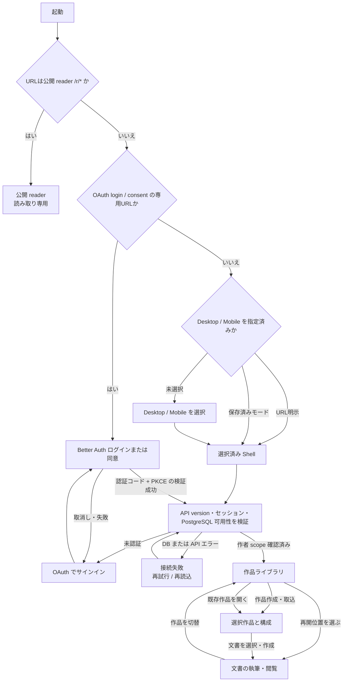
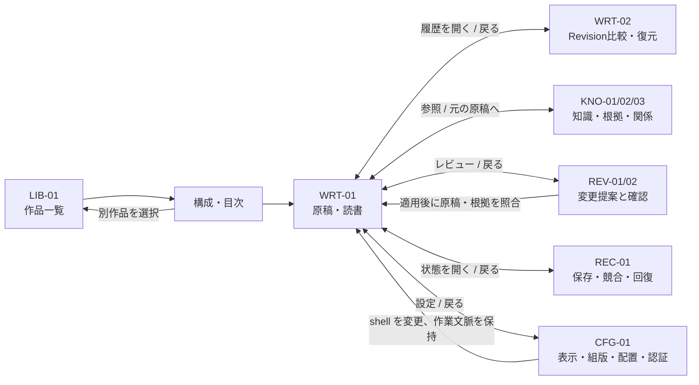
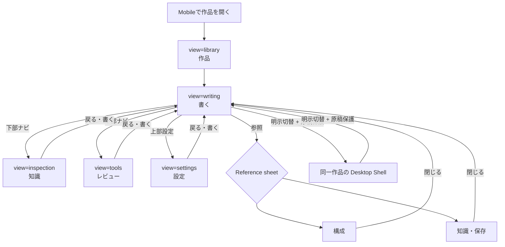
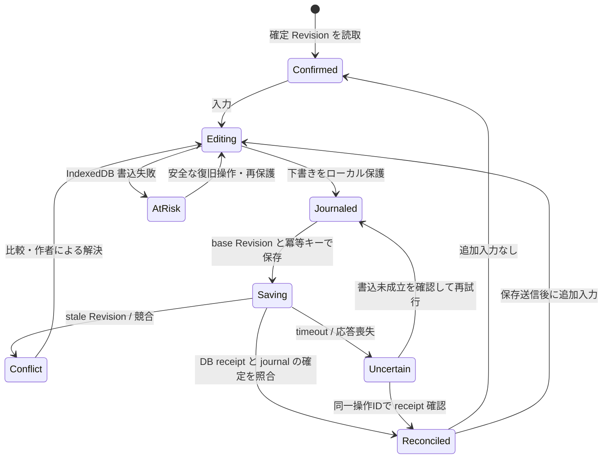

# 利用画面の遷移設計

**種別: 正本・規範的設計。** 本書は作者が Desktop / Mobile / iOS から作品を利用する際の画面、遷移条件、失敗時の扱いを定義する。画面配置・内部 UI の実装をそのまま設計の正本にしない。[システム基本設計](../architecture/SYSTEM-DESIGN.md)、[UX 契約](UX-CONTRACT.md)、[情報設計](INFORMATION-ARCHITECTURE.md)に従う。

## 起動から作品への遷移

未認証と PostgreSQL 不可を同じ「作品なし」画面へ変換しない。サインイン時・サインアウト時・作者 scope 変更時には未保存の原稿と回復 journal を保護し、失敗しても別作者の作業領域を表示しない。ログインと認可は [API 認証仕様](../architecture/API-AUTHN-AUTHZ.md) を正本とする。公開 reader は作者用エディターと独立し、書込操作へ進ませない。

## 執筆を中心とした利用画面

画面 ID は論理識別子であり、各状態への新しい独立 URL や新たなデータベースを意味しない。専用ルートを設ける場合も [情報設計](INFORMATION-ARCHITECTURE.md) の既存 scope と guard を維持する。

- **作品と構成:** 作成、インポート、選択、再開、巻・章・シーン・ノートの作成・移動を許された API 操作へ結び付ける。存在しない文書の直接リンクを空の編集画面で成功扱いしない。
- **原稿:** CodeMirror の入力・IME・カーソル・選択・undo を表示更新で破壊しない。読書表示や日本語組版の変更は Markdown 原稿への暗黙の編集としない。
- **履歴:** 元 Revision の表示、比較、復元を分ける。復元は新しい Revision を作り、過去の確定内容を破壊しない。
- **知識・根拠:** 人物・設定・根拠・Evidence の一覧と詳細へ移動しても、元の document、selection、scroll、作者 scope を維持する。履歴が現在の Revision に一致しない根拠は再確認を要求する。
- **レビュー:** Native ChangeSet と Module proposal はそれぞれの作者承認・適用契約を保持する。提案の閲覧だけでは適用しない。外部 MCP は作者承認を迂回しない。
- **設定:** 外観・組版・Workspace、認証・セッションへ到達する。管理者の資格情報変更は [管理画面遷移](ADMIN-SCREEN-FLOW.md) に従う。

## Desktop と Mobile の導線

| 観点 | Desktop | Mobile |
| --- | --- | --- |
| Shell | `/desktop/` | `/mobile/` |
| 作品・文書の正規 URL | `/desktop/projects/:projectId`、`/desktop/projects/:projectId/scenes/:documentId` | `/mobile/projects/:projectId`、`/mobile/projects/:projectId/scenes/:documentId` |
| 作業面 | 可動 Workspace: 構成、原稿、知識、レビュー、任意 panel | `?view=library`・`writing`・`inspection`・`tools`・`settings` の一画面選択 |
| 主導線 | 構成 / 原稿 / 参照パネル、Workspace の tab や分割 | 「作品」「書く」「知識」「レビュー」の下部導線、独立の「設定」入口 |
| 執筆中の参照 | 知識・構成 panel を併置 | 「構成」「知識・保存」の reference sheet を開閉 |
| 端末切替 | Mobile に明示切替 | Desktop に明示切替 |
| 共通原則 | 作者・作品・本文・回復は同一 API/journal 契約 | 同左。viewport の幅で自動的に別 Shell へ移行しない |

`view` は Mobile の表示 state として URL query に保持する。Desktop / Mobile 変更でも project/document の識別は維持する。Mobile の現在の reference sheet を閉じる通常操作によって editor を再生成しない。執筆前の保護処理が拒否した場合は表示をそのまま維持し、理由と再試行を示す。

## 保存・復旧の状態遷移

「保存中」「このブラウザーに下書きあり」「PostgreSQL へ保存済み」「状態の確認が必要」は相互排他的な一個の変数ではない。保存要求後に加えた入力を、先に返った成功 receipt の内容に含めない。競合、local quota 不足、ネットワーク断、認証失効、unknown response は異なる回復指示を出す。原稿を黙って破棄・強制上書き・自動 conflict merge しない。具体的な UI 状態は [Interaction contract](INTERACTION-CONTRACT.md) を使用する。

## 権限・異常系と受入

| 条件 | 設計上の画面動作 |
| --- | --- |
| 未ログイン、OAuth キャンセル | 明示的な認証入口へ。成功画面は表示しない |
| 権限拒否、他作品の ID | 対象を表示せず、作者 scope を保ったエラーと戻り先を示す |
| DB 不可、API の応答不良 | 認証未済と区別して再試行。Git/ファイルに切替えない |
| 作品・文書の不存在 | 選択中作品の目次または作品ライブラリへ誘導する |
| stale network response | navigation generation と Revision で破棄し、現在の編集を差し替えない |
| optional module 不可 | 関連する panel のエラーに限定し、Core 原稿を利用可能に保つ |
| 競合・回復保護に失敗 | 遷移を禁止し、原稿・journal・作業 context を残す |

**受入証拠:** OAuth あり/なし、Desktop/Mobile、Core/Full、深いリンク、操作中の IME、端末切替、保存追加入力、競合、応答喪失、ブラウザー再読込、作者切替、権限拒否を実ブラウザーと実 PostgreSQL で確認する。本書は画面操作の正本であり、上記がすべて実装・検証済みであるとの宣言ではない。
