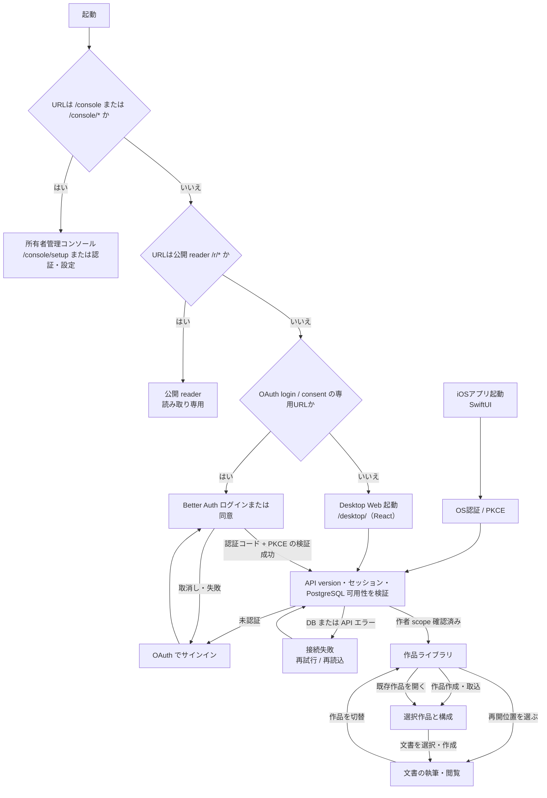
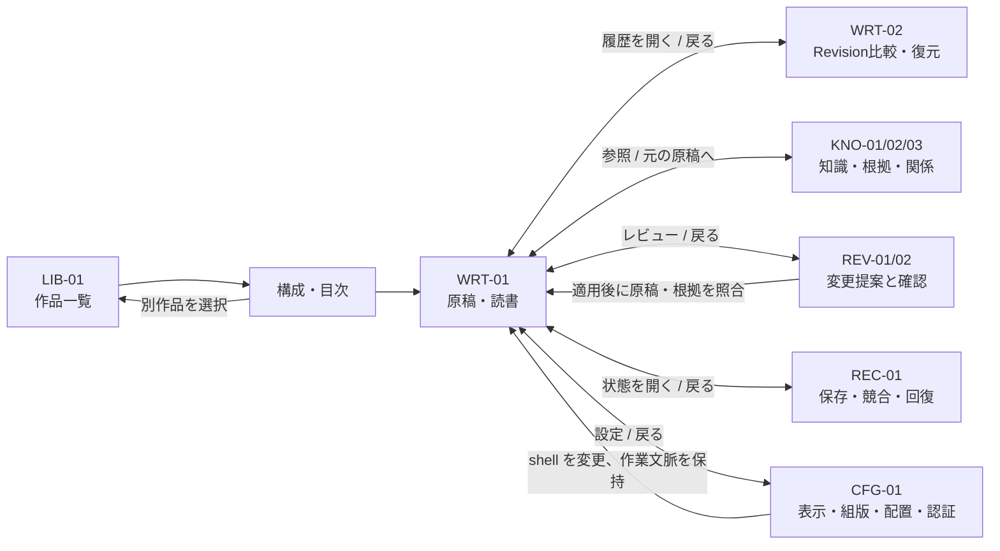
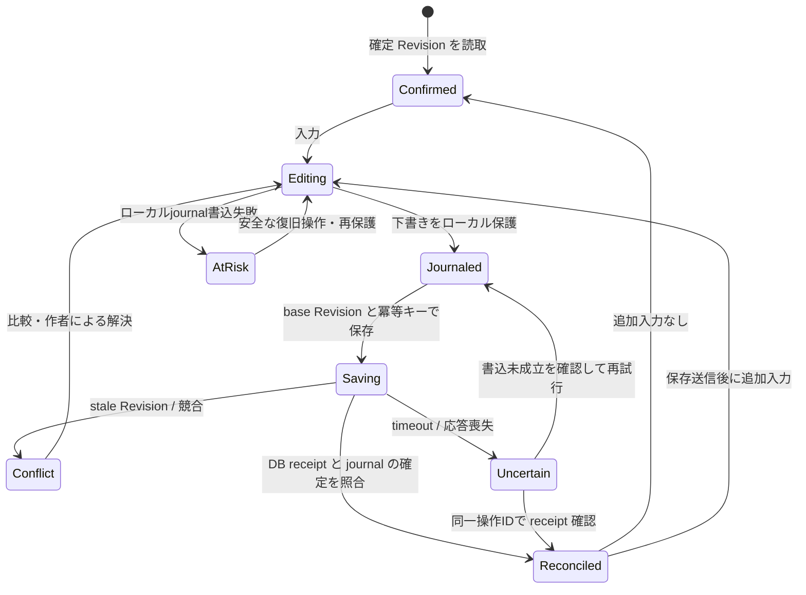

# 利用画面の遷移設計

**画面ごとの詳細正本:** [全画面・ボタン台帳](SCREEN-CONTROL-CATALOG.md)、[状態遷移図](SCREEN-STATE-ATLAS.md) と [URL/API認可](../architecture/ROUTE-AUTHORIZATION-CONTRACT.md) に各画面の入口・主操作・異常系・principalを紐付ける。本書は作者体験の横断契約であり、個別画面の権限を曖昧にしない。

**種別: 正本・規範的設計。** 本書は作者が Desktop Web（React）/ iOSアプリ（SwiftUI）から作品を利用する際の画面、遷移条件、失敗時の扱いを定義する。画面配置・内部 UI の実装をそのまま設計の正本にしない。[システム基本設計](../architecture/SYSTEM-DESIGN.md)、[UX 契約](UX-CONTRACT.md)、[情報設計](INFORMATION-ARCHITECTURE.md)に従う。

## 起動から作品への遷移

[利用画面の遷移図をSVGで開く](https://yohn-jp.github.io/codexia/architecture/#user-1)

`/console`以下の画面・遷移・初回登録の認可は[管理画面の遷移設計](ADMIN-SCREEN-FLOW.md)が正本となる。Workersが静的ルートを配信し、VM上のBetter Authが認証・owner確認を担当する。通常の執筆用モード選択へ迂回させない。

未認証と PostgreSQL 不可を同じ「作品なし」画面へ変換しない。サインイン時・サインアウト時・作者 scope 変更時には未保存の原稿と回復 journal を保護し、失敗しても別作者の作業領域を表示しない。ログインと認可は [API 認証仕様](../architecture/API-AUTHN-AUTHZ.md) を正本とする。公開 reader は作者用エディターと独立し、書込操作へ進ませない。

## 執筆を中心とした利用画面

画面 ID は論理識別子であり、各状態への新しい独立 URL や新たなデータベースを意味しない。専用ルートを設ける場合も [情報設計](INFORMATION-ARCHITECTURE.md) の既存 scope と guard を維持する。

- **作品と構成:** 作成、インポート、選択、再開、巻・章・シーン・ノートの作成・移動を許された API 操作へ結び付ける。存在しない文書の直接リンクを空の編集画面で成功扱いしない。
- **原稿:** DesktopはCodeMirror、iOSはUIKit UITextView/TextKit 2ベースのネイティブ編集面でIME・カーソル・選択・undoを保護する。読書表示や日本語組版の変更は Markdown 原稿への暗黙の編集としない。
- **履歴:** 元 Revision の表示、比較、復元を分ける。復元は新しい Revision を作り、過去の確定内容を破壊しない。
- **知識・根拠:** 人物・設定・根拠・Evidence の一覧と詳細へ移動しても、元の document、selection、scroll、作者 scope を維持する。履歴が現在の Revision に一致しない根拠は再確認を要求する。
- **レビュー:** Native ChangeSet と Module proposal はそれぞれの作者承認・適用契約を保持する。提案の閲覧だけでは適用しない。外部 MCP は作者承認を迂回しない。
- **設定:** 外観・組版・Workspace、認証・セッションへ到達する。管理者の資格情報変更は [管理画面遷移](ADMIN-SCREEN-FLOW.md) に従う。

## Desktop Web とネイティブ iOS の導線

| 観点 | Desktop Web (React) | iOS App (SwiftUI) |
| --- | --- | --- |
| 入口 | `/desktop/` | iOSアプリアイコン・許可されたアプリdeep link |
| 作品・文書 | `/desktop/projects/:projectId` / `.../scenes/:documentId` | ネイティブのLibrary/Outline/Editor経路。/mobile/ URLを使用しない |
| 作業面 | 可動Workspace、タブ、構成、原稿、知識、レビュー | 本文中心のネイティブ画面、必要時に構成・保存・知識を表示 |
| 遷移の保護 | ブラウザーdraft journalとguard | 保護されたiOS draft journalとnative guard |
| 共通契約 | Core/API・認証認可・Revision/receipt/競合復旧 | 同じCore/API・認証認可・Revision/receipt/競合復旧 |

~~~mermaid
flowchart TD
    I["iOS SwiftUI 起動"] --> AUTH["System OAuth + PKCE"]
    AUTH --> LIB["Library / 作品"]
    LIB --> TREE["Outline / 構成"]
    TREE --> WRITE["Writing / TextKit 2"]
    WRITE -->|保護済み遷移| REF["Knowledge / Review / History"]
    WRITE -->|一時参照| SHEET["Native Sheet: 構成・保存状況"]
    SHEET -->|閉じる、入力状態保持| WRITE
    REF -->|作業文脈を保持| WRITE
    WRITE -->|ローカル保護 + API receipt| REC["Draft / Saving / Conflict / Unknown"]
    REC --> WRITE
~~~

Mobile Webの`/mobile/`・`?view=`・Ionic参照sheetは廃止対象の実装であり、正規製品導線ではない。画面の幅に応じてWebがモバイル執筆shellを自動選択する設計は採用しない。iOS画面の詳細は [iOS SwiftUI設計](../architecture/IOS-SWIFTUI-ARCHITECTURE.md)。

## 保存・復旧の状態遷移

「保存中」「この端末に下書きあり」「PostgreSQL へ保存済み」「状態の確認が必要」は相互排他的な一個の変数ではない。保存要求後に加えた入力を、先に返った成功 receipt の内容に含めない。競合、local quota 不足、ネットワーク断、認証失効、unknown response は異なる回復指示を出す。原稿を黙って破棄・強制上書き・自動 conflict merge しない。具体的な UI 状態は [Interaction contract](INTERACTION-CONTRACT.md) を使用する。

## 権限・異常系と受入

| 条件 | 設計上の画面動作 |
| --- | --- |
| 未ログイン、OAuth キャンセル | 明示的な認証入口へ。成功画面は表示しない |
| 権限拒否、他作品の ID | 対象を表示せず、作者 scope を保ったエラーと戻り先を示す |
| DB 不可、API の応答不良 | 認証未済と区別して再試行。Git/ファイルに切替えない |
| 作品・文書の不存在 | 選択中作品の目次または作品ライブラリへ誘導する |
| stale network response | navigation generation と Revision で破棄し、現在の編集を差し替えない |
| optional module 不可 | 関連する panel のエラーに限定し、Core 原稿を利用可能に保つ |
| 競合・回復保護に失敗 | 遷移を禁止し、原稿・journal・作業 context を残す |

**受入証拠:** Desktop WebはWindows Chromiumを正式対象とし、Chromiumと実PostgreSQL、Windows固有の操作は実Windowsで、iOSはSimulatorに加えて物理iPhoneと実PostgreSQLで、OAuth/IME/保存追加入力/競合/応答喪失/アプリ復帰/作者切替/権限拒否を確認する。Mobile React向けviewport E2Eは受入対象としない。本書は画面操作の正本であり、上記がすべて実装・検証済みであるとの宣言ではない。
