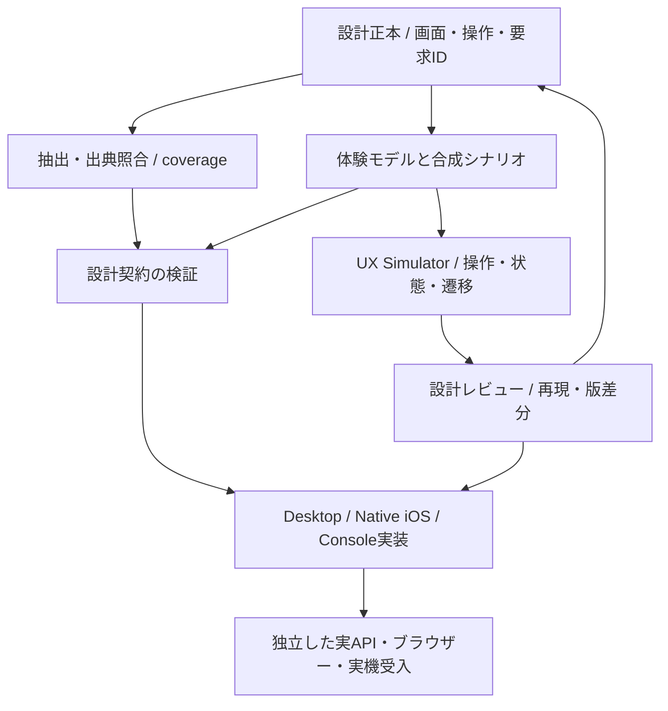
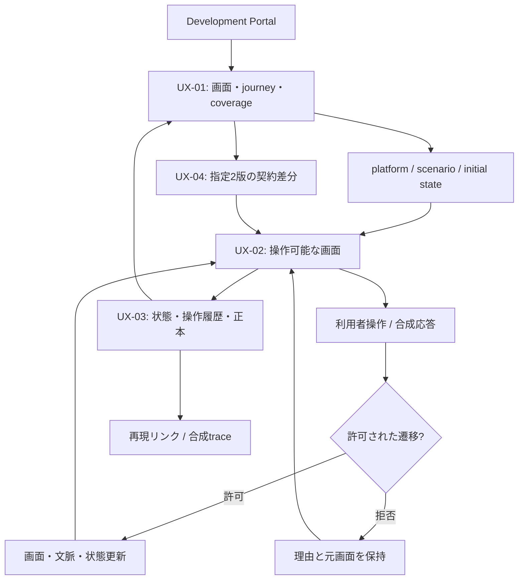

# UX Simulator — 設計体験の実行可能な検証契約

**種別: 正本・規範的設計（採用目標、未実装）。** 本書は開発ポータル内のUX Simulatorの責務、検証単位、状態・操作モデル、公開境界と受入条件を所有する。対象読者は設計者、開発者、レビュアー。製品の画面・業務・認可の意味は既存正本が所有し、モックの実装や見た目で上書きしない。

## 1. 目的と非目標

設計 → 操作できる設計モデル → 設計レビュー → 製品実装 → 実ブラウザー/実機受入の順に、作業体験を早期に評価する。VM、DB、API、認証、製品buildを準備せず、任意の画面を起点に正常系・異常系の作業を再現する。

UX Simulatorを [Development Pages](DEVELOPMENT-PAGES-UX.md) の `/ux/` に置く。Architecture Atlasが図を、API Referenceが通信契約を、Simulatorが操作の結果を表現する。単一画面の画像、次のスライドへ進むだけのデモ、コンポーネント一覧、現行製品のpreviewは代替にならない。

- 抽象化: 画面の情報階層・相対配置・表示文言・入力・選択・モーダル・遷移・guard・保護状態・結果を表現する。合成原稿を使い読書、保存、比較、戻る、再試行まで操作できる。pixel-perfectな製品再現は要求しない。
- 対象: Desktop Web（React/CodeMirrorを想定）、native iOS（SwiftUIのnavigation、sheet、editorを想定したブラウザー上の代理表示）、owner console、ログイン/同意、公開reader。旧Mobile Web/Ionic/Capacitorは新規対象外。native代理表示はSwiftUI、TextKit、IME、Keychain、Passkeyの実機検証ではない。
- 非目標: 第二の製品・業務/認証/永続化正本、実HTTP client/server、DBやdevice storageの再実装、実WebAuthn/OAuth、VM/IAM/S3操作、実原稿/secret、別Pages publisher、行動収集。MCP client・OPERATORは製品画面を新設せず、合成イベント・拒否・結果や外部境界で表現する。

## 2. 権威と派生方向

| 意味の所有者 | Simulatorの入力 |
| --- | --- |
| [Screen control catalog](SCREEN-CONTROL-CATALOG.md) | screen ID、CTRL ID、入口、principal、成功/失敗時の復帰 |
| [Screen State Atlas](SCREEN-STATE-ATLAS.md) | 許可された遷移、分岐、異常状態、離脱条件 |
| [User screen flows](USER-SCREEN-FLOW.md)・[Admin screen flows](ADMIN-SCREEN-FLOW.md) | 横断journeyと管理UX |
| [UX contract](UX-CONTRACT.md)・[Interaction contract](INTERACTION-CONTRACT.md)・[App design system](../../app/DESIGN.md) | 情報階層、入力保護、復旧表示、視覚方針 |
| [iOS SwiftUI architecture](../architecture/IOS-SWIFTUI-ARCHITECTURE.md) | native固有の導線・操作面・戻り方 |
| [Route authorization](../architecture/ROUTE-AUTHORIZATION-CONTRACT.md)・[API contract](../architecture/API-CONTRACT.md)・[Backup console contract](../architecture/BACKUP-CONSOLE-CONTRACT.md) | principal/操作制約、receiptと失敗の意味 |
| [XState contract](XSTATE-STATE-MACHINE-CONTRACT.md) | feature-local machineと副作用の境界 |
| [Requirements register](../requirements/REQUIREMENT-REGISTER.md)・[StrictDoc traceability](../requirements/STRICTDOC-TRACEABILITY.md) | 要求ID、独立した実装/証拠との対応 |

設計変更は所有文書に先に反映し、Simulatorへ写像する。machine・画面・fixtureから新しい業務要求を自動採用しない。既存台帳から識別子・出典・採用状態を抽出して照合し、自由記述やMermaidを無検証で実行コードに変換しない。機械化できない意味は小さな明示的mappingと独立した期待値で検証する。採用済み目標、現行実装、未採用提案を区別する。例えばKNO-03は未採用として隔離し、OPS-01は製品UIなしの境界として台帳に残す。CFG-01は概念上の束であり別画面を作らない。対象外・不足を黙って除外しない。

## 3. 体験モデルとデータ契約

所有ディレクトリを `scripts/ux-simulator/` とする。専用static generator、browser UI、純粋なfeature別model、synthetic fixtures、検証を同一責務内に置き、既存命名規則・lock管理に従う。製品側依存は公開可能な純粋な型/契約/設計資産に限定し、製品bundle、実API接続、secretを参照するruntime module、実device storageを取り込まない。別build system・巨大なglobal state storeを作らない。

| 単位 | 必須の意味 |
| --- | --- |
| Screen | 安定screen ID、platform、表示形態（page/panel/dialog/sheet）、principal、採用状態、正本path/anchor、CTRL ID |
| Control | CTRL ID、ラベル/操作・入力、前提、enabled/disabledと理由、event、取消/成功/失敗 |
| Transition | 安定した識別子、source state、event、guard、target state、作業文脈の保持/変更条件、出典。未知eventは拒否 |
| Scenario | 安定scenario ID、platform、fixture ID、初期画面/状態/文脈、決定的な合成応答列、期待到達点/不変条件 |
| Context | 合成project/document/revision、draft、selection/scroll、参照元、navigation generation、principal、operation/receipt/run ID等の必要な観測値 |
| Evidence | source SHA、契約/model/fixture/lock digest、screen/control/transition/scenario対応、試験結果と欠落理由 |

同一初期状態と合成event列から同一結果を得る。保存・journal・DB receiptなどは直交した意味を保つ。複雑なfeature machineには採用済みXState v5を利用でき、純粋で副作用を分離した既存契約/machineは適用可能な範囲で再利用する。単純な表示遷移へ強制せず、製品側のXState採用範囲、API認可、SwiftUI実装方式を変えない。外部作用は合成adapterから明示eventとして返す。新規依存は[依存選定規則](../architecture/DEPENDENCY-POLICY.md)に従い、version/lockを記録する。

画面状態を直接開くことと通常操作で到達したことを区別する。直接表示もguard・principal・文脈が整合する定義済みfixtureのみ。不正組合せは拒否する。障害注入、reset、checkpointへのjumpは開発者領域に置き製品操作と分離する。注入はguard無効化や成功強制ではなく合成adapterからの拒否/timeout/receipt等で行う。保存/適用/保全の結果不明時に別operation IDを勝手に生成しない。

## 4. 画面構成と開発者の導線

| 論理画面 | 操作と表示 |
| --- | --- |
| UX-01 Catalog | platform/principal/screen/CTRL/採用状態/journey/正常・異常を検索。未対応を明示。正本、journey開始、定義済み状態の直接表示 |
| UX-02 Player | 中心の実操作面。入力、選択、モーダル、戻る、確認、取消で遷移。同じモデルを使う。DesktopはWorkspace/panel、iOSはnavigation/sheet、console/readerは独立 |
| UX-03 Inspector | 現在状態、guard/拒否理由、操作と合成応答、source/target、保持文脈、出典、履歴、次応答注入、reset、再現URL/traceコピー。通常操作面から分離 |
| UX-04 Compare | 検証済み2版のscreen/control/transition/scenario、guard・表示・合成結果の追加/削除/変更、根拠と欠落。未取得/異なるschemaは差分なしとしない |

Desktopのポータルは左を検索/シナリオ、中央を操作面、右を展開可能Inspectorとする。狭い画面は操作領域を優先しサイド領域を折り畳む。native代理表示は安全領域、階層、sheet等の差異を表し、縮小Desktopを作らない。キーボード、focus、拡大、戻る、再読込、長い日本語、空/多数項目を扱う。ポータルのレスポンシブ対応はMobile Web製品受入を意味しない。

再現URLにはsource SHAと定義済みplatform/scenario/fixture/checkpoint IDだけを含める。任意コード・外部URL・実本文・秘密・巨大なstate serializeは禁止。不明ID/不一致版は停止し、無関係な初期シナリオを再生しない。同一artifact・URLは同じ初期状態を復元する。途中操作はresetまたは合成event列の安全なJSON exportで再現する。再読込は実DB保存を意味しない。別SHAへ無条件に読み替えない。

## 5. 全画面・必須journey

網羅性は固定件数ではなく最新のScreen control catalog/State Atlasとの照合で判定する。全採用screen/CTRLと対象platform、状態・分岐をmanifestへ登録し対応操作・試験へ結び付ける。次の横断journeyだけで個別画面のcoverageを代替しない。

| 領域・ID | 必須シナリオ |
| --- | --- |
| 起動・認証（ENTRY/AUTH） | ログイン→同意→Library、Passkey/IdP取消、失効、不正scope/client、DB不可と未認証の区別 |
| 作品・構成（LIB/OUT） | 再開、作成、取込/書出、検索・追加・移動・削除確認、対象不存在・権限拒否、戻る |
| 執筆・読書・履歴・復旧（WRT/READ/REC） | 編集→journal→保存→receipt、送信後追加入力、IME/離脱guard、競合、応答不明→同一ID照合、quota失敗、復帰、Revision比較/復元、selection/scroll保持 |
| 知識（KNO） | 候補検索・確定、根拠→原稿→戻る、stale Revision/anchor、統合preview→確認→競合/成功。KNO-03は隔離 |
| 提案・任意機能（REV/TOOL/JOB） | 閲覧→別承認→別適用→receipt、未承認/MCP拒否、module無効・局所失敗、非同期不明、受信箱/既読/閉じる |
| 表示・設定（DISPLAY/PREF） | Workspace/組版/テーマ、認証管理への遷移、原稿文脈保持、壊れたlayout/失効、native独自設定 |
| 初回owner（CON-00〜03） | 未登録→キー→模擬Passkey→owner確定→準備/公開待ち→ログイン。期限切れ、取消、競合、不明、既存owner/復旧時拒否、setup-onlyの業務操作不可 |
| セキュリティ・連携（CON-10/11/20/21） | Passkey追加・削除・fresh認証、最後の手段保護、session終了、OIDC検証→有効化、grant失効、拒否/中断/照合 |
| バックアップ（CON-30〜34） | draft→probe→activate→run受付→保全receipt→独立復旧証拠、412/422、secret非表示、重複要求、接続断、証拠欠落。probe/202を成功としない |
| 公開reader（PUB） | 読書、テーマ、失効/不存在、private操作禁止。Publishing作者側は採用済みCTRL/仕様に従う |

iOSは対象作者journeyをnative入口、戻る/sheet、アプリ復帰、入力保護へ写像する。Web限定console/readerへの遷移は外部画面境界を明示する。対象外のplatform/画面は正本の根拠と理由を登録する。動的module panelは宣言された対応操作を台帳と照合する。要件にない製品機能を創作しない。

## 6. Pages・版比較・安全性

既存 [Repository Audit Pages](../../.github/workflows/repository-audit.yml) のgenerator/assembly/publication-policy、共通navigation、`site-manifest.json`、ブラウザースモークを再利用する。`/ux/manifest.json` にschema version、source SHA、所有文書path/digest、generator/lock/digest、model/fixture/asset digest、coverageと未対応理由を記録しsite-manifestに同じ版・route・statusを登録する。実生成物と参照元の一致を検査し、既存Atlas/Graph/API/AuditのURLを維持する。観測台帳は実装検証後に更新し、目標を実装済みとしない。

PRは既存の非publish `repository-audit-preview` artifactとscreenshotsを使い、mainの単一publisherだけが公開する。PRごとの公開サイト、任意branchの動的コードロード、GitHubトークン要求、第二publisherを導入しない。版比較は同一repository/source/manifestに結び付く検証済み2版のモデルデータに限定する。既存PR preview artifactとmainのmanifest/承認済みsnapshotを比較元とし、取得できなければ利用不可を表示する。別版のJS/HTMLを実行せず安全な構造化データを比較する。PR previewをmainへ公開しない。

原稿・人物・owner・ID・receiptは明示的な合成データ。入力を外部送信・永続公開しない。本番URLへのfetch、WebSocket、form submit、OAuth redirect、WebAuthn、外部asset要求を禁止。API/S3 credential/Passkeyはダミー入力/合成応答のみ。既存public artifact policy、入力/出力の秘密検査、許可asset/route/参照検査を適用する。HTML/JSONを安全にescapeし、URLからコード・任意ナビゲーションを実行しない。local assetsとCSP等で外部接続や不要なform/iframeを抑止し、実ブラウザーで外部通信ゼロを検証する。正本への明示閲覧リンクは固定source SHAのrepository URLに限定する。guardや管理操作の模擬表示は権限を付与しない。

## 7. 独立した受入とCI

| ID | 受入条件 |
| --- | --- |
| UXS-001 | 正本から抽出した全採用screen/CTRL/platformをmanifestと照合。欠落・重複・未知ID・未採用混入・出典不在・虚偽完了を拒否。未完成sliceはpartialと表示 |
| UXS-002 | 正常・拒否・取消・戻る・再試行の遷移を独立した期待値で検証。到達可能なstate/edgeと対象外理由を照合し、未到達・未知event・誤guard・不正成功を検出 |
| UXS-003 | 全必須journeyを実画面操作で同じmodelへ入力し、表示/結果/draft/selection/scroll/identity/receiptの不変条件をassert。直接state設定・遷移表自己照合は代替不可 |
| UXS-004 | 障害注入、拒否/unknown/conflict、reset、同一artifact再現URLと合成traceを検証。直接表示をjourney到達証拠としない |
| UXS-005 | Desktop/native iOS/console/reader固有の導線、アクセシビリティ、ポータルの1440/768/390/320pxでの操作、既存導線とdeep linkをブラウザーで検証。実機受入とは別 |
| UXS-006 | source SHA、入力/lock/出力digest、site-manifest、出典リンク、2版差分と不明状態を検証。PR artifactのみ、mainのみ公開。外部通信/secret/実データ/権限操作なしを負の試験で証明 |
| UXS-007 | canonical CI impact selectionへ文書・model・fixture・generator・共通shell・browser proofを登録。対象変更だけのmodel検証、共通変更の全回帰、統合Pages smokeを既存workflow/認定に結合。Simulatorのみで製品OCI・実VM・native実機を起動しない。製品変更をSimulator PASSで認定しない |

`DESIGN_MAPPED`（正本への対応）、`DESIGN_SIMULATED`（対象modelと操作試験成功）、`PRODUCT_VERIFIED`（別途実製品証拠が存在する場合のみ）を独立して扱い単一の完成率にしない。StrictDoc/既存traceabilityにsource-bound対応表を渡し第二認定系統を作らない。既存の製品ブラウザー/DB/native実機試験を維持する。Simulatorレビューは設計改善の材料であり自動マージ承認ではない。[製品UX受入](UX-CONTRACT.md)・[既存preview](../verification/UI-PREVIEW.md)の責務を維持する。
