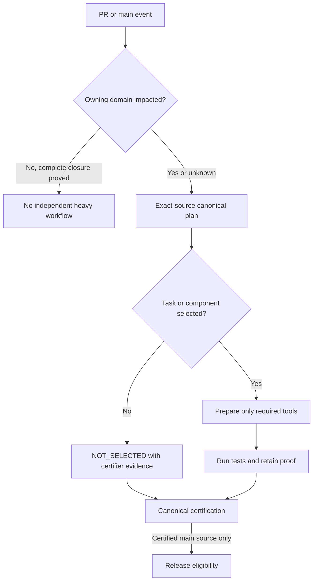
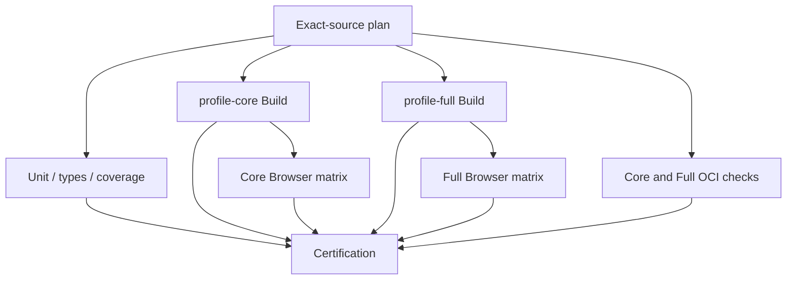
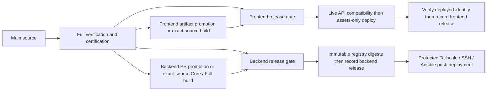

## CodexiaCTL automatic publication boundary

[CodexiaCTL canonical specification](../deployment/CODEXIACTL.md#21-cli-自身のリリース更新ライフサイクル正本) owns the release/version/update lifecycle. The `codexiactl-auto-release.yml` workflow observes a successful exact-source `Verify Codexia` main run, checks changed CLI inputs, and creates the next immutable `v0.1.x` tag using scoped `GITHUB_TOKEN` (`contents: write`), then explicitly dispatches the dedicated publisher at that tag ref using `actions: write`. GitHub's default `GITHUB_TOKEN` tag pushes cannot trigger a second push workflow, but explicit `workflow_dispatch` can. No PAT, GitHub App, or `CODEXIA_RELEASE_TAG_TOKEN` is required. The independent `publish-codexiactl.yml` dispatch workflow retains exact-source admission, CLI build, attestation, checksum, immutable Release response and asset verification gates. CLI `v0.1.x` tags are explicitly excluded from `publish-oci.yml`; the CLI publication never publishes OCI images or deploys production. Backend OCI publication and production handoff remain owned by `backend-release.yml` and `backend-deployment-handoff.yml`, and require existing protected deployment enablement and compatibility/backup gates. A created tag is not evidence of successful publication. Release failures must not silently skip checks or reuse a tag. Production deployment is not triggered by the CLI version alone.

# CI/CD architecture and certification contract

## Incompatible deployment admission and impact

The [Deployment lifecycle](../deployment/DEPLOYMENT-LIFECYCLE.md#実行系統と互換性境界) owns route selection, compatibility axes, approval, checkpoint and recovery semantics. Incompatible installed environments are refused without mutation. There is no automated epoch transition or coordinated deployment fixture inventory. Candidate Backend and Frontend must remain mutually compatible.

The ordinary verification graph retains deployment contract, read-only planner, bootstrap admission, release compatibility, backup/restore and ordinary transaction regression tests. The disposable lifecycle workflow exercises initial activation, compatible update and rollback. No exact-source, mandatory main, or release certificate requirement is relaxed; old publication certificates are read-only historical evidence, never an executable transition. Production enrollment and live acceptance are not CI claims.

## Desktop toolchain — independent migration gates

WEB-01 ([#790](https://github.com/yohn-jp/codexia/issues/790)) accepts TypeScript 7 native type checking with Vite 8 independently of CSS migration. Require workspace and test type checking, emitted declarations, Node built-in types, Core/Full builds and OCI, OAuth source boundaries, Desktop browser E2E and existing mandatory verification and security checks. Do not use TypeScript 5 fallback, suppressed diagnostics or skipped tasks as proof.

WEB-02 ([#791](https://github.com/yohn-jp/codexia/issues/791)) remains a separate accepted design pending implementation: vanilla-extract CSS/theme/recipes, Light/Dark/Paper parity, CSS/JS output and performance comparison, CodeMirror interaction and Desktop browser E2E. Its completion is not required for WEB-01 acceptance. iOS SwiftUI acceptance remains independent.

Workspace builds and `pnpm typecheck`, `pnpm typecheck:tests`, `pnpm typecheck:safety`, and `pnpm typecheck:deployment` use the root TypeScript 7 native `tsc`. The test-source runner supplies each existing verification scope as a project and reports compiler diagnostics through the corresponding `test-types-*` task. The shared tsconfig opts in to the installed Node types so project checks and declaration emit resolve Node built-ins consistently.

The [system design](../architecture/SYSTEM-DESIGN.md) owns deployment boundaries; [Deployment lifecycle](../deployment/DEPLOYMENT-LIFECYCLE.md) owns cross-component route selection, initial pair activation, coordinated maintenance/recovery and shared exclusion; [first activation](../deployment/INITIAL-DEPLOYMENT-FLOW.md) and [compatible update / rollback](../deployment/UPDATE-FLOW.md) own operational transitions. CI supplies source-bound conformance evidence and cannot redefine their requirements.

This is the normative execution and release architecture. [Test architecture](TEST-ARCHITECTURE-OPTIMIZATION.md) owns proof placement and test design; [Verification](README.md) owns local commands; [Deployment](../deployment/README.md), [OCI releases](OCI-RELEASE.md), [Infrastructure as code](../deployment/IAC.md) and [Push deployment](../deployment/PUSH-DEPLOYMENT.md) own artifact formats, operator procedures and compatibility policy. This contract describes required behavior, including requirements not yet implemented; a green run is evidence only for the checks actually performed.

**仕様ツール導入の採用済み目標:** [Specification tooling acceptance](SPECIFICATION-TOOLING-ACCEPTANCE.md) はTypeSpec/StrictDoc/MCP v2/pgTAP/LikeC4/Threagile/k6の検証義務を定義する。これは既存verification task/impact selectionの置換や新CIタスクの実行完了を意味しない。実装PRが既存のsingle machine authorityへ登録し、exact-source/selected task証明を満たした場合にのみgateとして有効化する。

## Single machine authority

| Responsibility | Canonical implementation |
| --- | --- |
| Task inventory, groups, producer dependency and required job names | [ci-contract.mjs](../../scripts/ci/impact/contract.mjs) |
| Impact selection, plan validation and digest | [plan.mjs](../../scripts/ci/impact/plan.mjs) |
| Per-task input-closure proof validation | [ci-task-input-proof.mjs](../../scripts/ci/evidence/input-proof.mjs) |
| Task producer invocation, input-proof generation, and coverage input inventory | [group.mjs](../../scripts/ci/execution/group.mjs), [ci-task-input-proof.mjs](../../scripts/ci/evidence/input-proof.mjs), [ci-coverage-inputs.mjs](../../scripts/ci/evidence/coverage-inputs.mjs) |
| Workspace prerequisites and execution | [ci-workspace.mjs](../../scripts/ci/execution/workspace.mjs), [group.mjs](../../scripts/ci/execution/group.mjs) |
| Verification DAG | [verify.yml](../../.github/workflows/verify.yml) calls [verify-profile.yml](../../.github/workflows/verify-profile.yml) for `profile-core` and `profile-full`; each call owns that profile Build and Browser matrix. |
| Same-run artifact retrieval and final certification | [verify.yml](../../.github/workflows/verify.yml) retrieves each selector-validated immutable artifact ID through [download-artifacts.mjs](../../scripts/ci/evidence/download-artifacts.mjs), verifies its SHA-256 and extracts only the plan or report JSON. Certification downloads at most two selected reports at a time. Each report has its own output directory, and both downloads settle before a failed batch stops certification. [certify.mjs](../../scripts/ci/certification/certify.mjs) validates the downloaded evidence. |
| Release eligibility and exact main source | [policy.mjs](../../scripts/release/components/policy.mjs), [verify-source.mjs](../../scripts/release/components/verify-source.mjs) |

Do not maintain a parallel hand-written inventory. Update the declarative contract, workflow, impact rules, coverage checks, evidence selector, certifier and release consumers together when their interfaces change. Every workspace, test source, required profile and named validation must be covered. Workspace prerequisites come from package scripts and declared dependencies, never regex parsing the root test command.

## HTTP contract verification

The TypeSpec compiler, deterministic OpenAPI artifact check, Redocly lint,
Fastify schema and route checks, and oasdiff run through the existing HTTP
contract tasks. Changes to a shared contract select the affected downstream
client checks under their existing owners. The Repository Audit Pages workflow
validates and publishes the static API reference for its own checked-out SHA.

Compare the candidate OpenAPI with the event's immutable base commit. Pull
requests use `pull_request.base.sha` and pushes use `before`. For historical
bases read the approved OpenAPI blob. For source-only bases, build in a separate
checkout of that SHA with its frozen toolchain. An unavailable base fails the
comparison. A generation
mismatch, invalid contract, rejected schema conversion or error-level breaking
change fails the contract task. The Verify certifier still binds task execution
to the selected source, plan, run attempt and immutable artifact.

## Declarative waits and controlled time

**Default: no `sleep` for synchronization.** A fixed-duration `sleep`, `delay`, or equivalent time-based polling is not evidence that a service is ready, that a process has failed, or that an asynchronous operation has completed. CI runners, integration and browser tests, and deployment scripts must wait on the actual contract: a systemd unit and health notification, Podman/Docker state or health event, PostgreSQL readiness, an HTTP status, a process exit, an emitted event, or a resolvable promise. Use injectable/virtual clocks for application timer semantics. A finite timeout caps failure latency; reaching it is a failure, not proof of success.

A genuine exception requires an explicit timing requirement in the specification or an irreducible protocol interval. Document the provider/requirement, the shortest justifiable bound, the real condition being observed and why an event/condition-based wait cannot replace it. Do not conceal unconditional sleeps behind retry wrappers or choose a shorter arbitrary interval in place of the original arbitrary 60 seconds.

This rule is the **repository-wide target and review contract**. Existing fixed-sleep loops outside the deployment transaction and lifecycle paths are not claimed to be migrated by this policy. Migrate them in their owning components without weakening tests, production behavior, or the single CI task/impact authority. The [push-deployment lifecycle contract](../deployment/PUSH-DEPLOYMENT.md#disposable-app-lifecycle-ci) is already enforced by targeted tests for its critical paths.

## CI admission, execution and resource policy

This section is the **normative scheduling and resource contract**. The canonical task
inventory, impact selection, input-closure proof and certifier above remain authoritative.
Workflow `paths`, local shell guards and special-purpose release filters are implementation
of those decisions, never independent permission to waive a required verification task.
The design below is the accepted target; an item is operational only after its workflow,
impact rules, tests and CI acceptance are committed and observed.

### Admission and ownership

**Three distinct stages must not be conflated:**

1. **Event admission** prevents a workflow run from being created when none of its
   required obligations can be affected. Use `on.pull_request.paths` / `on.push.paths`
   only for domains with a complete and independently tested input-closure mapping;
   include the workflow and its relevant policy/configuration files. A change outside
   that closure must not activate unrelated release or integration lanes.
2. **Job admission** happens in one cheap exact-source plan. Use the existing
   `scripts/ci/impact/plan.mjs` task selection and `scripts/ci/impact/contract.mjs` job inventory; expose selected
   prerequisites explicitly. Do not launch a costly job merely because another task
   shares its job family. Unknown paths, unavailable diffs, invalid identities and
   unreviewed dependency edges fail closed to wider verification.
3. **Step admission / reuse** installs or executes expensive tools only for actually
   selected tasks. Chromium, StrictDoc, model files, image builds and temporary hosts
   must not be prepared for a `NOT_SELECTED` task. Reuse only through existing
   content-addressed, toolchain-bound and source/attempt-verified receipts.

| Change/input owner | Required proof | Avoid when unrelated |
| --- | --- | --- |
| Native iOS SwiftUI/transport and Xcode projects | Native Swift build, API contract, simulator/physical acceptance as specified by iOS design | Desktop browser E2E, backend OCI, real-model OCI |

| Database contract-only tests / isolated proof fixtures | DB contract, affected type/unit and coverage | Backend/frontend image release builds, app host lifecycle, real-model OCI |
| Runtime Backend/Core/Full sources and packaging inputs | Applicable unit/type, actual Core/Full OCI, API/integration and exact-image identity | Unrelated Pages and iOS workflows |
| Desktop React, static assets, or frontend build inputs | Desktop type/build, affected browser shards, UI asset packaging/delivery | Backend publication and VM lifecycle unless shared runtime inputs change |
| Auth, PostgreSQL runtime schema or deployment state machine | Owning DB/API contract, auth E2E, relevant host and rollback acceptance | Unrelated model, native or Pages integration |
| StrictDoc/specification inputs | Requirements trace with its pinned StrictDoc/Chromium toolchain and affected Pages acceptance | Full model or backend image solely because a trace test changed |
| Pages generators, diagram/graph/audit inputs | Generator tests, source-bound report, faithful browser rendering | OCI builds and host lifecycle |
| UX Simulator design, canonical product route/view/control/state/trace, projection generator and fixture inputs (adopted target) | [UX Simulator](../design/UX-SIMULATOR-CONTRACT.md) exact-source independent design/implementation projections, source-change propagation, no duplicate behavior, affected regression and Pages browser interaction | Product OCI, production VM and native runtime acceptance for simulator-only changes; existing product gates remain required for product changes |
| JavaScript/TypeScript or analyzer rule inputs | CodeQL and quality checks per analyzed source closure | A CodeQL run for unrelated native/docs-only input |
| Dependency, container, IaC and secret-handling inputs | Trivy and appropriate config/security checks, plus affected runtime proofs | Full Git-history scan for every unchanged history |
| New, renamed, deleted, unknown or missing-diff inputs | Conservative safe superset / full verification until closure is proven | Unverified skipping or unconditional success |

Native-only PR admission is bounded to reviewed `ios/CodexiaTransport/`,
`ios/CodexiaApp/` and `ios/CodexiaEditor/` Swift/Xcode/configuration inputs
and dedicated `ios-api.yml` / `ios-editor.yml` workflows. The exact PR diff
receives `unit-root` and canonical `coverage` proof; native build and
simulator acceptance remain owned by native workflows. Shared OpenAPI inputs
retain their affected contract tasks; lockfiles or unknown inputs retain the
applicable conservative verification scope.

**Temporary iOS application freeze.** Native iOS development and automatic native Xcode CI (state model, editor/app Simulator, API contract and transport/Keychain Simulator, and the native SwiftUI unsigned IPA) are frozen until explicitly re-enabled. [Native iOS](../../.github/workflows/ios-editor.yml) and [Native iOS API](../../.github/workflows/ios-api.yml) remain available via `workflow_dispatch` only. Desktop/backend and shared API contract verification remain active. Native acceptance evidence is deferred, not waived; do not claim iOS release readiness during the freeze.

**Native iOS execution.** As with independent Chromium groups, keep native state-model, UIKit editor Simulator, SwiftUI application Simulator and ARM64 unsigned IPA proof in independent hosted `xcode-27` lanes; do not fail-fast across them. Preserve PR-only supersession cancellation, exact candidate checkout, SDK/architecture validation, locked SwiftPM inputs, and the existing signing/archive certificate. Each Simulator lane first builds its own test products for the generic ARM64 iOS Simulator destination, without starting the device concurrently, then waits for the selected iOS 27 iPhone to become ready and executes the same scheme's complete test inventory from its local `.xctestrun` without rebuilding. Keep build, boot and test as independently timed steps. The cold-start comparison supports this ordering; do not enable speculative remote compiler caches or disable indexing without measured net savings and unchanged test evidence. Both build and actual Simulator readiness must succeed; missing or ambiguous test products and missing successful result bundles fail the lane. Keep lane/source/attempt-specific Simulator evidence. The test-product compilation replaces a redundant standalone Editor Simulator build; macOS state-model tests remain independent until their separate obligation is explicitly retired. Native API uses three independent lanes: macOS generation and contract tests, signed KeychainProbe Simulator, and Transport package Simulator. The latter two use the same build-for-testing / boot / test-without-building ordering and retain the complete existing scheme inventories, locked dependencies and signing. The standalone unsigned iOS compilation is replaced by test-product compilation. [Measured experiment](https://github.com/yohn-jp/codexia/actions/runs/45517723628): critical runner duration 1386s to 634s, aggregate runner duration 1386s to 1239s, one comparison excluding queue time; Keychain 2 and Transport 13 tests passed on both paths. Physical-device acceptance and legacy cutover obligations are unchanged. Measure queue time, runner seconds, boot, build, test, and wall-clock separately; do not adopt remote DerivedData or cached test results as proof.

**Independent-workflow owners.** `verify.yml` is the only owner of task inventory
and canonical certification. `backend-release.yml` and `frontend-release.yml` own
component build, package, promotion and publication; `push-app-lifecycle.yml`,
deployment-config/host/backup flows own real operational proof; `repository-audit.yml`
owns development Pages; `ios-*.yml` own native acceptance;
`codeql.yml` and `security-scans.yml` own static security scanning.
Do not run a backend image or disposable VM lifecycle merely because a
`packages/**` test file or unrelated deployment documentation changed. Conversely,
include packaging scripts, profile manifests, dependency locks, workflows and actual
runtime inputs in the relevant closure. A package filename suffix is not by itself
proof that a file is irrelevant: generated/test assets consumed by a build remain inputs.

**Security scope implementation.** `scripts/ci/impact/security-admission.mjs`
uses the exact PR merge result and its two verified parents to determine a
CodeQL/Trivy net-change closure. The stable check jobs remain present, but
scanner steps are omitted for proven unrelated inputs. Missing history,
checkout identity disagreement, unexpected extensions or unresolved scope
runs both scans. Main/scheduled scans and Gitleaks are never filtered here.
`scripts/ci/impact/design-admission.mjs` uses the same verified PR
merge-result identity to keep the existing Impeccable check job while skipping
the actual scan and SARIF upload for isolated `app` or `modules/*/src`
test/spec changes. The existing workflow event `paths` are retained because
effective legacy required-check policy could not be read through the connector.

The admission decision is recorded in the job log and step summary; a skipped
scanner must never be reported as having analyzed changed code.

**Security admission.** CodeQL PR analysis must cover changed analyzable JS/TS
or analyzer configuration, with main/default-branch and scheduled scanning retained.
Trivy must cover dependency locks, Dockerfiles, containers, IaC, action/dependency
security configuration and other verified scanner inputs. Gitleaks must inspect new
PR commits (including file renames) without rescanning unrelated full history on
each PR, and retain complete-history review on main/schedule. If the commit base,
history span, or scan coverage cannot be verified, run the broader scan or fail.
Preserve SARIF upload/category behavior and non-bypassed security controls.
Security alerts, static policy gates and CI certification are separate obligations.

**Main and delivery.** Every main source requires full exact-source verification or
the already defined strictly validated same-tree merged-PR reuse. Direct pushes,
manual runs and invalid reuse use full execution. Publication/deployment starts
only after successful exact-main certification; the completed event is not an
excuse to create redundant backend/frontend jobs for unaffected components.
Never cancel source certification, image publication, rollback or protected
deployment merely because a later PR arrives. Cancel only superseded PR heads
in the *same* workflow and PR; no cross-PR or cross-source cancellation.
Reuse verified artifacts, not stale success statuses or unverified skip contexts.

**Required checks.** Before enabling a GitHub event-level path exclusion, verify
the active branch ruleset and every effective required check context for the repo.
An excluded workflow may leave a required check pending; a skipped job may appear
successful while proving nothing. Keep a cheap, stable admission/certification
status, emit `NOT_SELECTED` with an explicit owning input closure and reason,
and independently verify that no selected task or security gate disappeared.
Branch protection/merge queue and status check migration must be updated atomically;
if effective rules cannot be read, do not deploy a potentially deadlocking filter.

### Measurement and change acceptance

Measure **run count**, cancellation before and after runner acquisition,
per-PR workflow multiplicity, executed versus queued job count, p50/p95 queue time, runner seconds,
critical path, wall clock, cold/warm cache state, failure/retry rate, and the
specific phases (tool downloads, fixture setup, build, browser, artifacts).
`cancelled` run count is *not* equal to wasted runner minutes; check actual job
start/logs before making a savings claim. Actions queued/waiting jobs may expose
placeholder start timestamps; they consume no observed runner seconds and must
not be counted as executed jobs. Cancelled jobs may also expose placeholder
timestamps even after becoming `completed`; require a positive assigned
`runner_id` before claiming runner consumption, and report pre/post-runner
cancellations separately. Prefer comparable exact-source and
toolchain runs; record counterfactual estimates separately from observed results.
Compare a full run, native-only changes, test-only DB changes, documentation-only
changes, frontend/backend runtime changes, unknown/new paths and changed workflow
definitions before and after an admission change. For rapid consecutive main merges,
record each source SHA and its actual PR plan mode, base SHA, merge parent,
reusable proof decision, queued jobs, executed jobs and runner seconds. A green
`affected` PR check is not a complete main certificate; a stale base or
unverified proof must trigger exact-source execution, not an implicit pass.

A rollout passes only when (a) the canonical plan and actual workflow trigger
agree; (b) every selected task is proven or blocked/fails, never silently skipped;
(c) selected security and release gates remain enforced; (d) source/attempt/lock/
profile identities are preserved; (e) test-only and unrelated changes no longer
start expensive lanes; and (f) comparable actual CI demonstrates improved queue,
runner and wall-clock behavior. A budget alone never authorizes dropping proof.

## Static quality and Code Scanning contract

The accepted JS/TS quality-toolchain design uses [Biome](../architecture/DEPENDENCY-POLICY.md) as the single Lint, formatter and import-organizing authority. Run non-mutating `biome ci` as a required PR quality gate and upload **Lint-only** SARIF to GitHub Code Scanning under its own category, separate from CodeQL. Formatting findings fail the CI check, but must not be uploaded as security alerts. TypeScript type checks, CodeQL's security and data-flow analysis, tests and architecture boundaries remain independent obligations; a passing Biome job never satisfies a skipped or failed security check.

The `biome-ci` canonical task runs as an exact-source `biome` Verify job when a PR changes application JS/TS under `app`, `packages`, `modules`, `edge/frontend` or changes `biome.json`, and on the full main plan. The CLI is fixed to v2.6.8 through `biomejs/setup-biome`; the job needs no additional production dependency. To introduce enforcement without reformatting unrelated legacy files, the check uses Biome's VCS-aware `--changed --since=<verified-base>` (the previous main SHA on push) and `--no-errors-on-unmatched`. It runs read-only formatting, lint, and import organization on those application source trees only. Legacy build/CI scripts are deferred until they have an accepted style baseline, avoiding mass-formatting unrelated CI logic. An independent `biome lint` pass writes lint-only SARIF for `github/codeql-action/upload-sarif` in category `biome-lint`, using narrowly scoped `security-events: write`; any lint, formatting, assist or upload failure fails the selected task/job and therefore certification. The SARIF upload explicitly identifies the analyzed PR head ref and SHA (or the triggering ref and SHA for non-PR runs), rather than the synthetic PR merge commit. This is an incremental changed-file quality gate, **not** a claim that every legacy source file already conforms to Biome. TypeScript, CodeQL and all other mandatory checks remain independent.

For a rule or scope change, evaluate the pinned Biome CLI on the same exact source and same file scope with the existing configuration and the official non-nursery `linter.rules.preset: "all"` candidate. Record per-rule/severity diagnostics, representative findings, elapsed lint time and relevant dependency/domain limitations in PR evidence. A trial is read-only, never publishes its candidate SARIF as the accepted Code Scanning result and does not replace the required `biome-ci` result. Review correctness, accessibility, security, architecture and performance value rather than enabling conflicting or irrelevant rules wholesale.

Configuration-only changes cannot be accepted on an empty changed-file scan alone. Prove compliance with each newly enforced rule on its full applicable source scope, not just changed source; preserve the incremental gate for existing unrelated debt. Keep rule/config/plugin inputs in exact-source selection and proof closure when applicable. Use Biome's standard rule configuration and GritQL before creating any extra static-check implementation. Adopt required rules as errors; maintain narrowly justified exceptions and separate evidence for type, security and real-browser behavior. Do not run an exploratory all-rules scan on every routine PR. When `biome.json` changes, the canonical task additionally runs Biome on the entire current application scope for all explicitly configured root-level error rules. Changes to presets, domains, overrides, or plugins also require full applicable-scope evidence for newly enforced rules not covered by that check. The additional scan is not a second Code Scanning producer.

## GitHub-hosted runner and browser image policy

Use explicit `ubuntu-24.04` x64 GitHub-hosted VMs for the certified browser jobs. Each job starts on a fresh VM, so do not assume a persistent Docker layer cache. Keep the content-addressed pnpm store cache and same-profile build artifacts as separate, verified inputs; do not introduce Docker save/load through actions/cache. Public-repository pull requests stay on isolated hosted runners, never a persistent self-hosted runner with long-lived credentials.

The canonical `VERIFICATION_GROUPS` browser inventory determines the required browser. All Core and Full browser lanes use the digest-pinned Git-capable Chromium-only GHCR runtime. [E2E execution](E2E-EXECUTION.md) governs scope and preserves all required functional, security and accessibility proof; native-device admission is independent. `verify-runtime.mjs` checks the exact image digest, Ubuntu Noble, Node/pnpm/Playwright versions and Chromium launch before executing the selected shards. A missing browser or mismatched image is a failure, not a reason to skip any shard. Configure browser job containers with `--init --ipc=host`; limit GHCR credentials to read permissions.

Review base-image digest updates through Dependabot, rebuild with smoke tests, and promote newly published runtime digests to Verify only in a reviewed PR after exact-source browser acceptance. A successful experimental image benchmark alone is not certified browser evidence. When evaluating runtime changes, compare matched runner class, package lock, browser projects, PostgreSQL fixture, Pull, init, E2E and job elapsed times across multiple runs; keep experimental benchmark jobs outside the certified task inventory. Maintain PR-only supersession cancellation and never cancel exact-source main certification or release-critical jobs.

## Verification execution

PRs verify the exact source selected by the workflow, using the affected-task plan. Superseded runs of the same PR are cancelled immediately; main/manual runs have independent run identities. Documentation-only PRs retain coverage checks unless a document is an executable assertion input. Explicitly reviewed operational inputs, including the enumerated root-only CI contract tests, select the root unit and coverage checks; CI orchestration implementation changes and unknown test paths remain fail-closed, with dedicated infrastructure, audit or static-delivery integration as applicable. Shared foundation/unknown paths or missing diff history select the full inventory. Plan calls `profile-core` and `profile-full`; within each call, its Build directly gates only the corresponding Browser matrix. Main pushes and manual verification plan every obligation. Manual runs always execute the full graph. Before an authorized merge, fetch current main and the PR head and run `node scripts/ci/certification/merge-readiness.mjs PR_NUMBER` with the repository read token in `GH_TOKEN` and the existing CI evidence dependencies installed. A stale base, pending/failed exact-head Verify or moving head is not ready; an affected plan legitimately requires full main verification. The compact-candidate result is advisory only; the main certifier must revalidate the actual merged tree and all evidence. This is not a new required CI job or a release authority. A main push may certify existing complete PR source proof instead of executing the graph only under the merged-tree reuse contract below. A manual or PR success alone is not a main-push release certification.

The certified graph retains the normative cap of at most twenty-two execution jobs, including Plan and Certification. It preserves stable logical identities for Plan, `profile-core`, `profile-full`, and Certification, plus the established `build-<profile>` and `browser-<group>` validation jobs inside each reusable profile call. Plan selects profile work; each profile Build gates its own Browser matrix independently, and Certification evaluates evidence across all selected obligations. A failed profile does not suppress selected work in the other profile. The former twenty-job budget was explicitly revised by two lanes for the measured 72.7s API suite and 52.3s DB contract; both previously serialized with root/HTTP/foundation checks on a 220s Unit Core runner. Keep the original task inventory and independent exact-source evidence. No additional task inventory or runner pool is used to evade the budget. Keep independent work parallel and fail-fast disabled for independent groups. Within a group retain individual results even after a sibling failure. Each browser job restores its exact immutable profile Build artifact; artifact absence, identity mismatch, or failed Build fails the dependent browser validation. Reruns may execute a failed profile and its failed dependencies without rerunning a successful sibling profile. Certification requires complete source/run-attempt-bound evidence for every selected obligation, preserving failed, blocked and not-selected distinctions. The Full-model OCI workload is a supplemental high-cost reusable job: Verify calls it only for its exact pull-request input paths, while the standalone workflow runs it for matching main pushes or manual dispatch. It stays outside the artifact-evidence certification and release job inventory; a selected failure still fails the overall Verify workflow.

The `coverage` task reports a per-task input closure for its static-only check. The closure binds coverage and orchestration sources, the Verify workflow, workspace manifests and directories, discovered test file paths and contents, runtime/toolchain identity, invocation recipe, and the empty prerequisite set. Every other passed task in a successful full main run also reports a task execution proof. That conservative closure binds the exact Git tree except documentation paths excluded by the impact selector, test file identities, dependency manifests, runner/toolchain identity, canonical task invocation, and declared producer prerequisites. Documents asserted by root tests select the root unit and stay in the Git tree fingerprint. Each process captures the shared input digests once per exact source and runner, including the package manager from that source tree. The planner and certifier recompute independently, and each task still binds its own recipe and producer prerequisites. Impact selection is authoritative for PR execution: a task outside the verified changed-input closure is NOT_SELECTED, not PASSED or REUSED, and requires no historical task proof. Missing diff history, an unknown input, or a shared foundation change still selects the full graph. Certification independently checks the exact PR base and changed-file inventory against Git, recomputes the canonical plan, and requires verified execution reports for every selected task. Only the selected static `coverage` check may optionally reuse its own latest successful exact-base main proof when its seven input-closure dimensions match; absent, stale, incomplete, failed, foreign, expired, or mismatched coverage proof causes that check to execute normally, never a plan expansion. Supplemental CI contract tests still execute as required. On main/manual pushes the full graph remains mandatory unless the strict same-tree reuse of a previously fully verified PR passes independent certification; an affected PR plan never authorizes compact main certification.

- Within a Runner, use at most two concurrent independent validations, retaining results in canonical task order. Build shared workspace prerequisites once per selected unit/type group; a failed build blocks only tasks that require its outputs. Serialize workspace writers, CPU-heavy model suites and performance measurement with respect to siblings. Browser specs own distinct disposable databases, API/control port pairs, state and trace output directories; do not increase worker count inside a spec. Keep profile generation within its profile Build.
- Chromium browser lanes consume the same-profile build output through their direct reusable-workflow dependency; there is no producer polling. Each browser lane records bounded before/after container-visible CPU, cgroup quota/throttling, memory/pressure, kernel and image identity observations, tied to the source/run/attempt. They are diagnostic artifacts only and do not substitute for validation. Missing measurements remain unknown; provider/region must be confirmed from runner provisioner logs. The lane name does not redefine its test inventory. Each spec retains isolated DB, server, browser context, port and temporary state. Do not rebuild the workspace in each consumer.
- Standalone OCI checks still exercise the actual selected image, startup and shutdown. Browser build success does not certify an OCI image. Component release packaging may reuse a proven equivalent artifact but must verify the exact image or assets being released. The root unit's canonical `test:scripts` includes route/runtime configuration, release identity tests and Worker typecheck/request tests. The frontend release lane retains its distinct static asset packaging, Wrangler dry-run, browser delivery and exact main certification gate, but does not repeat these root checks. The dedicated infrastructure workflow owns Ansible syntax/fixtures and Terraform provider-schema checks, selecting only affected independent infrastructure scopes.
- A common prerequisite failure blocks dependent work, not independent checks. The final certification always evaluates available evidence and fails closed.

## Evidence and trust

Use the plan's exact source, plan digest, producer run/job/attempt, artifact ID, profile/selection, toolchain, platform, lock/recipe identity and file checksums/sizes as applicable. Bind consumer receipts to the precise verified producer; same name, branch, cache hit or old successful attempt is insufficient. OCI manifests/configs and registry digests must be verified as required by their existing contracts. Reuse exact producer artifacts within a run; reuse prior test results only through the explicit merged-tree certification contract below. Refuse missing, corrupted, stale, wrong-profile or wrong-source evidence, unsafe archive paths and symlink escapes. Do not transmit credentials to redirect targets or include author data, secrets, session tokens or model caches in build artifacts.

| State | Meaning |
| --- | --- |
| PASSED | Required validation ran against the bound source/artifact and its success evidence exists |
| FAILED | Executed validation failed |
| BLOCKED | Selected validation could not run because a prerequisite failed or evidence was missing |
| NOT_SELECTED | Canonical impact plan explicitly excludes the validation |
| NOT_CHECKED | External or manual acceptance was not performed; never equivalent to PASSED |

A skipped job is not proof of a selected task. Certification must validate the plan, all selected task/group results and producer identities. Missing, duplicate or contradictory evidence fails. Main release eligibility requires a successful exact-SHA main-push run and certification success. The normal path requires every required job exactly once; the compact path requires an explicit successful merged-PR-proof certification step and the exact skipped family placeholders. A skip is never a passed validation. Read all API result pages and fail closed on incomplete or invalid evidence; a historical or PR result cannot authorize a release. A failed main verification must never be overridden by manual image publication or deployment.

### Merged-tree source certification (Build once, Test once, Promote many)

The source-certification increment in #215 retains the existing Verify workflow and canonical task inventory. Its main-push plan may select the compact path only for a single two-parent merge commit whose second parent is the successfully verified same-repository PR head, whose first parent is the actual push's previous main, and whose Git tree is byte-for-byte identical to the verified head. The original PR must have been verified against that first parent and the exact actual diff. Read the merged PR association and latest exact workflow/attempt from GitHub, require successful pre-merge certification, revalidate the plan and all selected reports and producer identities by immutable artifact ID/digest. The compact path requires a complete full PR plan. Main verification executes the full inventory when the merged PR used an affected plan. The `scripts/ci/evidence/input-proof.mjs` validator defines the fail-closed input-proof shape covering source, tests, dependency closure, environment, toolchain, recipe and producers, and compares complete task inventories. Verify execution reports also carry a producer inventory with the source, workflow run/attempt/job, selected task inventory, top-level task/group commands and runner identity. The plan passes only the eligible flag to certification; certification independently resolves and validates exact-source proof before succeeding, without persisting API lookup receipts between jobs. Every heavy group must be skipped for the compact main path. Direct pushes, fork PRs, different trees, stale bases, unavailable/expired/ambiguous evidence, failed or pending proof and any mismatch fall back to the full graph at planning; invalidated proof at certification fails the run. The only release authority remains the successful exact-main-push certification. Never execute a downloaded PR artifact in a privileged context.

Frontend main releases may promote the immutable UI archive from the latest successful same-repository PR run when the canonical resolver proves its full-plan verification, exact merged tree/base and current successful build attempt. The selector makes one bounded lookup for the latest exact-SHA main Verify push run. Release selection starts only after a completed successful exact-main Verify event, so release runners never poll unfinished verification. Unavailable or invalid PR promotion evidence falls back to an exact-source frontend build inside the verified release workflow. Protected deployment independently requires the successful exact-SHA main push certification before accepting a promoted artifact or deploying. The artifact name binds the PR number, producer run, head SHA and attempt; the protected consumer checks its digest and embedded identity without running its code. The UI keeps its producer SHA/version, while the GitHub release tag and top-level release metadata stay bound to the exact merged main SHA and record the producer receipt separately. Missing, stale, foreign, failed, ambiguous, tree-mismatched, incompatible or non-newer artifacts fall back to the exact-source main build. Main source certification, protected deployment preflight, live API compatibility and post-deploy identity checks still gate publication and deployment.

Backend main releases may promote the exact Core and Full Docker archives from the latest successful same-repository PR backend workflow when the canonical full-plan resolver proves the merged PR's exact tree/base. Both profile artifacts must belong to the same latest workflow run and successful producer attempt, have verified artifact digests, carry matching embedded source/version/compatibility identity, and be strictly newer than published backend releases. Otherwise both profiles are built and smoke-tested from the exact main source. A read-only promotion job writes a short-lived main-run handoff containing both tested archives and their producer receipt; the publisher independently rechecks the main proof, producer artifacts and handoff hashes, then emits immutable GHCR digests and a deployment certificate. The read-only deployment handoff rechecks the backend publication, artifact receipt and both images before exposing deployment inputs. Backend release builds and promotion checks start after completed Verify, trading some release latency for zero runner-held verification wait. The embedded image `sourceSha` remains the producer SHA; the GitHub backend release tag and top-level metadata bind the exact merged main commit and preserve PR producer, verification and artifact identities separately. Main exact-source verification, immutable registry digest checks and compatibility checks remain mandatory. Independent infrastructure and model workflows retain their own proof ownership. Main pushes may reuse the exact successful pre-merge same-repository PR job only after checking merged-tree/base identity, latest attempt and positive required verification steps. The deployment configuration gate checks each scope selected by the actual merged diff; Full-model main resolves the distinct successful Verify PR caller and checksum/lifecycle steps. The push backup workflow verifies lock ownership, writer quiescence and interrupted-deployment recovery; this CI proof does not replace target-host restore acceptance. Manual model dispatch always executes. Task-level input fingerprints must be migrated explicitly; do not infer independent proofs from the source-certification shortcut. Strict merge governance/merge queue and latest-only delivery may be introduced separately without weakening immutable publication and activation contracts.

For backend promotion, resolver rejection or handoff-upload failure before build selection runs the exact-main fallback in that same workflow. If promotion was selected and the build matrix skipped, a publisher handoff recheck failure aborts publication; there is no same-run fallback after that point.

## Independent component delivery

Independent deployment means distinct source-change filters on the completed Verify event, version streams, artifacts and deployment owners; it does not mean independent security bypasses. UI-only changes must not publish a backend or require a VM restart. Backend-only changes must not deploy a Worker. Shared inputs select both affected release lanes. PRs may build/test both lanes but may not publish, deploy, sign a channel or modify production. Verification never publishes.

The normative release gate is common to **both** main-source component lanes: complete exact-source main certification plus the lane's own successful artifact verification, before any external mutation. Backend publication already uses the source gate; frontend must use the same gate before switching the Worker. Its live API compatibility check is an additional gate, not a substitute for certification. The read-only production Access preflight for release runs after verified event admission and before frontend deployment and publication, verifies both identity paths and anonymous identity denial plus external denial on out-of-scope routes (Access or edge challenge), and must succeed before the frontend mutation job. It may also be dispatched independently and runs daily from main; no publishing credentials are exposed to it. Keep the existing tagged full-product OCI release path separately gated. The completed Verify event supplies immutable head SHA and run ID; workflow_run GITHUB_SHA points to default-branch HEAD and cannot substitute for the verified source. The source gate uses the certified Verify push boundary for component impact and rejects unrelated Git history, incomplete or failed certification, and mismatched job inventories. The current main tree supersedes the older source only when the component inputs differ between the two. A later change and revert with no net component delta preserves eligibility. Frontend and backend deployment jobs recheck component freshness after acquiring their production slot. Backend handoffs queue so a late publisher cannot displace a pending newer release. The VM accepts a different digest only when its certified backend version is newer than the installed version. Reapplying the installed digest remains idempotent. Release jobs need no new verification job inventory and must not trigger a second verification run for the same source.

- Frontend: build and verify the exact Full assets, validate actual running backend profile and API epoch via the protected origin, deploy assets only, observe the deployed identity, then record immutable release metadata. A missing configuration, credential, incompatible/unobservable API or stale artifact blocks deployment. No guessed fallback URL, epoch or auth mode. Serialize production replacement and reject stale releases that would overwrite a newer deployed identity.
- Backend: independently build and verify Core/Full, publish exact tested immutable SHA-addressed images after certification, verify pulled digests and record both identities; publication remains independent from protected runtime activation. On retry, use the existing exact-artifact verification rules, never repoint a tag. Only protected production lifecycle operations may SSH through Tailscale; ordinary release activation uses the production deploy job and unprivileged service identity, while bootstrap uses its separately approved administrator identity. Ansible serializes activation, enforces encrypted backup for compatible Backend image changes and rejects incompatible database migrations.
- Compatibility: component SemVer is independent; profile/API epoch compatibility is checked against real deployed identities in both directions. DB migration/persistence format changes or incompatible installed API epochs stop without mutation. A pristine install uses the protected R5 ordinary Frontend publication and R6 Backend-only activation; ordinary compatibility checks remain mandatory. All production mutation lanes must share the target's production slot and durable maintenance state. Only the currently supported deployed API identity is admitted; retired updater formats have no compatibility path.
- Release configuration belongs to protected GitHub environments and host provisioning. Scope package writes, contents writes and Cloudflare credentials only to the necessary mutation jobs. Verify provisioning without printing secrets. A release record, artifact publication, actual deployment and operational acceptance are distinct outcomes.

## Measuring and changing the graph

Use [measure.mjs](../../scripts/ci/dashboard/measure.mjs), the [CI Observatory Pages dashboard](CI-DASHBOARD.md) and actual workflow/artifact evidence. Pages timing is a bounded observational sample, not certification or measured counterfactual critical-path savings. Compare equivalent full/affected plans, runner classes, toolchain, profiles, fixture and cache conditions. Record wall-clock, critical path, queue and runner seconds, producer build/transfer/extraction, fixture setup, failure/retry rates and per-test time separately. Compare at least three matched successful runs where practical; record all values and limitations. No runtime target is justification for changing verification coverage or release gates. The optimization objective is shorter critical path and lower total runner time with equal or stronger detection and certification. Cache immutable model data by the exact pinned manifest digest, not by unrelated workflow/test edits, and verify every file checksum before use. Do not install workspace dependencies on the backend image runner outside Docker when its host probes use only Node built-ins.

A graph change must demonstrate complete coverage, dependency failure propagation, exact-source/attempt binding, correct partial reruns, and rejection of stale, missing or tampered artifacts. Test both allowed and denied release cases. Any removal or migration of test obligations must follow the [test architecture](TEST-ARCHITECTURE-OPTIMIZATION.md) and [E2E execution](E2E-EXECUTION.md). Record execution evidence in PRs and machine artifacts, not in this document.

### Standalone VM configuration proof

[Infrastructure as code](../deployment/IAC.md) defines the normative Ansible desired-state and lifecycle coverage. Artifact publication, Ansible syntax checks and database-role fixtures are distinct from VM convergence and acceptance. The `Verify Ansible Host`, `Verify Ansible Base Secrets`, `Verify Deployment Configuration` and `Push deployment host bootstrap` workflows provide isolated host and deployment-contract evidence; a green release is not evidence of production VM rollout. Keep routine PR checks in those owning workflows, and record target-VM acceptance separately. Routine PR and verification workflows must not receive production VM SSH credentials; the protected deployment job uses its dedicated SSH secret only after the main handoff checks. Do not weaken the protected frontend compatibility gate.

### CI cache admission and storage hierarchy

The primary execution tiers are runner-local computation/BuildKit cache mounts, GitHub Actions Cache for bounded content-addressed dependency stores, and immutable GHCR toolchain images. Cache entries are disposable accelerators, never verification evidence. Do not automatically export or restore whole product build graphs on each PR. In [PR #811's Full backend run](https://github.com/yohn-jp/codexia/actions/runs/45377599108/job/138388635913), GHA mode=max export took 119.2 seconds and a cached dependency layer took 44.5 seconds to materialize, compared with 11.2 seconds to fetch packages in [the baseline](https://github.com/yohn-jp/codexia/actions/runs/45363355388/job/138339313833). Remove this negative-value remote cache path; retain the local builder, one frozen pnpm store shared by filtered install/deploy, and fast gzip-compatible exact-image archive compression. A missing local store triggers retrieval of locked packages, not an unverified cache acceptance.

Host Verify jobs restore the exact lock/toolchain GHA dependency cache and do not upload PR-local duplicates. [Maintain bounded CI dependency cache](../../.github/workflows/ci-dependency-cache.yml) is the single host-cache writer on main lock/toolchain changes, independent of compact Verify reuse. The separate main browser cache owner is the full-reference shard, which installs the entire dependency set. Core browser, API and DB-only jobs use frozen filtered installs without restoring or saving a full-store cache. API integration runs on its own runner. The DB lane builds the API closure once for its selected DB contract, HTTP Schemathesis and MCP conformance tasks. It starts the PostgreSQL service only for selected protocol fixtures, each with a dedicated database. The DB contract keeps its separate container and encrypted restore. It requires the digest-pinned restore image only when selected; a failed pull blocks that task while selected protocol proofs still run. The explicit pull is required because a BuildKit base layer is not a locally exportable Docker image. A closed-PR event deletes only that PR's merge-ref caches with an actions-write job that never checks out or executes PR code. Main/other PR caches, source, artifacts and GHCR packages are outside its deletion scope. Cache misses install frozen dependencies; no cache availability requirement is added to product verification.

GHCR holds immutable CI runtime images, including the digest-pinned Chromium-only browser runtime. The Requirements Trace job provisions StrictDoc through the shared uv-based host environment and installs the pinned Chromium headless shell used by browser acceptance. The two locked installations run concurrently, and both setup commands and the trace/browser verifier must succeed. The [all-browser StrictDoc container trial](https://github.com/yohn-jp/codexia/actions/runs/45381878440/job/138402883059) informed this choice. Image prefetch reached the 30-second timeout, and the job completed in 118 seconds with local installation.

Python package management uses [uv](../architecture/DEPENDENCY-POLICY.md#pythonパッケージ管理). All active Python dependency installation paths share [`scripts/shared/python-env.sh`](../../scripts/shared/python-env.sh). Use the official uv release pinned by platform/architecture and SHA-256, the caller's existing Python interpreter, a fresh isolated environment (or the explicitly admitted existing protected S3 environment), and the existing dependency declarations. Retain hash verification and forced reinstall for the S3 lock. StrictDoc in Verify and Repository Audit Pages retains Python 3.12 and the unchanged exact-version `requirements.lock.txt`. Fail closed on tool acquisition, dependency installation or dependency-check failure; do not fall back to pip or reuse verification results. Keep Chromium provisioning parallel in Verify. The [three-run matched experiment](https://github.com/yohn-jp/codexia/actions/runs/45503666650) measured fresh environment plus dependency installation at 26.47s (pip cold) versus 1.83s (uv cold), and 21.48s versus 0.59s with a local warm cache. All twelve arms installed the same 89 locked packages and passed the actual trace/browser verifier. uv acquisition averaged 0.43s. No remote Python cache is admitted: the local uv cache was approximately 313 MiB for only 1.24s of incremental warm benefit. These are dependency setup measurements, not a claim of equivalent full Verify critical-path savings. Retain the existing lockfile and exact-source trace/certification semantics. The [remaining Python toolchain experiment](https://github.com/yohn-jp/codexia/actions/runs/45508121929) demonstrated matched dependency versions and target validation for Graphify, Ansible, Ansible with Mitogen, S3, Hugging Face, and iOS PyYAML on their actual runner families. Use the same shared installer for their active CI and controller paths; preserve root-owned Ansible environments, protected workflow approval, the model-cache and revision/hash gates, the isolated S3 restore, and native generation and Simulator gates. Changes to the shared installer must select every consuming independent validation; no real production operation is authorized by a CI optimization. Do not add a remote Python cache without measured net savings.

Each profile Build packages the union of its required workspace roots and dependencies once with pnpm's topological scheduling. Registry generation and the profile-specific UI are produced in that Build before it uploads the immutable profile artifact. Its Browser matrix restores the artifact only after the successful same-call Build, without polling or rebuilding the workspace. Core and Full Build jobs and Browser matrices are independent under Plan, preserving partial reruns and per-profile failure isolation. Dagger and Nx are not adopted for the current hosted-runner architecture; their comparison experiments are retired. [Full workspace benchmark](https://github.com/yohn-jp/codexia/actions/runs/45377599089/job/138388055445) verified byte-equivalent pnpm and Nx outputs: pnpm 2.968s, Nx cold 5.967s, Nx warm 0.559–0.573s. [StrictDoc smoke benchmark](https://github.com/yohn-jp/codexia/actions/runs/45377599089/job/138388055179) showed Docker/Dagger cold 75/74s and warm 1/<1s on one runner. Retain pnpm execution and the adopted minimum-input checkout and filtered installs below; do not introduce an unfrozen tool or weaken certified proof. Coverage retains all existing test discoveries; full-source audit/security lanes stay complete.

Plan and certification use blobless sparse checkout bootstrapped from the same [evidence input selector](../../scripts/ci/impact/evidence-checkout.mjs), retaining full history, all workspace manifests, all discovered tests, both `verify.yml` and `verify-profile.yml`, all scripts/deploy/profile files and historical migration inputs. The selector derives the inventory from the exact Git tree, asserts all required paths were materialized, and expands to full checkout for unknown workspace directory layouts or unsafe literal patterns. Do not use sparse checkout for global audits, coverage execution or product/security verification. Core and Full OCI builds install only the respective profile dependency closure (plus the Desktop workspace for the combined image), without an unconditional all-workspace fetch. Core Verify build also installs the selected profile, Desktop and evidence dependencies only, avoiding restoration of the full pnpm store. The architecture-only lane installs just its evidence dependency before its existing independent architecture toolchain. A failure of any selected build, actual OCI startup, identity, deployment or certification check remains a failure; no fallback to skipping validation is permitted. Benchmark the exact source/runner and retain complete required proof.

R2 is a future optional storage backend only: require measured net savings (lookup, transfer, decompression, execution, export, contention, misses and eviction), immutable content-addressed keys, bounded retention/size by workload, verified producer identity, and separate CI/backup buckets and credentials before enabling it. Prefer bounded prefetch during independent computation and recomputation on a cache miss. No R2 client, storage abstraction, credentials, bucket or lifecycle mutation is introduced until there is a measured storage need. Maintain exact-source certification and release admission regardless of cache behavior.
