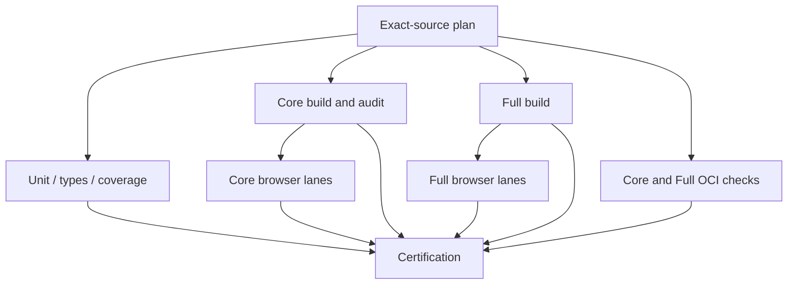
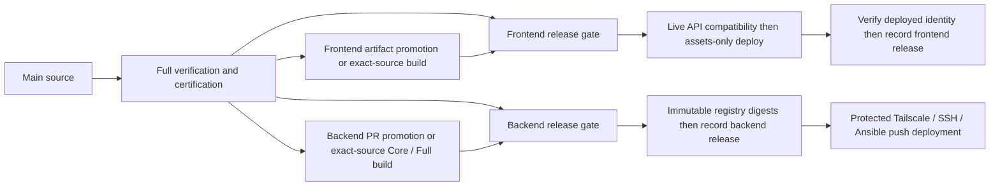

# CI/CD architecture and certification contract

This is the normative execution and release architecture. [Test architecture](TEST-ARCHITECTURE-OPTIMIZATION.md) owns proof placement and test design; [Verification](README.md) owns local commands; [Deployment](../deployment/README.md), [OCI releases](OCI-RELEASE.md), [Infrastructure as code](../deployment/IAC.md) and [Push deployment](../deployment/PUSH-DEPLOYMENT.md) own artifact formats, operator procedures and compatibility policy. This contract describes required behavior, including requirements not yet implemented; a green run is evidence only for the checks actually performed.

## Single machine authority

| Responsibility | Canonical implementation |
| --- | --- |
| Task inventory, groups, producer dependency and required job names | [ci-contract.mjs](../../scripts/ci-contract.mjs) |
| Impact selection, plan validation and digest | [ci-impact.mjs](../../scripts/ci-impact.mjs) |
| Per-task input-closure proof validation | [ci-task-input-proof.mjs](../../scripts/ci-task-input-proof.mjs) |
| Task producer invocation, input-proof generation, and coverage input inventory | [ci-group.mjs](../../scripts/ci-group.mjs), [ci-task-input-proof.mjs](../../scripts/ci-task-input-proof.mjs), [ci-coverage-inputs.mjs](../../scripts/ci-coverage-inputs.mjs) |
| Workspace prerequisites and execution | [ci-workspace.mjs](../../scripts/ci-workspace.mjs), [ci-group.mjs](../../scripts/ci-group.mjs) |
| Verification DAG | [verify.yml](../../.github/workflows/verify.yml) |
| Same-run artifact retrieval and final certification | [verify.yml](../../.github/workflows/verify.yml) uses pinned `actions/download-artifact@v8.0.2` by selector-validated immutable artifact ID and fails on digest mismatch; [certify-ci.mjs](../../scripts/certify-ci.mjs) validates the downloaded evidence. Cross-run API retrieval still uses [download-ci-artifacts.mjs](../../scripts/download-ci-artifacts.mjs). |
| Release eligibility and exact main source | [release-policy.mjs](../../scripts/release-policy.mjs), [verify-release-source.mjs](../../scripts/verify-release-source.mjs) |

Do not maintain a parallel hand-written inventory. Update the declarative contract, workflow, impact rules, coverage checks, evidence selector, certifier and release consumers together when their interfaces change. Every workspace, test source, required profile and named validation must be covered. Workspace prerequisites come from package scripts and declared dependencies, never regex parsing the root test command.

## GitHub-hosted runner and browser image policy

Use explicit `ubuntu-24.04` x64 GitHub-hosted VMs for the certified browser jobs. Each job starts on a fresh VM, so do not assume a persistent Docker layer cache. Keep the content-addressed pnpm store cache and same-profile build artifacts as separate, verified inputs; do not introduce Docker save/load through actions/cache. Public-repository pull requests stay on isolated hosted runners, never a persistent self-hosted runner with long-lived credentials.

The canonical `VERIFICATION_GROUPS` browser inventory determines the required browsers. Writing and reference groups require Chromium only; WebKit groups also run Chromium auth/UI scenarios and must use an image containing **both** browsers. The official multi-browser runtime remains the certified default until a Git-capable minimal image has passed real producer restoration and every selected browser shard. Promote a Chromium-only GHCR digest for writing/reference groups separately, never for WebKit groups. `verify-browser-runtime.mjs` checks the exact selected image digest, Ubuntu Noble, Node/pnpm/Playwright versions, and all required browser launches before executing the shard. A missing browser or mismatched image is a failure, not a reason to skip any shard. Configure browser job containers with `--init --ipc=host`; send GHCR credentials only to GHCR images and limit the job token to read permissions.

Review base-image digest updates through Dependabot, rebuild with smoke tests, and promote newly published runtime digests to Verify only in a reviewed PR after exact-source browser acceptance. A successful experimental image benchmark alone is not certified browser evidence. When evaluating runtime changes, compare matched runner class, package lock, browser projects, PostgreSQL fixture, Pull, init, E2E and job elapsed times across multiple runs; keep experimental benchmark jobs outside the certified task inventory. Maintain PR-only supersession cancellation and never cancel exact-source main certification or release-critical jobs.

## Verification execution

PRs verify the exact source selected by the workflow, using the affected-task plan. Superseded runs of the same PR are cancelled immediately; main/manual runs have independent run identities. Documentation-only PRs retain coverage checks unless a document is an executable assertion input. Explicitly reviewed operational inputs select the root unit and coverage checks, with dedicated infrastructure, audit or static-delivery integration as applicable. Shared foundation/unknown paths or missing diff history select the full inventory. Browser consumers pull in the build for their profile. Main pushes and manual verification plan every obligation. Manual runs always execute the full graph. A main push may certify existing complete PR source proof instead of executing the graph only under the merged-tree reuse contract below. A manual or PR success alone is not a main-push release certification.

The certified verification graph groups tasks into at most twenty jobs including plan and certification. The cap is on execution jobs, not test coverage. Keep independent work parallel and fail-fast disabled for independent groups. Within a group retain individual results even after a sibling failure. Prefer reuse of one certified producer over repeated builds. Do not add a second workflow or runner inventory just to bypass the bound. The Full-model OCI workload is a supplemental high-cost reusable job: Verify calls it only for its exact pull-request input paths, while the standalone workflow runs it for matching main pushes or manual dispatch. It stays outside the artifact-evidence certification and release job inventory; a selected failure still fails the overall Verify workflow.

The `coverage` task reports a per-task input closure for its static-only check. The closure binds coverage and orchestration sources, the Verify workflow, workspace manifests and directories, discovered test file paths and contents, runtime/toolchain identity, invocation recipe, and the empty prerequisite set. Every other passed task in a successful full main run also reports a task execution proof. That conservative closure binds the exact Git tree except documentation paths excluded by the impact selector, test file identities, dependency manifests, runner/toolchain identity, canonical task invocation, and declared producer prerequisites. Documents asserted by root tests select the root unit and stay in the Git tree fingerprint. Each process captures the shared input digests once per exact source and runner, including the package manager from that source tree. The planner and certifier recompute independently, and each task still binds its own recipe and producer prerequisites. A PR may keep an affected plan only when the latest exact-base main run is successful, full, and has a valid immutable proof for every omitted task, and all seven closure digests match. The certification job independently resolves the same first-parent main artifacts and recomputes every candidate closure. Missing, stale, incomplete, failed, foreign, expired, or mismatched evidence expands the PR plan to the full inventory while retaining the actual diff. The selected coverage task remains independently reusable only when its narrower static closure also matches; its supplemental script tests stay selected.

- Within a Runner, use at most two concurrent independent validations, retaining results in canonical task order. Build shared workspace prerequisites once per selected unit/type group; a failed build blocks only tasks that require its outputs. Serialize workspace writers, CPU-heavy model suites and performance measurement with respect to siblings. Browser specs own distinct disposable databases, API/control port pairs, state and trace output directories; do not increase worker count inside a spec. Keep profile generation after the workspace dependency build barrier.
- Browser writing/reference/WebKit lanes consume the same-profile build output. The lane name does not redefine its test inventory. Each spec retains isolated DB, server, browser context, port and temporary state. Do not rebuild the workspace in each consumer.
- Standalone OCI checks still exercise the actual selected image, startup and shutdown. Browser build success does not certify an OCI image. Component release packaging may reuse a proven equivalent artifact but must verify the exact image or assets being released. The root unit's canonical `test:scripts` includes route/runtime configuration, release identity tests and Worker typecheck/request tests. The frontend release lane retains its distinct static asset packaging, Wrangler dry-run, browser delivery and exact main certification gate, but does not repeat these root checks. The dedicated infrastructure workflow owns Ansible syntax/fixtures and Terraform provider-schema checks, selecting only affected independent infrastructure scopes.
- A common prerequisite failure blocks dependent work, not independent checks. The final certification always evaluates available evidence and fails closed.

## Evidence and trust

Use the plan's exact source, plan digest, producer run/job/attempt, artifact ID, profile/selection, toolchain, platform, lock/recipe identity and file checksums/sizes as applicable. Bind consumer receipts to the precise verified producer; same name, branch, cache hit or old successful attempt is insufficient. OCI manifests/configs and registry digests must be verified as required by their existing contracts. Reuse exact producer artifacts within a run; reuse prior test results only through the explicit merged-tree certification contract below. Refuse missing, corrupted, stale, wrong-profile or wrong-source evidence, unsafe archive paths and symlink escapes. Do not transmit credentials to redirect targets or include author data, secrets, session tokens or model caches in build artifacts.

| State | Meaning |
| --- | --- |
| PASSED | Required validation ran against the bound source/artifact and its success evidence exists |
| FAILED | Executed validation failed |
| BLOCKED | Selected validation could not run because a prerequisite failed or evidence was missing |
| NOT_SELECTED | Canonical impact plan explicitly excludes the validation |
| NOT_CHECKED | External or manual acceptance was not performed; never equivalent to PASSED |

A skipped job is not proof of a selected task. Certification must validate the plan, all selected task/group results and producer identities. Missing, duplicate or contradictory evidence fails. Main release eligibility requires a successful exact-SHA main-push run and certification success. The normal path requires every required job exactly once; the compact path requires an explicit successful merged-PR-proof certification step and the exact skipped family placeholders. A skip is never a passed validation. Read all API result pages and fail closed on incomplete or invalid evidence; a historical or PR result cannot authorize a release. A failed main verification must never be overridden by manual image publication or deployment.

### Merged-tree source certification (Build once, Test once, Promote many)

The source-certification increment in #215 retains the existing Verify workflow and canonical task inventory. Its main-push plan may select the compact path only for a single two-parent merge commit whose second parent is the successfully verified same-repository PR head, whose first parent is the actual push's previous main, and whose Git tree is byte-for-byte identical to the verified head. The original PR must have been verified against that first parent and the exact actual diff. Read the merged PR association and latest exact workflow/attempt from GitHub, require successful pre-merge certification, revalidate the plan and all selected reports and producer identities by immutable artifact ID/digest. This compact path still requires a complete full PR plan. An affected PR plan proves omitted task identity only through the complete task input reuse receipts described above; if any proof is ineligible or differs, planning expands it to the full inventory. The `ci-task-input-proof.mjs` validator defines the fail-closed input-proof shape covering source, tests, dependency closure, environment, toolchain, recipe and producers, and compares complete task inventories. Verify execution reports also carry a producer inventory with the source, workflow run/attempt/job, selected task inventory, top-level task/group commands and runner identity. The plan passes only the eligible flag to certification; certification independently resolves and validates exact-source proof before succeeding, without persisting API lookup receipts between jobs. Every heavy group must be skipped for the compact main path. Direct pushes, fork PRs, different trees, stale bases, unavailable/expired/ambiguous evidence, failed or pending proof and any mismatch fall back to the full graph at planning; invalidated proof at certification fails the run. The only release authority remains the successful exact-main-push certification. Never execute a downloaded PR artifact in a privileged context.

Frontend main releases may promote the immutable UI archive from the latest successful same-repository PR run when the canonical resolver proves its full-plan verification, exact merged tree/base and current successful build attempt. The selector makes one bounded lookup for the latest exact-SHA main Verify push run. Release selection starts only after a completed successful exact-main Verify event, so release runners never poll unfinished verification. Unavailable or invalid PR promotion evidence falls back to an exact-source frontend build inside the verified release workflow. Protected deployment independently requires the successful exact-SHA main push certification before accepting a promoted artifact or deploying. The artifact name binds the PR number, producer run, head SHA and attempt; the protected consumer checks its digest and embedded identity without running its code. The UI keeps its producer SHA/version, while the GitHub release tag and top-level release metadata stay bound to the exact merged main SHA and record the producer receipt separately. Missing, stale, foreign, failed, ambiguous, tree-mismatched, incompatible or non-newer artifacts fall back to the exact-source main build. Main source certification, protected deployment preflight, live API compatibility and post-deploy identity checks still gate publication and deployment.

Backend main releases may promote the exact Core and Full Docker archives from the latest successful same-repository PR backend workflow when the canonical full-plan resolver proves the merged PR's exact tree/base. Both profile artifacts must belong to the same latest workflow run and successful producer attempt, have verified artifact digests, carry matching embedded source/version/compatibility identity, and be strictly newer than published backend releases. Otherwise both profiles are built and smoke-tested from the exact main source. A read-only promotion job writes a short-lived main-run handoff containing both tested archives and their producer receipt; the publisher independently rechecks the main proof, producer artifacts and handoff hashes, then emits immutable GHCR digests and a deployment certificate. The read-only deployment handoff rechecks the backend publication, artifact receipt and both images before exposing deployment inputs. Backend release builds and promotion checks start after completed Verify, trading some release latency for zero runner-held verification wait. The embedded image `sourceSha` remains the producer SHA; the GitHub backend release tag and top-level metadata bind the exact merged main commit and preserve PR producer, verification and artifact identities separately. Main exact-source verification, immutable registry digest checks and compatibility checks remain mandatory. Independent infrastructure and model workflows retain their own proof ownership. Main pushes may reuse the exact successful pre-merge same-repository PR job only after checking merged-tree/base identity, latest attempt and positive required verification steps. The deployment configuration gate checks each scope selected by the actual merged diff; Full-model main resolves the distinct successful Verify PR caller and checksum/lifecycle steps. The push backup workflow verifies lock ownership, writer quiescence and interrupted-deployment recovery; this CI proof does not replace target-host restore acceptance. Manual model dispatch always executes. Task-level input fingerprints must be migrated explicitly; do not infer independent proofs from the source-certification shortcut. Strict merge governance/merge queue and latest-only delivery may be introduced separately without weakening immutable publication and activation contracts.

For backend promotion, resolver rejection or handoff-upload failure before build selection runs the exact-main fallback in that same workflow. If promotion was selected and the build matrix skipped, a publisher handoff recheck failure aborts publication; there is no same-run fallback after that point.

## Independent component delivery

Independent deployment means distinct source-change filters on the completed Verify event, version streams, artifacts and deployment owners; it does not mean independent security bypasses. UI-only changes must not publish a backend or require a VM restart. Backend-only changes must not deploy a Worker. Shared inputs select both affected release lanes. PRs may build/test both lanes but may not publish, deploy, sign a channel or modify production. Verification never publishes.

The normative release gate is common to **both** main-source component lanes: complete exact-source main certification plus the lane's own successful artifact verification, before any external mutation. Backend publication already uses the source gate; frontend must use the same gate before switching the Worker. Its live API compatibility check is an additional gate, not a substitute for certification. The read-only production Access preflight for release runs after verified event admission and before frontend deployment and publication, verifies both identity paths and anonymous identity denial plus external denial on out-of-scope routes (Access or edge challenge), and must succeed before the frontend mutation job. It may also be dispatched independently and runs daily from main; no publishing credentials are exposed to it. Keep the existing tagged full-product OCI release path separately gated. The completed Verify event supplies immutable head SHA and run ID; workflow_run GITHUB_SHA points to default-branch HEAD and cannot substitute for the verified source. The source gate uses the certified Verify push boundary for component impact and rejects unrelated Git history, incomplete or failed certification, and mismatched job inventories. The current main tree supersedes the older source only when the component inputs differ between the two. A later change and revert with no net component delta preserves eligibility. Frontend and backend deployment jobs recheck component freshness after acquiring their production slot. Backend handoffs queue so a late publisher cannot displace a pending newer release. The VM accepts a different digest only when its certified backend version is newer than the installed version. Reapplying the installed digest remains idempotent. Release jobs need no new verification job inventory and must not trigger a second verification run for the same source.

- Frontend: build and verify the exact Full assets, validate actual running backend profile and API epoch via the protected origin, deploy assets only, observe the deployed identity, then record immutable release metadata. A missing configuration, credential, incompatible/unobservable API or stale artifact blocks deployment. No guessed fallback URL, epoch or auth mode. Serialize production replacement and reject stale releases that would overwrite a newer deployed identity.
- Backend: independently build and verify Core/Full, publish exact tested immutable SHA-addressed images after certification, verify pulled digests and record both identities; publication remains independent from protected runtime activation. On retry, use the existing exact-artifact verification rules, never repoint a tag. Only the production deploy job may SSH through Tailscale; Ansible serializes activation, enforces encrypted backup and rejects incompatible database migrations.
- Compatibility: component SemVer is independent; profile/API epoch compatibility is checked against real deployed identities in both directions. DB migration/persistence format changes or incompatible API epochs require coordinated manual operation, not an automatic update. Only the currently supported deployed API identity is admitted; retired updater formats have no compatibility path.
- Release configuration belongs to protected GitHub environments and host provisioning. Scope package writes, contents writes and Cloudflare credentials only to the necessary mutation jobs. Verify provisioning without printing secrets. A release record, artifact publication, actual deployment and operational acceptance are distinct outcomes.

## Measuring and changing the graph

Use [measure-ci.mjs](../../scripts/measure-ci.mjs), the [CI Observatory Pages dashboard](CI-DASHBOARD.md) and actual workflow/artifact evidence. Pages timing is a bounded observational sample, not certification or measured counterfactual critical-path savings. Compare equivalent full/affected plans, runner classes, toolchain, profiles, fixture and cache conditions. Record wall-clock, critical path, queue and runner seconds, producer build/transfer/extraction, fixture setup, failure/retry rates and per-test time separately. Compare at least three matched successful runs where practical; record all values and limitations. No runtime target is justification for changing verification coverage or release gates. The optimization objective is shorter critical path and lower total runner time with equal or stronger detection and certification. Cache immutable model data by the exact pinned manifest digest, not by unrelated workflow/test edits, and verify every file checksum before use. Do not install workspace dependencies on the backend image runner outside Docker when its host probes use only Node built-ins.

A graph change must demonstrate complete coverage, dependency failure propagation, exact-source/attempt binding, correct partial reruns, and rejection of stale, missing or tampered artifacts. Test both allowed and denied release cases. Any removal or migration of test obligations must follow the [test architecture](TEST-ARCHITECTURE-OPTIMIZATION.md). Record execution evidence in PRs and machine artifacts, not in this document.

### Standalone VM configuration proof

[Infrastructure as code](../deployment/IAC.md) defines the normative Ansible desired-state and lifecycle coverage. Artifact publication, Ansible syntax checks and database-role fixtures are distinct from VM convergence and acceptance. The `Verify Ansible Host`, `Verify Ansible Base Secrets`, `Verify Deployment Configuration` and `Push deployment host bootstrap` workflows provide isolated host and deployment-contract evidence; a green release is not evidence of production VM rollout. Keep routine PR checks in those owning workflows, and record target-VM acceptance separately. Routine PR and verification workflows must not receive production VM SSH credentials; the protected deployment job uses its dedicated SSH secret only after the main handoff checks. Do not weaken the protected frontend compatibility gate.
