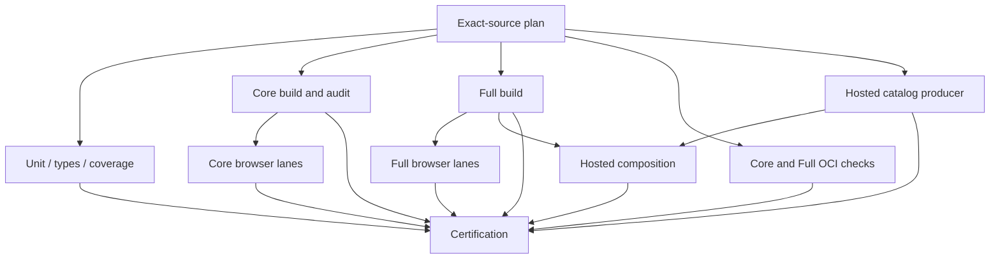
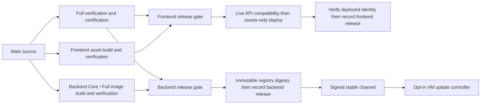

# CI/CD architecture and certification contract

This is the normative execution and release architecture. [Test architecture](TEST-ARCHITECTURE-OPTIMIZATION.md) owns proof placement and test design; [Verification](README.md) owns local commands; [Deployment](../deployment/README.md), [OCI releases](OCI-RELEASE.md) and [Update release](../deployment/UPDATE-RELEASE.md) own artifact formats, operator procedures and compatibility policy. This contract describes required behavior, including requirements not yet implemented; a green run is evidence only for the checks actually performed.

## Single machine authority

| Responsibility | Canonical implementation |
| --- | --- |
| Task inventory, groups, producer dependency and required job names | [ci-contract.mjs](../../scripts/ci-contract.mjs) |
| Impact selection, plan validation and digest | [ci-impact.mjs](../../scripts/ci-impact.mjs) |
| Workspace prerequisites and execution | [ci-workspace.mjs](../../scripts/ci-workspace.mjs), [ci-group.mjs](../../scripts/ci-group.mjs) |
| Verification DAG | [verify.yml](../../.github/workflows/verify.yml) |
| Artifact retrieval and final certification | [download-ci-artifacts.mjs](../../scripts/download-ci-artifacts.mjs), [certify-ci.mjs](../../scripts/certify-ci.mjs) |
| Release eligibility and exact main source | [release-policy.mjs](../../scripts/release-policy.mjs), [verify-release-source.mjs](../../scripts/verify-release-source.mjs) |

Do not maintain a parallel hand-written inventory. Update the declarative contract, workflow, impact rules, coverage checks, evidence selector, certifier and release consumers together when their interfaces change. Every workspace, test source, required profile and named validation must be covered. Workspace prerequisites come from package scripts and declared dependencies, never regex parsing the root test command.

## Verification execution

PRs verify the exact source selected by the workflow, using the affected-task plan. Documentation-only PRs retain coverage checks; shared foundation/unknown paths or missing diff history select the full inventory. Browser and Hosted consumers pull in their prerequisites. Main pushes and manual verification always select every obligation. A manual or PR success is not a main-push release certification.

The certified verification graph groups tasks into at most twenty jobs including plan and certification. The cap is on execution jobs, not test coverage. Keep independent work parallel and fail-fast disabled for independent groups. Within a group retain individual results even after a sibling failure. Prefer reuse of one certified producer over repeated builds. Do not add a second workflow or runner inventory just to bypass the bound. The Full-model OCI workload is a supplemental high-cost reusable job: Verify calls it only for its exact pull-request input paths, while the standalone workflow runs it for matching main pushes or manual dispatch. It stays outside the artifact-evidence certification and release job inventory; a selected failure still fails the overall Verify workflow.

- Within a Runner, use at most two concurrent independent validations, retaining results in canonical task order. Build shared workspace prerequisites once per selected unit/type group; a failed build blocks only tasks that require its outputs. Serialize workspace writers, CPU-heavy model suites and performance measurement with respect to siblings. Browser specs own distinct disposable databases, API/control port pairs, state and trace output directories; do not increase worker count inside a spec. Keep profile generation after the workspace dependency build barrier.
- Browser writing/reference/WebKit lanes consume the same-profile build output. The lane name does not redefine its test inventory. Each spec retains isolated DB, server, browser context, port and temporary state. Do not rebuild the workspace in each consumer.
- Hosted catalog owns runtime-base and Build Kit OCI verification and catalog identity. Core/selected/full composition consumes the exact verified catalog and Full server/module build; each selection independently verifies its package closure and offline composition. Avoid rebuilding shared producer identities; measure transfer and disk cost before adding shared artifacts.
- Standalone OCI checks still exercise the actual selected image, startup and shutdown. Browser build success does not certify an OCI image. Component release packaging may reuse a proven equivalent artifact but must verify the exact image or assets being released.
- A common prerequisite failure blocks dependent work, not independent checks. The final certification always evaluates available evidence and fails closed.

## Evidence and trust

Use the plan's exact source, plan digest, producer run/job/attempt, artifact ID, profile/selection, toolchain, platform, lock/recipe identity and file checksums/sizes as applicable. Bind consumer receipts to the precise verified producer; same name, branch, cache hit or old successful attempt is insufficient. OCI manifests/configs and registry digests must be verified as required by their existing contracts. Reuse artifacts, not prior test results. Refuse missing, corrupted, stale, wrong-profile or wrong-source evidence, unsafe archive paths and symlink escapes. Do not transmit credentials to redirect targets or include author data, secrets, session tokens or model caches in build artifacts.

| State | Meaning |
| --- | --- |
| PASSED | Required validation ran against the bound source/artifact and its success evidence exists |
| FAILED | Executed validation failed |
| BLOCKED | Selected validation could not run because a prerequisite failed or evidence was missing |
| NOT_SELECTED | Canonical impact plan explicitly excludes the validation |
| NOT_CHECKED | External or manual acceptance was not performed; never equivalent to PASSED |

A skipped job is not proof of a selected task. Certification must validate the plan, all selected task/group results and producer identities. Missing, duplicate or contradictory evidence fails. Main release eligibility requires the complete successful exact-SHA main-push run, every required job exactly once and certification success. Read all API result pages and fail closed on incomplete or invalid evidence; a historical or PR result cannot authorize a release. A failed main verification must never be overridden by manual image publication or deployment.

## Independent component delivery

Independent deployment means distinct source-change triggers, version streams, artifacts and deployment owners; it does not mean independent security bypasses. UI-only changes must not publish a backend or require a VM restart. Backend-only changes must not deploy a Worker. Shared inputs select both affected release lanes. PRs may build/test both lanes but may not publish, deploy, sign a channel or modify production. Verification never publishes.

The normative release gate is common to **both** main-push component lanes: complete exact-source main certification plus the lane's own successful artifact verification, before any external mutation. Backend publication already uses the source gate; frontend must use the same gate before switching the Worker. Its live API compatibility check is an additional gate, not a substitute for certification. The read-only production Access preflight runs independently of build/certification, verifies both identity paths and anonymous identity denial plus external denial on out-of-scope routes (Access or edge challenge), and must succeed before the frontend mutation job. It may also be dispatched independently and runs daily from main; no publishing credentials are exposed to it. Keep the existing tagged full-product OCI release path separately gated. Release jobs need no new verification job inventory and must not trigger a second verification run for the same source.

- Frontend: build and verify the exact Full assets, validate actual running backend profile and API epoch via the protected origin, deploy assets only, observe the deployed identity, then record immutable release metadata. A missing configuration, credential, incompatible/unobservable API or stale artifact blocks deployment. No guessed fallback URL, epoch or auth mode. Serialize production replacement and reject stale releases that would overwrite a newer deployed identity.
- Backend: independently build and verify Core/Full, publish exact tested immutable SHA-addressed images after certification, verify pulled digests and record both identities; signed stable-channel publication uses authenticated immutable evidence and stays separately gated. On retry, use the existing exact-artifact verification rules, never repoint a tag. CI must not SSH into the VM; activation belongs to the opt-in updater and its exclusive-writer, migration and rollback contracts.
- Compatibility: component SemVer is independent; profile/API epoch compatibility is checked against real deployed identities in both directions. DB migration/persistence format changes or incompatible API epochs require coordinated manual operation, not an automatic update. Preserve legacy compatible client bundles.
- Release configuration belongs to protected GitHub environments and host provisioning. Scope package writes, contents writes, signing and Cloudflare credentials only to the necessary mutation jobs. Verify provisioning without printing secrets. A release record, artifact publication, signed advertisement, actual deployment and operational acceptance are distinct outcomes.

## Measuring and changing the graph

Use [measure-ci.mjs](../../scripts/measure-ci.mjs) and actual workflow/artifact evidence. Compare equivalent full/affected plans, runner classes, toolchain, profiles, fixture and cache conditions. Record wall-clock, critical path, queue and runner seconds, producer build/transfer/extraction, fixture setup, failure/retry rates and per-test time separately. Compare at least three matched successful runs where practical; record all values and limitations. No runtime target is justification for changing verification coverage or release gates. The optimization objective is shorter critical path and lower total runner time with equal or stronger detection and certification.

A graph change must demonstrate complete coverage, dependency failure propagation, exact-source/attempt binding, correct partial reruns, and rejection of stale, missing or tampered artifacts. Test both allowed and denied release cases. Any removal or migration of test obligations must follow the [test architecture](TEST-ARCHITECTURE-OPTIMIZATION.md). Record execution evidence in PRs and machine artifacts, not in this document.

### Standalone VM configuration proof

[Infrastructure as code](../deployment/IAC.md) defines the normative Ansible desired-state and lifecycle coverage. Artifact publication, Ansible syntax checks and a database-role fixture are distinct from VM convergence/acceptance. The migration adds isolated rootless host integration proofs and separately recorded target-VM evidence; a green release is not evidence of VM rollout. GitHub Actions must not acquire production VM SSH credentials or weaken the protected frontend compatibility gate.
