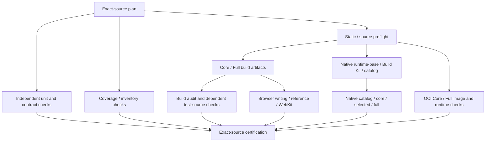

# Test Architecture Optimization

検証アーキテクチャの設計提案。目的は、欠陥検出能力と認証の信頼性を維持したまま、開発ループの待ち時間、重複計算、障害調査コストを削減することにある。現行の実行手順は [Verification](README.md) を参照する。本書の採用だけで既存ゲートの変更やテスト削除を許可するものではない。

## 1. Authority と設計制約

- [Core](../architecture/CORE.md)、[Internal boundaries](../architecture/INTERNAL-BOUNDARIES.md)、[MCP-first](../architecture/MCP-FIRST.md)、[UX contract](../design/UX-CONTRACT.md) を製品契約の正本とする。テストは現行実装の追認ではなく、それらの契約を証明する。
- [ci-contract.mjs](../../scripts/ci-contract.mjs) は検証インベントリ、[ci-impact.mjs](../../scripts/ci-impact.mjs) は影響選択、[ci-group.mjs](../../scripts/ci-group.mjs) は実行、[certify-ci.mjs](../../scripts/certify-ci.mjs) は最終認証の現行authorityである。検証の責務と実行単位を区別する。
- PostgreSQL単一正本、明示的作者承認、外部エージェントの権限、固定Snapshot、Core/FullおよびHostedの構成境界を維持する。内部LLM開発凍結、Git永続化の廃止、閉鎖済み移行証拠の保全を変更しない。
- 既存の全検証義務を維持する。実行単位の再編と検証義務の削減を混同しない。必須テストの移管には旧・新の契約対応表と同等以上の検出能力の証拠が必要である。
- main pushと手動実行は全インベントリを実行する。PR影響選択は現行のfail-closed原則を維持する。認証・公開・リリース権限の変更、CI外への秘密値送信、実作者データを使う検証は禁止する。

## 2. 課題と目標

現在の検証は既に複数グループを並列化している。一方、ブラウザの各実行グループでプロファイルビルドを繰り返し、Hosted Nativeの各selectionでruntime-base、Build Kit、catalogを構築する。単一の共通コンパイル障害が、それを前提とする多数の実行で再発する。実行時間の長い検証を追加し続けるだけでは、組み合わせ爆発と調査コストを抑制できない。

最適化は次の三つを独立に扱う。

1. **実行DAG:** 依存成果物を一度だけ作り、検証済みの同一成果物を複数の消費者で使う。独立検証は並列のまま維持する。
2. **テスト配置:** 論理分岐の検証を責務に近い層へ置き、境界を貫通する高価値のシナリオをE2Eで維持する。
3. **テスト設計:** 非決定的な同期、過剰な準備操作、重複セレクタを整理し、契約に基づく状態遷移を検証する。

初期性能目標（設計上の目標値、実績ではない）は、同一インベントリの成功時wall-clock中央値を25%以上、runner実行秒数の合計を30%以上削減すること。失敗時は最初の原因を早期に報告し、共通前提の失敗後に同じコンパイルを繰り返さない。目標が達成できない場合も認証を弱めない。計測条件と結果はPRまたは機械成果物に記録する。

## 3. テスト層と証明責務

ここでE2Eとは、利用者が直接利用するインターフェースから永続化まで、管理下の実コンポーネントを結合して検証することを指す。ブラウザUIテストだけをE2Eとは呼ばない。API/MCPからPostgreSQLに至る検証もE2Eである。コンポーネント描画だけの検証はUIテストであってもE2Eではない。

| 層 | 責務 | 主たる実装資産 |
| --- | --- | --- |
| 静的検証・契約 | production/test-source型検査、safety、schema、インベントリ、依存境界 | workspace typecheck、scriptsの契約テスト、Core audit |
| 単体・モデル | 純粋計算、分岐、境界値、不変条件、決定的な状態遷移 | packages/modules/appの既存unit suite |
| コンポーネント | 描画状態・表示条件、イベント、shared controller、エラー表示の結線 | appの既存テスト基盤。必要なら既存ブラウザ環境で局所テスト |
| 実DB結合・API E2E | 永続化、Revision、トランザクション、認可、冪等、契約間の整合 | persistence-postgres、core、api、MCP integration |
| ブラウザE2E | UIから正本までの結合、実操作、IndexedDB、再起動、IME、Desktop/Mobile、実ブラウザ差 | tests/e2e、Core/Full、Chromium/WebKit |
| 実行環境・パッケージング | OCI startup/drain、migration identity、構成分離、native producer、catalog、compose | verify-oci、verify-hosted-native、profile-package |
| 特殊資源・運用受入 | 実モデル推論、native workerの解放、物理端末、バックアップ復元、実配備 | [Integration](INTEGRATION.md)、[OCI](OCI.md)、運用契約 |

単体・コンポーネント層では依存を制御できるが、PostgreSQL、Core/APIやMCPの境界、実ブラウザの永続化を証明するテストで対象そのものをモックへ置換してはならない。外部provider、外部ID基盤などの組織制御外の依存をテストダブルで置き換える場合、代替範囲を明示する。実モデル検証の未実行を、provider non-executionや型検査の成功で代替しない。

### 3.1 検証義務の配置

| 契約 | 分岐・境界の主証拠 | 保持すべき結合・E2E証拠 |
| --- | --- | --- |
| Native Knowledge/Evidence | Alias曖昧性、UUID解決、UTF-16、取得上限、旧投影、機密設定除外 | 実DB上の関連付け、削除済み根拠、archive round trip、Snapshot固定 |
| Story/Scenario/Context | 時間・視点・置換・ID衝突・省略、独立した仮説 | 保存→採用提案→作者承認→正本状態、実データからContext、読者/人物非開示 |
| ChangeSet/Proposal | 遷移可能性、入力契約、digest、stale/replayの分岐 | 実DBで同一操作の競合、原子的適用、承認境界、receipt永続化・再起動 |
| MCP | named/generic schema、scope決定、結果型 | stdioとStreamable HTTPの実接続、PostgreSQL、認可・provider非実行 |
| エディタ | Draft状態、revision acknowledgement、ナビゲーション世代、純粋なreducer | 実IMEイベント、保存中入力、遅延応答、reload/別タブ、実IndexedDB quotaと復旧 |
| ワークスペース | 表示状態、アクション利用可否、画面内操作 | Desktop/Mobileの執筆・参照・復帰、モジュール有無、WebKitの契約 |
| 配備 | 解析・構成選択・artifact identity | Core/Full実イメージ、native catalogとcore/selected/full compose、起動・停止 |
| モデル | capability leaseや設定の論理分岐 | 実モデルの推論、キャンセル、release、派生索引再構築と置換後の正本照合 |

下位層へ移管するのは、その層で同じ故障を検出できると証明したケースだけとする。例えば遅延保存の世代判定は単体で網羅できても、実エディタのnavigationとIndexedDBの結合に固有の故障はブラウザに残す。

### 3.2 高価値シナリオの固定

例ベースE2Eは、少なくとも次の契約を代表する既存シナリオを維持する。ケース数の目標を先に設定して削減しない。

- 作者のログイン、原稿編集、保存、Revision再読込、Draft復旧。複数文書・別タブ・競合・応答順序逆転を含む。
- Desktop/Mobileで場面を切り替え、参照・修正して原稿へ復帰する。IMEの合成中の遷移、保存保護、明示的navigationの優先を確認する。
- 外部MCPによる作品参照・提案、作者UIによるレビュー・承認、PostgreSQL適用とreceipt、拒否された操作が正本を変更しないこと。
- Knowledgeの根拠、Story Contextの視点、Scenarioの仮説と承認後の確定状態。実装の横断的な結合を証明する。
- Core/Fullとブラウザ固有の差、Hosted catalog・composition、実OCIライフサイクルの証明。

テスト移管時は、契約ID、旧テスト識別子、検出対象の反例、移管先、実装前の失敗または故障注入、保持するE2E、適用profileを対応付ける。移管先がまだ実行されていない段階で旧テストを削除しない。

## 4. 実行DAG

現行の論理タスク名と実行グループを保つことを基本に、成果物生成を明示的な前提へ分離する。グループ数・ジョブ構造の変更はci-contract、impact plan、workflow、evidence selector、certifier、release eligibilityを同一の変更で整合させる。

図は依存関係の設計であり、既存workflowの実装済み構成ではない。実際には各profile、selection、依存workspaceを区別し、共有前提に関係しない検証を不要に直列化しない。全体wall-clockが悪化する場合は、必要最小限のpreflightに限定する。

### 4.1 前提障害の伝播

共通ビルドが失敗した場合、その成果物を消費するタスクはBLOCKEDとする。独立した単体・契約検証は継続する。

- FAILED: 実際に実行した検証が失敗。
- BLOCKED: 選択された検証の前提が成立せず実行できない。原因タスクとidentityを記録する。
- NOT_SELECTED: 正規の影響選択により対象外。
- PASSED: 当該検証を実行し、正規の成功証拠が揃った場合のみ。

依存jobがGitHub Actionsでskipされても、選択済み検証をNOT_SELECTEDやPASSに変換しない。final certificationは失敗時にも実行され、選択タスク全ての証拠を照合し、FAILED/BLOCKED/欠落を非成功とする。前提失敗・artifact欠落・中断・部分再実行の回帰テストを追加する。

### 4.2 ブラウザ成果物の再利用

- [ci-group](../../scripts/ci-group.mjs) のprofile buildを一つの正規producerへ集約する。Core/Fullの各ビルド出力は独立させ、同じprofileのwriting/reference/WebKitで再利用する。
- 現行の[run-browser-shard](../../scripts/run-browser-shard.mjs)のprebuilt経路とcoverage reporterを利用する。producerは必要なserver、module、app、生成profile構成を完全に含める。ブラウザコンテナで実行互換性を確かめる。
- 検証済み成果物を展開して起動する。実行時に再ビルドされていないことを証明する。依存installが必要ならfrozen lockfileを維持し、環境固有バイナリを無条件に移送しない。
- 各shardは独立したDB/プロジェクト、ブラウザ状態、port、temp領域を持つ。成果物の共有と可変テスト状態の共有を区別する。
- OCIの実パッケージング証明をブラウザ用ビルドで代替しない。

### 4.3 Hosted Native成果物の再利用

[verify-hosted-native](../../scripts/verify-hosted-native.mjs)はruntime-base/Build Kitを構築し、OCI digest・labelを照合し、catalogの生成とnative composeを実行する。[hosted-native-selection](../../scripts/hosted-native-selection.mjs)がcatalog/core/selected/fullの構成を定義する。

共通producerは同一ソースのruntime-base、Build Kit、catalogと必要なimmutable inputを一度生成する。消費者は検証済みdigestを使用し、独立したcompose結果を取得する。既存のcache primingとoffline composeの前提を維持し、実行対象ごとのbuildKey、module composition、source/recipe/lock digest、producer revisionを照合する。

実装では、OCI archiveの実サイズ、転送・展開時間、runnerのディスク制約を計測する。巨大archiveの配布でかえって遅くなる場合は、同一runner内で共通準備を共有してselectionを独立に実行する案を比較する。固定出力パスを共有した並列composeは行わない。各selectionの証拠が区別でき、単独失敗が他selectionの検証結果を隠さないことが条件となる。未検証のリモートイメージ取得、GHCRへの検証用publish、既存release権限の拡大は不要であり禁止する。

### 4.4 成果物の信頼境界

成果物manifestに少なくとも source SHA、source tree、plan digest、producer job/run/attempt、artifact ID、profile/selection、Node/pnpm/lockfile identity、platform、build recipe/構成identity、ファイルdigestとサイズを結び付ける。OCIの場合は既存のimage/manifest/config digestを検証する。

- 同一sourceかつ同一検証runに属する明示されたproducer成果物だけを消費する。再実行時は現行exact-ID/attempt選択契約に従い、依存と選択結果を再照合する。
- 名前だけ、cache hitだけ、branch名だけの一致を信頼しない。artifactの取得失敗・identity不一致・破損・欠落・旧attempt混入は非成功。
- 展開パスの逸脱、symlinkの逸脱、実行形式の違いを拒否する。秘密値・作者データ・認証Cookie・モデルcacheを配布成果物へ含めない。
- artifactを認証することと、そのartifactを対象にした検証を認証することを区別する。成果物の再利用はテスト結果の再利用を意味しない。
- 現行のexact-ID取得、digest検査、限定認証、redirect先への認証情報非転送を弱めない。[download-ci-artifacts](../../scripts/download-ci-artifacts.mjs)を既存の信頼境界とする。

## 5. 状態遷移ベースのテスト設計

### 5.1 独立した契約モデル

資料でいうグラフベーステストは、仕様の状態遷移モデルを用いて、実行可能なイベント列と拒否されるイベントの整合性を検査する。単なるランダムUIクリックやコードの分岐網羅ではない。

Codexiaでは次のモデルを既存契約から定義する。実装の関数を期待値生成器として再利用せず、モデルと実装を独立させる。

| モデル | 観測する状態 | イベント例 | 不変条件 |
| --- | --- | --- | --- |
| Draft/Revision | 文書、base revision、generation、保護済みDraft、in-flight、競合、receipt | edit、protect、save、ack、navigate、reload、recover | 新しい入力を古い応答で破棄しない。別文書を上書きしない。未保護データを失う操作を拒否する |
| Proposal/ChangeSet | actor、project、snapshot、operation、承認、適用receipt | propose、review、approve、apply、reject、replay、stale | 未承認・別scope・不正revisionの適用を拒否する。再送は重複変更しない |
| Scenario/Context | 基準snapshot、代替案、置換、視点、開示、提案 | compare、save、adopt、approve、update snapshot | 仮説間・正本の分離。比較と採用の整合。非開示情報を返さない |
| Module lifecycle | installed、enabled-idle、active、draining、disabled、lease | enable、invoke、cancel、disable、release | 利用権限のない処理を起動しない。最後のleaseの終了でworkerを解放する |

モデルの抽象状態は仕様を表し、実装の内部フラグと一対一にする必要はない。上表は設計対象であり、現行実装の全状態列挙ではない。許容・拒否条件、安定状態、観測値、入力、既存契約との対応を各モデルのテスト仕様で確定する。

### 5.2 探索とoracle

- 許容トレース外への遷移（安全性違反）と、安定状態で受理すべきイベントが拒否されること（活性違反）を区別する。正当なエラー応答を無条件に失敗とみなさない。
- 非同期処理中は安定状態とみなさない。Promise、deferred応答、制御可能なclock、正規の状態通知を用い、待機の上限は失敗を検出するために使用する。実時間sleepで順序を期待しない。
- 有界の状態・遷移探索、境界値、決定的seedによるシーケンスを用いる。失敗時はseed、初期状態、イベント列、観測値を記録し、最小の再現列を保存する。
- 高価値シナリオは固定例ベースで別途実行する。探索時間内に偶然通過することを必須契約の証拠としない。
- 初期はDraft/RevisionとProposal/ChangeSetを対象とし、純粋な状態遷移テストまたは実DB/APIアダプタから導入する。ブラウザ探索はUI結合に固有の問題に限定する。形式手法による全状態空間の完全証明を主張しない。

## 6. ブラウザテストの保守性

### ReusableOperator

資料でいうReusableOperatorは、イベント名と具象的な画面操作の対応を分離するパターンである。Codexiaでは既存のE2E helperを先に調査し、ログイン、作品選択、場面選択、入力、保存、レビュー、承認、復旧等の共通操作を責務単位で整理する。

テストシナリオは操作意図と期待する契約に集中し、locatorや低レベルの操作はhelperに局所化する。既存のユーザー向けrole/nameと正規のtest identityを使い、アサーションを隠す巨大な共通関数や汎用テストDSLを作らない。

### ContextStream

資料でいうContextStreamは、画面と文脈の組から次の画面と文脈の組を返す型付き非同期遷移を合成するパターンである。必要な場合、project ID、document ID、revision、セッション等を明示したfixture型を利用する。現行テストの単純な操作には追加抽象化を強制しない。

### Fixture・同期・分離

- ログインや作品作成が目的でない場合、正規のAPI経由の準備、正規のfixtureを利用できる。ただしUI導線そのものを検証したという主張はしない。ユーザー操作の結合を証明する代表シナリオでは実UIから操作する。
- PostgreSQLへ直接seedする場合は、必要な不変条件を保った隔離データに限定し、seedで通過しなかった処理を別に検証する。旧Git fixtureを復活させない。
- 原則としてテストを独立実行可能にする。資料のテストケース連鎖パターンは、成功した先行テストの終了状態を明示的依存で後続が継承する方式である。共通初期化を再利用するだけで暗黙の順序依存を導入しない。採用する場合は副作用局所化、依存失敗時の後続BLOCKED、単独再現性を証明する。
- 失敗trace、最初の未成立条件、API応答、fixture identity、raceのevent順序を記録する。無根拠なretry、timeout延長、skip、assertion弱体化で緑化しない。

## 7. 計測と受入

[measure-ci](../../scripts/measure-ci.mjs)と既存のmachine evidenceを拡張・再利用する。wall-clock、queue time、runner秒数、critical path、各producerのbuild、artifact upload/download/verify、fixture準備、test実行、cache状態を区別する。計測されていない区間をゼロとみなさない。

比較は同じrunner class、toolchain、profile、選択インベントリ、fixture、同等のcache条件で行う。少なくとも3回ずつの比較可能な成功実行を集め、中央値と個別値を記録する。warm/coldを分け、初回失敗率、再実行時の変化、失敗分類も観測する。性能のためだけに結果を変えないCI再実行を日常運用へ導入しない。計測専用の実行は明示する。

最適化の受入条件:

- 既存の全検証義務と対応表が明確で、選択・除外・skip・BLOCKED・PASSの意味が維持される。
- 共通前提の失敗時に依存する成果物を使用せず、独立検証と最終失敗判定が機能する。identity不一致、欠落、再実行、破損を検証する。
- Core/Full、Hosted各selection、全workspace、実DB、ブラウザの認証証拠が、正しいソース・成果物・実行に結び付く。
- テスト移管前に捕捉していた代表的な欠陥を移管後も捕捉できる。新旧の同等性を証明するまで既存テストを保持する。
- 実測で目標と負のトレードオフを評価し、改善しない最適化は採用しない。リリース認証と検証inventoryの弱体化を性能改善とみなさない。
- 実装・文書・コマンド・検証契約が一致し、最新mainの全インベントリが成功する。実行できなかった実モデル・物理端末・実配備の検証は別途未確認とする。

## 8. 変更境界と依存

実行DAG/成果物再利用の変更とテスト移管を分離する。DAG変更はインベントリをそのまま証明することを優先し、ブラウザ用producerとHosted producerは共有のartifact契約を確定後に独立して改善できる。テスト配置変更は契約対応表と移管先の成功証拠を前提とする。状態遷移モデルは既存の承認・保存の意味を変えない限り、CI実行再編から独立して設計できる。

対象外: 新規テストフレームワークへの全面移行、汎用モデル検査基盤の先行実装、広範な製品リファクタリング、DBスキーマ変更、LLM/providerの拡張、確率的なPRテスト省略、main全検証の省略、リリース・本番環境への変更。

## 9. 設計参考

Kuniwak『E2Eテスト大全』をテスト設計の参考とした。特にE2Eの境界（p.6）、実行・保守コストと組み合わせ爆発（pp.11–14）、テストピラミッド（pp.15–16）、グラフベースと高価値例ベースの併用（pp.17–21）、ReusableOperator、ContextStream、テストケース連鎖（pp.22–25）を参照する。これらの独自用語は本書で適用上の意味を明示した。テスト選択・自動修正・並列化は同資料の詳細な論述対象外（p.28）であるため、実行DAGとartifactの設計はCodexia固有の提案であり、資料から直接導出した保証ではない。

本書は検証の設計目標を示す。現在の実行・認証を変更する際は、対象の検証契約と対応する実装・テストを同時に更新する。
