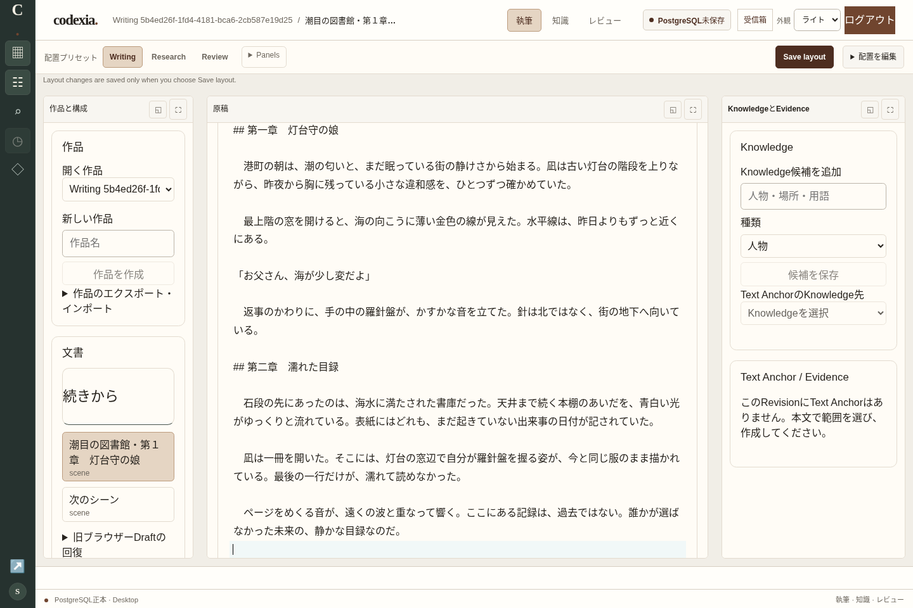
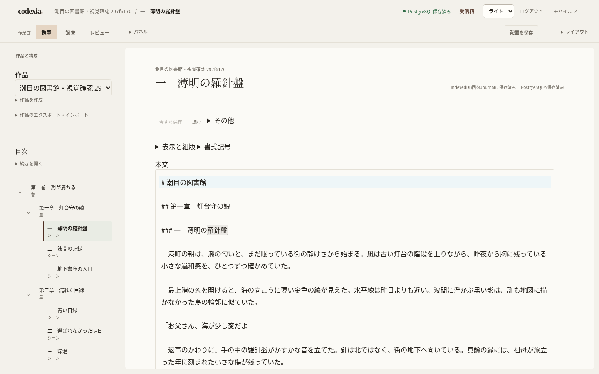
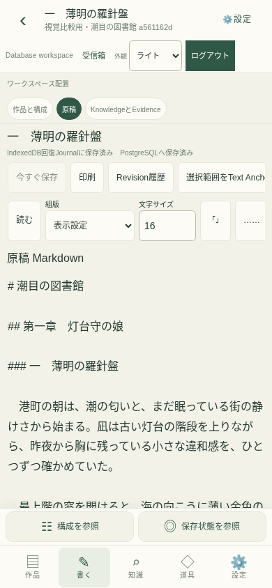
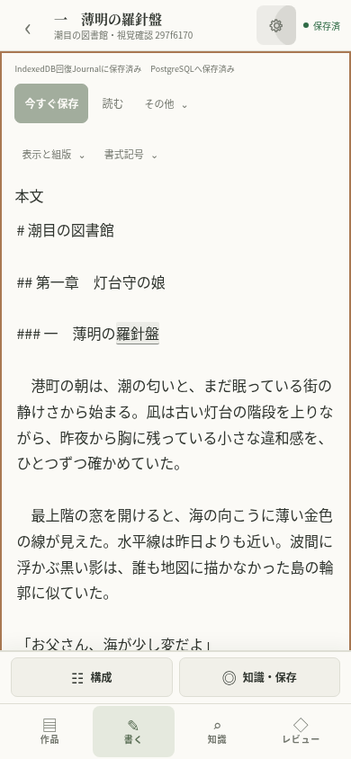

# UI redesign v2 acceptance record

実装・操作テストのソース: `ae9154b`。画像・計測は隔離された合成作品とローカル Chromium で取得した。

## デザイン判断

二案を実画面サイズで作成・比較した。 [Folio Atlas](direction-folio.png) は構成・原稿・参照を三列で同時に見せる案で、調査密度に優れる一方、初期執筆でも参照paneが原稿と競合する。 [Quiet Page](direction-focus.png) は章索引を細く保ち、本文を作業領域の主面にする案で、Writingの集中と日本語の読幅が明確だったため採用した。Folioの情報密度はResearch／Review配置へ引き継いだ。

採用後の構成は、Desktop Writingを章索引約20%／原稿約80%とし、Knowledge／Evidence、履歴、提案レビューはResearch／Reviewまたは設定済みパネルから呼び出す。Mobileは同じ構成を縦積みせず、原稿を初期画面に置き、構成・知識と保存をIonic参照sheet、作品・執筆・知識・レビューを下部ナビゲーションに割り当てた。CodeMirrorを通常参照の開閉でunmountしない。

合成原稿は複数章・複数シーン、Beacon Quay／Lantern Harborの知識・根拠、承認前後の提案、複数Revisionと差分を含む。 [全画面一覧](.) にはWriting／Research／Review、Dark／Paper、1024px、320px、Knowledge sheet、Revision比較を保存した。灰色縮小表示でも、初期Writingの二分割シルエットと原稿面の広さ、Mobileの上下ドックが変更前と異なることを目視した。

## Modern Web Guidanceの採用

- [CSS layout](https://github.com/GoogleChrome/modern-web-guidance/blob/main/skills/modern-web-guidance/guides/css/css-layout.md) — 固定座標でなくGrid／Flexの可変trackで索引・本文・参照を配置。
- [Responsive design](https://github.com/GoogleChrome/modern-web-guidance/blob/main/skills/modern-web-guidance/guides/css/responsive-design.md) — Desktop／Mobileの操作構成を分離し、Mobileでsafe-area insetとviewport高変動を考慮。
- [Typography](https://github.com/GoogleChrome/modern-web-guidance/blob/main/skills/modern-web-guidance/guides/visual-design/typography.md) — 日本語本文の行長・行間を優先し、本文のwrapに`text-wrap: pretty`を適用。
- [Defer rendering heavy content](https://github.com/GoogleChrome/modern-web-guidance/blob/main/skills/modern-web-guidance/guides/performance/defer-rendering-heavy-content.md) — 非表示workspace panelのmountと要求は既存lifetimeに従う。実測で必要を確認していない`content-visibility`等の遅延APIは追加していない。

実装では論理方向のsizing、原稿幅のcontainer query、`dvh`、safe-area環境変数、遅延状態表示の非侵入配置を使った。新API採用を目的にしていない。

## 受入結果

| Gate | 結果 | 証拠・範囲 |
| --- | --- | --- |
| 視覚品質 | PASS | before／after、Folio Atlas／Quiet Page、1440×900、1024幅、320幅、Light／Dark／Paper、Research／Review、Revision差分の実画面を取得・目視。詳細画像は同じdirectoryに保存。 |
| 操作・入力 | PASS（Chromium自動ブラウザー範囲） | Core suite 82 passed／6 skipped／0 failed、Full suite 85 passed／3 skipped／0 failed。`redesign-visual.acceptance.spec.ts`、modular workspace、native review、UI-v1、Story／Speaker reviewを含む。Mobile reference sheet中のEditor node同一性、composition中遷移拒否、route/history/focus、preset、float／dock／resize、提案承認と適用を確認。 |
| Accessibility | PARTIAL | role/name、keyboardでのtab・panel操作、sheetの表示・閉鎖とfocus／IMEガードをブラウザーで確認。手動screen-reader評価と物理iOS／Android日本語IME・native keyboardは未確認。 |
| Persistence integrity | PASS（合成PostgreSQL） | PostgreSQLのrevision・Knowledge／Text Anchor・提案・receipt、IndexedDB回復Journal、draftのreload、保存競合、応答不明の再照合と配置storageを実操作で確認。実ユーザー原稿へはアクセスしていない。 |
| Performance | PARTIAL（変更後のローカルlab計測） | 下記`performance.json`。同条件の変更前Navigation／interaction計測がないため改善幅は未証明。bundleサイズのみ比較。Field INP／CLS達成の主張には使わない。 |

Coreの全Chromium browser suiteはcommit `ae9154b`で実行し、82 passed／6 skipped／0 failed。Fullも同じsourceで85 passed／3 skipped／0 failed。profileを指定した4ケースと環境依存の2件（native headful visibility）が各profileでskipされた。Playwright WebKitはこの実行環境に`libgtk-4.so.1`／Grapheneがなく起動不能。`playwright install-deps`は権限のない`su`で失敗し、Docker browser imageは容量不足で取得できなかったためBLOCKEDとした。物理端末IMEもNOT_CHECKED。

既存レイアウト編集でPanel操作ボタンとドロップダウンが重なることをブラウザー実操作で発見し、編集中だけ操作行をフロー展開する修正を入れた。通常のWriting表示でEditor枠のボタンを隠す挙動も、配置編集中は表示する。

## Performance evidence

計測JSONは[`performance.json`](performance.json)。変更前の同一fixture・profile・cache条件の実行時間は採取していない。以下は初回実装時点の現状値であり、性能改善や回帰なしの証拠ではない。ローカルheadless Chromium、cache無効、CPU／network throttleなし。ローカル試行でありフィールドRUMではない。

| Viewport | Same-origin transfer | Main JS | DCL | LCP | CLS |
| --- | ---: | ---: | ---: | ---: | ---: |
| Desktop 1440×900 | 2.06 MB | 1.75 MB | 169 ms | 784 ms | 0.0041 |
| Mobile 390×844 | 2.13 MB | 1.82 MB | 202 ms | 744 ms | 0.0009 |

現在の`performance.json`はFull profileの試行。Core buildのmain JSはDesktop 1,752.34 kB／gzip 460.25 kB、Mobile 1,814.80 kB／gzip 477.01 kB。Full buildはDesktop 1,753.97 kB／gzip 460.59 kB、Mobile 1,816.43 kB／gzip 477.33 kB。origin/main Core build比で約3.86 kB raw、gzip約1 kBの増分。既存の500 kB chunk警告は継続している。interaction試行値（Research 150 ms、Review 232 ms、Mobile reference sheet 748 ms）は初回sheet表示を含むラボ観測で、ユーザー母集団の応答時間ではない。

## Review follow-up

Mobileの原稿操作disclosureを通常フローに置き、操作列でのクリッピングを除去した。目次はPostgreSQLの正規取得順序を保持し、選択対象または祖先経路が変わった場合だけ祖先を展開する。明示的な折り畳みは維持する。追加のブラウザー受入テストは320/390幅の原稿操作、同一orderKeyの文書と名称変更、履歴ナビゲーションからの選択表示を対象とする。上記スクリーンショット・性能値は初回実装の記録であり、レビュー修正後の再測定値ではない。
